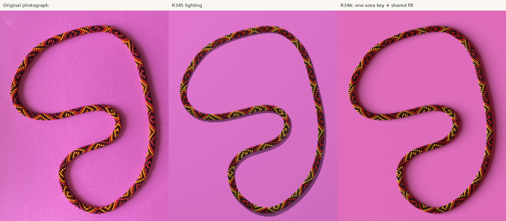

# Beads

Crocheted bead ropes, procedural geometry, and the problem of recovering a
necklace's repeating color pattern from one photograph.

**[Explore the project website](https://rharriszzz.github.io/beads/)** ·
[Original bead demonstration](https://rharriszzz.github.io/beads/beads.html) ·
[Research overview](docs/photo2/overview.md) · [Reusable graph paper](docs/graph-paper.md)



*Left: original necklace photograph. Middle: the complete R345 POV-Ray model.
Right: the same geometry with R346's improved whole-necklace paper shadow.
This saved comparison is copied unchanged from `photo2/r346/output/comparison.jpg`
at research commit `62835143`. A close visual match does not establish physical truth.*

## From a pattern to a picture—and back

The original [beads.pov](beads.pov) program places rounded, hollow beads along a
coiled rope, assigns colors from a repeating string, and ray traces bracelets
with POV-Ray. Eight built-in examples explore different patterns. The historical
[HTML demonstration](beads.html), its photographs and simulated bracelets remain
available. The original source on master is preserved; see the separate
[sine-angle and radius note](BEADS_POV_SINE_ANGLE.md) before using its dimensions.

Photograph 2 asks the inverse question: given a curved necklace with hidden beads,
reflections and shadows, can we recover the stringing sequence and construct a
numerical model? Recognizing colored regions is only part of the problem. A bright
spot is not necessarily a distinct bead, and image-nearest neighbors need not be
consecutive beads on the string.

## Why 6.5 beads per turn?

In this ideal crochet convention, thirteen string positions make two turns around
the rope. Unrolling the surface gives alternating rows of six and seven beads.
On the mathematical chart, string index increases **+1 right, +6 up-left and
+7 up-right**. The [graph-paper method](docs/graph-paper.md) keeps that structure
for any repeat length, including negative continuation indices and partial rows.
Its side copies reveal wraparound structure without adding observations.

## What was recovered

The research produced a strong **208-position candidate**. All 208 positions have
recorded observations under the working lattice assignment, with this status:

| Evidence epoch | Supported / conflicting / insufficient | Candidate agreement |
|---|---:|---:|
| Historical R344 | 199 / 2 / 7 | 1,038 / 1,041 |
| R347 maker-answer assessment | **201 / 0 / 7** | **1,040 / 1,040 retained** |

Two software-red readings received maker **photo-based yellow** corrections.
A third pigment was withheld because it was unreadable independently of the
reconstruction. It supplies no yellow confirmation. Seven sparsely corroborated
positions remain provisionally black. Agreement with these repeatedly studied
photographic labels is **not independently measured physical accuracy**.

The photographic graph supplies consistent integer neighbor relationships and a
working circuit displacement `H=(214,201)`. Only A/208 survives the saved finite
uniqueness check **given** that lattice, the specified counting conventions,
complete repeats and a shortest period below 400. Those calculations do not
independently prove body identities, the physical count or the actual topology.
[Pattern and evidence](docs/photo2/pattern.md) explains the qualifications.

## The numerical necklace and its shadow

R345 renders **2,704 separate rounded beads with bores**, using thirteen copies
of the candidate and 416 minor turns. Saved checks certify closure and
nonintersection for the chosen model, including 8,112 nearby pairs. The count,
repeat count, camera and bead poses remain conditional or approximate choices.
R345 is a complete executable reconstruction, not a calibrated physical replica.

R346 keeps that geometry and all materials fixed, improving the broad shadow
with one large area source and shared warm room fill. Relative paper-profile RMS
error falls from **20.4 to 6.8 percentage points**; reserved geographic stations
improve from **20.0 to 6.4**. These quantify photographic paper brightness loss,
not physical correctness. [Geometry and rendering](docs/photo2/geometry-and-rendering.md)
includes the actual renders, shadow fields and remaining discrepancies.

## Study and reuse

- [Overview and current claim register](docs/photo2/overview.md)
- [Pattern, evidence epochs and visibility](docs/photo2/pattern.md)
- [Geometry, complete render and whole-loop shadow](docs/photo2/geometry-and-rendering.md)
- [Methods, failures and lessons](docs/photo2/methods-and-lessons.md)
- [Reproduction commands and pinned sources](docs/photo2/reproducibility.md)
- [Research history and retained archive](docs/photo2/research-history.md)
- [Independent, sequence-only graph-paper tool](docs/graph-paper.md)
- [Promotion plan](docs/PROMOTION_PLAN.md) and [asset provenance](docs/photo2/provenance.json)

The authentic chart and original necklace have not supplied independent
confirmation. Comparing the intended chart under cyclic offset and reversal,
checking the seven tentative black positions, and independently verifying count
and correspondence are future work. No further reconstruction campaign is part
of this promotion.

## Small local checks

Python 3.10+ and Node 20+ suffice for the maintained tools and static site:

```sh
python3 -m unittest discover -s tests -v
node --check site/app.js
python3 scripts/build_site.py
python3 scripts/build_site.py --check
python3 -m http.server 8000 --directory dist/beads
```

Open `http://localhost:8000/`. The builder uses an explicit publication allowlist;
it never fetches the research branch or copies the checkout. The complete
experiment archive stays on
[`photo-2-strategy-v3`](https://github.com/rharriszzz/beads/tree/photo-2-strategy-v3),
with public sources pinned to
[`628351437842b2ecd05f8a1765d17449fbea61f9`](https://github.com/rharriszzz/beads/tree/628351437842b2ecd05f8a1765d17449fbea61f9).
