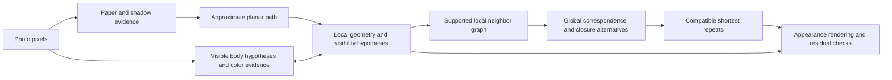

# Photo 2: strategy decision — R233

**R235 update:** the user authorized the narrowed four-section Stage 1 pilot with
approximately10% red/yellow visibility and reflection-supported black eligibility.
It is completed in [STAGE1_PILOT.md](photo2/STAGE1_PILOT.md): 76/109 provisional
eligible bodies automatically covered, 33 assisted additions, unresolved references
and proposals retained. The automatic completeness gate fails; this does not make
useful image observations a dead end. Stop for review before global indexing.
No new geometry or production detector implementation was made.

**R234 clarification supersedes the proposed E233 execution plan below.**
The current objective is (1) a complete reliable map of sufficiently visible
red/yellow/black bodies, then (2) correct globally consistent full-string indices,
with geometry allowed to feed back into observation review. Repeating-pattern
inference waits until both succeed. The broad E233 architecture comparison and
its 60% coverage gate are not the recommended next milestone. Proposed next:
complete inventories in four representative sections, two reserved from tuning,
using existing colored and black-evidence methods; account for every clear body,
with zero known false/duplicate bodies or wrong colors. This is a local pilot,
not whole-photo completion. See current [plan](PLAN.md) and [R234](REQUEST_LOG.md).
R234 was discussion only; R235 subsequently authorized and executed the narrowed
pilot above. The original broad architecture comparison remains historical.

2026-10-10. Documentation review, **not an executed reconstruction experiment**.
Reviewed `photo-2-strategy-v3` at `d65c78f`, based on R232
`b28b99e8ae224d0a597b69049160f43563b29540`; fetched remote tips agree.
The [session instructions](beads_astra_initial_prompt.md) supersede R232's next
pixel question. The [independent handoff](beads_reconstruction_strategy_handoff.md)
is advice, not evidence of a successful method.

## 1. Executive recommendation

**Stop making a trusted seed for every bead a prerequisite. Test local body
hypotheses that combine image evidence, helical geometry and visibility.** Keep
M4 as a frozen proposal baseline and potential source of good interior evidence.
Do not replace it merely because a geometric model looks persuasive.

The bottleneck is not that observations come from the image—they must. It is
the progression from a color/brightness point to a distinct bead, then from that
point to a precise geometric location. Those implications have failed separately.
Geometry can propose where to look without a seed there; image evidence must
still support any claimed body. Missing slots and competing assignments stay explicit.

Run **one eight-crop real-photo comparison**: frozen M4, an appearance-only
proposal model, and the same evidence with local annular-bead geometry. Include
a small FFT initialization ablation. Measure distinct bodies, errors, duplicates,
and supported neighbor relations. A shared appearance control is essential:
beating colored-only M4 by adding a black-bead detector would not demonstrate
the value of geometry. Stop after the predeclared gate in §5.

I agree with the handoff's real-photo priority and local hybrid direction. I
disagree with treating geometry-first as already preferable, with restarting
noncircular geometry as though it were absent, or with treating sparse positive
patches as sufficient evidence for a unique fit. Existing results directly
challenge all three shortcuts.

## 2. Current state and evidence worth retaining

Evidence labels below distinguish **maker facts**, **recorded measurements**,
**model tests**, and **review judgments**. None supplies verified global indices.

| Evidence | What it establishes; what it does not |
| --- | --- |
| [Maker construction facts](INITIAL_QUESTION.md) | Planar noncircular major path, approximately 6.5 beads/turn, neighbor differences ±1/±6/±7, whole repeats, shortest photo-2 repeat <400 and not divisible by 13. No exact total, measured camera pose, or exact image centers. |
| R230–R232 [seed comparison](photo2/SEED_METHOD_COMPARISON.md), [maker review](photo2/SEED_METHOD_REVIEW.md) | Maker rejects old/M2 displays and finds M4 promising in two crops. Frozen counts are 1,566 old / 537 M1 / 926 M2 / 431 M3 / 599 M4 proposals, not bodies. No measured photo precision. |
| [R231 calibration ledger](photo2/review/r231/calibration.json) | Re-summing the stored four fixtures gives old 449/450 eligible colored bodies covered, M4 427/450; neither has a seed on background or black. The rejected old method passes this test. This is a real validation failure, not evidence that the photo criticism is wrong. |
| [R171–R174 neighbor diagnosis](photo2/NEIGHBOR_ANGLES.md) | Maker-supported bodies 11→14→16 form the supplied chain, yet selected-point directions differ by 48.32°. Point 14 is a displaced black reflection. Reweighting angular histograms repairs one edge while losing others. Correct ownership does not establish a usable geometric anchor. |
| [R126–R136 surface fits](photo2/LOCAL_SURFACE_FIT.md), [boundary experiment](photo2/BOUNDARY_ARC_FIT.md) | Python/POV ownership agrees closely, but both old photo charts assumed BC=1; maker evidence later required coupled BC/CG families 6/7 or 7/6. Optimizing a wrong correspondence is not fixed by better boundaries. |
| [R132 positive-only fitting](photo2/SURFACE_CONSTRAINTS.md) | For H1, C's core coverage rose 81.7→100%, its area ratio rose 1.26→1.67, and withheld G overlap fell 73.9→59.2%. Against uncertain assistant polygons, this is a concrete overexpansion warning, not an exact physical error measurement. |
| [R160 confirmed-interior refit](photo2/INTERIOR_REFIT.md) | Opposing families can cover all 660 confirmed core pixels, 454 route samples and all 27 marks in retained photo poses. Even the known synthetic example admits a wrong family satisfying the positive constraints. More positive pixels alone need not resolve topology or hand. |
| [R210 correspondence](photo2/VISIBLE_CORRESPONDENCE_PILOT.md), [R214 registration](photo2/POSITIVE_PATCH_REGISTRATION.md) | Minus-3592 has smaller balanced center RMS than minus-2698 (7.04 vs 11.31 px), but fewer coherent patches (61 vs 111 of 208). After registration, changing patch weight selects another pose in four of six hypotheses. These scores do not identify N. |

Retain the five **maker-confirmed** interior loops on 8/11/14/17/20, exact
R193–R198 ownership facts, R204/R205 same-color/black-reflection facts, R211's
M/V/O membership, stable observation IDs and 41 maker visible-part marks.
The [208 distributed patches](photo2/DISTRIBUTED_COLORED_POSITIONS.md) are
**automatically selected, agent-screened colored references**, not 208 individually
maker-confirmed, distinct beads. Preserve this weaker provenance in future losses.

The calibrated [placement](photo2/bead_placement.py),
[curved local surfaces](photo2/curved_surface_fit.py), first-hit visibility, and
[spline forward model](photo2/TANGENT_CIRCLES.md) are substantial reusable work.
Agreement with POV validates implementation of the authorized source geometry;
it does not measure real packing, camera elevation, or correspondence.

**Direct inspection this review:** the original 2540×3182 photograph and the
eight unaltered crops in §5 show noncircular curvature, differently oriented
sections, bright spots displaced within dark bodies, adjacent yellow surfaces,
and shadows extending beyond visible bodies. These are visual judgments, not
new identity labels or measured error rates. Representative existing raw/overlay
comparisons: [R231 A](photo2/review/r231/comparison-a.png),
[R171 chain](photo2/review/r171/neighbor-comparison.png),
[R214 bend](photo2/review/r214/bend-comparison.png).

Historical cross-checks: the [old methods overview](https://github.com/rharriszzz/beads/blob/2c4c116bf7f7b9e8c773358a97740dcd77879a8a/METHODS_AND_PLAN.md)
explicitly leaves photo indices unresolved. Read-only `bead_map` at `46e17d6`
uses hand-produced masks, connected components and skeleton routing; `hsv_tools`
at `3e70fe3` learns masks from clicked HSV samples. They offer useful tools, not
independent body truth. The [older plan](https://github.com/rharriszzz/beads/blob/402663eb579a8b66abe553cc3c917ab8f0cbc7c0/image-to-pattern/plan.md)
asserts photo 4 = case 4. A history search finds the assertion's introduction
there, but no independent maker confirmation or indexed correspondence in the
reviewed records. **Photo 4 remains an unverified potential control.**

The [image-to-pattern progress log](https://github.com/rharriszzz/beads/blob/26ba79a/image-to-pattern/plan.md)
also records higher best-case pattern matches with very few retained samples.
Its attribution to color separation is incomplete: sampled centerline order is
not full-string order. Retain its regression lessons, not its proposed filling
of invisible colors or the assumption that better quantization establishes indices.

## 3. Dependency and assumption audit



The linear chain is bypassable up to local geometry: a crop and uncertain local
tangent can replace a complete mask and global spline. Complete bead outlines,
lighting recovery, all-body seeds and exact N are not prerequisites for a local
graph. In contrast, physical index differences require supported correspondence;
unique global closure and repeat claims require evidence across missing stretches.
Local repeat constraints may be tested before exact N, but cannot silently supply it.

Three likely strategic errors:

1. **Confusing support with identity and location.** The earliest historical
   unsupported step was treating color-selected paper/foreground as a reliable
   outline; shadows bias the centerline. In the current seed branch it is
   color-compatible support → bead interior → distinct body. Code inspection of
   [R218](photo2/refine_colored_masks.py) confirms a distance bonus saturating at
   0.10D, followed by peak suppression and old-seed fallback. M4 improves local
   evidence, but still searches the old/M1/M2/M3 color-dependent pool and uses
   same-family spacing 0.5D. It cannot discover an absent-pool black body or
   prove uniqueness. Against this criticism, some genuine interiors clearly
   are useful; discard the implication, not all the observations.
2. **Treating good conditional fit as model identification.** Positive-only
   coverage can reward oversized bodies; nearest-center loss favors denser
   predictions. R132/R160/R210 demonstrate these risks. R136 shows a wrong
   graph shared by competing fits. Counterevidence: visibility mechanics and
   several synthetic inverse checks work. Use those components, with alternative
   graphs, size constraints and real-photo prediction tests—not a new global fit.
3. **Measuring the wrong success.** Candidate totals, correlated pixel checks,
   and repeated synthetic scenes replaced independent body-level evaluation.
   R232's P/Q answer would resolve one local alias, but cannot adjudicate the
   architecture. Existing ledgers carefully preserve uncertainty; the missing
   piece is a fixed real-photo scorecard with an explicit decision consequence.

## 4. Competing approaches and distinguishing predictions

| Family | Advantage and assumption | Real-photo failure/falsification |
| --- | --- | --- |
| Appearance-first proposals/instances | Cheap; M4 profiles and local color/edge patches can provide real interiors without geometry. | Same-color merging, multiple highlights, black omission. Fails as the main architecture if reliable coverage requires repeated manual repair and remains poor on new crops. |
| Fourier/spatial periodicity first | Estimates collective direction/spacing without locating each body. Uses the repeated packing rather than pigment thresholds. | Peaks follow color bands, glints, shadows or harmonics; too few periods across the rope. Reject as an initializer if nearby windows produce incompatible layouts or no better search efficiency/predictions. |
| Geometry/occlusion-first local matching | Known construction restricts arrangements; predicts missing candidates and exposed regions. | Wrong graphs and positive-only fits can be convincing. Reject if predicted bodies lack independent pixel support, perturbations swap identities, or constrained fits underperform appearance-only. |
| **Local hybrid, recommended for comparison** | Appearance proposes evidence; geometry proposes additional slots and groups evidence; visibility tests ownership. Both may abstain. | More flexibility can hide errors. Require a shared appearance-only control, fixed held-out crops, and contradictory-layout tests. |
| Whole-image inverse rendering | Eventually couples camera, spline, material and lighting to all pixels. | Currently too many compensating unknowns; attractive residuals need not establish string order. Defer until local correspondence is reproducible. |

This is a project-specific adaptation of joint part/geometry inference, not a
claim that a generic recognition algorithm solves beads. See
[Felzenszwalb and Huttenlocher's part models](https://www.cs.princeton.edu/courses/archive/spr08/cos598B/Readings/FelzenszwalbHuttenlocher2004.pdf)
and [feature-based probabilistic inverse graphics](https://arxiv.org/abs/1407.1339).
Neither validates this necklace or supplies calibrated confidence scores.

**FFT deserves a bounded test, not another prerequisite.** Preserve the maker's
[working spectral conventions](photo2/FFT_EXPLORER_NOTES.md). For a local spatial
lattice basis A, reciprocal vectors satisfy `AᵀG = I` in cycles/pixel; spectral
peaks are not automatically neighbor vectors. Opposite pairs alone neither name
1/6/7 nor give their signs. Power loses translation phase and has inversion
symmetry; retain complex coefficients/spatial reconstruction and both possible
hands. Color layout can introduce stronger periodicity than bead packing.
Autocorrelation and Fourier power are related measurements, not independent votes.

## 5. One bounded experiment: E233, local body evidence versus structure

### Inputs, split and reference ledger

Only `beads-photo-2.jpg`, EXIF orientation 1, original encoded RGB, x right/y
down. SHA-256:
`eb7c9edb62f5580ef56632872da48da92556d62b758295137068cc2404dc8fbb`.
The following are half-open native crop boxes `[x0,y0,x1,y1]`, selected from raw
context. Read a 60px halo for context, clipped to the image; score only the box.
Coordinates are benchmark selection, never a runtime bead-location prior.

| Crop | Box | Role / observed difficulty |
| --- | --- | --- |
| D1 | [1581,255,1761,395] | Development; R231 A, rejected old seeds, yellow/red and dark gaps |
| D2 | [845,350,1025,490] | Development; R231 B, same-color adjacency and shadow |
| D3 | [1210,225,1370,365] | Development; R171 chain, displaced black reflection |
| D4 | [1660,1540,1860,1740] | Development; tight bend, changing tangent and exposure |
| H1 | [135,1040,335,1240] | Held out from tuning; left section, yellow/black and shadow |
| H2 | [1990,720,2190,920] | Held out; slanting upper-right section, dark bodies and blur |
| H3 | [2170,2040,2370,2240] | Held out; right section, crowded same-color bodies |
| H4 | [1390,2910,1590,3110] | Held out; lower section, opposite tangent and edge slivers |

These are prospective **algorithm-tuning holdouts**, not unseen photographs:
their raw pixels were inspected for selection and historical full-photo methods
used this image. No cross-photograph generalization claim is possible.

Before viewing new outputs, the agent prepares a frozen raw-image ledger of all
clearly distinguishable substantial central bodies in each box, aiming at 5–12
per crop, plus ambiguous bodies and excluded edge/sliver regions. Do not cherry-pick
to meet that target or delete hard bodies. Store stable IDs, conservative interior
patches, partial boundary/separation evidence where clear, color/unknown, and
provenance. No exact centers or complete outlines are required. Record same-body
and different-body facts separately from direction-family labels; most new
family/sign labels may remain unknown. Link prior maker facts only at their exact
coordinates/IDs. New agent labels remain provisional.

Keep H labels evaluator-only. Blind method names during output adjudication;
record valid / invalid / uncertain point ownership without interpreting an
unlabeled pixel as background. An optional single maker panel of at most 12
decision-changing bodies/relations can resolve a gate; no marking campaign.
If uncertainty could reverse the gate, report **inconclusive**, not invented truth.
Blinding method names reduces presentation bias; it does not turn the same
agent's annotations into independent ground truth. Report maker-validated and
provisional subsets separately, and preserve that limitation in any go decision.

### Frozen baseline and candidate arms

**M4:** read the 599 points in [R231 points.json](photo2/review/r231/points.json),
SHA-256 `422858d7f4365cc415014b39c3001f091ca2d6099946bbbfc620c9062f517bfd`.
Do not rerun/tune the historical extractor or union in M1/M3. Read its stored
parameters and R232 suppression explanation. The baseline is colored-only;
report colored and all-color denominators separately.

**A, appearance-only control:** build a common dense bank of potential visible
supports from multiscale local contrast, learned color differences and partial
edge evidence, including dark-body context. Use image-derived scale/tangent
ranges, not the saved D=27.19 as a measured constant. Small glints are evidence
within possible bodies, not additional bodies. M4 may propose candidates but is
not a hard gate. Score every proposal with the same appearance terms used below;
permit several candidates and an explicit unsupported outcome.

**H, hybrid:** use that same bank and score terms with the existing curved
annular-surface model. Fit only local translation, scale, tangent/view, phase and
bounded planar curvature; nominal q=6.5, both hands. No total-count parameter,
saved photo indices, pattern prior or manual runtime anchors. Seed the search
from several image-derived configurations; never force the two old H1/H2 charts.
Generate additional local slots from geometry and query their image support
even when M4 is absent. Give A access to the same dense support bank so extra
search positions alone cannot explain a claimed structural advantage.

Represent evidence-to-body assignment as latent membership. Several interior
samples may belong to one body; one observation cannot establish two bodies.
Use first-hit visibility, including hidden occluders, and keep unfinished rays
unknown. Combine normalized appearance support with supported partial separation
arcs, finite image-derived size bounds, and a penalty for confidently asserting
an unsupported visible body. Unknown pixels are neutral. Positive-only coverage
and arbitrary dark-pixel exterior penalties are forbidden. Retain at least the
best three distinct feasible assignments, not just a best-fit picture. Neighbor
differences come from the model and remain proposals; check cycles such as
`+1 +6 -7 = 0`, but do not treat algebraic consistency as observation.

Use the frozen local model as a hypothesis, not exact physical metrology. Test
q=6.45/6.55 and orthographic versus the recorded nominal-perspective scenario
as sensitivities; these are numerical brackets, not measured uncertainty bounds.
Fix redundant camera/phase gauge parameters. No per-bead free translations,
out-of-plane centerline bends, global spline correction or lighting fit.

**H+F ablation:** same H objective and equal search budget; only initialization
changes. Gaussian-window local luminance and gradient spectra, FWHM equal to
estimated rope width W, compare 0.8W/1.2W; band periods 0.5D–2D from the image
scale range. Retain multiple reciprocal-basis hypotheses and spatial reconstructions;
never force three physical peak pairs. Compare to direct displacement evidence.
Run this after freezing the common objective, with no holdout-specific band tuning.

Choose numerical weights on D1–D4 only from at most six recorded configurations.
Cap each local fit at 16 initial hypotheses and 300 objective evaluations per
hypothesis; record termination and all starts. Cap total experiment fitting at
four wall-clock hours, checkpoint and report incomplete cases if reached.
No extra tuning after H1–H4 are opened for scoring. An optional D3-only assisted
check using existing confirmed interiors may diagnose initialization failure;
report separately and never substitute it for the automatic arm.

### Measurement, falsification and decision gate

For each crop/method report: proposals inside a supported body / total proposals;
distinct clear bodies covered / all clear eligible bodies; extra proposals per
covered body; confirmed misses by color/difficulty; uncertain ownership; and
unsupported or conflicting neighbor edges. Score coverage with body identities,
not a radius around a supposed center. Each output body supplies an actual
support point/patch for this test, distinct from its predicted 3D center. Report
region conflicts as well as point accuracy. Preserve inferred-but-unobserved slots
outside the detected-body count. Save integer numerators/denominators, per-crop
results, runtime and best-alternative gaps; scores are not probabilities.

Adverse checks, specified before fitting:

- Remove M4 inputs from one evaluator-selected clear body per development crop,
  leaving raw pixels available. H must be able to recover image-supported bodies
  without that seed; report failure rather than inserting the withheld label.
- Refit after replacing representative pixels by other points within the same
  support patches. Supported identities/edges should survive; point-to-center
  errors like R171 must not recur silently.
- Apply a smooth ±10% illumination ramp and ±10% scale initialization changes
  to A/H, using identical preprocessing. Require at least 90% of accepted body
  associations to persist. Keep the historical M4 original-image score separate.
- Censor a proposed body's image terms in both proposal generation and scoring,
  retaining its location only on the evaluator side; test deliberately
  incompatible spacing hypotheses (±25% fixed spacing). H must abstain on the
  unsupported body and expose worse fit/ambiguity, not report geometry as visual
  confirmation. A remaining tie is an identifiability result. Opposite hand is
  an alternative, not a known-wrong negative control.
- Verify first-hit ownership and ±1/±6/±7 bookkeeping on existing opposite-hand
  POV fixtures. Include a displaced glint/missing-proposal control. Report these
  mechanics separately from photo scores; no synthetic score can pass the photo gate.

**Predeclared engineering gate, not a statistical guarantee:** require at least
32 clear held-out central bodies in total, including eight black bodies, or mark
the comparison underpowered without selecting easier replacement crops. A/H
must reach at least 95% conservatively scored point ownership and 60% all-color
body coverage, with at most 10% duplicate proposals. Count uncertain proposals
as failures for this conservative precision gate, and publish their upper bound
separately. Coverage counts only supported distinct bodies.

Adopt H as the next research architecture only if it passes that floor, improves
colored coverage over M4 by at least 10 percentage points, **and** either improves
all-color coverage over A by at least 10 points at that floor, or halves A's
false-plus-duplicate count with at least two fewer errors and at most a 5-point
coverage loss. Require improvement in the same metric in at least three of four
held-out crops, no contradiction of retained
maker facts, and the adverse checks above. Uncertain labels must not be able to
reverse the decision. These deliberately modest pilot thresholds authorize
further testing, not production use or recovered indices.

If A passes but H adds no reliable advantage, keep an appearance-led body
inventory and use geometry for checking. If H helps ownership but family labels
remain ambiguous, proceed only with body localization, not string indexing.
If both fail, use the D3 assisted diagnostic to separate observation/initialization
failure from model inadequacy; report the failing premise and stop. If FFT adds
neither useful accuracy nor search efficiency, omit it from this path. Do not
extend the benchmark, restart seed tuning, or fit the full necklace automatically.

## 6. Roadmap after the gate and identifiability

| Quantity | What the photograph can support; evidence needed next |
| --- | --- |
| Local bodies, colors, tangent and apparent spacing | Often directly constrained by visible surfaces and context, with explicit unknowns. Pixel scale is observable; physical scale is not calibrated. |
| Local relative indices and 6/7 distinctions | Require supported associations and visible occlusion/contact evidence across several bodies; competing charts may survive. Keep observation ID, local index and global index separate. |
| Helicity versus index convention | Origin and string reversal are gauges. Physical winding requires discriminating shape/occlusion evidence under a common camera; local camera/phase gauges or unlabeled FFT peaks cannot establish it. |
| Planar spline and camera | Jointly constrained across differently oriented sections after local matches work. Old spline is an initializer; neither shadow-biased envelopes nor EXIF focal metadata calibrate pose. |
| N and closure | Integrate overlapping local graphs around the loop, retaining integer offsets across hidden stretches; demand consistent closure. No compression of missing slots and no nearest-center count minimum as truth. Multiple N may remain. |
| Shortest repeat | For every supported N, enumerate divisors L<400 with L mod 13≠0; reject same-residue color conflicts and retain witnesses. With uncertain N, maintain joint (N,L,index) alternatives. The shortest *compatible* block need not be the maker's uniquely determined design. |
| Hidden colors | Recover only when a verified repeat residue has a visible, reliably indexed occurrence. Unseen residues stay unknown; the non-multiple-of-13 fact does not guarantee coverage. |
| Lighting/materials | Fit later with POV-Ray to supported geometry and color hypotheses. Reflectance/illumination and camera/specularity remain coupled; good RGB similarity is a consistency check, not recovered order. |

A second view or a maker record of exact count/pattern could break remaining
ambiguities, but neither is requested or made a prerequisite for E233. Palette,
background and placement variation must precede any generality claim.

## 7. What is needed from the maker

**No technical or pixel question now.** Recommend proceeding with E233 on this
branch. Approval can be: **“Proceed with E233 in STRATEGY_REVIEW.md and stop at
its decision gate.”** This is the implementation authorization explicitly
reserved by the session prompt. Q232.1 and other historical questions remain
preserved, but do not block this decision. Any later visual request must identify
the decision it could change and fit within the single small panel described above.

## 8. Handoff to implementation

Implement E233 in new isolated files, proposed names
`photo2/strategy_benchmark.py`, `photo2/local_body_hypotheses.py`, and
`photo2/test_strategy_benchmark.py`. Freeze its manifest/configuration and
provisional evaluator labels in `photo2/review/strategy-e233/`; routine arrays,
renders and checkpoints belong in ignored `photo2/output/strategy-e233/`.
Import reusable forward kernels; do not alter production extraction, historical
review payloads, `beads.pov`, the source photo or live maker annotations.

Start with this runnable read-only preflight (works now):

```sh
git status --short --branch
.venv/bin/python - <<'PY'
import hashlib, json
from pathlib import Path
from PIL import Image, ImageOps
checks = {
 'beads-photo-2.jpg': 'eb7c9edb62f5580ef56632872da48da92556d62b758295137068cc2404dc8fbb',
 'photo2/review/r231/points.json': '422858d7f4365cc415014b39c3001f091ca2d6099946bbbfc620c9062f517bfd',
}
for name, expected in checks.items():
    assert hashlib.sha256(Path(name).read_bytes()).hexdigest() == expected, name
image = ImageOps.exif_transpose(Image.open('beads-photo-2.jpg')).convert('RGB')
assert image.size == (2540, 3182)
data = json.loads(Path('photo2/review/r231/points.json').read_text())
assert len(next(m['points'] for m in data['methods'] if m['key']=='M4')) == 599
print('Photo and frozen M4 verified; no extraction or fitting performed.')
PY
```

Expose the following **future CLI contract; these commands are not implemented
by this review**:

```sh
.venv/bin/python photo2/strategy_benchmark.py prepare --output photo2/review/strategy-e233
.venv/bin/python photo2/strategy_benchmark.py fit --split development --output photo2/output/strategy-e233
.venv/bin/python photo2/strategy_benchmark.py freeze
.venv/bin/python photo2/strategy_benchmark.py evaluate --split holdout
.venv/bin/python -m unittest discover -s photo2 -p test_strategy_benchmark.py
```

`prepare` materializes the exact boxes/split and a raw-only provisional reference
ledger; `freeze` seals data/config/code hashes before holdout evaluation. The
evaluator reads sealed predictions, never refits from labels. Meaningful tests:
mutating held-out labels cannot change fits; crop/native/EXIF coordinates agree;
same-body duplicates and missing/uncertain observations stay in denominators;
synthetic owners never enter detection; gauge-equivalent indices are compared
correctly; seed removal and displaced-point controls preserve evidence semantics.

Deliver a compact results table, raw/overlay pairs, error/uncertainty ledger,
all competing local assignments, hashes, executed commands, timings/caps and one
go/no-go conclusion in `photo2/STRATEGY_E233_RESULTS.md`. Commit/push scoped work
after checking user files, update log/plan/handoff, verify the remote, and **stop**.
Recommended execution: GPT-6.1 Sol, High reasoning, in this branch; use `/new`
for a clean implementation session after approval, with this document as its task.
This is a workflow recommendation, not a claim of measured model superiority.
