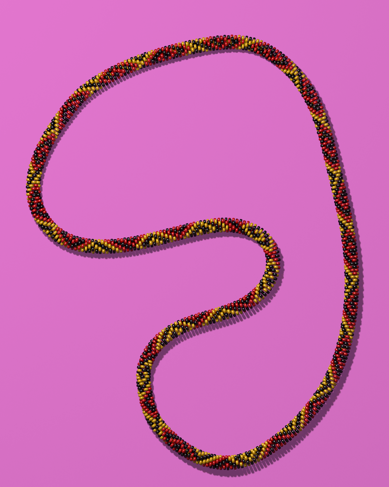
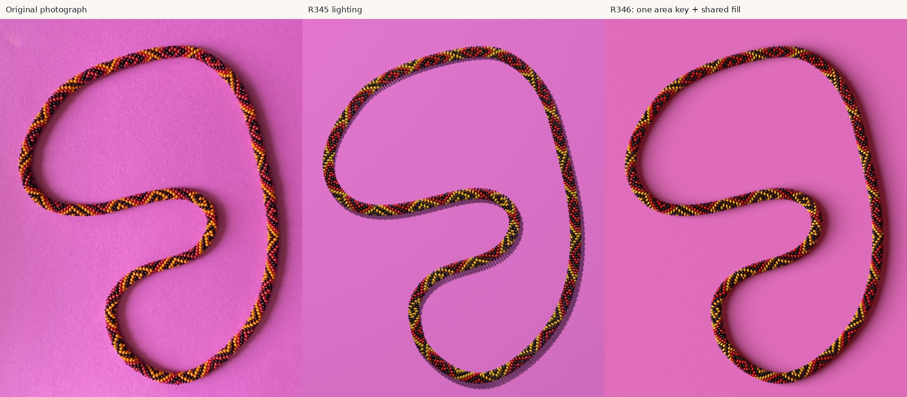
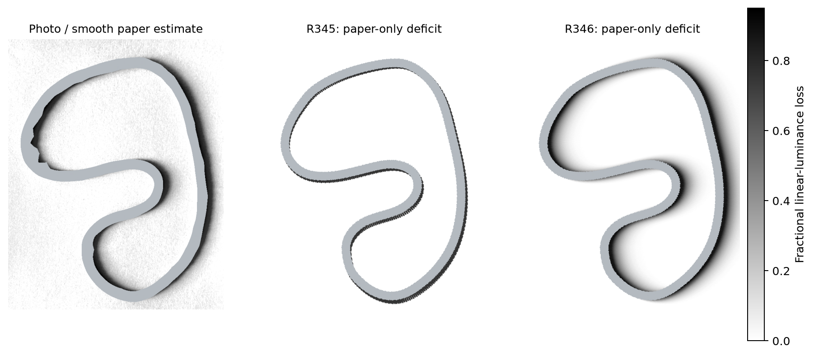
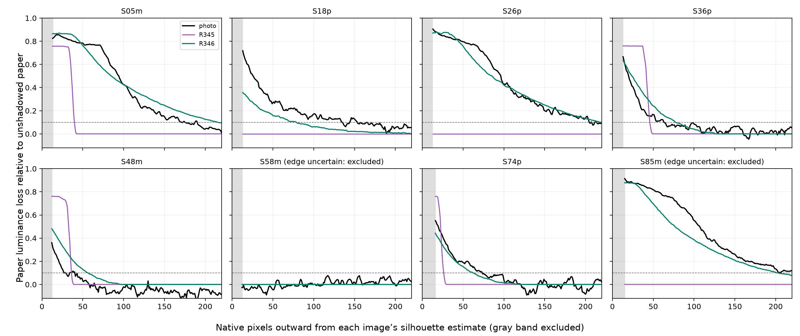
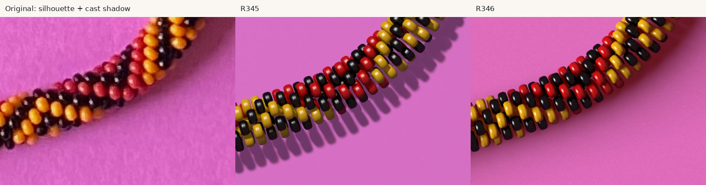

# A complete model, then a better shadow

[Overview](overview.md) · [Pattern](pattern.md) · [Reproduction](reproducibility.md)

## R345: 2,704 actual numerical beads

*Unchanged 2540×3182 R345 output, `photo2/r345/output/render.png`. The entire
necklace is ray traced from separate rounded, bore-bearing objects; it is not
an image texture. Its visible regularity and gloss differ from the photograph.*

The scene repeats the R344 provisional 208-position word thirteen times and
uses 416 signed minor turns. It reuses the original rounded CSG bead macro,
including the bore. Smooth degree-five station and phase fields follow the
historical image-axis spline. That spline is an image reference, not a finally
measured physical centerline. No later failed optimizer was silently adopted.

Common radius is 1.78453698 arbitrary units; thickness/diameter is 0.55. The
orthographic camera has elevation 80° and scale 8.5 native pixels per world unit.
Helicity is -1 under the documented transported frame. Count, exact poses,
dimensions, paper, optical properties and camera remain construction assumptions
or approximations. The original string's hole-axis tilt and relaxation are not
recovered mechanically.

Saved independent checks certify all **8,112 nearby pairs** disjoint, with minimum
separating-plane margin about 0.00012883 units, and glass at least 0.03000068
above the paper. Distant pairs are excluded by bounding geometry. They also
check closure, signed winding, the actual macro's bore and surfaces, emitted
transforms and camera-marker projection. These establish properties of this
scene. They do not independently validate photographic associations or count.

The fitted bright-support-to-glass-proxy error is 14.43 native-pixel RMS and
6.58 median, not bead-center accuracy. The maximum remains 94.73 pixels. The
model is more regular, thinner and glossier than the photographed crochet.

Master's original `beads.pov` remains unchanged by this promotion. The research
version includes R345 dispatch, corrected sine radius with a legacy switch, and
the example-5 material repair. Use the pinned research checkout for the complete
R345 scene; copying a few generated includes would create a misleading partial
reproduction. The existing master [sine-angle note](../../BEADS_POV_SINE_ANGLE.md)
documents the legacy radius convention.

## R346: measure the shadow of the whole loop

*Original photograph / R345 lighting / R346 lighting. All 2,704 transforms,
camera, bead shape, materials, pattern, handedness and paper stay fixed.*

One fixed tilted circular area source at `(-5500,-700,4000)`, diameter 6000,
and shared warm room fill produce a longer, softer broad shadow. These are
arbitrary scene units, not measured lamp distances. The setup is plausible,
not a uniquely recovered source calibration. There are no per-bead shadow
targets, section-specific lights or local geometry repairs.

*Gray excludes material and uncertain boundaries. The photograph's field uses an
estimated smooth unshadowed-paper reference. These fields are relative paper
brightness loss, not independently measured shadow segmentation.*

At 96 stations on both sides, 142 of 192 contours supply quantitative profiles.
All contours, including rejected edges, remain in the archive. Grayscale boundary
selection and conservative material guards keep bead darkness out of paper
metrology. A quadratic log-RGB paper reference uses 23,312 grid points more than
260 pixels from the entire traced necklace. An initial narrow local reference
was shadow-contaminated and is explicitly rejected in the historical archive.

| Relative paper-loss RMS, percentage points | R345 | R346 |
|---|---:|---:|
| All eligible contour-relative profiles | 20.4 | 6.8 |
| Reserved geographic stations | 20.0 | 6.4 |
| Same image-coordinate paper, reserved stations | 19.8 | 8.1 |

Every fourth geographic station is reserved. This remains retrospective
evaluation on the same image. The primary encoded-RGB/sRGB-transfer approximation
is qualified; converting the source's embedded profile retains the improvement
without changing lighting. Increasing area sampling from 17×17 to 33×33 changes
profiles by about 0.146 percentage-point RMS.

*Saved R346 profile comparisons. Image distances use native photograph pixels;
the metric is normalized linear-light paper brightness loss.*

For the same 42 strong photographic profiles, median 10%-loss reach is 125.5 px
in the photograph, 27.4 in R345 and 123.2 in R346. The outer 90–10% falloff
medians are 117.3, 7.5 and 120.9 px respectively, with denominators 42,24,41;
missing modeled falloffs are not assigned favorable widths. True under-body
contact darkness is mostly hidden; the nearest safely sampled 12–20 px paper
band is a separate measurement.

*The shadow improves while geometry, pose, gloss and local color-arrangement
discrepancies remain. Paper grain and gradual illumination are approximate.*

Sources: [R345 report](https://github.com/rharriszzz/beads/blob/628351437842b2ecd05f8a1765d17449fbea61f9/photo2/R345_REPORT.md),
[R346 report](https://github.com/rharriszzz/beads/blob/628351437842b2ecd05f8a1765d17449fbea61f9/photo2/R346_REPORT.md).
Selected historical receipts are in [evidence](evidence/); their source paths and
hashes are in [provenance.json](provenance.json).
