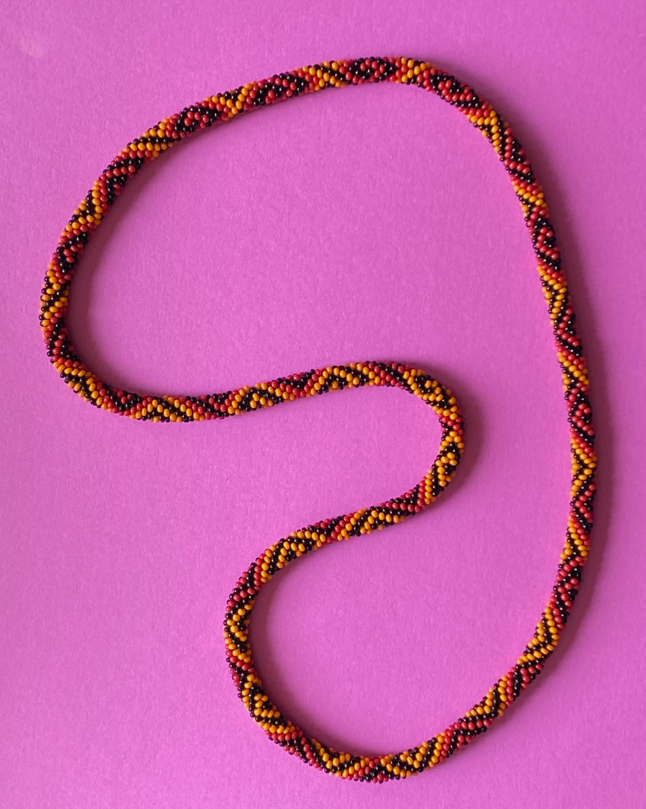

# Photograph 2: a qualified reconstruction

[Project](../../README.md) · [Pattern](pattern.md) · [Rendering](geometry-and-rendering.md) · [Methods](methods-and-lessons.md) · [Reproduce](reproducibility.md) · [History](research-history.md)

*The original 2540×3182 photograph, already present on master. Highlights,
colored interiors and dark edges are appearances; each needs an ownership
decision before it can constrain a distinct physical bead.*

The forward program turns a supplied color sequence into a beaded-rope image.
The inverse problem asks which bodies, neighbor relations and sequence explain
this photograph. Occlusion, repeated colors and uncertain optics make that
correspondence harder than extracting color patches.

The useful progression was **source feature → proposed body → lattice site →
string address → repeat position**. Local photographic row hypotheses, overlap
and integer consistency built a working graph. Recurrence then predicted colors
away from individual patches. Native-photo review corrected some labels and
withheld an unreadable one. Rendering remained a separate construction task.

## Current claims and their limits

| Claim | Status and evidence | Remaining independent check |
|---|---|---|
| A 208-position color candidate | R347: 201 supported, 0 conflicting, 7 insufficient; 1040/1040 retained labels agree; every residue observed | Authentic chart; seven tentative black pigments; correspondence |
| Working photographic lattice | 1041 indexed sites, 2290 links, one component, H=(214,201); exact equations and alternatives archived | Actual body identities and global row choices |
| A/208 conditional uniqueness | Only compatible case in the specified A/B count families, complete-repeat premise and period<400 | The premises, including physical count and topology |
| R348 deletion sensitivity | Hypothetical removal of Q1 leaves 1040 nodes/2287 links, one component, the same H and remaining coordinates modulo H | Static saved-graph result; no counterfactual inference rerun or active-graph edit |
| Complete numerical necklace | R345: 2704 hollow beads, thirteen candidate repeats, closed separated model | Physical count, pose, camera and dimensions |
| Better broad paper shadow | R346: RMS 20.4→6.8 points; held geographic stations 20.0→6.4 | Independent illumination/geometry calibration; contact region remains mostly hidden |

“Supported” means the historical rule: an uncontradicted color in at least three
observations and three fixed geographic blocks. It is a corroboration policy for
this evidence, not a calibrated probability. Most labels are analyst/software
interpretations of one repeatedly studied image. Geographic holdouts and exact
software checks do not create independent physical ground truth.

Historical R344 remains **199/2/7 and 1038/1041**. R347 separately records two
maker photo-based yellow corrections and one pigment exclusion; it neither
replaces the old products nor changes the candidate. Q1's reconstruction-assisted
yellow selection is not confirmation. The chart and original object have not
yet supplied an independent comparison.

The [retrospective](https://github.com/rharriszzz/beads/blob/628351437842b2ecd05f8a1765d17449fbea61f9/photo2/RETROSPECTIVE.md)
provides the full assessment, including successful methods and rejected epochs.
This curated default branch promotes results and a small reusable tool; the
complete historical experiment archive stays on its research branch.
