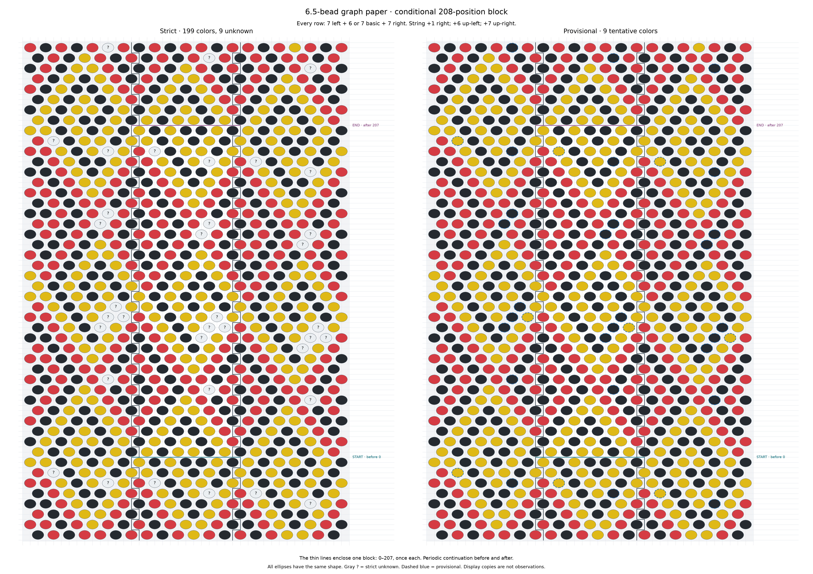
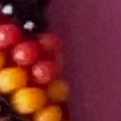
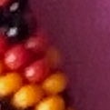
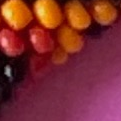
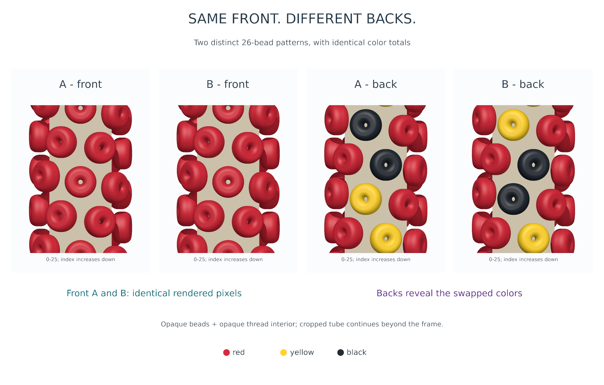
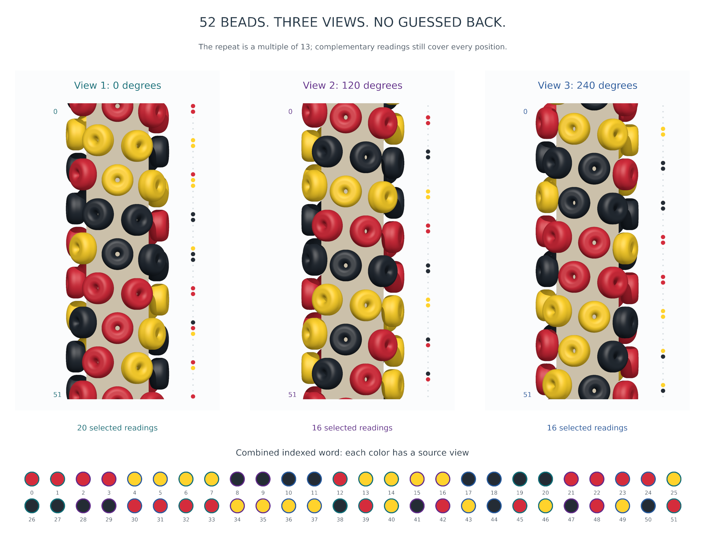
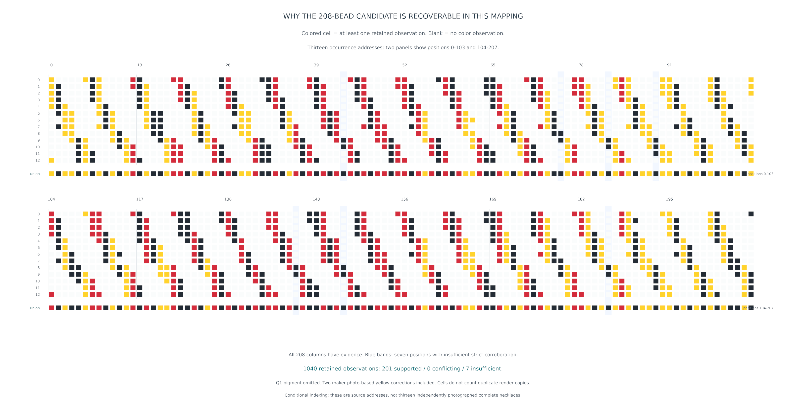

# Pattern, observation and inference

[Overview](overview.md) · [Graph-paper tool](../graph-paper.md) · [Reproduction](reproducibility.md)

Thirteen bead positions span two minor turns in the ideal 6.5 convention. On the
unrolled lattice, `k=7a+6b`, `x=a-b`, `y=a+b`, and `2k=x+13y`. Neighbor directions
are +1 right, +6 up-left, +7 up-right. A display seam changes x/y by `(13,-1)`
without changing k. These are construction conventions, not measurements of every
body in the photograph.

The working photographic graph returns with H=(214,201). The specified A map
gives `7*214+6*201=2704`; exchanging families gives B count 2691. Testing exact
complete repeats below 400 means testing divisors of those counts. R347's retained
colors admit only A/208 within these premises. Exact algebra cannot establish
that the photographed rows were all followed correctly, that either count is the
physical total, or that complete repetition has no defects.

## Keep the evidence epochs separate

| Epoch | Supported / conflicting / insufficient | Agreement / observations |
|---|---:|---:|
| Historical R344 | 199 / 2 / 7 | 1038 / 1041 |
| Withhold Q1 only | 199 / 2 / 7 | 1038 / 1040 |
| Correct Q2/Q3 only | 200 / 1 / 7 | 1040 / 1041 |
| R347: withhold Q1, correct Q2/Q3 | 201 / 0 / 7 | 1040 / 1040 |

Strict support requires an uncontradicted color in three observations and three
geographic blocks. All 208 residues are observed; **43, 75, 82, 89, 140, 147 and
186** have insufficient corroboration and remain provisional black. The unchanged
complete candidate has 62 red, 62 yellow and 84 black entries. Current supported
colors are 62 red, 62 yellow and 77 black. The compact
[two-epoch dataset](data/candidate.json) preserves counts, IDs, blocks and status
for every position, without treating copies as observations.

*Unchanged R344 presentation: strict left has nine unknowns; provisional right
marks all nine tentative entries. This is the **historical 199/2/7 epoch**, not
the current R347 support mask. Every row includes seven extensions on each side.
Only 208 central symbols are selected members; the 984 displayed symbols per
panel include aliases and continuation.*

[Clean two-page A4 PDF](assets/r344-graph-paper.pdf) ·
[Numbered two-page A4 PDF](assets/r344-graph-paper-numbered.pdf)

## What the maker judgments mean

| Saved native crop | Source and position | R347 treatment |
|---|---|---|
|  | R332-R-0037-0040; position 83; support XY 2301.35,1430.23 | Pigment withheld: original photo insufficient; yellow selection depended on reconstruction |
|  | REC266-P035619; position 83; XY 2124.72,736.69 | Maker photo-based yellow correction; historical software red retained |
|  | R332-R-0197-0183; position 189; XY 599.64,624.45 | Maker photo-based yellow correction; historical software red retained |

These are literal 121×121 native crops saved by R347, with original image profile.
The target is the saved cue near each crop's center; this is not a claim of a
measured physical bead center. [Crop boxes and source coordinates](data/photo-questions.json)
and the [original numbered keys/adjacency](https://github.com/rharriszzz/beads/blob/628351437842b2ecd05f8a1765d17449fbea61f9/photo2/r347/review/index.html)
provide context. Q1..3 are completed judgments, not new questions to answer here.
The [assessment](https://github.com/rharriszzz/beads/blob/628351437842b2ecd05f8a1765d17449fbea61f9/photo2/r347/answers/ASSESSMENT.md)
preserves their evidence basis. Q1's identity and links remain historical working
hypotheses; R348 separately tests hypothetical deletion without changing them.

## Why a multiple of thirteen can be recovered

For position p in copy j of a repeat of length L, angular phase class is
`(p+jL) mod 13`. If L is a multiple of thirteen, equally oriented copies retain
the same phase. A fixed front view can hide the same colors forever. Otherwise,
successive copies visit all thirteen phases, given enough copies and correct
correspondence. Divisibility controls phase, not the existence of evidence in
other views or differently oriented occurrences.

*Synthetic teaching example, not photographic evidence: two primitive 26-bead
words have identical front renders under the stated opaque-bead/core geometry.
Saved checks compare all 452,480 front pixels and owner-ID passes. Other bead
shapes and viewing angles are outside that demonstration.*

*Synthetic 52-bead example: 0°,120°,240° views supply 20+16+16 selected readings.
Known index correspondence lets their union cover 52 positions. Bending a real
necklace alone does not guarantee these views or identify its indices.*

*Saved evidence under the conditional indexing: 1040 occupied observation cells
cover all 208 columns. These occurrence rows are addresses in one photograph,
not thirteen independently photographed necklaces. Q1 supplies no pigment cell;
the union adds no observation. Geographic corroboration is a separate rule.*

Every proper divisor of 208 has contrary supported-color witnesses, so every
completion of the strict block has minimal cyclic period 208 under this indexing.
The stronger A/208 uniqueness statement additionally requires the lattice/count
and complete-repeat premises. Neither proves the authentic design. An independent
chart comparison should allow every cyclic offset and both reading directions;
a chart match confirms intended design, not necessarily every assembled bead.

Sources: [R344 report](https://github.com/rharriszzz/beads/blob/628351437842b2ecd05f8a1765d17449fbea61f9/photo2/R344_REPORT.md),
[R347 conditional proof and assessment](https://github.com/rharriszzz/beads/blob/628351437842b2ecd05f8a1765d17449fbea61f9/photo2/R347_PATTERN_CONFIRMATION.md),
[illustrated visibility explanation](https://github.com/rharriszzz/beads/blob/628351437842b2ecd05f8a1765d17449fbea61f9/photo2/PATTERN_VISIBILITY_ILLUSTRATED.md).
