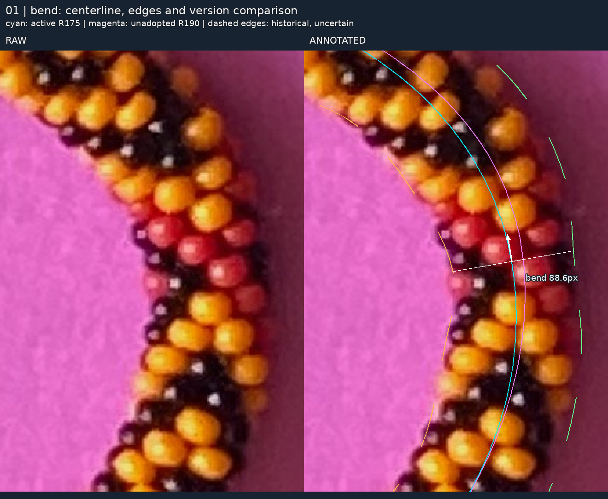
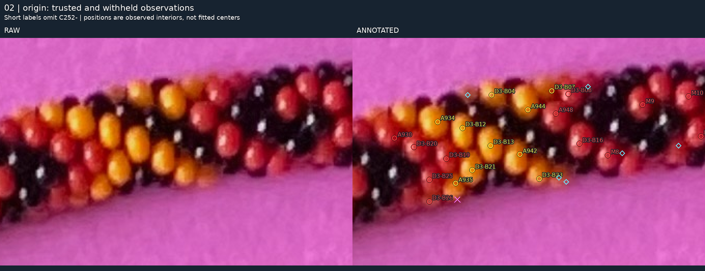
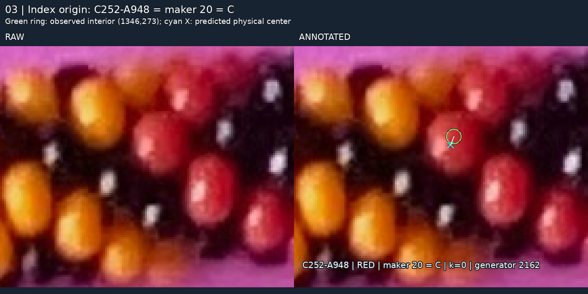
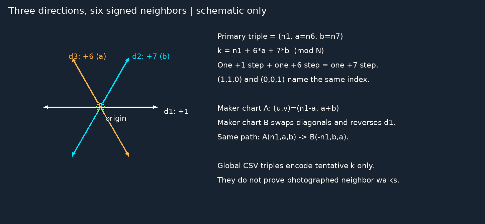
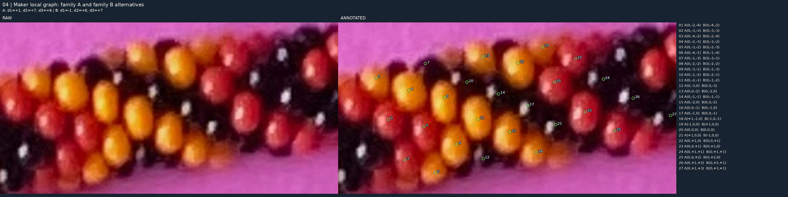
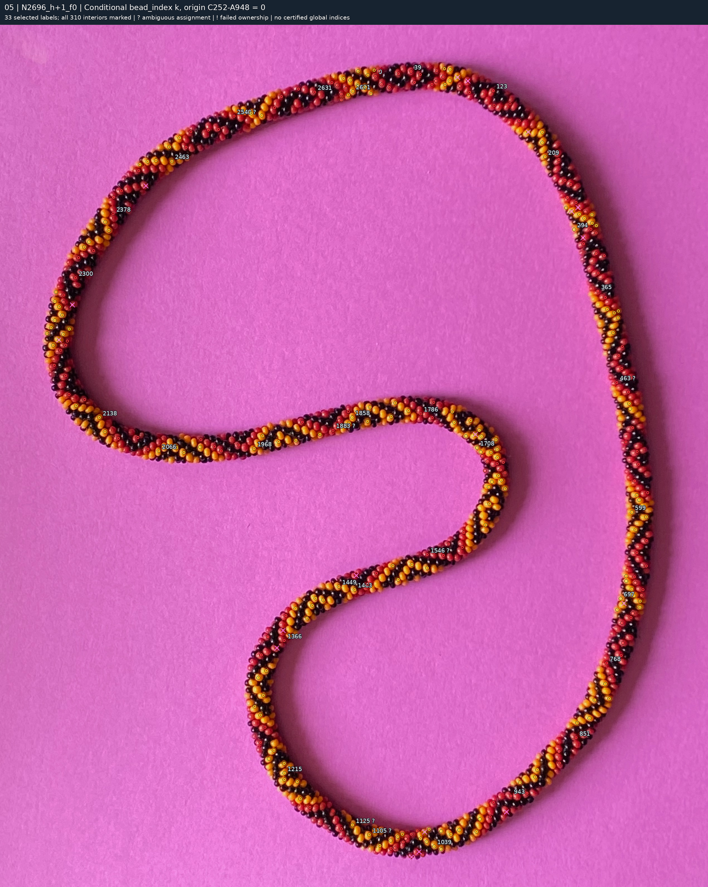
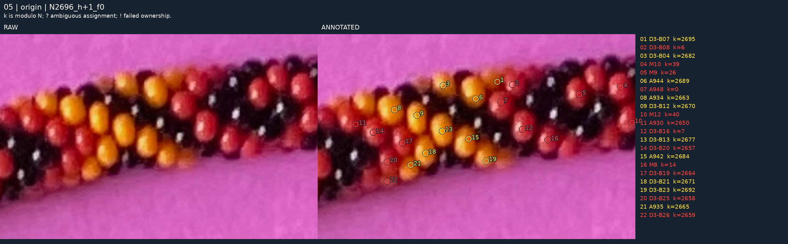
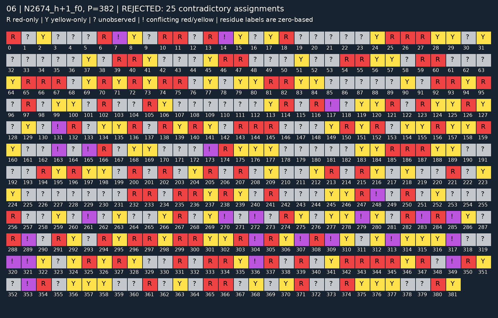
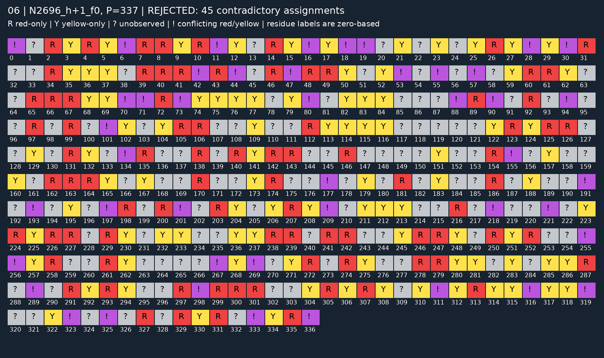

# R255 — visual audit from photograph to pattern

**The trusted red/yellow evidence is usable; the complete reconstruction is not yet solved.** This package makes the saved chain inspectable without changing any observations, fitting a new model, or searching new periods. In particular, accurate edges, a physical centerline, globally correct indices, and a consistent repeating pattern have **not** been established.

[Visual evidence index](review/r255/INDEX.md) · [Original photograph](../beads-photo-2.jpg) · [Observation → triple → index table](review/r255/observation-index-triples.csv) · [Three small review questions](review/r255/QUESTIONS.md).

Read the figures in this order:

1. **Photograph → edges and centerline:** historical image tracing supplies an approximate path. Its bias propagates into the geometry.
2. **Photograph → trusted visible interiors:** R252 supplies 310 reviewed red/yellow observations. The spline supplies coverage sectors; it does not establish their physical centers.
3. **Origin and local directions:** maker 20 = C = C252-A948 anchors the numbering. Local graph topology and its conditional direction assignments are distinct from global fitting.
4. **Geometry + observations + origin → bead indices:** count, camera, helicity, winding and correspondence determine a proposed index for each observation. Ownership and alternatives remain visible.
5. **Indices + observed colors + candidate P → residue template:** equal residues must have equal colors. A contradiction can reveal an incorrect mapping or period; it does not authorize changing a photographed color.

Four presentation methods were considered and combined: raw/marked pairs, one primary labeling convention, source-linked ledgers, and labeled residue boxes with photographic witnesses. Enlargements use nearest-neighbor scaling of original pixels. Whole-photo overlays preserve the native **2540 × 3182** dimensions; headings cover only the top paper margin. No generated bead appearance is used.

## 1. The spline actually in use, and the historical edges


Cyan is the **R175 seed's current periodic cubic spline**, unchanged through R252–R254. Orange and green dashes are the historical outer and inner edge splines. White arrows follow increasing spline parameter; white cross-sections are perpendicular to its image tangent. Dashes mean **unvalidated historical boundaries**, not measured confidence intervals. Paper and cast shadow remain background; a line traversing shadow is an error to inspect, not permission to classify shadow as bead.

The producer was `find_splines.py` in the local `fft-image-explorer` repository, audited at `2caf0707c2b63a0d7540e2cac447d2f1b883d8c1`. Image-only HSV tracing produced 152 outer and 142 inner control points. Catmull–Rom interpolation produced the saved displayed edge curves. `_build_centerline_spline()` resampled the **control polylines**, paired each inner sample with its nearest outer-polyline point, and took the midpoint. These pairs need not be normal sections. The 303-point closed midpoint result was rounded to four decimals in the historical `photo2/centerline.json`, then preserved in [spline-seed-r175.json](spline-seed-r175.json).

[`SplineRope` in tangent_circles.py](tangent_circles.py) normalizes orientation/closure and calls SciPy `splprep(..., per=True, k=3, s=len(points)*2²)`. The 2px value is a smoothing budget, **not centerline accuracy**. It samples 8,193 parameter values. [`global_fit_r253.py`](global_fit_r253.py) and [`camera_r254.py`](camera_r254.py) reuse this shape, inverse-project it onto the paper plane, and parameterize physical arclength for each camera/count hypothesis. No current fitting stage repaired the projected spline shape.

The exact old edge source is now tracked as [historical-splines.json](review/r255/historical-splines.json), so this audit can replay without the neighboring repository. Its SHA-256 exactly matches the original R175 and [R187 provenance](spline-provenance-r187.json): `1e5f0d985be2dfb44b9fa3eac6ad54a0f1345c2ae9a6ed0a8bc3ca510b07dac7`.

**Seed versus registered model:** the primary R254 model translates the seed by **(−4.074, +0.691) native pixels**. [This additional full-resolution overlay](review/r255/01-registered-centerline-whole.png) shows the registered centerline in cyan and the unshifted seed in white. Historical edge coordinates stay fixed. Stretch and twist change bead placement along/around the curve, not its shape. [Seed samples/tangents](review/r255/spline-samples.csv) and [registered samples](review/r255/registered-centerline.csv) preserve both conventions.



The magenta curve is the **unadopted R190 colored-body candidate**, made by [fit_bead_centerline.py](fit_bead_centerline.py) and preserved in [candidate-spline.json](review/r190/candidate-spline.json). R191 favored the existing cyan curve at the reviewed bend. This candidate uses opposite-side colored-interior support, not verified physical edges; see [CENTERLINE_FIT_REVIEW.md](CENTERLINE_FIT_REVIEW.md). Its sampled nearest distance to the active curve has median 3.56px, 95th percentile 8.31px and maximum 10.96px. Those values describe separation, not which curve is correct. Earlier rejected edge corrections are not active inputs; [PRIOR_WORK.md](PRIOR_WORK.md) retains R093's objection to implausible indents and bumps.

[Top/near-straight crop](review/r255/01-splines-origin.png), [right straight run](review/r255/01-splines-right.png), [left curve](review/r255/01-splines-left.png), [bottom turn](review/r255/01-splines-bottom.png) complete the comparison.

The five cross-sections intersect the saved sampled inner/outer curves along the normal to the **unshifted** active seed. Their widths are approximately 108.5, 104.0, 88.6, 113.0 and 93.0px at top/right/bend/left/bottom; center-to-section-midpoint offsets are 1.0–2.9px. [Endpoints, tangent vectors and widths](review/r255/cross-sections.csv) are numerical diagnostics of those curves. They do not establish true necklace width or exclusion of shadow. A nearly centered midpoint does not validate either edge.

## 2. Which observed beads later stages use


**All 310 R252 observations are retained: 151 red and 159 yellow.** Red/yellow rings distinguish their accepted observed colors. Cyan diamonds mark 29 unresolved cases, whose number of distinct physical beads is unknown. Magenta crosses mark two rejected colored proposals, each repeated historically under R238/R239 source names. Aliases are not extra beads. These withheld points never become fit or pattern evidence in this package.



The [right](review/r255/02-trusted-right.png), [bend](review/r255/02-trusted-bend.png), [left](review/r255/02-trusted-left.png) and [bottom](review/r255/02-trusted-bottom.png) crops show additional orientations and touching same-color bodies. Short labels omit `C252-`; full identities and evidence levels are in the main CSV. The bend includes the rejected reddish shadow proposal; the origin crop includes the rejected fringe near a yellow face.

R252's strongest disjoint evidence categories are 21 bounded maker confirmations, 34 maker-marked/reviewed observations and 255 curator-reviewed observations. “Trusted” means accepted for this assisted experiment, not independently measured perfect precision or complete coverage. These marks are **interior samples**, not visible centroids, highlights, physical centers or bead masks. R252's [inventory](review/r252/inventory.json), [identity decisions](review/r252/decisions.json), [raw separation evidence](COLORED_OBSERVATION_CONSOLIDATION.md) and the audit's [withheld-candidate table](review/r255/withheld-candidates.csv) preserve the basis and exclusions.

Black evidence remains separately preserved in the R252 inventory. No black observation participates in the saved 310-point correspondence/template basis, so this package does not introduce a new black inventory. Unobserved pattern positions never mean black. Color-independent body/reflection review remains necessary before adding black evidence.

## 3. One photographic origin; several distinct numbering systems



[Whole-photo origin locator](review/r255/03-origin-whole.png).

The primary origin is **C252-A948**, observed **red** interior at **(1346, 273)** in native image coordinates (x right, y down). It is the preserved **maker 20 = C** identity and the center of an existing six-neighbor maker graph. It was selected for this identity/topology support and reuse across models, not because a pattern search liked its color. It is a numbering gauge, not a recovered manufacturing seam or uniquely privileged first bead.

| Convention | Identity of this observation |
|---|---|
| Stable photographic identity | C252-A948 = maker 20 = historical C |
| Primary audit model, `N2696_h+1_f0` | `bead_index k=0`; generator index 2162 |
| Separate pattern diagnostic, `N2674_h+1_f0` | `k=0`; generator index 2142 |
| Opposite-hand geometry nominee, `N2681_h-1_f0` | `k=0`; generator index 2152 |

For each model, **`k = (generator_index − origin_generator_index) mod N`**. Generator indices belong to that model's source loop, not measured photographic labels. The spline's parameter origin near (2282,1604), down the right side, is yet another convention and does not set k=0.

In the primary model, the predicted physical center projects to **(1344.58, 277.04)**, shown separately as a cyan cross. The assigned surface owns the representative and all saved positive patch pixels. Under the P382 diagnostic the same origin representative is owned but patch support falls to **65.7%** and its assignment is not conditional-unique. Keeping the origin label fixed does not certify it under every geometric hypothesis.

## 4. Local triples: what is supported, and what is only an address



Use **`(n1, a, b) = (+1 count, +6 count, +7 count)`**, with signed counts. Then `k = n1 + 6a + 7b (mod N)`. Counts specify a path, and paths are nonunique: `(1,1,0)` and `(0,0,1)` both advance by seven. The opposite directions subtract the corresponding counts.



This enlarged photograph labels all **27 maker graph points** with readable keyed A/B triples alongside the image. It is the supported local-topology view; its maker numbers are not the R252 observation IDs or global indices. [The local chart table](review/r255/maker-local-triples.csv) retains each original maker UUID and native coordinate.

In family A, the graph's `d1,d2,d3` increments mean `+1,+7,+6`. In family B they mean `−1,+6,+7`. R254 pairs family A with h=+1 and B with h=−1 as conditional hypotheses. The same graph path transforms from A `(n1,a,b)` to B `(-n1,b,a)`; a global reversal additionally negates all index increments. Neither family assignment follows solely from the image's clockwise direction.

The graph stores `(u,v)`, with A index `u+7v` and B index `−u+6v`. For a deterministic short path, the audit chooses `a=median(-u,0,v)`, then A triple `(u+a,a,v-a)`. This only removes a redundant triangular path cycle; it adds no measured neighbor edge. The saved geometric models can still fail photographic ownership for a maker target: the primary owns 26/27, not all 27. See [its exact R254 maker-ownership view](review/r254/N2696_h+1_f0-maker-ownership.png).

**There is no independently verified whole-necklace local neighbor chart.** To fulfill the global triple display without inventing one, the whole-photo and five distributed triple crops use explicitly labeled **canonical index addresses** derived from each model's tentative k. Lift k to signed s in `(-N/2,N/2]`, set `b=floor((s+3)/7)`, and display `(s−7b,0,b)`. The zero a count is a display convention, not absence of +6 neighbors. The signed cut produces a jump opposite the origin, with no compressed or missing physical indices.

[Whole-photo triple overlay](review/r255/04-triple-whole.png) · [origin](review/r255/04-triple-origin.png) · [right](review/r255/04-triple-right.png) · [bend](review/r255/04-triple-bend.png) · [left](review/r255/04-triple-left.png) · [bottom](review/r255/04-triple-bottom.png).

Those algebraic addresses are **downstream of fitting**, unlike the maker graph. They cannot independently validate the inferred indices. The [alternative-assignment ledger](review/r255/assignment-alternatives.csv) provides the other saved k/triple proposals with ownership, patch support and costs. Nearby alternatives are hypotheses, not equally plausible established neighbors.

## 5. Inferred bead_index, with a clearly named working model



The primary view is **R254 `N2696_h+1_f0`**, the favored-hand nominee selected by training geometry among the eligible saved R254 cases. `f0` denotes an orthographic camera hypothesis. This is a current working geometry, **not a recovered exact N or a pattern-compatible solution**. R253's earlier `N2671_h+1_both` geometry leader is not promoted back to primary: R254 excludes N2671 under the maker's exact repeat-divisibility fact.

All 310 trusted observations are marked; the whole-photo overview selects 33 readable labels. Dense crop labels are keyed to a gutter so text does not cover bead faces. `?` means the saved assignment is not conditional-unique; `!` means the assigned surface fails to own the observed representative. These refer to index correspondence, not a changed red/yellow color judgment.



[Right](review/r255/05-index-right.png), [bend](review/r255/05-index-bend.png), [left](review/r255/05-index-left.png) and [bottom](review/r255/05-index-bottom.png) show the other local orientations. The complete [930-row table](review/r255/observation-index-triples.csv) has 310 observations for each of three separately named models: the primary, the P382 diagnostic and the opposite-hand geometry nominee. It includes source IDs, colors, image coordinates, triples, k, generator origin, fitted centers, ownership, patch support, split and uncertainty.

| Saved hypothesis | Conditional-unique assignments | Representatives owned | Role |
|---|---:|---:|---|
| N2696, h+1 | 243/310 | 292/310 | Primary geometry view |
| N2674, h+1 | 246/310 | 291/310 | Best saved new all-observation pattern diagnostic |
| N2681, h−1 | 241/310 | 294/310 | Opposite-hand geometry alternative |

None of these counts is global index accuracy. A wrong lattice can cover many observed interiors; representative ownership alone is weaker than full-patch agreement and local-neighbor consistency. For the alternative's separate visual view, use [R254's N2681 native overlay](review/r254/N2681_h-1_f0-indexed-photo.png). No alternative is squeezed into the primary figure.

## 6. What an “almost matching” pattern actually looks like



This is the saved **N2674, h+1, P382** diagnostic. It satisfies `2674 = 7 × 382`, `P<400`, and P not divisible by 13. Every box is labeled by zero-based residue. **105 red-only** and **108 yellow-only** positions are conditionally forced by their mapped observations, **144 gray `?`** positions have no color evidence, and **25 purple `!`** positions require both colors. No black is forced. These are fragments of an **inconsistent hypothesis**, not 213 recovered template colors.

“25 contradictory assignments” is `sum(min(red_count,yellow_count))` over residues: the minimum number of assignments whose color requirements cannot coexist. Nothing is removed, recolored or resolved by majority vote. Here there are also 25 conflicted residues; those two counts need not agree in general.

[Every observation at every residue, readable table](review/r255/PATTERN_RESIDUES.md) · [Machine-readable residue table](review/r255/pattern-residues.csv) · [Witness coordinates, support and figures](review/r255/conflict-witnesses.csv).

| P382 residue | Red observation → k | Yellow observation → k | Photographic check |
|---:|---|---|---|
| 7 | C252-D3-B16 → 7 | C252-F196p-2 → 389 | [Red raw/marked](review/r255/06-conflict-N2674_h+1_f0-r7-red.png), [yellow raw/marked](review/r255/06-conflict-N2674_h+1_f0-r7-yellow.png) |
| 14 | C252-M8 → 14 | C252-A121 → 396 | [Red raw/marked](review/r255/06-conflict-N2674_h+1_f0-r14-red.png), [yellow raw/marked](review/r255/06-conflict-N2674_h+1_f0-r14-yellow.png) |
| 117 | C252-A973 → 2409 | C252-A560 → 1645 | [Red raw/marked](review/r255/06-conflict-N2674_h+1_f0-r117-red.png), [yellow raw/marked](review/r255/06-conflict-N2674_h+1_f0-r117-yellow.png) |

For example, `389 mod 382 = 7`, so the first pair asks the same template position to be both red and yellow. In the first two pairs, both assigned surfaces own all saved positive patch evidence. The third pair illustrates weaker correspondence: representative ownership succeeds, but patch support is only 37.0% and 85.1%. A color conflict is not automatically evidence of a color mistake. [R254's alternative-support comparison](review/r254/N2674_h+1_f0-conflict-crops.png) preserves the competing local assignments.



For comparison, the **primary geometry** model's saved best all-310 admissible period is P337, with `2696 = 8 × 337`: 84 red-only, 90 yellow-only, 118 unknown and 45 conflicted residues/assignments. This shows why geometry rank and color consistency must remain separate. Its three photographic witness pairs are also linked in the index; one explicitly includes failed representative ownership.

The P382 result was selected post hoc using all observations. It is not an independent predictive success. R254's separate training-only diagnostic had 12 training contradictions and predicted 13 held-out colors correctly, six wrongly and abstained on 37. No surviving exact pattern was found among the tested hypotheses. Their rejection does not disprove the maker's repeating-pattern fact.

## 7. What is solid, doubtful, and next

**Solid enough to inspect and reuse:** the original pixels and source hashes; stable R252 observation identities and observed colors with explicit evidence levels; preserved maker-local topology; reproducible deterministic geometry for each named hypothesis; and exact residue conflict arithmetic.

**Still doubtful:** the edge/centerline's physical accuracy, independently visible black-body coverage, exact total count, camera/helicity/phase and row ownership, global local-neighbor walks, and therefore global bead indices and the repeating pattern. The preliminary work has improved the evidence basis, but it has not solved every earlier problem.

**Next unresolved question:** can independently supported local neighbor walks explain specific row/index slips without moving trusted colored interiors? Start with the [three illustrated review questions](review/r255/QUESTIONS.md), especially the P382 residue-7 pair and the primary model's failed maker target. No new inference is authorized by merely generating this package.

## Reproduction and delivery boundary

Run from the repository root with the existing Python 3.12 environment:

```sh
.venv/bin/python photo2/audit_r255.py
.venv/bin/python photo2/audit_r255.py --output photo2/output/r255-replay
```

The script reads saved evidence, evaluates existing splines, computes five line/curve intersections and canonical display triples, recounts two saved periods, and draws figures. It performs **no detection, fitting, ray search, period search, observation edits or new scene rendering**. [Verification](review/r255/verification.json) seals source/artifact hashes, checks all 930 source/coordinate/color/index/triple rows, both chart families, all 719 residue states and memberships against R254, witness arithmetic, and native overlay sizes. A second run was compared byte-for-byte; raw crop panels were checked against the original pixels. Documentation links and scoped Git changes were checked before delivery.

Stop after committing/pushing this audit and verifying the exact remote commit and clean worktree. Next task is visual review, not automatic model expansion. Retain **GPT-6 Astra / High** as the existing recommendation for a later inference round; this is not a claim about active model status. **No /new is needed for reviewing this package; use /new before a separately authorized implementation round.**
