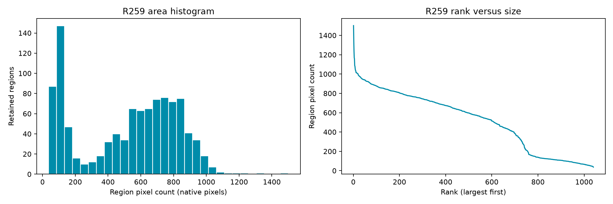
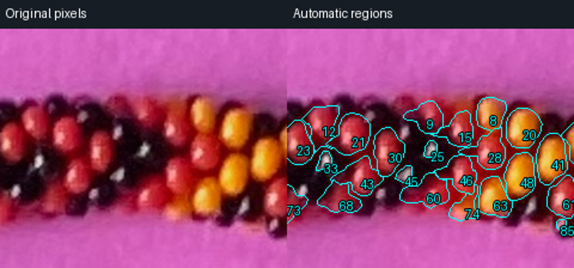

# R259 — automatic regions from the original photograph

Historical R259 result, preserved below. The current coordinate-focused review and
revised detector are in [R260](DETECTION_REVIEW_R260.md).

The full 2540 × 3182 photograph produces **1,040 retained region proposals** and
**454 rejected candidates** from **1,498 brightness maxima**. Four shallow-saddle
peak pairs are grouped. There are 917 bright-interior proposals and 123
reflection-on-dark proposals. These counts are not a verified bead inventory.
No historical bead labels, splines, centerlines, adjacencies, geometry or simulated
positions are read by the detector. No geometry, indexing or pattern inference
is part of this result.

The maker's mid-round clarification changes the black-region target: **stop at
the first fully dark perimeter around a reflection**. Do not seek the full black
bead extent. All 123 retained dark-support regions satisfy the saved-pixel
perimeter contract. Their areas and centroids concern reflection support only.
They are deliberately not comparable to a complete colored bead's body area.

[Launch instructions](bead_detection/README.md) · [complete data and curated images](review/r259/README.md)

```bash
.venv/bin/python -m photo2.bead_detection.server
```

Then open http://localhost:8767. The old debugger launch now opens the same simple
interface; add `--legacy` to access its preserved functionality and reviews.

## Implemented method and alternatives

Four approaches were considered before implementation: marker-controlled watershed,
radial growth from brightness peaks, active contours, and learned instance
segmentation. Radial growth was selected for colored regions because its decline,
significant rise and retreat are directly inspectable. Seed-distance competition
arbitrates overlapping proposals. Black support uses a distinct first-dark-perimeter
stop after the maker clarification. No trained segmentation model is used.

1. Decode the original JPEG with EXIF orientation. Analysis uses its decoded RGB,
   without white balancing or sampled rendering. HSV has H in circular degrees,
   S and V in [0,1]. A display PNG removes the embedded ICC tag so browser display
   does not silently transform the measured RGB. Original JPEG bytes are unchanged.
2. Smooth HSV Value with Gaussian sigma 1.15 pixels. Morphological h-maxima at
   prominence 0.055 remove small noise fluctuations. Each peak gets a connected
   near-peak patch within an 8-pixel window, its unweighted patch centroid and
   lossless pixel runs. The peak representative is an actual maximum pixel,
   distinct from patch centroid and final grown-region centroid.
3. Estimate normalized RGB paper appearance from a 3.5% border band. A robust
   image-derived distance tolerance recognizes paper, including enclosed paper and
   its chromatically similar shadows. No magenta hue range or bead position is
   supplied. This assumes a framed object and reasonably consistent paper
   chromaticity; colored illumination and very dark shadows remain limitations.
4. Merge close peaks (within 11 pixels) only for a shallow connecting Value saddle
   (drop below 0.085) and compatible normalized RGB (distance below 0.3). Preserve
   all original maxima and merge evidence. This protects deep-valley neighbors,
   but cannot prove that every shallow saddle lies inside one physical bead.
5. A median Value sample at radius 8 separates tentative dark-surround seeds from
   bright-interior seeds. The threshold 0.32 is an explicit engineering parameter,
   not a supplied bead color range. Seed classification can be wrong near a bead
   edge or a dark colored body and is open to review.
6. Colored growth samples 64 directions to radius 42. Each ray follows a running
   brightness low, tolerates ripples, and requires a persistent recovery exceeding
   0.045. Retreat moves inward from that low by a small brightness allowance and
   at least one pixel. Paper-like runs also stop growth. Median/Gaussian smoothing
   across directions gives a moderately smooth closed radial outline; unsupported
   directions are flagged. The maximum radius is a scale-specific search limit,
   not a recovered bead radius. Regions need at least 42% supported valley rays.
7. **Black growth:** grow the connected reflection through pixels with smoothed
   V > 0.32, then add one 8-connected pixel shell. Stop immediately if that shell
   is completely dark (V ≤ 0.32). A crop-edge hit, insufficient peak/perimeter
   contrast (<0.14), or failure of a complete dark shell rejects the candidate.
   No dark-body outer edge is sought. Smoothing precedes growth; contour display
   simplifies the resulting boundary by at most a 0.55-pixel tolerance. The exact
   saved raster perimeter, rather than the display polyline, defines the contract.
8. Reject paper-dominated, tiny (<18 pixels) and unsupported candidates, preserving
   their geometry and reasons. Confidence-weighted seed-distance competition
   prevents retained masks from overlapping. Keep the largest connected support,
   smooth colored masks lightly, and recompute statistics. If competition breaks
   a dark region's complete dark perimeter, reject it instead of claiming success.

Region confidence combines boundary evidence, non-paper fraction and peak-to-surround
contrast. It is an uncalibrated heuristic, not a probability. Pixel count equals
projected raster area in px²; no physical-area conversion is made. Hue mean and
dispersion use saturation-weighted circular statistics; S/V include mean, standard
deviation, extrema and quantiles. IDs belong to this source/algorithm/parameter run;
they carry no historical identity or string index.

## Actual outputs

| Quantity | Result |
| --- | ---: |
| Meaningful maxima at the declared prominence | 1,498 |
| Candidate groups after four peak merges | 1,494 |
| Retained regions | 1,040 |
| Rejected candidates | 454 |
| Bright-interior / dark-perimeter supports | 917 / 123 |
| Minimum / median / maximum region pixels | 37 / 579.5 / 1,501 |
| Sum of disjoint retained pixels | 538,160 |



The histogram mixes the two declared support types; a small black support is not
evidence of a small physical bead. Numeric histogram bins and sorted region IDs
are saved. The viewer uses 24 clickable bins; the static figure uses 30 bins,
both over identical retained pixel counts.

The three raw/outlined crop pairs are automatically selected high-confidence
examples separated by at least 350 pixels, not a random validation sample. Inspect
largest/smallest regions and rejected candidates to see failures as well.



## Validation and practical limits

Six detector tests cover adjacent known synthetic bodies, first-dark-perimeter
stopping without full-body growth, no-reflection dark gaps, cast paper shadows,
noise, shallow-saddle multi-peak grouping, translated/recolored fixtures, hue
wraparound, deterministic masks, empty images, centroid arithmetic, nonoverlap and
closed contours. Colored fixture IoU must exceed 0.45; the black fixture instead
must retain a compact reflection support and a fully dark perimeter. These are
implementation tests, not photographic precision/recall estimates.

Full-photo validation checks every native retained mask, pixel count, centroid,
contour closure, label raster, ID and peak accounting, and every retained dark
perimeter pixel. An isolated replay copies only the standalone detector and
original photograph into a temporary directory: identical JSON and label arrays
demonstrate independence from historical files. Exact evidence is saved in
`review/r259/validation.json`.

Real Chromium checks cover the simplified controls, image/ID selection, all size
navigation, pan/zoom coordinate mapping, histogram mouse/keyboard filtering,
optional evidence, rejected IDs, native RGB preservation, downloads and narrow
screens. The viewer has no model, bead-index, adjacency, lighting or pattern UI.
It exposes only explicit read-only artifact routes. Browser checks never write
production reviews.

Legacy regressions: 28 of 29 passed. The older immutable-input test expects an
archived review-file hash; `photo2/output/debugger/reviews/latest.json` was already
modified on October 11 at 20:22 local time, before this round. Its current hash
differs from that old snapshot. The file was preserved, not reset to satisfy the
test. All tracked prior reviews and experiments are unchanged.

The photograph still shows misses, truncated colored bodies, possible merged dark
supports and uncertain peripheral patches. Some dark reflections connect through
above-threshold pixels to a neighboring bright region and are rejected when a
local closed perimeter cannot be found. Other dark candidates lack sufficient
contrast. The no-closed-perimeter reason occurs for 220 candidates; rejection
reasons overlap and must not be summed as unique counts. No-reflection black
bodies remain deferred under the maker's eligibility rules.

Completeness, photographic precision, recall and physical bead count remain
unmeasured. A fixed pixel scale and thresholds also prevent claiming generality
across arbitrary resolution, exposure or background. Synthetic palette/placement
checks are limited evidence only. This is an inspectable automatic first inventory,
not an accepted final segmentation. No maker labels were requested or used to
initialize it.

## Next task and stopping point

Stop after this delivery. Inspect automatic size outliers and a few missed/rejected
reflections using the saved IDs, then improve detection from that feedback. Keep
black growth limited to the first dark perimeter; do not reopen geometry or indexing.
[Optional review prompts](review/r259/QUESTIONS.md) are not prerequisites.

Recommendation: GPT-6 Astra / High for the next detection ambiguity review;
this is a recommendation, not a new active-model status. The [official model
documentation](https://developers.openai.com/api/docs/models/gpt-6-astra) supports
its use for complex reasoning and the High effort setting. No `/new` is needed
to inspect this viewer; use `/new` before another substantial implementation round.
Sites was used locally only; OpenAI Docs only for this recommendation. No subagents,
hosting, or messages to other accounts were used.
