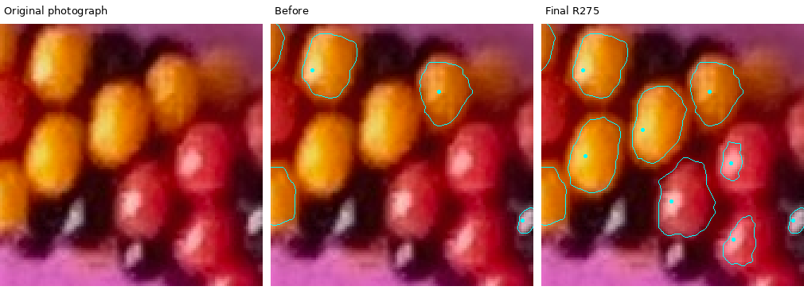
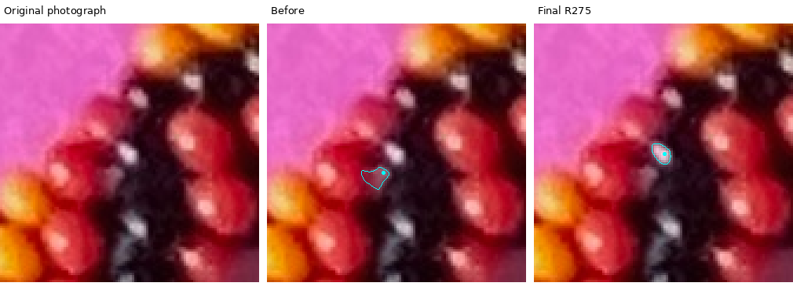
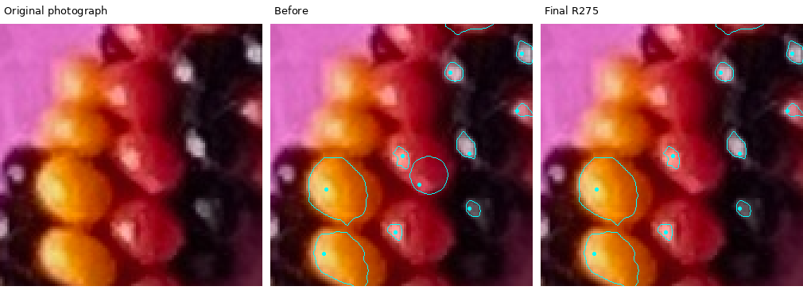
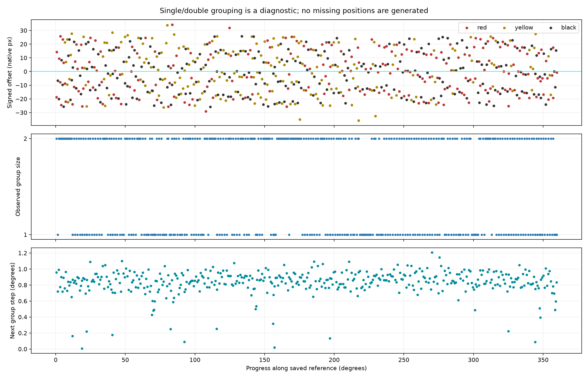

# R275 — centerline recovery and angular-gap audit

[Viewer](centerline_inventory_r275/index.html) · [whole photograph](review/r275/whole-photo.png) · [numbered audit and reproduction](review/r275/README.md) · [complete audit CSV](review/r275/centerline-audit.csv).

The fixed target band increases from **422 to 658 accepted image-derived locations**. The whole inventory contains 810 locations and 807 exact interior masks. Large angular gaps are repaired without inserting predicted bead positions. Five weak black reflections are suppressed, one extra red patch is deferred as a secondary patch, and three colored fragments are corrected to stronger black reflections.

**100% photographic capture and reliability are not certified.** The computational audit covers every accepted location and preserves every tested maximum, but it is not independent physical-bead ground truth. 63 residual peak groups remain diagnostically unassigned; these include shadow fragments and secondary highlights, not that many proven missing beads. There are 24 accepted locations with small colored supports and 12 unusually short group intervals worth reviewing. No close same-color accepted pair remains within the declared 16px audit radius. The user’s zero-unresolved objective remains unverified rather than being inferred from candidate counts or regular spacing.

## Target and preservation

Use the existing **unregistered image-traced** R255 curve, `review/r255/spline-samples.csv`, SHA-256 `9c6bdffad4f5e6032e04d0e10f94d401a336fe3f00709ace5282cd01077d8431`. The later model-translated centerline is not used. A 12-native-pixel half-width band selects a bead proposal when its measured interior intersects that band, **or** its accepted point is within 26px (12px band +14px visible-body allowance). Exhaustively search native maxima within 40px, then apply the same final membership rule. Linear subdivision bounds reference-distance error by 0.125px. This is a reproducible apparent-body proxy, not a full-body silhouette measurement; marginal membership deserves review.

The 152 prior locations outside the target are unchanged. All 574 original R274 location measurements and 570 masks survive in the active or archived records. Two target black secondaries (`K-0959-1570`, `K-0515-1595`) are explicitly removed from the active set. One prior red label (`C-2022-2657`) is corrected to black and moved to its much stronger reflection; its old point, label and mask remain in `superseded_*`. The other two color corrections affect new proposals. No R272–R274 source, report, viewer or result is edited; 429 protected tracked files are hash-checked against the parent commit.

| Accepted target color | Locations |
|---|---:|
| Black | 246 |
| Red | 218 |
| Yellow | 194 |

The audit status breakdown is 419 retained image-check acceptances, 1 repaired interior, 235 recovered candidates, and 3 color/location corrections. These are audit statuses, not modeled string indices. Stable IDs survive corrections; sequential inventory numbers are reassigned deterministically, with old numbers retained separately.

## What was blocking recovery, and what changed

All recovery rules run across the entire fixed target, without reviewed coordinates or IDs as inputs. The centerline selects work; its direction, gaps, spacing and pair/single expectation never place a bead or decide its color.

| Experiment | Diagnosis and selected behavior |
|---|---|
| Small hue-consistent fallback; 5/7/9px mean maxima | R274 could not resurrect peaks rejected upstream, and an uncertain broad mask could hide a good point. Preserve all raw/mean maxima, retry the broad hue-aware support, then retain a smaller supported interior when justified. |
| Expanded chromatic core and pale-highlight enclosure | A bright neutral highlight can suppress the local colored fraction. Require consistent learned color around all eight sectors before bypassing that gate; never borrow a one-sided neighbor’s color. |
| Layered support and connected-growth control | Test brightness fractions through R274 hue/path-supported pixels. Cleanup only removes pixels. The alternative connected-growth rule added no accepted photographic points; it is retained as a failed recovery control. |
| Retreat seed and stable core | The original edge highlight can disappear during cleanup while its mean-maximum anchor remains safely interior. Retain that anchor, then remeasure the native brightest pixel. A stable 5/7/9 endpoint can retain a round core entirely contained in twice-eroded hue/path support when the larger outline is irregular. |
| Naturally disjoint layers | An otherwise sound broad proposal can overlap a neighbor. Try a brighter native layer that becomes disjoint naturally; do not subtract the neighbor’s outline or partition an overlapping region. This repairs the final large pale-red gap. |
| Black perimeter levels and material controls | Compare encoded-gray ceilings 0.36/0.40 and neutral-shell fractions 0.40/0.35/0.25. Select 0.40/0.25 (encoded-gray 0.40 = linear Y 0.13287) with the original peak, contrast, background, size and ownership checks. Colored spill can tint genuinely dark bead material. |
| Late reflection controls | Compare relative shell levels 0.65/0.70/0.75. Select 0.70, ceiling 0.40, with at most 25% confident high-saturation learned-color boundary pixels in an otherwise dark enclosing shell. A strongly supported tinted-shell exception is explicit below. |
| Ownership and color correction | Suppress a weak black peak only with peak ratio ≤0.35, contrast ratio ≤0.65 and continuous dark non-paper material. Correct a small weak colored fragment only when a much stronger neutral peak has a closed dark shell and measured dark continuity. Recheck late recoveries and prevent suppressed aliases reappearing. |
| Homogeneous color margin | Permit a 4° prototype margin instead of 6° only for ≥50 samples, ≥80% chromatic core and ≤10° hue dispersion. This recovers one red point. A second patch on an existing red body is rejected using a continuous same-color bridge to a stronger point. |

**Specific black miss repaired:** the reflection at `(2273,1856)` has ICC linear luminance 0.331984 and saturation 0.30. The brightness-only component leaked into the neighboring yellow material. The hue boundary closes a 35px core with 93.3% dark shell, contrast 0.319, no paper pixels, and 8.6% chromatic core. Only 10% of its shell passes the old neutral-material test because the dark pixels are yellow-tinted. The uniform exception requires shell neutrality ≥10%, chromatic core ≤10%, peak S≤0.35, encoded contrast ≥0.25 and dark shell ≥85%; it adds this one target candidate beyond the mixed-boundary control. All rejected controls and native shell runs are retained.

**Additional dim-color control:** lower the mean7 cutoff from 0.04 to 0.025 only with ≥30 chromatic samples, ≤10° hue dispersion, ≥80% chromatic core, three-window endpoints within 3px and 16px isolation. Permit a 13px core entirely inside twice-retreated hue support. Of 13 proposals, 12 have supported interiors outside the fixed final band and one has no supported core; none changes the target inventory. In the reviewed dim red case, mean7 Y=0.02918 and hue dispersion=2.55°. A 13px core survives, but its brightest pixel `(279,1375)` lies 28.15px from the reference, outside the 26px point rule. [Dim boundary photographs](review/r275/comparisons.json) and [all valid-looking band-edge candidates](review/r275/band-edge-candidates.json) retain this uncertainty. The band has not been narrowed to erase misses.

## Angular progress and the single/double observation

Each point is projected to the saved image-derived curve. Its progress is **θ = 360s/L**, where `L = 9235.586px`. The zero and direction follow the saved curve. This is normalized projected arclength around this folded necklace, not polar angle about the photo center, a physical 3D rotation, or bead rotation around the rope axis. Every circular interval list sums to 360°.

Individual successive steps need not be equal: two opposite-side points can occur at almost the same progress. The diagnostic therefore pairs opposite-side noncentral points within half the median colored-support equivalent diameter, choosing the closest pairs deterministically, with at most two members and no chaining. It never invents missing partners. The saved sequence contains **225 double groups and 208 single groups**; stretches and transitions are preserved rather than forced into an alternating template.

- Largest individual gap: **113.47px (4.423°) → 28.28px (1.102°)**.
- Original individual-gap flags: **48**. Final group intervals above 1.6× their 20-neighbor local median: **0**. Pair-tolerance controls at 0.75×, 1× and 1.25× also retain zero long-gap flags.
- Group median step **0.8521°**, maximum **1.2057°**, coefficient of variation **0.191**. Spacing is more regular, but not perfectly uniform.
- **12** intervals below 0.4× local median remain flagged. These expose imperfect pair association or highlight displacement; they are not automatically merged or silently declared solved.

[Every bead’s angle and increment](review/r275/angular-increments.csv), [single/double groups](review/r275/station-increments.csv), [30° sector comparison](review/r275/angular-sectors.csv), [observed runs and summaries](review/r275/angular-summary.json), [flagged photographs](review/r275/group-flags.json).

## Measurements, tests and remaining doubts

`inventory.json` contains exact run-length masks, native area centroids and pixel counts, connected brightest-patch masks/centroids/counts, absolute brightest native pixel **within the accepted support**, ICC-corrected linear relative luminance, original and corrected RGB/HSV, raw and smooth closed contours, acceptance evidence and warnings. Display smoothing does not add measured pixels. A bright-patch centroid and an interior centroid are not physical bead centers. Three prior locations retain uncertain interiors and remain clickable without invented areas or size ranks.

The regression suite has **61 Python tests**. The viewer’s actual JavaScript is tested under Node with **50 navigation/selection checks**; this does not verify rendered layout in a real browser. That browser check remains deferred under the user’s skip-new-approval instruction. Independent validation checks all native masks, peak/centroid/patch measurements, disjointness, closed angular loops, preservation, sequential inventory order and JSON/viewer parity. Full image-only replay is compared by measurement hash.

The end-to-end synthetic set has 87 scenes, with known identities used only for scoring. Across the full set: black 28/32, red 58/62, yellow 62/62; zero accepted false detections, duplicate extras, wrong colors, background pixels or foreign-body pixels. The 70 illuminated scenes with visible black reflections capture 122/122 bodies. Four black bodies without reflections and four dim red bodies are missed. These controlled successes do **not** establish photographic 100% recall.

Residual candidates remain visible in a separate orange layer and in the numbered atlas. The audit distinguishes secondary aliases, excluded proposals and accepted small supports, but low contrast, color spill, partial exposure and multiple highlights still make some physical ownership uncertain. The exact mask only establishes measured support, not a complete visible-body boundary. Review the residual photographs and short-interval witnesses before treating this inventory as a guaranteed complete bead census. Prior accepted success is not used as proof that every label was correct.

No watershed, geometric bead predictions, historical growth splines, hand-assigned runtime identities, lighting inversion or physical-string indexing is used. The sole geometric reference is the user-authorized existing image-derived centerline. Stop after scoped commit/push for photographic review of these remaining doubts; keep the current model/reasoning and use the same session, with no `/new` needed.
