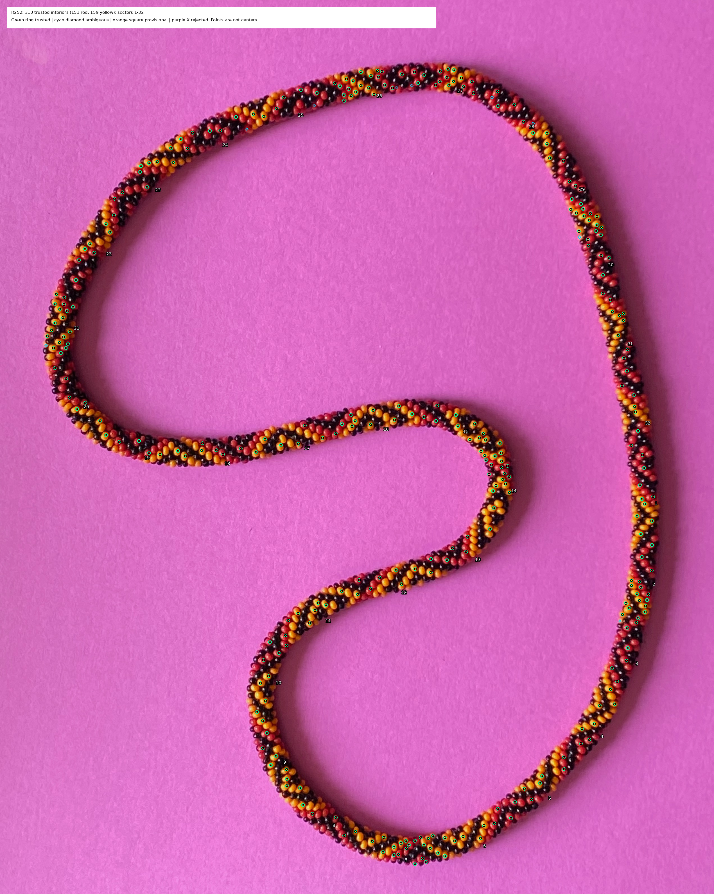
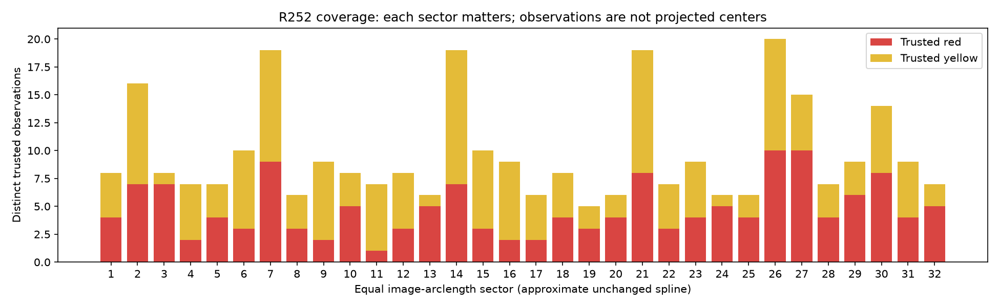

# R252 — consolidated trusted red/yellow observations

**310 distinct, sufficiently supported photographic bead observations: 151 red and 159 yellow.**
Both colors occur in all **32 equal image-arclength sectors**. Counts range **5–20**
per sector. The largest trusted gap is **87.2 native spline pixels (0.944% of the
loop)**. This is an assisted, curator-reviewed basis for a bounded fitting trial,
not independently validated precision, a complete inventory, or recovered indices.

[Accepted CSV](review/r252/accepted.csv) · [Full inventory](review/r252/inventory.json) ·
[Evidence index](review/r252/INDEX.md) · [Coverage CSV](review/r252/coverage.csv) ·
[Unresolved cases](review/r252/unresolved.csv) · [Source accounting](review/r252/source-accounting.csv).



The [all-status map](review/r252/whole-inventory.png) adds provisional and rejected
source candidates. Green rings denote trusted observations, cyan diamonds ambiguous
hypotheses, orange squares unreviewed proposals, purple crosses rejected proposals.
The dot inside each trusted ring denotes red/yellow; numerals identify coverage
sectors, never bead indices. Repeated aliases are retained in data, not drawn as
additional trusted bodies. Accepted positions are measured photographic interiors,
not rendered predictions, physical centers, or full visible-surface centroids.

## Sources, identity and review

Considered raw-crop review, saved-patch support matching, and local parallel Value
profiles. Selected their combination without a new segmentation pass. Native image
hash is `eb7c9edb62f5580ef56632872da48da92556d62b758295137068cc2404dc8fbb`.
The photograph, old masks/pixel runs, center marks, detector outputs, scene and
centerline remain unchanged. Source hashes are embedded in the inventory and sealed
in the explicit [curator decisions](review/r252/decisions.json).

Reviewed all eleven R201 raw/interior sheets, every maker mark, all six local
Stage 1 reference regions, original positive/identity facts, 32 raw coverage crops,
and 454 nearby identity comparisons (84 same, 369 distinct, one unresolved).
The 45px neighborhood only schedules comparisons; it never decides identity.
The isolated maker mark M37 was reviewed separately. Points separated by more than
45px have individual/raw-sector review, not an exhaustive all-pairs identity test.
Every accepted observation has a source coordinate, original record/ID, current
status, supporting photographic evidence and source relationships. Historical
IDs retain their namespaces. In particular **R235:D3-P04 is R192:938, while
R238:D3-P04 is R192:951**; matching those labels alone would invent an association.
Historical baseline aliases are therefore recovered through their exact original
source IDs **and coordinates**, then their saved photographic adjudication.

The current evidence levels are **21 with bounded explicit maker confirmation,
34 maker-marked and photographically reviewed, and 255 curator-reviewed**. These
are disjoint strongest-evidence categories, not independent reviewers. Maker
confirmation applies only to the original positive region or point/identity
answer; new aliases and color interpretations are identified as curator work.
For example R168's middle point is a black reflection and is preserved separately;
R189's three pictured bodies are yellow. Neither identity answer alone supplied
those semantic color labels. All 41 saved marks survive without moving them.

| Consolidation source, in this accounting order | Accepted unique bodies represented | New bodies beyond preceding rows |
| --- | ---: | ---: |
| Original 208 R201 selected patches | 202 | 202 |
| R200 maker marks | 41 | 26 |
| R235 colored references | 74 | 50 |
| R239 fresh colored references | 28 | 16 |
| Earlier explicit maker facts | 21 | 7 |
| Eight existing R201 gap proposals, newly reviewed | 8 | 8 |
| T2 upper yellow halo observation, newly reviewed | 1 | 1 |
| **Union** | **310** | **310** |

The original 208 are not added to 41 or to Stage 1 counts. Six R201 samples
(A32/A50/A895/A920/A954/A958) remain ambiguous under the stricter ownership review;
this does not assert that their visible bodies are nonexistent. Three previously
eligible pale rims (H1-B31, T1-B16, T2-B23) are also withheld. The nine principal
withheld body hypotheses remain visible on the map. A75 was a further gap proposal
with insufficient saddle ownership. The approximate 10% visible-area guideline
still applies: clear small visible faces remain accepted, without a circular-shape
requirement. No exact visible-area fraction was newly measured.

Nine additions use existing proposals only: eight obvious colored interiors in
large gaps, and T2-A01, whose former halo status was bookkeeping rather than
physical ineligibility. Source automatic status is preserved; current acceptance
is explicitly a new curator decision. No hue threshold or detector was tuned.

## Same-color separation without dark-pixel assignment

Each profile card shows unmarked raw context, identified colored endpoints and
why they were chosen, then five connecting routes offset by −2, −1, 0, +1, +2 native
pixels. RGB is bilinearly sampled before Value=max(R,G,B). No brightness minimum
chooses an endpoint. Each route uses at least 41 samples, approximately quarter-pixel
spacing; interpolation adds no optical resolution. The quoted dip is one minus
the minimum in the middle 15–85% divided by the smaller median of the first/last
12% of the route. It is a descriptive diagnostic, not an eligibility threshold.

| Example | Decision and observed diagnostic |
| --- | --- |
| [D4 B30/B27, old A02/P14](review/r252/profile-yellow-area-failure.png) | **Two yellow beads retained.** Five dips 20.0–27.9%; dark saddle consistent with two credible faces. R239's shared 1239px support exceeded its ~1220px ceiling; that mask failure is not evidence of one body. |
| [R194 close yellow points](review/r252/profile-yellow-touching.png) | Maker-confirmed distinct. Dips only 4.1–12.1%; weak contrast does not negate the identity answer. |
| [R204 S/Q](review/r252/profile-yellow-shallow.png) | Maker-confirmed distinct. Dips 12.5–19.1%, with nearby-path agreement. |
| [D4 B19/B22](review/r252/profile-red-adjacent.png) | Distinct red faces, dips 22.8–48.6%, corroborated by raw shape and surrounding bodies. |
| [D4 P10/A08](review/r252/profile-red-duplicate.png) | **Same red bead**, preserved as aliases. Mostly directional shading; 0.3–2.8% interior dips do not establish another face. |
| [R211 M/O](review/r252/profile-yellow-duplicate.png) | **Same yellow bead** by maker answer and raw context; differing positions are not center errors. |
| [T2 A01/A06](review/r252/profile-yellow-false-merge.png) | Distinct yellow faces from raw context. This route has nearly clipped Value and weak/nonpositive smaller-endpoint dips (−13.1 to +5.7%); the profile metric alone **fails to establish separation** here. Both interiors remain useful; no claim that every pair passes a valley test. |

[Full numerical profiles and interpretation](review/r252/dark-separation.json),
[all samples](review/r252/dark-profiles.csv). Dark pixels remain **unassigned**.
Neither a connected color mask nor a minimum alone supplies a bead count. No full
mask was enlarged, partitioned, or refined. The original R239 mask/area evidence
and original retain/abstain decisions remain in each source record.

## Coverage and remaining visible omissions

The unchanged R175 periodic spline, with its existing 2px smoothing and 8193-point
sampling convention, supplies only approximate image arclength. Length 9235.59px;
sector width 288.61px. Origin is approximately (2282.0,1603.9), following the
clockwise image route, down the right side first. No physical necklace angle,
3D length, calibrated centerline error, or fitted geometry is implied.



The top and historical Stage 1 patches are denser. Sector 19 (left inward bend)
has five trusted observations; sectors 8/13/17/20/24/25 have six. Only one yellow
occurs in sectors 3/13/24, and only one red in sector 11. These weaker regions must
not be outweighed by sectors 7/14/21/26 (19–20 each). Fit and evaluation should be
balanced by sector and include spatially held-out regions.

The largest remaining gaps are listed below, with native endpoints and all twelve
largest gaps in [summary.json](review/r252/summary.json). They are gaps in trusted
sampling, not demonstrations of missing beads or black-only stretches.

- **87.2px (0.944%)**: C252-A748 → C252-A758; endpoints (356.8, 1497.8) → (273.9, 1455.6).
- **75.6px (0.818%)**: C252-A267 → C252-A275; endpoints (2066.9, 2646.7) → (2005.7, 2695.1).
- **74.8px (0.810%)**: C252-A71 → C252-A78; endpoints (2004.1, 572.7) → (2026.5, 646.2).
- **74.4px (0.806%)**: C252-A539 → C252-A546; endpoints (1663.1, 1910.1) → (1742.5, 1883.3).
- **72.9px (0.789%)**: C252-A278 → C252-A286; endpoints (2007.5, 2737.9) → (1927.4, 2761.8).

[Sector-by-sector raw review notes](review/r252/coverage-review.json) and all 32
raw/marked crops identify unrepresented colored faces throughout the necklace.
The left inward bend, upper-right run, colored transition into the central bend,
and sparsely sampled rows deserve priority if later validation needs more anchors.
Broad front-face coverage is useful already; small rear faces and touching same-color
areas remain incomplete. **No per-sector recall denominator or completeness
percentage is claimed.** All unresolved source coordinates, alternatives and
same-color review regions remain in [unresolved.csv](review/r252/unresolved.csv).

## Full accounting and uncertainty

The inventory contains **1347 source records**, of which **1183 are colored or
color-uncertain source records**: 310 representatives, 305 accepted duplicate/alias
records, 45 ambiguous records, 519 provisional records, and four rejected records.
The four rejected records describe **two distinct rejected measurement proposals**
repeated across R238/R239, not four false beads. “Duplicate” here means a redundant
observation of an accepted bead, not a rejected physical bead. Unreviewed automatic
proposals are not all wrong and are not all unique. R238's 1144 lower-level detector
traces are archived separately, outside these source-record/body counts.

The 45 ambiguous records form **29 unresolved cases** using explicit reference
links or identical historical measurement provenance. **The number of distinct
ambiguous physical beads is unknown**: several alternatives may name the same
body or no body. Nine principal reviewed-but-withheld hypotheses are a subset of
those cases, not a number to add. This limitation prevents a false unique total.
The older R114 pilot records and R115/R147 identity answers are preserved without
assuming that body identity confirms a safe interior or color. Only the explicit
C = maker20 alias is accepted across those records. R188’s “Cannot tell” remains
unresolved. Black observations, confirmed reflections and no-reflection deferrals retain their
original evidence separately; none contributes to the colored count.

The following rows overlap in their accepted entities and must not be summed.
“Alias” is a redundant accepted source record; “Unreviewed” is provisional.

| Original source | Records | Trusted entities represented | Representative | Alias | Ambiguous | Unreviewed | Rejected |
| --- | ---: | ---: | ---: | ---: | ---: | ---: | ---: |
| colored-review-answers-r188.json | 1 | 0 | 0 | 0 | 1 | 0 | 0 |
| correspondence-answer-r211.json | 3 | 1 | 1 | 2 | 0 | 0 | 0 |
| local-pilot-r114.json | 8 | 1 | 0 | 1 | 2 | 5 | 0 |
| profile-answers-r204-r205.json | 2 | 2 | 2 | 0 | 0 | 0 | 0 |
| profile-transfer-answer-r209.json | 2 | 2 | 2 | 0 | 0 | 0 | 0 |
| r196/trusted-facts.json | 14 | 14 | 14 | 0 | 0 | 0 | 0 |
| r200/position-basis.json | 41 | 41 | 34 | 7 | 0 | 0 | 0 |
| r201/interiors.json | 677 | 210 | 190 | 20 | 7 | 460 | 0 |
| r215/confirmed-pixel-facts.json | 2 | 2 | 2 | 0 | 0 | 0 | 0 |
| r235/automatic.json | 61 | 56 | 0 | 56 | 5 | 0 | 0 |
| r235/halo-audit.json | 20 | 3 | 0 | 3 | 0 | 17 | 0 |
| r235/references.json | 83 | 74 | 48 | 26 | 9 | 0 | 0 |
| r238/development/candidates.json | 53 | 36 | 0 | 39 | 3 | 9 | 2 |
| r238/transfer/candidates.json | 52 | 35 | 0 | 35 | 4 | 13 | 0 |
| r239/development/ownership.json | 88 | 71 | 0 | 74 | 7 | 5 | 2 |
| r239/references.json | 33 | 28 | 16 | 12 | 5 | 0 | 0 |
| r239/transfer/ownership.json | 43 | 28 | 1 | 30 | 2 | 10 | 0 |

## Readiness, checks and stop

**No additional broad observation/segmentation campaign is required before a bounded
geometric fitting experiment.** First freeze a spatially balanced fit/holdout split,
and implement/check a likelihood for visible-surface interior membership with
uncertain ownership/visibility. Do not minimize exact-center residuals at these
points. Use existing known examples to check that observation interpretation, then
fit **both h=+1 and h=−1 with equivalent camera/centerline/phase flexibility**, and
compare held-out photographic support, failures and competing correspondences.
Do not treat a numerical minimum as exact N, closure, unique hand, or bead indexing.
Validate local predictions in multiple orientations before whole-necklace prediction.
The 29 unresolved cases can remain withheld unless a fit materially depends on them.

Source h=+1 remains the strongly favored working expectation from the dense FFT
and maker interpretation; this round supplied **no additional helicity evidence**.
No fitting, bead-location prediction, index assignment, color-repeat recovery,
rendering, or new FFT experiment was performed.

Eleven tests cover source identity collisions, unchanged original records and hashes,
maker same/different constraints, forbidden transitive conflicts, duplicate red
samples, the harmful yellow-mask merge, a one-body dark stripe that must not become
a split decision, native RGB/Value interpolation, positive-mask representative
selection, evidence levels and sector/count conservation. Exact artifact replay
checks reproducibility, **not independent photographic precision or completeness**.
See [verification.json](review/r252/verification.json) for hashes, environment and
actual results. No old detector or geometry implementation was modified.

```bash
.venv/bin/python -m unittest photo2.test_consolidate_colored_observations
.venv/bin/python photo2/consolidate_colored_observations.py build --output photo2/output/r252/reproduce
```

`decisions.json`, `gap-proposals.json` and the historical source files are the
review inputs. Regeneration must not infer new curator decisions. IDs are frozen
within this delivered inventory; future edits must retain IDs or record explicit
identity migrations. The script refuses changed sealed source files.

Stop after scoped commit/push and exact remote/clean verification. Next concrete
task: prepare and run the bounded, sector-balanced, interior-aware comparison of
both helicities after user review/authorization. Recommend **GPT-6 Astra / High**
for that scientific implementation and **/new** with this report and handoff.
This is a recommendation, not an assertion about the active runtime model; user
controls switching. No further aspect is started automatically.
