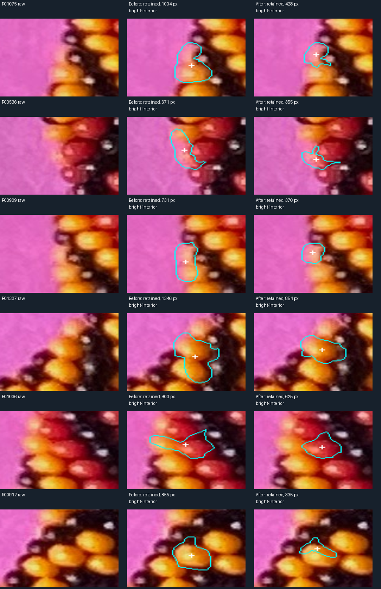
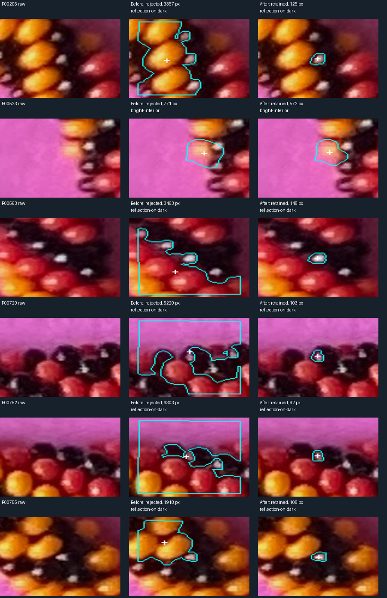
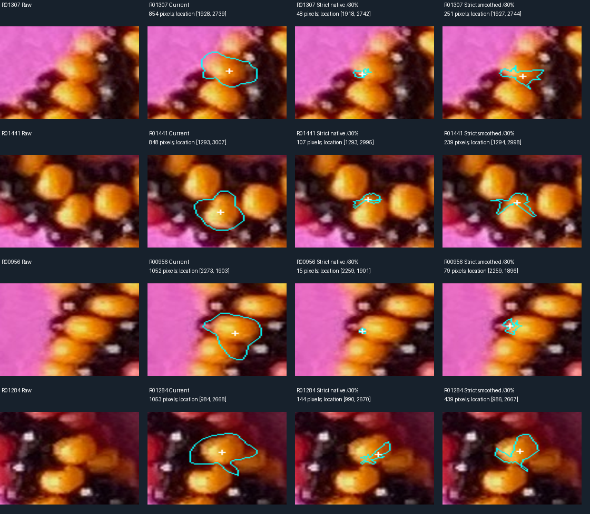
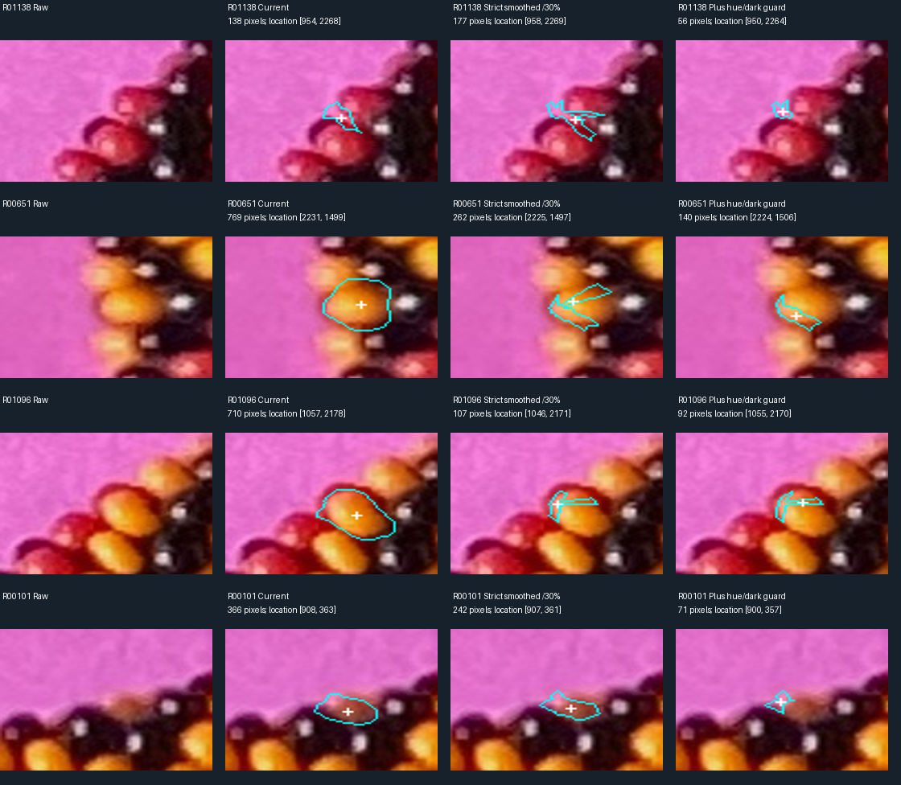

# R260 — review and more sensitive bead locations

The review found correctable neighbor spill and missed reflections. The revised
run retains **1,057 candidate locations**, including all 1,040 previously retained
regions and 17 previously rejected candidates. This is a candidate inventory,
not a verified count of distinct beads.

The user clarified the objective: **good coordinates for each bead, not all pixels
belonging to it**. Compact support is useful when it identifies one bead reliably.
Black growth still stops at its first complete dark perimeter. Neither region
centroid nor the new representative location is called a physical bead center.

[Viewer instructions](bead_detection/README.md) · [coordinates and evidence](review/r260/README.md)

## Review findings and changes

I compared raw pixels with the 12 largest regions, 12 smallest, 15 geographically
distributed samples, and 12 strongly contrasted rejected dark candidates. Then I
inspected all 17 additions and the 12 largest centroid movements. Samples overlap;
this is targeted assistant review, not maker annotation or a random accuracy audit.
The committed comparison sheets preserve both accepted improvements and limitations.

**Neighbor spill:** R01307 includes much of a second yellow bead in the old run;
R01441 has an extension toward a neighbor. R01075, R00909, R00464 and R01036 show
other mixed-support problems. The original sustained brightness-rise threshold
0.045 can miss shallow valleys. I compared 0.045, 0.025 and 0.015 on six raw crops.
The user then explicitly requested increased sensitivity, including elsewhere.
The new default is **0.015 across the entire photograph**, retaining the three-sample
rise check and smoothing to tolerate small noise. This removes the conspicuous
second-body extension in R01307 and substantially improves several other supports.

The lower threshold can stop within a bead's shading, as in R00912 and R00905.
Their coordinates still lie on the intended visible bead in these crops. Losing
body pixels alone is therefore not counted as failure under the clarified goal.
I did not optimize these supports for full-area coverage or claim measured
coordinate accuracy without reference locations.

**Angular smoothing also matters:** an ablation disables only the angular median
and Gaussian filters while preserving radial Value smoothing. In the six diagnostic
examples, individual smoothed radii extend 7.18–20.77 pixels beyond an unsmoothed
ray's stop. These are radial-filter differences, not measured physical boundary
errors; short stops can themselves be caused by internal shading. The lower rise
threshold fixes clear examples without removing angular smoothing globally. Some
neighbor extensions remain, notably R00956 and R01284. Their reviewed coordinates
remain on plausible bead support; these are still provisional locations, not
accepted complete outlines. These default changes were judged by their coordinates. The subsequently
requested strict and color-aware comparisons are documented below.

**Rejected reflections:** 1.15-pixel Gaussian smoothing sometimes bridges a narrow
dark gap from a reflection into a neighboring bright bead or paper. Three remedies
were considered: less smoothing, a closed-perimeter-first classifier, and an adaptive
darkness threshold. The narrow adopted change retries failed dark growth at sigma
0.55, retaining the same V ≤ 0.32 dark-perimeter requirement and contrast ≥0.14.
Already closed dark regions use the original signal. The chosen sigma is saved
per candidate and used again for final validation after overlap competition.
This recovers **13 compact reflection supports**; all prior 123 retained dark
regions remain. Four additional bright-region candidates become retainable after
the global sensitivity change. There is no inferred full black-body boundary.

**Misleading “bright interior” labels:** the smallest reviewed regions are often
reflection patches, including R00362 and R00236, rather than established colored
interiors. A conservative uncertainty rule now tags small supports (<π·8² pixels)
with near-peak mean saturation <0.6 as `bright-patch-ambiguous`, caps confidence at
0.5, and explicitly leaves reflection versus colored interior unresolved. It does
not declare them black or certify a dark perimeter. All remain in the location
inventory. This is an uncertainty heuristic, not a confirmed material classification.

**Coordinates outside a concave support:** R00732's centroid already lay outside
its mask; R01008 does so after increased sensitivity. Every candidate now includes
`location`, the supported interior pixel nearest its region centroid, preferring
at least a two-pixel distance-transform value where available. Exact centroids
are retained separately. R00732 maps centroid (1075.13,1572.09) to location
(1072,1572); R01008 maps (1469.44,2016.94) to (1471,2017). This guarantees a point
inside the detected support, not that the support is necessarily the correct bead.
The viewer displays both fields and offers a **Coordinates** CSV download.

## Results

| Quantity | R259 | R260 |
| --- | ---: | ---: |
| Retained / rejected candidates | 1,040 / 454 | 1,057 / 437 |
| Closed dark-perimeter supports | 123 | 136 |
| Bright-interior proposals | 917 | 751 |
| Explicitly ambiguous bright patches | 0 | 170 |
| Old retained IDs lost | — | 0 |
| Median / largest support area, pixels | 579.5 / 1,501 | 526 / 1,053 |

Maxima (1,498) and candidate groups (1,494) are unchanged. Existing IDs still refer
to the same grouped input maxima in this particular comparison; generation IDs
remain necessary for identifying exact support and statistics. Final generation
is `219a6fe6c2b98f00`. Median common-region centroid movement is 0.52 pixels,
90th percentile 3.00, maximum 12.48. Movement is not coordinate error. The largest
movements were visually reviewed rather than counted automatically as improvements.

## Validation and remaining uncertainty

Nine tests pass, including new shallow-neighbor-valley/noise, narrow-dark-gap and
concave-support location contracts. Synthetic palette, placement, neighbor separation,
multi-peak grouping, no-reflection gaps, circular hue and first-dark-perimeter checks
remain passing. The full photograph passes exact-mask, centroid, overlap, closed
contour, all136 dark-perimeter and all1,057 supported-location checks. A standalone
detector/photo replay produces byte-identical JSON and labels. Real Chromium passes
29 checks, including the new coordinates download. Historical review files and
the frozen R259 artifact directory remain unchanged. The previously documented
legacy review-snapshot hash mismatch was not “fixed” by resetting user reviews.

The 17 additions are visually plausible locations, but no exhaustive recall or
precision estimate follows. R00880/R00931 retain ambiguous compound support;
edge reflections without a closed dark perimeter remain unresolved. Multiple peaks
can still describe one bead, and weak/no-maximum bodies can be missed. Small regions
and uncertain colors remain explicit. Confidence is not a calibrated probability.
Final-runtime detection still uses only the original image; selected review IDs
appear solely in the diagnostic script, never as runtime priors.

## Requested strict-darkening and color-clue comparison

After the review, the user requested a test requiring **strictly increasing
darkness**, followed by enough retreat to remove the darkest part, even when
that dark part belongs to the bead. They also requested attention to changing
hue (red toward yellow or vice versa) and clues about entering black material.
These are saved full-photograph comparisons, separate from the default viewer run.

Each of the 1,494 automatically generated candidate groups is tested, including
all 437 current rejections. The seed is the maximum of the tested Value signal
within its automatically detected initial bright patch; both original and tested
seeds are saved. This uses no historical bead labels, coordinates or geometry.
Results are compared over the same 1,057 currently retained candidate IDs; this
is not a fresh claim that every tested candidate is a bead.

For each seed, 64 rays advance in one-pixel steps with bilinear interpolation.
**Every next Value must be strictly lower. Equality or any rise stops immediately.**
There is no rise tolerance, minimum growth radius, radial smoothing, angular
smoothing or skipping of fluctuations. Two signals are explicitly separated:
native HSV Value, and HSV Value after Gaussian smoothing with sigma 1.15 pixels.
Strictness on the smoothed signal does not imply strictness on the native pixels.
The 42-pixel search limit remains; 75 rays among currently retained candidates
reach that limit in each smoothed variant and have an unobserved continuation.
The native variants have no capped rays in this comparison population.

After stopping at value V_end, retain only samples strictly above
`V_end + f * (V_seed - V_end)`, comparing f=0.14 and f=0.30. Thus the darkest
14% or 30% of the encountered intensity drop is excluded, including on-bead
shadow where present; this is an intensity fraction, not a radial fraction.
Raster pixels between rays must also exceed the angularly interpolated threshold.
Keep only the seed-connected part, with a seed-only fallback when no growth is
possible. No angular smoothing extends growth radii; these diagnostic outlines
can be jagged. Display contours retain the common 0.55-pixel simplification; exact
pixel runs are authoritative. Strictness is checked at sampled ray positions, not asserted
for every continuous direction or every path through the resulting pixel mask.

| Signal / retreat | Median pixels | Seed-only | Median coordinate change from default, px |
| --- | ---: | ---: | ---: |
| native-14 | 70 | 60 | 5.00 |
| native-30 | 46 | 63 | 5.00 |
| native-30-color | 37 | 63 | 5.00 |
| smoothed-14 | 317 | 0 | 1.41 |
| smoothed-30 | 226 | 0 | 2.00 |
| smoothed-30-color | 171 | 0 | 2.24 |

These statistics use the same 1,057 retained IDs. Movement is not accuracy error.
The hue/dark guard triggers on 836 native and 960 smoothed candidates; in the
smoothed run, 12,262 rays stop for hue drift and 10,439 for a dark/low-chroma clue.
These are stopping events, not counts of material boundaries or black beads.

### Hue and possible-black stopping clues

Three options were considered: abrupt hue jumps, accumulated local hue drift,
and Value/chroma loss. The experiment combines persistent hue drift with a
separate dark/low-chroma clue, and adds them to each strict 30% variant. They can
only shorten a strict run, never authorize growth past a brightness rise.

Hue is measured circularly against the first reliable chromatic sample along
that ray. Two consecutive reliable samples at least 20 degrees from that anchor
trigger a stop before the first changed sample. Reliable means saturation >=0.35,
Value >=0.20 and chroma S*V >=0.08 (HSV units 0–1, hue reported in degrees).
This is symmetric for reddish-to-yellowish and yellowish-to-reddish transitions,
and independent of an absolute red/yellow palette. It ignores achromatic hue and
handles red's wraparound. Hue/saturation are obtained by interpolating RGB, with
the same Gaussian sigma in the smoothed experiment; Value remains exactly the
strict test's separately computed signal. Historical white-balanced hue boxes
from R100–R102 are not used; their overlap limitations were re-read first.

A separate clue requires Value <=0.32, a drop >=0.14 from the peak, and chroma
reduced to <=45% of the chromatic anchor. When no reliable chromatic anchor exists,
the darkness/drop test supplies the clue around an achromatic reflection. Again,
two consecutive samples are required. This is **possible dark material or shadow**,
not a black-material classification: a shaded colored bead, gap or cast shadow can
satisfy it. These strict tests deliberately retreat from darkness; they do not
claim the default detector's complete dark-perimeter contract.

Every triggered event records its ray, first/confirmation positions, reason,
anchor HSV, event HSV and hue drift. All thresholds, stop/retreat radii, pixel
runs, closed contours, coordinates and HSV statistics are saved for every candidate.
The color guards use no saved photo labels or color ranges. Synthetic tests cover
both hue directions, palette rotation, wraparound, achromatic hue, single-sample
noise and dark-reflection clues. Generality across real photographs remains untested.

The strict runs remove the reviewed neighbor extensions in R00956 and R01284 and
stay close to the originating bright patch. Native strict growth is often much
more compact than smoothed growth. Small area alone is not a failure under the
coordinate objective, including single-pixel proposals; it does mean the coordinate
can depend strongly on which highlight or texture maximum starts the run.

The color review selected the four largest coordinate shifts with a hue event,
then the four largest remaining shifts with a dark clue. These are diagnostic
outliers, not a representative accuracy sample. R00651 contracts to the lower bright part of its yellow patch, while
R00487 and R01030 move toward a bright rim. R01138
remains an ambiguous edge patch. Color changes can occur *within* one bead; these
examples do not establish uniformly better coordinates. The default viewer therefore
keeps the reviewed R260 detector. Strict/color outputs remain explicit comparison
artifacts, not silently adopted settings or certified physical centers.

Twelve strict/color tests pass in addition to nine detector tests and 29 browser
checks. Six full-photo configurations each assert 95,616 ray contracts (573,696
total), plus per-pixel retreat exclusion. Independent export audits verify all
8,964 saved masks, counts, centroids, supported locations, closed contours and
ordered stop radii. Both color-guarded masks must be subsets of the corresponding
unguarded masks for all candidates. This audit exposed degenerate polygon-fill behavior in two native candidates
with zero-length rays. Direct pointwise interpolation of radial limits fixes it;
a randomized nested-mask regression and the full-photo subset audit check this.

See [strict summary](review/r260/strict-summary.json),
[export validation](review/r260/strict-validation.json) and the
[artifact/reproduction index](review/r260/README.md). Compare the saved coordinates
and remaining missed/duplicate locations next; do not optimize for full bead area.

Stop after this review/fix delivery. Next task: inspect missed and duplicate
**locations**, especially edge reflections and compound supports, before further
changes. Do not pursue pixel-complete outlines, geometry, bead indexing or patterns.
Recommend GPT-6 Astra / High for the remaining visual ambiguity, retaining the
[documented model recommendation](https://developers.openai.com/api/docs/models/gpt-6-astra).
No new active-model status was supplied. No `/new` is needed for viewer inspection;
use `/new` before another substantial algorithm round.
