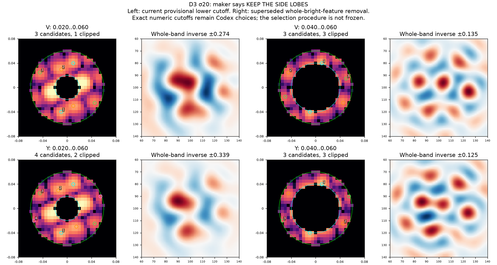
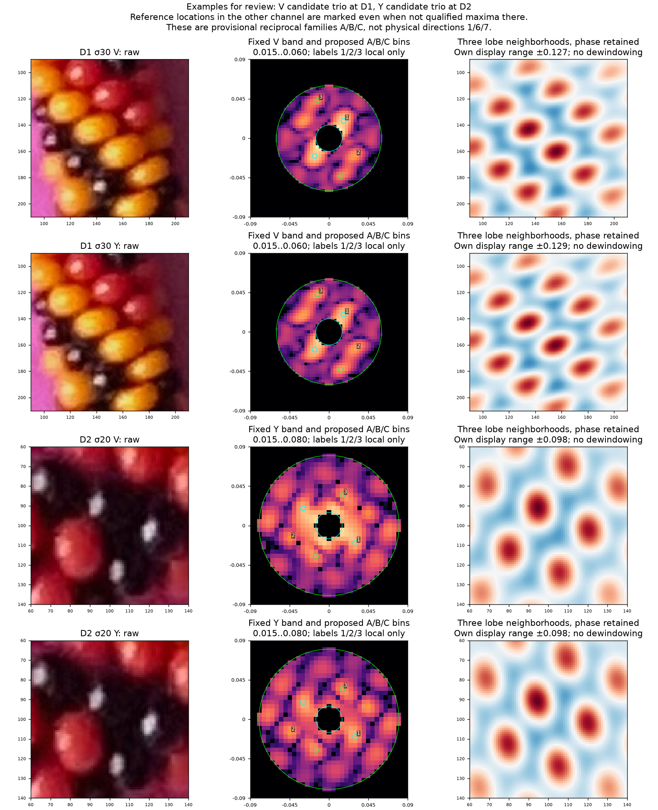

# R248 illustrated development review

The first authorized milestone is complete. Review comes before freezing the
procedure, applying it to the six reserved sites, or comparing helicities.

## Answer preserved: keep the side lobes

Asked with [D3 sigma20 lower sweep](review/r248/D3-s20-lower.png): keep the side
lobes with lower about .015–.020, remove the entire bright feature at about .040,
or mark the window ambiguous? Maker: **“Keep the side lobes.”**

Applied that distinction to the ambiguous small-window choices; numeric settings
remain Codex choices, not maker-supplied settings. The old stronger cuts and their
consequences remain recorded. [Saved answer](review/r248/maker-clarification.json).

## Two small review questions

Latest maker clarification: identify three or four bright noncentral conjugate
pairs; filtering more distant peaks may be unnecessary. Applied without changing
the lower choices: [D1 no-upper view](review/r248/D1-no-upper.png),
[D2](review/r248/D2-no-upper.png), [D3](review/r248/D3-no-upper.png).
Outer filtering is now optional. [Saved words](review/r248/bright-pairs-clarification.json).

1. Does the **left** FFT above retain the side lobes you intended, or should the
   lower boundary be smaller still? Current lower is .020; the
   [full sweep](review/r248/D3-s20-lower.png) includes .015 and .010. A remaining
   bright feature does not by itself count as failed background removal.
2. In the [channel examples](review/r248/channel-examples.png), do the D1 V and
   D2 Y proposed trios (also present without upper filtering) look like the
   directional structure you found interactively?
   The [D1 individual inverses](review/r248/D1-s30-V.png) and
   [D2 individual inverses](review/r248/D2-s20-Y.png) show positive crests over the
   raw crops. Identify a panel if it seems to follow highlights/color patches
   rather than bead rows. Physical1/6/7 labels are deliberately still unresolved.

Answers to these follow-up questions are pending; no agreement or freeze is
inferred from silence. A defensible freeze would preserve both channels, the
side-lobe distinction, brightest3/4 review with optional upper rejection, a
justified small width set, fixed display and exploration budget, cutoff-clipping
flags and abstention when no credible trio emerges.
Sigma30/40 are useful candidates for discussion, but D2 sigma20 is useful too;
the current evidence does not justify a universal winning width.

See [report](FFT_SPECTRUM_LED.md) for the full evidence, qualifications and commands.
