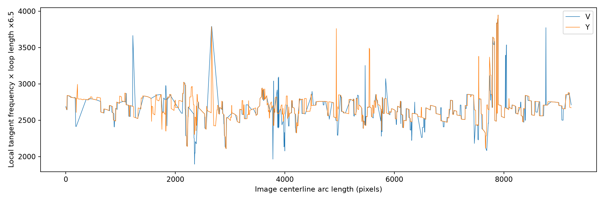
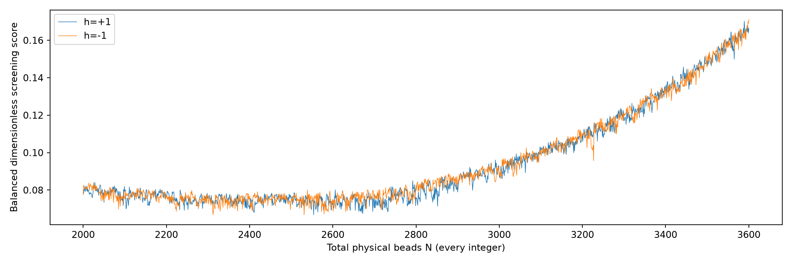
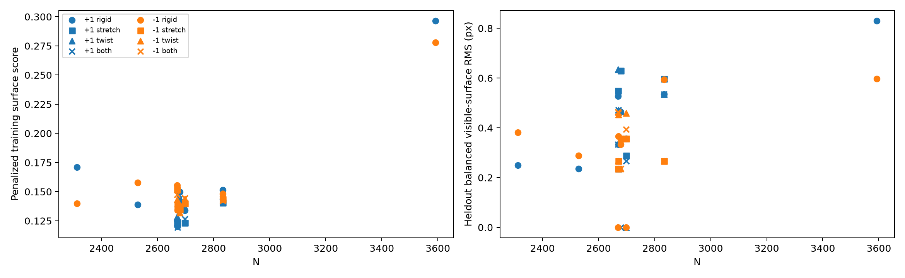
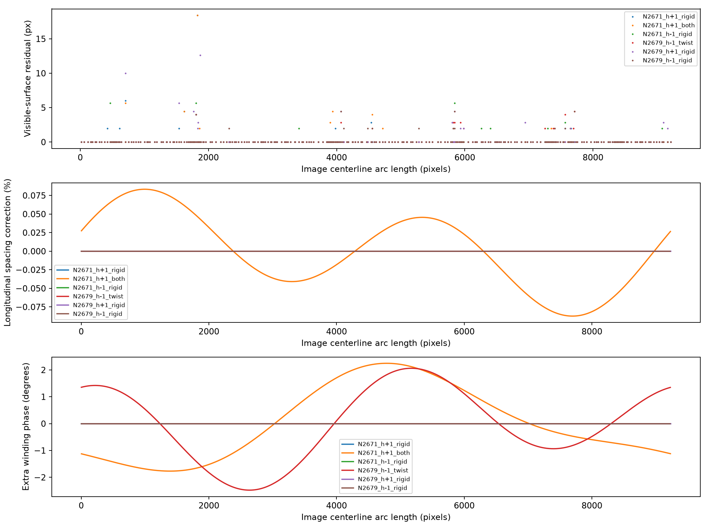
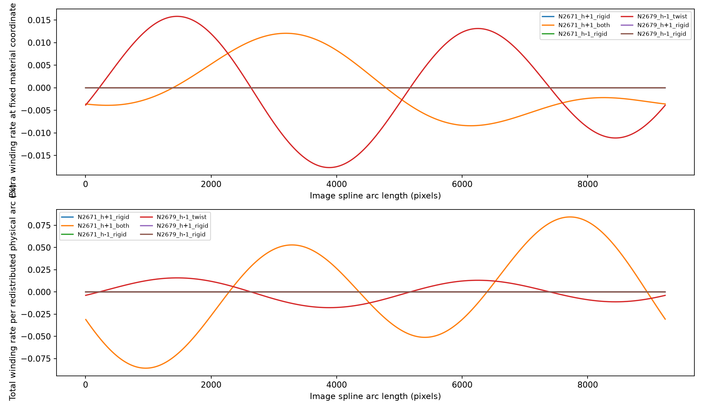
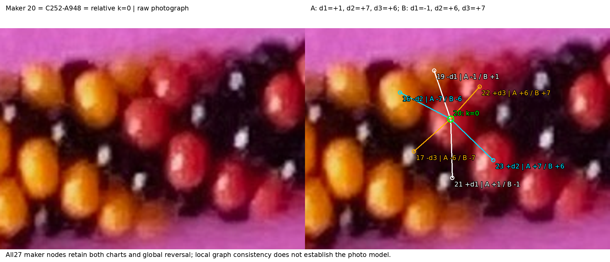

# R253 — initial global bead geometry and count comparison

**The best-supported working total is approximately 2,670–2,700 physical beads,
not an established exact integer.** The independent direction-1 FFT integral
suggests about **2,675–2,679**; the leading tested photographic fit is
**N=2,671, T=411, h=+1**. N=2,670, 2,679 and 2,698 remain useful neighboring
hypotheses. The conditional systematic uncertainty is of order **100 beads or
more**, not a ±1-bead confidence interval. Lower-count geometric alternatives
and the old2,833 proposal are preserved, not proven impossible.

The leading models predict approximately **1,650 meaningfully visible surfaces**
and **1,500 geometrically distinguishable bodies** under explicit area criteria.
The latter is a geometry-based proxy including possible black beads, not1,500
verified photographic identities. The unchanged310 red/yellow observations remain
the reviewed colored basis; actual all-color identifiability has not been counted.

h=+1 has the lower best training objective (0.1194 versus0.1319,9.5% lower),
but **held-out evidence does not establish a unique helicity**. The chosen +1
corrected fit improves its own held-out full-patch score from0.2016 to0.1702,
while the −1 rigid fit scores0.1741. The advantage is modest and changes with
model/metric. The earlier FFT sign evidence still favors +1 independently of this
assignment objective. No exact N, closed photographed index sequence, or repeating
color pattern is recovered.

This completes the user-authorized **bounded initial end-to-end comparison**:
3,202 count/hand hypotheses,51,232 coarse registrations,44 refined rigid models
plus two high-density rigid controls,46 surface-polished/audited candidates,
all310 observations evaluated, and six complete full-loop prediction sets.
It is not a completed unrestricted camera/centerline/surface inverse solution.

[All evidence and reproduction](review/r253/INDEX.md) ·
[46-model comparison CSV](review/r253/model-comparison.csv) ·
[Detailed metrics and worst residuals](review/r253/models.json) ·
[Color/sector metrics](review/r253/color-sector-metrics.csv) ·
[Complete correspondence alternatives](review/r253/cross-model-identities.json).

## Evidence, geometry and closure

Inputs are the unchanged R252 accepted.csv and complete inventory, small existing
positive R201 patch aliases, R250 measured FFT frequencies/angles, R175 approximate
periodic centerline, original2540×3182 JPEG, and literal beads.pov geometry.
[Hashes and verification](review/r253/verification.json) and
[unchanged-source checks](review/r253/source-integrity.json) preserve provenance.
This is assisted reconstruction on a supplied diagnostic spline/inventory; it is
not an image-independent automatic detector. No palette sequence enters fitting.

The source's literal radians expression `4*.96*sin(180/6.5)` gives radius
2.11091575, tube-center radius4, roundedness0.8, hole/radius0.14 and axial
half-height0.7R. Its turn pitch is `ROW=.65*2R*1.05`. Bead axes follow the
noncircular planar spline tangent. For each integer N, this bounded source-compatible
search uses **T=floor(N/6.5+0.5)** and exact ratio **q=N/T**. All N physical beads
remain present as occluders and in modulo-N indices. No hidden slots are compressed.

The spline projects to length9235.59px. Inverse projection gives planar world
arclength; scale makes its length exactlyROW×T. At the leading corrected fit,
scale7.82550px/unit implies approximately33.04px unoccluded bead diameter,
95.64px maximal tube-envelope diameter, and22.55px projected scale×ROW turn pitch
before direction-dependent projection. These are **model dimensions**, not newly
measured photo silhouettes. Gross necklace dimensions and local section placement
come from the existing noncircular photo spline. There is no supplied millimeter
calibration. The older27.19px apparent diameter is an occluded/image-derived
reference, not an independently calibrated3D diameter to impose simultaneously.

First fit global phase, string-origin gauge, image translation(±15px), camera
elevation70–89.9° and roll(±180°). Orthographic inverse projection preserves the
same planar seed projection. Camera tilt is a nuisance fit, not measured elevation.
Centerline shape and bead shape remain fixed; no freely varying local centers.
Nearest-T rounding is a source-compatible restriction: **independent T±1 trials
at fixed N and a fitted pinhole camera are not included**. This limits exact-N claims.

## Independent FFT count integral

Use R250's measured near-zero angle range3(−7.5° to19.5°), retaining its existing
selection/quality rules. Average multiple qualified peaks within each window by
the saved weights, then periodically interpolate gaps and integrate

`T_FFT = ∮ f(s) cos(alpha(s)) ds`,  `N_FFT ≈ 6.5 T_FFT`.

This projects the reciprocal vector onto the local centerline; frequency radius
alone is not substituted for that component. Overlapping windows are not treated
as independent replicates. V gives411.50turns/N2674.75; Y gives412.19turns/N2679.22.
V has1350/2000 observed windows, largest interpolation gap212.4px; Y has1926/2000,
maximum41.6px. Restricting angles to6°±8° gives2664.94(V),2679.00(Y).
The simple0.045×9235.59×6.5 estimate would give2701.41.

The32 spatial blocks have local-equivalent count10–90% ranges2552–2768(V)
and2591–2760(Y); these are nonuniformity diagnostics, not uncertainty intervals
for N. A coherent half-bin1/(2×301) cycles/pixel shift changes the integral by
roughly100beads. That is a **systematic sensitivity**, not an inferred random
standard error; peak/family bias, tangent error and gaps can add uncertainty.
The V/Y agreement is not independent replication. No FFT penalty was used to
force the photographic optimizer toward this answer.

[Integral details](review/r253/fft-count.json), [per-station components](review/r253/fft-profile.csv).

## Search, held-out design and loss

Four methods were considered before implementation: FFT integration, sparse
normalized projected support, exact rounded-surface ownership, and regularized
periodic deformation. Coarse search tests every N2000–3600 for both hands, with
eight minor phases and two origin gauges each. Refine a common union of separated
minima from both hands, historical counts and2679, with equal three-camera starts.
Refine neighboring integers±3 around the initial rigid leaders, equal two-start
budgets. Preserve all minima, including2312/2529 and3592 density controls.

The [frozen split](review/r253/split.csv) fits254 points in24 sectors and withholds
56 in entire sectors4,8,12,16,20,24,28,32. Every occupied sector receives equal
weight. An additional33-point held-out core lies at least60 image-arc pixels from
training-sector boundaries. No held-out metric chooses parameters or nominees.
Historical spline/FFT/inventory work saw the whole photo, so this is **not wholly
independent prospective validation**. Patch samples from held-out bodies are
excluded from fitting together with their representative.

Screening uses12 nearby candidate bodies with radial·eye>−0.35 and an ellipsoid
support approximation(axial/radial ratio0.7). The one-to-one assignment minimizes
`mean_sector[max(sqrt(Q)-.85,0)^2+.15Q]`, where Q is squared projected distance
normalized by bead scale and ellipsoidal support. This normalization removes the
raw nearest-distance reward for shrinking beads by increasing N. Ellipsoid support
is only a screening approximation; it fills the hole and approximates side exposure.

Next, exact rounded-annulus first-hit rays, with **all** beads as occluders, rerank
candidate ownership. Optimize phase/origin/dx/dy through17 deterministic trials
per model(two coordinate sweeps), using up to nine spread real positive pixels
per patch. Minimize equal-sector `(1−owned fraction)+.15Q` plus regularization.
All available original small-patch pixels are retained for the final audit.
Train assignments reserve identities before holdout assignment; neither set can
reuse a modeled bead within the combined310-assignment ledger. Exact ray owners
can re-enter the candidate set even if the approximate exposure gate excluded them.

This loss still contains a weak **interior-to-physical-center** preference. It is
not a calibrated likelihood of where an observed interior should lie. A packed
wrong lattice can cover many interiors. The score is useful comparative evidence,
not an exact-count proof or posterior probability. The3592 control demonstrates
why center distances alone are inadequate: its9.70px center RMS is similar to
the leading fit, but its full-patch training score0.2831 is much worse.

## Main photographic comparison

Optimization score uses at most nine patch pixels plus regularization; the next
column audits **all available positive pixels**, equal-sector, without adding the
regularization penalty. Center/surface RMS columns are unweighted all310-point
summaries. Held-out patch support is the mean over56 held-out bodies. Full balanced
and unweighted metrics, all46 candidates, and every worst point are retained.

| Model | Optimization score | Full-patch train / heldout score | Center RMS, all (px) | Surface RMS, all (px) | Heldout patch support | Conditional unique /310 |
|---|---:|---:|---:|---:|---:|---:|
| N2671_h+1_rigid | 0.1204 | 0.1237 / 0.2016 | 9.70 | 1.20 | 86.9% | 244 |
| N2671_h+1_both | 0.1194 | 0.1266 / 0.1702 | 9.64 | 1.23 | 89.2% | 242 |
| N2671_h-1_rigid | 0.1343 | 0.1412 / 0.1741 | 9.65 | 0.63 | 89.0% | 238 |
| N2679_h-1_twist | 0.1319 | 0.1366 / 0.1864 | 9.84 | 0.59 | 88.6% | 237 |
| N2679_h+1_rigid | 0.1499 | 0.1552 / 0.1897 | 10.14 | 1.16 | 89.3% | 233 |
| N2679_h-1_rigid | 0.1377 | 0.1454 / 0.1782 | 9.88 | 0.61 | 89.1% | 235 |
| N2698_h+1_stretch | 0.1233 | 0.1284 / 0.2122 | 9.73 | 0.89 | 87.1% | 235 |
| N2698_h-1_rigid | 0.1394 | 0.1442 / 0.2170 | 9.97 | 0.97 | 85.9% | 221 |
| N2833_h+1_rigid | 0.1514 | 0.1574 / 0.1983 | 9.73 | 1.01 | 88.2% | 229 |
| N2833_h-1_rigid | 0.1480 | 0.1528 / 0.2380 | 9.82 | 1.03 | 85.0% | 222 |
| N2529_h+1_rigid | 0.1388 | 0.1448 / 0.1796 | 10.40 | 0.59 | 90.1% | 234 |
| N2312_h-1_rigid | 0.1398 | 0.1463 / 0.2281 | 11.28 | 1.91 | 86.1% | 230 |
| N3592_h-1_rigid | 0.2781 | 0.2831 / 0.2565 | 9.70 | 2.48 | 83.2% | 167 |

The +1 best full-patch held-out score0.1702 versus −1 corrected nominee0.1864 is
8.7% lower. Against the −1 rigid0.1741 it is only2.3% lower. On the33-point
held-out core the corrected scores are0.1510 versus0.1580; this is not a significance
test. Rigid +1 actually loses to rigid −1 on the full56-point held-out comparison.
These reversals prevent a strong new helicity conclusion from this experiment.

For N2671,+1,both: point-to-**projected physical-center** distances have mean8.715px,
SSE28781.77px²,RMS9.636px,median8.363px,p9014.632px,max18.956px.
Distance to the **assigned first-visible surface** has mean0.174px,SSE472px²,
RMS1.234px,median0,p900,max18.439px. Its ownership success is298/310(96.13%);
12representative conflicts remain. Heldout ownership is55/56(98.21%), but average
full-patch support is89.24%, showing why a single interior hit is weak evidence.
Red center/surface RMS9.49/1.68px; yellow9.77/0.53px. All32 sector breakdowns,
mean vector mismatch and worst locations are in linked numerical files.

Successful exact membership receives zero surface distance. A zero is **not**
zero center error. Failed membership distances are sampled at2px intervals in an
80×80px square around the observation, with other beads as occluders; thin slivers
can be missed. No sampled owner gives a flagged56.57px censored residual, not an
exact distance. This bound never silently disappears from scoring. Unknown ray
pairs cannot verify ownership. The worst leading-model surface residual is
C252-H4-B09 at(1455,3008),red,sector7,18.44px; the bottom crop preserves this failure.

## Stretch and winding are separate

Longitudinal redistribution changes the station fraction by a periodic integral
of two harmonics; its derivative has exactly zero integral and is bounded in
absolute value by2%. Winding adds a separate periodic angle at fixed material
index, bounded by12°. Neither changes N or integral T. Four coefficients of each
kind are allowed, not one parameter per bead or section. Gaussian-style engineering
regularizers use residuals `.15*[dx/30,dy/30,stretch_coeff/.015,twist_coeff/(20deg)]`.
No calibrated physical prior or AIC interpretation is claimed; heldout comparisons
supply the practical flexibility check. The stages have comparable budgets for
both helicities, but local optimization is not guaranteed globally optimal.

The leading corrected +1 fit needs only maximum/RMS stretch **0.0873%/0.0496%**,
maximum longitudinal displacement0.91px, and maximum/RMS added winding phase
**2.247°/1.326°**. Extra winding-rate magnitude at fixed material coordinate is
at most0.0121% of nominal; longitudinal redistribution also changes winding per
physical arclength, and that distinct contribution is plotted separately.
Its nine-pixel training objective improves only0.1204→0.1194, while the full-patch
training audit slightly worsens0.1237→0.1266; holdout improves0.2016→0.1702.
This is evidence to retain a small-correction alternative, **not proof of physical
stretch or a requirement for1–2% variation**. No-deformation models remain viable.

## Visibility and identifiability estimates

Trace the complete projected bounding regions on a2px image grid; every physical
bead participates in occlusion. For each body, separately ray-trace its own
unobstructed rounded annulus on the same lattice to estimate projected area.
**Meaningfully visible** means visible area≥10% of that unobstructed area **and**
≥24 native pixels². **Geometrically distinguishable proxy** means≥25% **and**
≥80pixels². These operational thresholds are declared assumptions;25% is not a
replacement for the R235 eligibility rule. Minor-outward-point exposure is never
the definition of whole-body visibility in this experiment.

Six leading/FFT-neighborhood models give1648–1652 meaningful surfaces and1494–1532
stricter proxies at2px sampling. Repeating two contrasting leaders at1px gives
1648(+1 corrected) and1653(−1 rigid); stricter counts1533 and1494. Unfinished rays
widen the1px meaningful counts to1648–1650 and1653–1654, respectively. Pixel-grid
changes are small compared with model/criterion uncertainty. Reducing/raising the
fraction threshold to5%/20% gives approximately1677–1727/1541–1574 with the24px²
floor;40% gives1281–1354. These are sensitivity ranges, not confidence limits.

Thus report **about1,650 visible, about1,500 potentially distinguishable** for the
near2670 family. Many may be black; no color is assigned from geometry. Actual
visibility/recognizability depends on reflection, contrast, blur and correct model
alignment. Only310 reviewed colored observations are certified by this inventory;
no complete black-photograph identification count is inferred.

## Index origin, local charts and unresolved assignments

Choose **C252-A948**, red interior(1346,273), preserved historicalC=maker20,
as intended relative k=0. It has a complete maker neighbor star. k increases in
the clockwise image-spline progression, down the right side from the seed seam;
h sets the signed minor-circle progression. The global string-direction reversal
remains an equivalent relabeling, not a second photographic observation.

Use the maker chart d1=(1,0),d2=(0,1),d3=(−1,1), with maker20 translated to(0,0).
FamilyA maps `k=u+7v` and familyB `k=−u+6v`; hence d2=d1+d3 gives the requested
A(+1,+7,+6) and B(−1,+6,+7). UnderA the±1 neighbors are21/19,±6 are22/17,
±7 are23/16. UnderB the±1 neighbors are19/21,±6 are23/16,±7 are22/17.
All27 maker nodes,54 links and prior28 independent consistent cycles remain in
[the local chart](review/r253/maker-local-chart.csv). No nearest-photo-point rule
chooses +1. Original maker IDs and consolidated R252 IDs remain separate.

The forward model reconciles +1 with A and −1 with B at this top section:
leading rigid models own23/27(A,+1) and24/27(B,−1) supplied maker points.
The corrected +1 owns22/27; the −1 twist training nominee owns only11/27.
The latter also fails the exact seed representative ownership test: its chosen
k=0 is **an unresolved candidate origin**, not a confirmed seed correspondence.
All such failures are preserved. The local reverse-chart tests in the ledger
hold model traversal fixed; their poorer scores do not break the true global
reversal symmetry, which also reverses model index traversal.

Each complete prediction CSV includes all modulo-N k, reverse_k, both chart
representatives, projected physical center, minor-outward reference, visible
centroid, occluded/visible area fractions, exposure thresholds and any proposed
observation/color association. The global integer chart representatives use a
canonical cut: A has u=k mod7,v=floor(k/7), with equivalent lift(u+7,v−1);
B has v=floor(k/6),u=6v−k, with equivalent lift(u+6,v+1). Use these transition
rules when walking across row cuts; these are covering-chart coordinates, not
measured photo rows. The maker chart is the meaningful local illustrated chart.

Of310 leading +1 assignments,242 meet the **within-model** uniqueness rule:
exact representative ownership,≥95% saved-patch support, and≥0.15 margin over
the next candidate in normalized ownership-plus-center cost. The remaining68
stay unresolved. Single-point records have weaker support than real patches.
**None of the242 is certified as a unique global photo index across models.**
Every body retains up to four alternative correspondences per model; the full
cross-model ledger retains46 candidates for every observation. Unsupported
assignments are proposals, not discoveries. Predicted colors remain`unknown`;
conditional observed colors apply only to supported associations.

## Camera, centerline and remaining scientific work

The source EXIF identifies an iPhone11Pro4.25mm lens,35mm-equivalent51mm and
digital zoom1.96875. Unknown crop/distance prevents calibrated intrinsics.
A pinhole sensitivity test uses nominal focal4799px and twice that, **first
inverse-projecting the same spline to the plane**, so the projected centerline
remains unchanged to numerical precision. Redistributing stations by that
physical arclength changes leading-model same-index centers by26–97pxRMS at the
nominal focal,13–49px at twice it. These are unrefitted sensitivity displacements,
not measured residuals or a successful perspective fit. They demonstrate why
small orthographic residuals do not yet certify physical indices.

[Camera sensitivity](review/r253/perspective-sensitivity.json) and
[sector mean residual vectors](review/r253/sector-vector-mismatch.csv) quantify
issues before any centerline correction. Interior-to-center displacement, camera
and correspondence errors confound those vectors. No automatic contour or spline
correction is made, and no real scallops are smoothed away.

**Next bounded scientific step:** fit a constrained pinhole/near-orthographic
camera family jointly with the existing maker neighbor graph and several
well-separated local stars, retaining both hands and counts near2670/2698 plus
competing basins. Require seed ownership and known distinct-neighbor constraints,
then compare heldout patch support and identity stability. Only afterward consider
a low-dimensional centerline correction if coherent residual evidence remains.
Do not begin repeat recovery or claim black detections from these predictions.
Recommend GPT-6 Astra / High, **/new before that next implementation**; this is a
future-work recommendation, not a new assertion about active model/session status.
Stop here after scoped commit/push and exact remote/clean verification.
