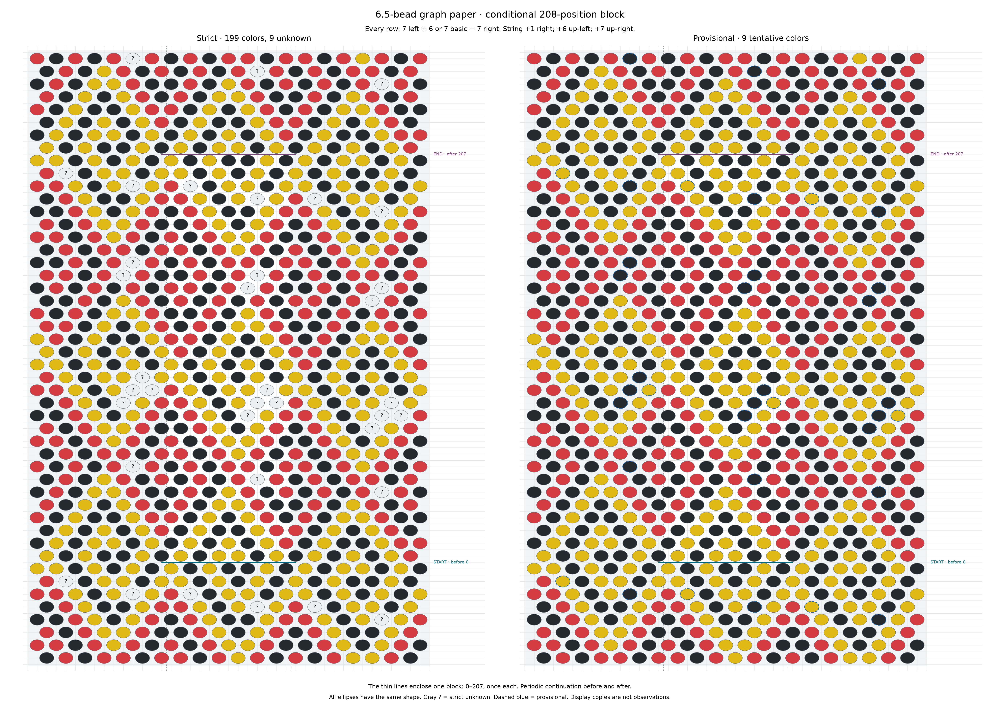

# Graph-paper presentation for a 6.5-beads-per-turn bracelet

This is a general way to draw any indexed repeating color sequence for the
6.5-bead crochet convention. It separates string order, display geometry, repeat
boundaries and photographic evidence. A mathematically consistent drawing does
not establish a physical bead count or prove an inferred sequence.

The [R344 interactive example](r344/review/index.html) and
[printable example](r344/graph-paper.pdf) use the conditional 208-bead sequence.
The construction itself does not require that length.

## Geometry and directions

Use integer lattice coordinates `(a,b)` and the A convention:

```text
k = 7a + 6b
x = a - b
y = a + b

a = (x+y)/2
b = (y-x)/2
k = (x+13y)/2
```

Valid display sites have the same parity of `x` and `y`. Draw increasing `x`
to the right and increasing `y` **upward**. A screen renderer must invert its
vertical pixel coordinate; it must not reverse the string indices to compensate.

| Primitive step in `(a,b)` | Display step `(Δx,Δy)` | Direction | `Δk` |
|---|---|---|---:|
| `(1,-1)` | `(2,0)` | right | +1 |
| `(0,1)` | `(-1,1)` | up-left | +6 |
| `(1,0)` | `(1,1)` | up-right | +7 |

One bead pitch horizontally is **two x units**. Adjacent rows use opposite
x parity, giving their half-bead offset. Positive screen scales can stretch the
horizontal and vertical directions for attractive packing; the integer steps
and their signs must remain unchanged.

## The strip and alternating rows

Choose any integer `x0` and keep one representative in:

```text
x0 <= x < x0+13
```

Each row contains either six or seven valid lattice sites; consecutive rows
alternate. The width13 is measured in half-bead pitches, hence6.5 bead pitches
per minor-axis revolution. Two rows contain13 beads. For `x0=-1`, even rows
contain six sites and odd rows seven:

```text
y=0: x =  0, 2, 4, 6, 8,10       k = 0..5
y=1: x = -1, 1, 3, 5, 7, 9,11    k = 6..12
y=2: x =  0, 2, 4, 6, 8,10       k = 13..18
```

The exact representative for **any integer string index**, including negative
continuation indices, is:

```python
x = x0 + ((2*k - x0) % 13)
y = (2*k - x) // 13
```

There is exactly one possible x residue modulo13, and therefore one representative
per index. `x+y` is automatically even. Avoid truncating division for negative
indices; the numerator is exactly divisible by13, so integer division is exact.

Horizontal order within every row is increasing string order. At the right end
of a row, the next index continues at the left end of the next row. This wrap is
an identification of the display strip, not an additional physical bead or link.

## Lateral identification and diagonal continuation

The zero-index lattice translation is:

```text
(Δa,Δb) = (6,-7)
7*6 + 6*(-7) = 0
(Δx,Δy) = (13,-1)
```

Translating a left-side representative rightward by13 x units moves its
same-index copy **one row down**. Conversely, normalizing a right-side copy
leftward moves it one row up. This is not a same-height identification.

For a primitive neighbor, first apply its actual unwrapped display step. If it
leaves the strip, add or subtract `(13,-1)` until its x coordinate lies in the
canonical interval. Its k value is unchanged by this normalization. Never draw
a spurious diagonal through the center of the strip merely to connect the two
canonical representatives.

For example, with `x0=-1`, k5 is at `(10,0)`. Its +1 neighbor is geometrically at
`(12,0)`, which identifies with canonical `(-1,1)`, k6. From k6, the up-left +6
neighbor lies at `(-2,2)`, identifying with `(11,1)`, k12. These are real primitive
steps in the unwrapped lattice despite their unusual canonical positions.

## Seven extra beads on each side of every row

The standard presentation extends **every horizontal row by exactly seven beads
to the left and seven to the right**. Each complete displayed row therefore has
20 or21 symbols. Keep the basic six/seven-bead strip visually identifiable with
fine dotted lateral seams. These seams differ from the START/END repeat cuts.

Generate these extensions by actual horizontal index steps, not by pasting one
neighboring strip at either side. For a row y, let:

```python
first_x = x0 + ((y-x0) % 2)
basic_x = list(range(first_x, x0+13, 2))
n = len(basic_x)                         # 6 or 7
for j in range(-7, n+7):                # seven left, n basic, seven right
    x = first_x + 2*j
    k = (x + 13*y) // 2
    position = (k-S) % L
    color = sequence[position]
```

If the first basic index is K, the row reads `K-7..K-1`, `K..K+n-1`,
`K+n..K+n+6`. Every move right is +1, including moves across either dotted seam.
For any extended site, recover its canonical representative `(cx,cy)` using the
formula above. Its exact seam multiplier is:

```text
m = (x-cx)/13
(x,y) = (cx,cy) + m*(13,-1)
```

Thus every copy keeps **exactly the same k, pattern position and color** as its
canonical original. This is the same string position shown on another side of
the minor circumference, not a newly inferred physical bead. Its canonical
representative can lie outside the currently displayed vertical range; its
identity is still given by the formula.

For example, row y=1 with `x0=-1` has:

| Left seven | Basic seven | Right seven |
|---|---|---|
| k=−1..5 | k=6..12 | k=13..19 |
| x=−15..−3, step2 | x=−1..11, step2 | x=13..25, step2 |

The extreme left site `(−15,1)`, k=−1, is canonical `(11,−1)` minus **two**
seam translations. The extreme right site `(25,1)`, k=19, is canonical `(−1,3)`
plus **two** translations. One adjacent whole strip supplies only six symbols
on these seven-bead rows and misses the required seventh extension. Normalize
as many times as necessary; do not stop after one seam.

These extended rows reveal diagonal color structures wrapping from the front
to the back of the minor circumference. Highlighting any copy should highlight
all copies of its pattern position. Keep extensions outside the selected
fundamental interval even when their k falls inside that interval. They are
never additional observations. A diagnostic toggle may hide all side extensions,
but the normal view and printable illustration include them on every row.

## Repeat membership and its boundaries

Let a chosen block have positive integer length L and start at string index S:

```text
S <= k < S+L
pattern_position = (k-S) mod L
color(k) = sequence[pattern_position]
```

Every chosen bead appears **once**: its canonical representative with k in that
interval. The lateral strip sides are not the beginning and end of the repeat.
The repeat can start or finish partway through a row, and its two cuts need not
form a rectangle.

Mark a thin START cut just before S and a thin, visually distinct END cut just
before S+L (after the last included bead). Keep every ellipse clear of the cuts.
The algebraic line `x+13y=2S-1` separates index centers, but can pass through the
drawn body of an ellipse. A stepped cut through the gaps is a clearer drawing:

1. Find `(xT,yT)`, the canonical representative of the first excluded index T.
2. If T is the first bead of its row, draw the cut horizontally at `yT-1/2`.
3. Otherwise put a vertical step at `xT-1`, halfway between adjacent bead centers.
   To its left, draw the horizontal cut at `yT+1/2`; to its right, at `yT-1/2`.

Indices less than T lie below this stepped profile; indices at least T lie above
it. Apply the same rule at T=S and T=S+L. Shade only their intervening central
region as the selected block. Lateral copies remain outside that region even
when their k is in the chosen interval.

For a short block whose cuts share a row, the resulting region can be a partial
row. Derive membership from the actual index interval, never from an assumed
number of full rows.

## Periodic continuation and general repeat translations

Draw extra rows before and after the chosen interval. These are obtained by
continuing integer k and looking up `(k-S) mod L`, including negative k. Use
enough context for the structures to become visible; short patterns may require
many repeats. Context must retain the same underlying sequence identity and
color, including unknown entries. Repeating a drawing does not add photographic
support. A vertical/periodic copy has k increased by L and retains the same
pattern-position identity. A lateral zero-index copy retains exactly the same k
as well as the same pattern position. Keep these two meanings of “copy” distinct.

For any L, a translation preserving pattern color has:

```text
Δx = 2L - 13t
Δy = t
Δk = (Δx + 13Δy)/2 = L
```

Choose integer t near `2L/13` for a compact translation. The parity condition is
automatic. Applying it may leave the canonical strip; normalize with `(13,-1)`.
Do not force an arbitrary L into a rectangular vertical period.

A purely vertical repeat requires `13` to divide L, giving `Δy=2L/13`. Even then,
a rectangle covering one whole repeat requires the chosen S to start a full
canonical row. Otherwise its two boundaries retain partial-row steps.

## Bead appearance and uncertainty

Use consistent, slightly elliptical beads across red, yellow and black. Keep
the size and shape independent of pigment, source authority and support count.
For example, screen spacing may be24pixels per x unit and32pixels per row,
with ellipse radii18pixels horizontally and14pixels vertically. The horizontal
bead pitch is then48pixels; the ellipses have a modest1.29 aspect ratio. Half-row
and half-pitch gap cuts avoid the bodies.

Use a neutral fill and `?` for unresolved strict entries. A provisional complete
pattern is a separate view; inferred entries need a visible distinction such as a
thin dashed border. Do not fill strict unknowns for aesthetic continuity. Keep
prediction confidence and photographic pigment authority separate.

Indices, lattice coordinates, graph-paper lines and primitive diagonal guides
may be optional. The default color arrangement should communicate the structure
without those annotations. Clicking any display copy should select its underlying
pattern position in the string-order sequence and link to actual photographed
observations. A display copy must never be counted as a new observation.

## The conditional 208-bead example

With `x0=-1` and S=0, the rectangle:

```text
-1 <= x < 12
 0 <= y < 32
```

contains exactly sixteen six/seven-row pairs: `16*(6+7)=208` distinct indices,
0–207. The START and END cuts are y=-1/2 and y=31+1/2. The period translation
`(a,b)->(a+16,b+16)` becomes `(x,y)->(x,y+32)` and adds208 to k.

The current conditional photographic H=(214,201) maps to `(13,415)`:

```text
(13,415) = 13*(0,32) + (13,-1)
```

This is consistent with thirteen displayed repeats plus the zero-index seam
identification. It is an algebraic consistency check, not independent evidence
for the physical total2704 or the actual shortest stringing repeat.

R344 displays eight continuation rows at each end (52 canonical indices before
and52 after), with seven side beads on both sides of **all48 rows**. Each strict
or provisional panel has984 symbols:312 basic-strip symbols plus672 side
symbols. These represent326 distinct unwrapped k values and208 pattern
positions; only208 symbols belong to the selected central block. Repeated
symbols are not repeated photographic measurements. The example retains199
strict colors, two conflicting positions and seven insufficient positions.



White denotes the selected central occurrence; gray denotes side or vertical
continuation. Thin teal/purple lines mark START/END; dotted vertical lines mark
the lateral seams. Both panels use the same sequence and differ only at the
nine explicitly unresolved entries. The [two-page A4 PDF](r344/graph-paper.pdf)
places one panel per page; [the PNG](r344/graph-paper.png) is4962×3507pixels at
300dpi. Clean and numbered vector/bitmap versions are provided.

## Reusable implementation and verification

[graph_paper.py](r344/graph_paper.py) provides `representative`, `boundary`,
`layout(length,start,x0,...,side_beads=7)` and the sequence-only entry point
`pattern_layout(strict_colors, provisional_colors=None, **geometry)`. It accepts
R/Y/B/? code strings or lists of full color names. No photographic reconstruction
is required. For example, this arbitrary17-position toy sequence is sufficient:

```python
from photo2.r344.graph_paper import pattern_layout
paper = pattern_layout('BRYBRYBRYBRYBRYB?', 'BRYBRYBRYBRYBRYBY',
                       start=5, x0=-1, side_beads=7)
```

Every point contains x/y, a/b, unwrapped k, pattern position, canonical identity,
row slot, left/basic/right membership and strict/provisional colors. The
renderer receives color from this sequence-position table, never from visual
placement. Arbitrary lengths use index-derived partial-row boundaries and enough
continuation rows to display multiple copies when short.

[verify_graph_paper.py](r344/verify_graph_paper.py) independently enumerates
possible representatives and checks directions, repeated seam equations, exact
seven-per-side rows, horizontal ±1 progression, unique chosen membership, copy
colors and ellipse clearance.

The current checks cover192 combinations of twelve lengths (including1,17,207,
208,209,299 and338), four origins and four strip placements. They verify partial
rows and continuation rather than assuming the208 example is universal. There
are77,408 boundary/ellipse clearance checks and174,922 horizontal index-step
checks across these cases and the current example. The toy17-position sequence
also exercises the color API independently of photographic data.
