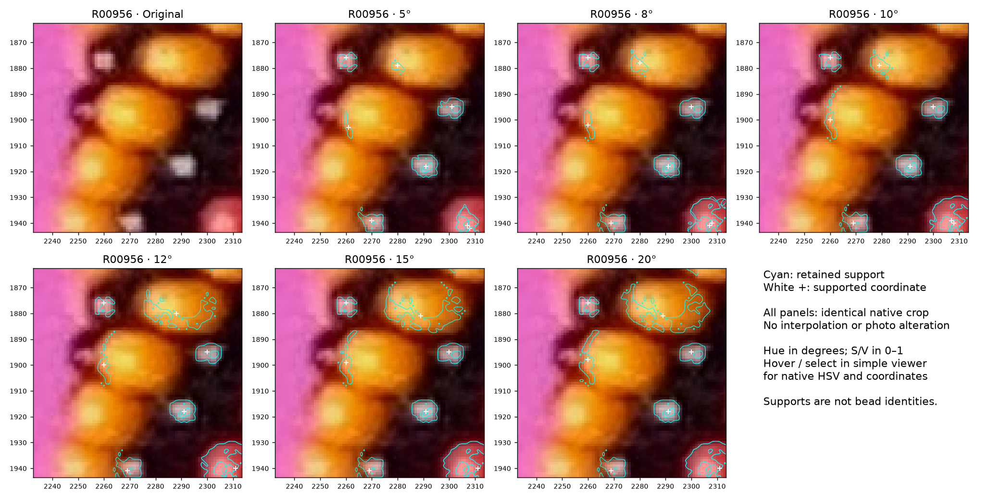

# R264 review question

## Q264.1 — is the middle yellow bead's rim coordinate usable?

P091744 is at (2260,1902) for 8°, on the left rim of the middle yellow body.
The lower yellow near (2255,1919) has no supported coordinate in any setting.
Should the on-body rim coordinate count as detected but weak, or as an unusable
location? This asks about the usefulness of the supplied coordinate, not for new
bead marking or a full outline.

**Status:** optional question sent during R264; no maker answer received. Current
review counts P091744 as detected but weak. Treating it as unusable would add one
miss to every hue setting; it would not change their relative ranking. The saved
review landmarks and identity judgments are assistant assessments, not maker facts.
