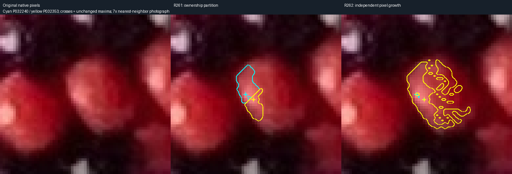

# R262 — remove the watershed ownership veto

The user narrowed this step to removing watershed, leaving the other problems for
separate work. `monotone_detect.py` preserves R261's maximum selection, bright-patch
definition, color and dark stops, strict brightness descent, and retreat. Every
maximum grows independently on native pixels; there is no spatial ownership map.
R261's `pixel_detect.py` and all earlier evidence remain unchanged.

Every failed destination stays locked within that region, regardless of later
approaches. Independent supports may overlap. The native label raster uses -1 for
overlap, accompanied by membership counts and exact per-region pixel runs. It does
not assign a replacement separator or assert that overlapping supports are one bead.

The complete run preserves 154,761 maxima and grows the same 7,543 significant
maxima. It retains 3,216 ambiguous supports (R261: 3,204), rejects 151,545 maxima,
and records 97 dark enclosures. There are 2,403 overlapping supports and 82,387
pixels with more than one membership. Median support area is 103.5 native pixels.

## The motivating pair

P032240 and P032353 peak at (478,670) and (481,672), both V245. Their highest
connecting saddle is V241. R261's watershed veto blocked even equal/downhill
steps: (480,671), V241 → (480,672), V241, and → (481,671), V237.
The new traces accept those destinations. The 4-level ascent back toward the other
peak is still subject to the unchanged strict brightness rule.

P032240 grows from 76 to 261 retained pixels; P032353 grows from 48 to 261. Their
new area centroids are (484.6667,669.8851) and (484.6782,669.8966); both supported
locations are (485,669). They share 259 retained pixels but remain two proposals.
This is strong duplicate-support evidence, not an implemented identity association.



The local diagnosis also identified a separate retreat problem: bright leaves in
the predecessor tree can be removed because their own brightness becomes their
retreat floor. That issue remains unchanged, including its small holes and queue
tree artifacts. R262 does not fix equal-height peak prominence or consolidate
multiple highlights. Removing watershed solves only the imposed ownership boundary.

## Validation and reproduction

Four tests include 52 exact old/new growth comparisons with the old ownership veto
disabled, all six requested synthetic scenes, the 245–241–245 bridge, and explicit
preservation of the known retreat behavior. Full-photo validation checks 3,451,100
accepted pixels and 4,106,612 stopped edges, exact RGB/HSV, all eight neighbors,
irreversible locks, retreat, masks, centroids and dark-enclosure evidence. Isolated
code/photo regeneration reproduces all 7,543 traces and exported arrays exactly.
The simplified viewer passes 41 real Chromium checks.

```
.venv/bin/python -m unittest photo2.bead_detection.test_no_watershed
.venv/bin/python -m photo2.bead_detection.monotone_detect
.venv/bin/python -m photo2.bead_detection.validate_monotone --isolation
.venv/bin/python -m photo2.bead_detection.curate_r262
.venv/bin/python -m photo2.bead_detection.server
```

Complete saved evidence: [review/r262](review/r262/README.md). Next aspect is
parameter exploration requested in R263, not automatic bead association.
