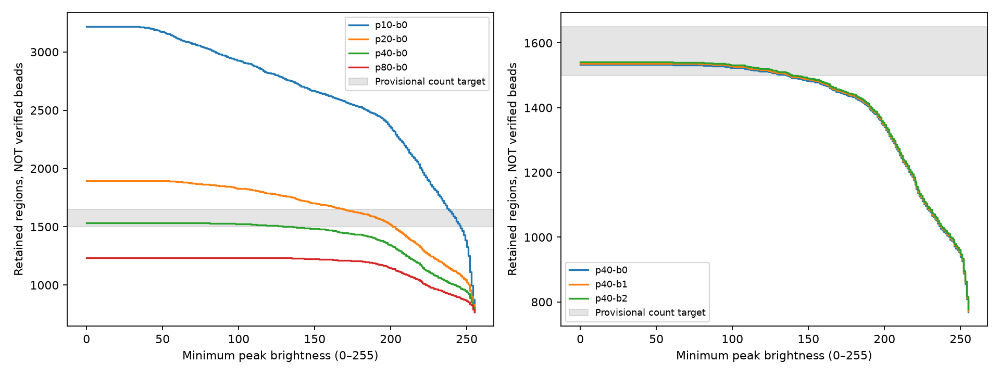
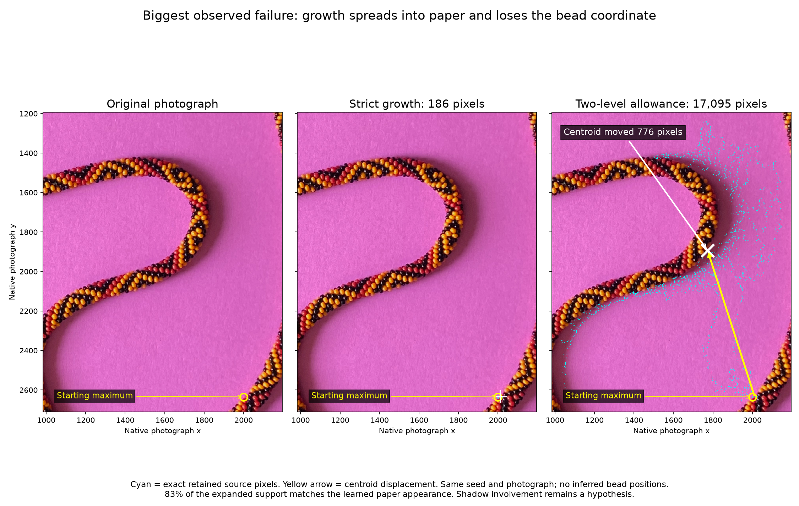
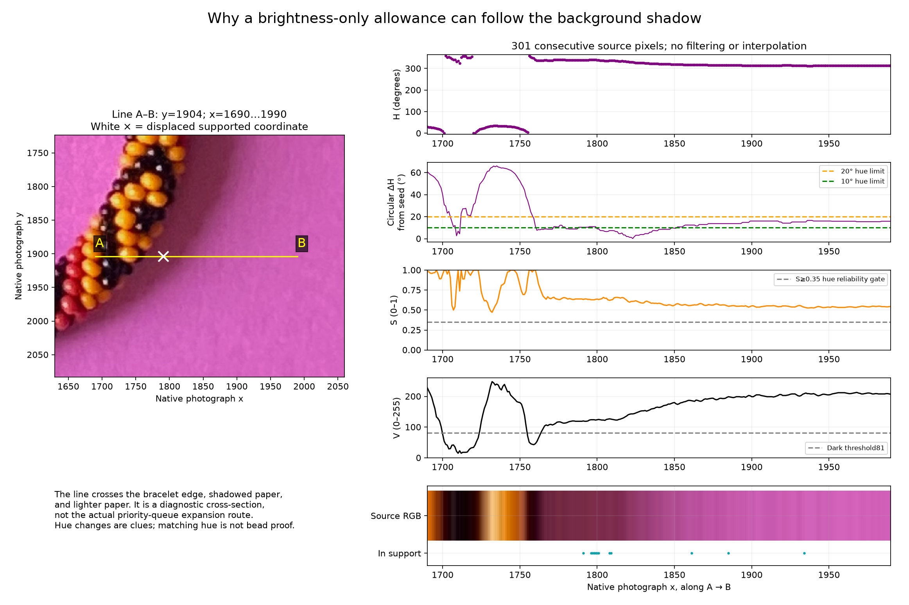
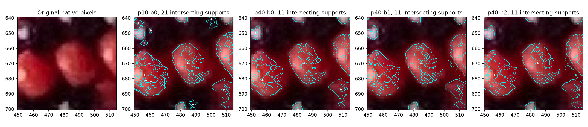
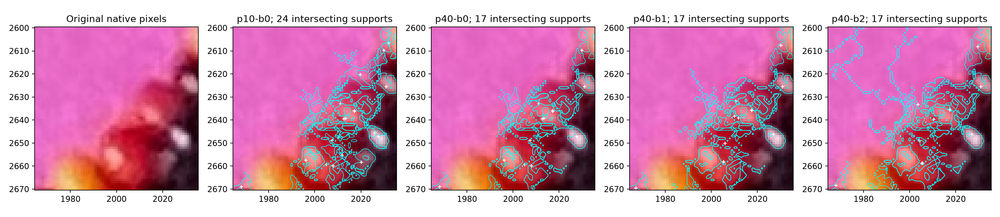

# R263 — local parameter exploration with a 15-minute limit

## Delivered default and limits

The current viewer uses independent native-pixel growth with **no watershed**,
strict brightness descent (equal values allowed), a **10° circular hue stop**,
prominence35, minimum peak0, and a **hard870-pixel pre-retreat growth ceiling**.
The minimum support parameter remains3; no new minimum was selected. The accepted
30×29 size reference and its limitations are recorded in
[BEAD_SIZE_REFERENCE.md](BEAD_SIZE_REFERENCE.md).

Generation `90b4284f50a29ced` preserves154,761 raw maxima:1,595 pass the meaningful
maximum test and are grown;1,552 supports remain, all identity-ambiguous.
153,209 candidates are rejected (153,166 below prominence plus43 grown candidates).
Five candidates attempt to exceed870 accepted pixels and are flagged/rejected,
with their traces preserved. Reaching870 alone is allowed; attempting an eligible
871st pixel stops growth, including every queued predecessor edge. This ceiling
applies before retreat, so it can reject a proposal whose final support would have
been much smaller. No capped coordinate is silently certified.

Retained areas are6–334 native pixels, median68;134 supports have verified dark
enclosures.695 supports overlap another support, covering24,210 overlap pixels.
These are candidate supports, **not1,552 established distinct visible beads**.
The count target has not established completeness or coordinate accuracy.
[Full result, histogram, centroids, masks and all traces](review/r263/bounded/summary.json)
are archived alongside the preserved20° run. See the
[evidence index](review/r263/README.md) for downloads and exact native comparisons.

The original timed search completed28 growth settings including the cached R262
baseline, each evaluated at256 exact peak cutoffs:7,168 combinations. The last
trial finished at21:48:33.123 UTC; experiment/test processes were confirmed complete
at21:49:02.935 UTC, approximately13m35s after the start.
One additional budget4 trial failed with signal9 and is excluded. Later fixed
production runs for the user-requested size ceiling and10° default, and their
audits/illustrations, were separate from that completed15-minute search. No new
parameter sweep was launched during final delivery.

The user requested adjustable one-level brightness decisions, a minimum permitted
local-maximum brightness, and automatic parameter exploration aiming at the earlier
visible-bead estimate. They then capped local computation at 15 minutes. This is
parameter exploration only: no watershed, new bead association, geometry fitting,
manual bead marking, or repair of the separate predecessor-tree retreat problem.

The test window began **2026-10-12 21:35:28 UTC**, with a hard deadline of
**21:50:28 UTC**. Both search processes enforce that absolute deadline for their
child trials, checkpoint completed results, and exclude incomplete trials.
[Search accounting and exact settings](review/r263/search.json),
[one-at-a-time sensitivity](review/r263/sensitivity.json), and
[curated evidence](review/r263/README.md) record actual outcomes.

## Target and method

The historical [R253 estimate](GLOBAL_GEOMETRY_R253.md#visibility-and-identifiability-estimates)
was about 1,650 meaningfully visible surfaces and about 1,500 potentially
distinguishable surfaces. These are conditional geometric predictions with
criterion/model uncertainty, not an independently counted photographic inventory.
Only these aggregate numbers enter the search; old predicted positions, splines,
manual labels and bead identities never enter detection or parameter scoring.

Considered a full grid, coordinate-wise changes, random sampling, and a coarse grid
with local refinement. Chose coarse/refined prominence and bounded-noise trials,
plus one-at-a-time dark, reflection, bright-patch, hue and retreat sensitivities.
For each trial, all 256 minimum-peak thresholds are evaluated exactly by filtering
independent supports. Synthetic fresh runs verify the filtering equivalence.
Minimum peak brightness affects growth eligibility only; it does not redefine the
set of significant peaks used to verify dark enclosures.

The count heuristic first minimizes distance outside 1,500–1,650, then prefers more
dark-enclosure supports, a lower absolute peak cutoff, less noise allowance, and
lower prominence. That is a search-order heuristic, **not a precision/recall score**.
Overlap and native-coordinate failures can reject a count-compatible setting.

## Findings

| Prominence | Minimum peak | Rise budget | Regions | Dark enclosures |
|---:|---:|---:|---:|---:|
| 10 | 0 | 0 | 3,216 | 97 |
| 10 | 238 | 0 | 1,643 | 5 |
| 20 | 170 | 0 | 1,643 | 100 |
| 39 | 0 | 0 | 1,537 | 134 |
| 40 | 0 | 0 | 1,533 | 134 |
| 41 | 0 | 0 | 1,522 | 134 |
| 40 | 0 | 1 | 1,537 | 134 |
| 40 | 0 | 2 | 1,541 | 134 |
| 80 | 0 | 0 | 1,234 | 129 |

The historical strict 40/0/0 setting was a useful **review candidate**, not a recovered bead
inventory. It preserves all 154,761 raw maxima, selects 1,568 for
growth, retains 1,533 ambiguous regions, rejects 35 grown candidates and leaves
153,193 below prominence: 153,228 rejected candidates in total. Median support is
135 native pixels; maximum407. All surviving IDs shared with R262 have exactly
unchanged masks and centroids: this prominence change selects seeds rather than
changing their growth.

Raising the absolute brightness cutoff to238 can reach the requested count while
discarding92 of97 baseline dark enclosures. This is a concrete failure of count-only
tuning. Increasing prominence can also change which bright structures qualify as
single-significant-maximum dark enclosures. Those extra supports are evidence
categories, not newly certified black beads.

**Nonzero noise budgets are not recommended from these trials.** At budget1,
P096956 grows from248 to6,155 pixels and its centroid moves367.30px. At budget2,
P126974 grows from186 to17,095 pixels and moves775.96px. The photograph shows
extension into paper. Their near-unchanged aggregate counts conceal severe local
failures. The budget4 trial exited with signal9 and has no completed result; its
partial traces are excluded. The cause of signal9 was not established.

**Duplicate evidence remains substantial.** The strict candidate has828 supports
overlapping another support and322 pairs with intersection-over-union greater
than0.5. This is an overlap diagnostic, not a bead merger. P032240/P032353 remain
separate maxima with nearly coincident support. We do not interpret1,533 as1,533
different sufficiently visible beads or claim completeness.



## Biggest failure: extension across shadowed paper



P126974 begins at native(2000,2635), with V255, H329.1045° and S0.52549.
Under strict growth it has186 retained pixels, centroid(2011.1183,2633.0054)
and supported coordinate(2011,2631). With a two-level rise allowance it grows to
17,095 pixels, centroid(1773.2845,1894.3925), supported coordinate(1791,1904),
and bbox[1029,1238,2151,2667]. The centroid moves775.96 pixels.
83.18% of the retained pixels match learned paper chromaticity; this is supporting
evidence of background spread, not a verified shadow segmentation. Exact pixels
are in `biggest-problem-pixels.csv`; `illustrate_failure` reproduces the figure
from saved results without rerunning detection.



The yellow diagnostic line runs from(1690,1904) to(1990,1904), sampling all301
consecutive native pixels. It crosses bead material, shadow and lighter paper,
including the displaced supported coordinate at(1791,1904). This straight line
is **not the growth path**. The CSV preserves exact RGB/HSV and membership.
Over x1841–1990, V ranges165–213 and H312.545–320.625°; hue is only about8.5–16.6°
from the originating bright patch. Consequently20° can admit paper here despite
its different material. These pixels are above the current dark threshold81 and
have S0.526–0.582, already above the reliable-saturation gate0.35.

The controls address different causes:

- `rise_budget_dn=0`: preserve strict descent; even one level allowed a6,155-pixel
  spill in another candidate. Equal brightness still passes.
- `max_region_pixels=870`: reject overgrowth even if brightness and color permit
  it. This provides an explicit ceiling, not a proof of a correct bead coordinate.
- `hue_stop_deg=10`: stop smaller relative hue changes. This helped substantially
  in the saved one-level trial; it can also fragment real within-bead color changes.
- `dark_dn` and `reflection_drop_dn`: stop sufficiently dark departures from a
  bright reflection. A threshold high enough to stop all illuminated paper could
  also remove legitimate bead pixels; dark stopping alone cannot solve this case.
- `reliable_saturation` and `saturation_drop`: determine when hue is meaningful
  and detect loss of saturation. Lowering the first gate did not eliminate the
  remaining smaller regressions; the illustrated paper is already saturated.
- `retreat_dn` and `retreat_fraction`: remove darker support after growth. They
  do not undo an unsupported excursion reliably, and the separate predecessor-tree
  leaf-retreat issue remains deferred. Increasing minimum peak cannot prevent
  this particular spill because its seed already has maximum brightness255.

## Adaptive selection and the hue limit

The automatic follow-up interpolated the measured strict-growth count bracket
toward1,575 candidates, selecting prominence35, and obtained1,560 supports before
the ceiling was added. It then tried hue20→10 at prominence40/rise budget1, followed
by lowering the reliable-saturation gate0.35→0.25. These decisions and their reasons
are checkpointed in [adaptive.json](review/r263/adaptive.json).

The regression gate flags an area ratio greater than4 together with a centroid
shift greater than max(10px, three times the equivalent baseline radius). This is
a diagnostic heuristic, not a bead-accuracy metric. **Correction to an earlier
progress comment:** hue10 removed the huge one-level spill; maximum retained area
fell from6,155 to432. Two smaller regressions remained, P117140 and P075232, with
centroid shifts26.95 and14.28px. Lowering the saturation gate left both flagged.
Thus nonzero brightness allowance was not chosen for production.

Hue stopping uses the smaller circular distance from the first sufficiently
chromatic pixel on the expansion path. Hue is reliable here only when S≥0.35,
V≥0.20 and S×V≥0.08. An eligible destination at **or above** the limit is stopped
and locked against alternate approaches. It is not a red/yellow classification,
an adjacent-pixel allowance that can accumulate indefinitely, or ±10° around a
globally fixed color. For example350°→357° passes, but the next4° is14° from350°
and stops at a10° limit. Low-saturation hue alone is not used to stop growth.

With the same strict growth, prominence35 and870 ceiling,20° retained1,496
supports and flagged64 oversized proposals.10° retains1,552 and flags5, because
earlier color stopping can keep a proposal from reaching the ceiling. Overlapping
supports decrease772→695 and median retained area126.5→68. These changes do not
prove more correct beads. The20° data and exact source snapshot remain archived;
[native comparisons](review/r263/bounded/hue20-to10.json) preserve added/lost IDs,
pixel changes and centroid shifts for every common retained ID.

**Next careful hue search, requested but not yet run:** test5°,8°,10°,12°,15°,20°
with all other parameters and the870 ceiling fixed. Assess coordinate stability,
oversized/overlapping proposals, discarded supports and native boundary evidence,
alongside the aggregate count. The user observes that **red and yellow look more
similar in shadows**. Preserve that as photographic guidance: evaluate shadowed
red/yellow transitions separately from brighter transitions, without hard-coded
color boxes or supplied bead positions as runtime priors. Similar measured hue
can fail even a tighter limit; excessively tight hue can split one shaded bead.
Hue remains supporting evidence alongside brightness, dark boundaries and size.

## Native comparisons and trace guarantees

[Every trial's mask/coordinate comparison](review/r263/native-comparisons.json)
and per-trial compressed native runs preserve exact added/lost candidate IDs,
overlap pairs, centroid movements and support sizes. CSVs accompanying the raw
crops give every native pixel's RGB, V and membership IDs for the baseline and
0/1/2-level growth budgets. Crops include the motivating pair, the automatically
selected largest coordinate change, and R260 failures R01307/R00956/R01284. Those
historical locations enter post-search evaluation only.





Equal brightness is accepted, with deterministic heap ties; each pixel is still
accepted separately and has an earlier adjacent predecessor. For noise allowance
B, the running minimum L of all accepted brightness never increases, and no next
pixel may exceed L+B. It is a deliberately conservative **region-wide** constraint,
not a fresh allowance at each edge: 200→201→202→203 fails at203 for B=2. Failed
destinations remain locked across all approaches within the region. Different
maxima grow independently and may overlap; no maximum is silently merged.

This constraint prevents accumulated uphill drift and reopening a rejected valley.
It does not prevent extensive travel through nearly level paper; that is precisely
the observed nonzero-budget failure. Color/dark stopping and retreat are unchanged
except where explicitly varied in the sensitivity trials.

Eight focused tests cover zero-budget equivalence, six synthetic scenes, brightness
gating, bounded staircase rises and alternate-route locks; all30 archived Python
tests pass. Full-photo audits of the 0/1/2-budget candidates verify source RGB/HSV,
individual adjacency, the global budget, irreversible locks, all eight frontier
neighbors, retreat, masks, centroids and overlapping memberships. The strict
candidate reproduces byte-for-byte from isolated code/photo, including1,568 traces.
The strict-candidate viewer passes41 Chromium checks. These implementation checks
do not turn the identified paper extensions into valid detections.

The delivered bounded10° version additionally passes five focused ceiling/hue
tests (43 Python tests across the preserved and new suites). Its full-photo audit
checks408,393 accepted pixels and503,340 stopped edges, all maxima and870 limits.
Isolated execution reproduces all1,595 traces byte-for-byte;41 Chromium checks
pass on the delivered viewer. Current native crops/CSVs compare the final10° run,
preserved20° run and R260 for R01307,R00956,R01284 and the motivating pair.
Intersection is documented without inventing one-to-one bead correspondence.
For example, R00956's old1,052-pixel mask intersects only35 pixels of one new
39-pixel support; the native crop shows that the prominent yellow interior is
still poorly represented. Smaller extent does not demonstrate adequate coverage.
R01307 intersects one78-pixel support; R01284 intersects55- and131-pixel supports.
These comparisons preserve the unresolved photographic failures.

## Reproduction and tuning

All parameters have command-line controls, including integer one-level values.
The viewer can open a trial without replacing its parameters with defaults.

```
.venv/bin/python -m photo2.bead_detection.bounded_detect --help
.venv/bin/python -m photo2.bead_detection.bounded_detect --prominence-dn 35 --minimum-peak-dn 0 --rise-budget-dn 0 --hue-stop-deg 10 --max-region-pixels 870 --output photo2/output/my-tuned-run
.venv/bin/python -m photo2.bead_detection.server --work photo2/output/my-tuned-run
.venv/bin/python -m unittest photo2.bead_detection.test_tuning photo2.bead_detection.test_no_watershed photo2.bead_detection.test_bounded
.venv/bin/python -m photo2.bead_detection.validate_bounded --isolation
.venv/bin/python -m photo2.bead_detection.curate_bounded
```

To repeat a bounded search, calculate an absolute Unix deadline no more than900
seconds ahead and pass the **same deadline** to `search_parameters` and
`search_sensitivity` with `--deadline-epoch`. They run on the local machine and
require no external optimizer or service. `curate_search` summarizes completed
trials; incomplete output directories are not candidates.

**Stopping point:** deliver the completed code/evidence; do not launch another
search automatically. Next bounded task is the requested controlled hue sweep,
including shadowed red/yellow evidence. Duplicate identity and the retreat issue
remain separate later aspects. Keep the existing model/reasoning choice; no `/new`
needed for review, and use `/new` before another substantial experiment session.
