# R254 — bounded repeating-pattern and geometry audit

**No exact repeating template has been recovered.** Every tested admissible
period conflicts with preserved color evidence. This is a failure of the tested
mappings/model family to explain the sequence, **not a rejection of the maker's
repeating-pattern fact or permission to change observed colors**.

The active rule includes the maker's in-session correction: **P must divide N**,
1 <= P < 400, and the shortest P is not divisible by 13. Consequently N2671 and
N2833 are excluded regardless of geometry: their only admissible P below400 is1,
which cannot contain both red and yellow. The earlier opening instruction allowing
an incomplete final repeat is superseded. Nondivisor scans are diagnostics only.

[Stage-by-stage visual review](review/r254/INDEX.md) ·
[114-model comparison](review/r254/comparison.csv) ·
[Protocol](review/r254/protocol.json) · [Verification](review/r254/verification.json).
All310 R252 observations, original photo, original centerline and R253 evidence
remain unchanged;155 source files pass byte-for-byte integrity checks.

## A — fixed mappings: exact arithmetic before fitting

Four methods were considered: exhaustive residue counting, bounded discrete
correspondence constraints, camera/identity fitting, and spatial holdout evaluation.
Use each at its appropriate stage. No color-error allowance enters any solver.

For a fixed mapping, origin0 and periodP, collect original observation IDs by
`k mod P`. Minimum contradictory assignments are
`sum_residue(total_count - max(red_count, yellow_count, black_count))`.
For two observed colors this is `sum(min(red_count,yellow_count))`, independent of
record order. This diagnostic counts how many assignments cannot coexist; **it does
not delete/recolor them**. A contradictory residue has status`!`, an unobserved
residue`?`. All fixed periods1..399 were exhaustively scanned for all46 R253 models,
using all310, conditional-unique subsets, and training conditional-unique subsets.

The requested preliminary checks reproduce exactly: N2671_h+1_both has minimum13
atP309, and N2679_h-1_twist minimum11 atP310, on their242/237 conditional-unique
observations. **Both N/P combinations are excluded by the new divisibility rule.**
None of the46 fixed mappings has an exact P even under the wider nondivisor scan.
Among admissible periods, the best original all310 diagnostic is N2670_h-1_rigid,
P267, with48 contradictions. The best original conditional-unique diagnostic is
N2529_h-1_rigid, P281, with22. Different subset sizes prevent treating those values
as comparable model likelihoods.

[All period counts](review/r254/fixed-periods.csv),
[fixed summaries and all exact-period lists](review/r254/fixed-summary.json), and
[every residue's exact source IDs for six selected models, all399 periods](review/r254/selected-residue-constraints.json.gz)
retain the complete result. Every admissible exact-period list is empty.

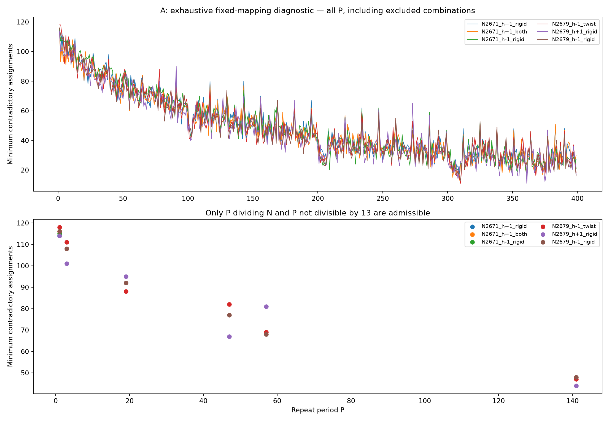

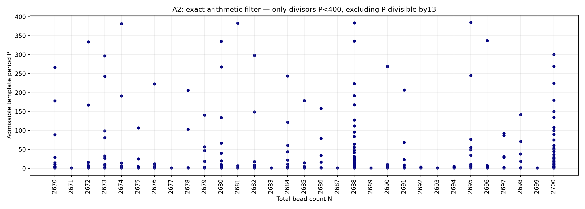

Before the divisibility correction, the implementation also exhausted every
observationally distinct seam cut for all/unique fixed mappings. No exact solution
was found under that relaxation either. These saved `any_seam` results are
**superseded sensitivity diagnostics**. For admissible P dividing N, adding/subtracting
N from an index preserves its residue, so seam placement cannot remove a conflict.
Template cyclic shifts and global reversal are equivalent descriptions when the
origin/traversal change consistently. There is no surviving template equivalence
class to choose between here.

## B — bounded correspondence search and conflict witnesses

At a fixed geometry each point's first visible surface owner is definite. A nearby
index cannot acquire that point merely because its color residue would be useful.
The exact-representative domain audit records missing owners and anchor failures;
none of the original models owns all310 representatives with a complete admissible
identity assignment. Original selected-model alternatives were separately re-traced
on the saved positive patches, recording support, representative ownership and
change in R253 assignment cost. No image segmentation was rerun.

To test whether nearby ambiguity could nevertheless rescue a period, expand each
observation's domain to saved alternatives within0.15,0.5 or1.0 normalized cost
above its assigned cost. These are **optimistic necessary-condition domains**, not
calibrated likelihoods or accepted photographic correspondences. They can admit
options with inadequate ownership. A contradiction even in this larger domain
proves failure for any stricter ownership/graph subset of it.

Propagation enforces one-to-one identities and a single color at each forced
residue. A binary integer formulation is implemented for unresolved domains and
validated on known feasible/infeasible controls. In the photographic cases,
propagation itself rejects **all702 original and2640 refined model/P/cost-envelope
combinations**. No photographic case needed branch-and-bound, timed out, or produced
an optimistic feasible solution. Every refined rejection has a replayable
**two-observation witness**, the smallest possible contradictory group. This is an
exact infeasibility result **within the saved domains**, not a global proof across
all continuous geometries or all possible physical correspondences.

[Original-domain proofs](review/r254/alternative-proofs.json) ·
[Refined-domain proofs](review/r254/refined-alternative-proofs.json) ·
[Selected exact support audits](review/r254/alternative-summary.json).

For the N2674,+1,P382 diagnostic, C252-D3-B16(red,k7) and
C252-F196p-2(yellow,k389) both constrain residue7. C252-M8(red,k14) and
C252-A121(yellow,k396) similarly conflict at residue14. Each assigned body owns its
saved positive evidence; the three displayed nearby alternatives have0% patch
support in these examples. The raw images give no basis here for silently changing
red to yellow. These pairs reject this mapping/period combination.

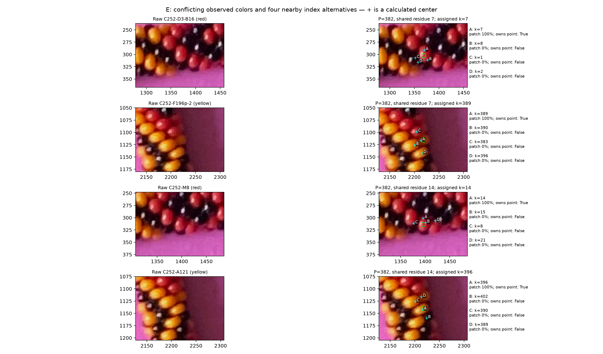

## C — constrained camera/count/turn comparison

The new round evaluates **114 deterministic geometry hypotheses,57 per helicity**.
Both signs receive identical count sets, free parameters, local budgets and
constraints. The initial42 fits compare orthographic and fixed nominal pinhole
focals9598.35/4799.18px for N2312,2529,2670,2671,2679,2698,2833. These focals are
sensitivity hypotheses, not calibrated iPhone intrinsics. The extension considers
all integers2670–2700 and R253's wider rigid basins;44 totals receive arithmetic
screening,11 are excluded because onlyP1 is admissible. Remaining new counts receive
matched orthographic fits. T±1 is also tested at N2670,2679,2698,2700 for both signs,
with16 additional orthographic fits. The default T is nearest(N/6.5).

Each new fit has two alternating optimization rounds, at most20 function evaluations
per round, with phase, origin gauge, translation, elevation, roll, four longitudinal
stretch coefficients and four winding coefficients. Bounds retain the old global
limits and modest neighborhoods of the starting fit: phase±0.7rad, origin±0.8bead,
translation±5px, elevation±8deg, roll±35deg, added stretch coefficients±0.0015,
added winding coefficients±0.04rad. New initializations reuse R253 rigid solutions
or its coarse count/hand start, with the old bounded proxy fitter where necessary.
These are local fits, not globally optimized camera posteriors.

The original projected spline is unchanged. For each camera it is inverse-projected
onto the plane and reparameterized by physical arc. Exact pinhole/orthographic rays
use all physical beads as possible occluders, the original rounded annulus,
numerical marching tolerance1e-5 world units and an explicit unfinished-ray flag.
No arbitrary positional noise or per-bead location adjustment is introduced.

The maker's27-node chart supplies explicit target-index residuals, familyA for+1
andB for−1, with the intended anchor C252-A948=maker20=k0. Numbers4,8,12,16,24 are
withheld as target identities;20 remains the anchor. Final exact membership is a
hard **certification check**, even though continuous fitting uses a soft geometric
guide. Failures remain visible and prevent calling the chart/origin confirmed.
The earlier27-node graph also implies its established links/cycles; no new maker
neighbor relations are invented elsewhere.

Distributed stars reserve up to three R253 conditional-unique identities within90px
around a reliable seed in each training sector. These are explicitly **model-
conditional identity hypotheses**, not newly verified maker facts. Their indices
are reserved one-to-one during both fitting and final assignment. An initial
implementation allowed temporary assignment collisions when reserving stars after
free matching; this was corrected, all affected fits rerun, and every delivered
star identity is retained. Photographic ownership may still fail and is reported.
R252 distinct-body evidence is enforced by one-to-one assignment of all310 rows.

The final R254 geometry cost is equal-sector mean of
`1 - positive_patch_support + 0.15*(interior_to_center_distance/(R*scale))**2`.
It is an engineering comparison score, not a calibrated surface likelihood.
Its center term is isotropic, whereas R253's audit used an anisotropic quadratic;
**do not directly compare their numerical costs as if the definitions were identical**.
Only exact ownership is used as a strict photographic certificate. Color counts,
index changes and geometry costs remain separate columns.

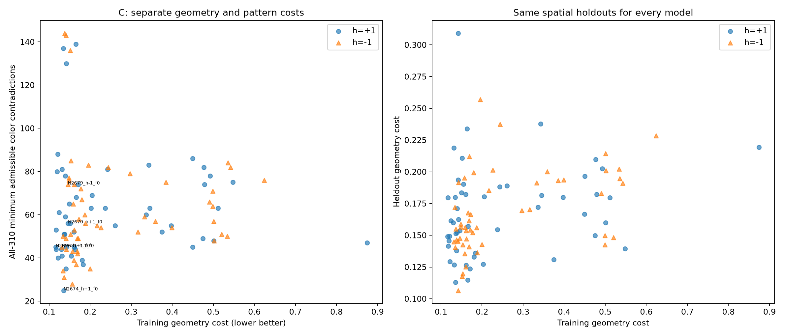

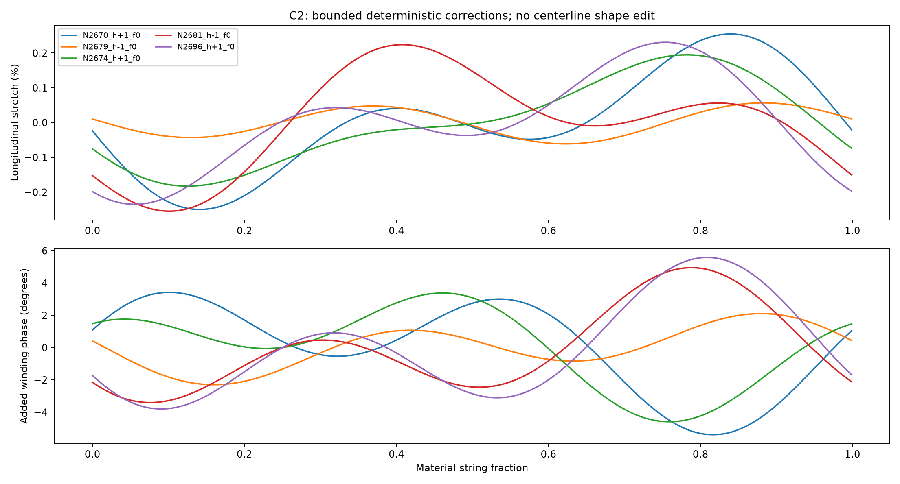

| Model (all orthographic here) | Best admissible P on all310 | Contradictions all310 / unique subset | Geometry train / heldout | Maker points owned /27 | Heldout colors correct / wrong / abstain* |
|---|---:|---:|---:|---:|---:|
| N2674,+1 |382|25 /17 of246|0.1354 /0.1129|26|13 /6 /37|
| N2695,−1 |385|28 /14 of218|0.1567 /0.1952|24|13 /11 /32|
| N2688,−1 |336|31 /14 of228 atP384|0.1364 /0.1549|26|8 /6 /42|
| N2534,−1 |362|34 /20 of235|0.1338 /0.1722|26|11 /12 /33|
| N2678,−1 |206|35 /17 of214|0.2000 /0.1428|24|26 /10 /20|
| N2696,+1 (training geometry nominee)|337|45 /28 of243|0.1163 /0.1491|26|0 /0 /56|
| N2681,−1 (training geometry nominee)|383|45 /25 of241|0.1314 /0.1449|24|7 /14 /35|
| N2670,+1 |267|56 /30 of229|0.1461 /0.1538|26|9 /12 /35|
| N2679,−1 |141|74 /46 of235|0.1459 /0.1477|26|15 /17 /24|

*Periods for heldout scoring are chosen using training colors only and may differ
from the all310 diagnostic period. All these training templates already conflict;
the scores are diagnostic, not validation of a feasible recovered pattern. Counts
include all56 heldout observations, including weaker correspondence cases.

N2674,+1 is the best new all310 color diagnostic, **not a surviving solution**.
Its same-index projected centers move3.02pxRMS from its initialization; maximum
stretch0.195%, winding correction4.59deg, and30/310 index correspondences change.
Only291/310 assigned representatives are owned. The +1 training-geometry nominee
N2696 has maximum stretch0.235%, winding5.58deg and20 changed indices; the −1
nominee N2681 has0.255%,4.95deg and37 changed indices. These are alternative fits,
not certified physical corrections. [All deterministic changes](review/r254/geometry-changes.csv)
and [all old/new observation indices](review/r254/index-changes.csv) preserve them.

Fixed pinhole starts generally lose ownership/cost when the geographically
reserved identities are maintained. This rejects those local starts; it does not
prove orthographic imaging or rule out different camera/correspondence basins.
No continuous focal optimization, alternative distributed-star chart discovery,
full independent A/B-family reassignment around the entire loop, or centerline
shape correction was performed. Prime-count controls remain saved as geometry
controls even though their pattern hypotheses are algebraically excluded.

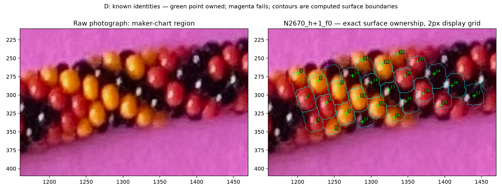

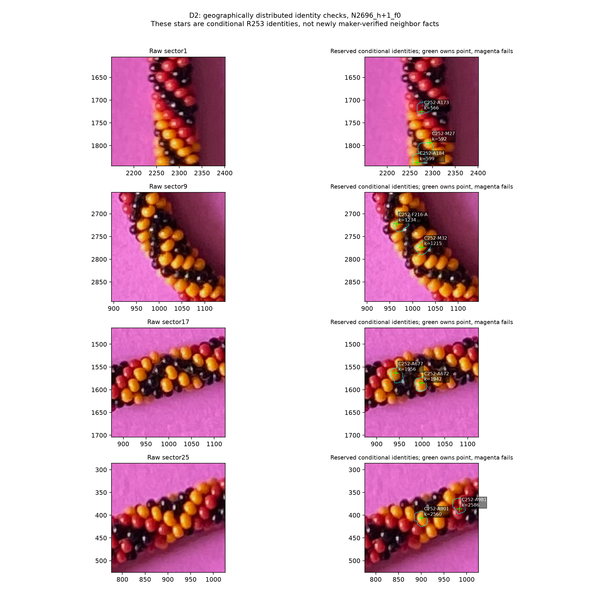

Many near-count models fail specifically at maker point7; the raw context above
shows the actual point and computed surface boundary. Four lower-count +1
orthographic fits own all27 maker points, but their global patterns still conflict.
Matching this local chart alone does not validate a global mapping. Both helicities
remain scientific possibilities outside the tested hypotheses; **neither has a
surviving tested period/mapping**. The prior direction1 FFT preference for+1 remains
working evidence, not a hard-coded exclusion of−1.

## D — template constraints, visibility and independent evaluation

No feasible template means there is no meaningful global count of recovered
versus unknown template colors. For review only, N2674,+1,P382 has238 residues
with evidence:105 red-only,108 yellow-only,25 contradictory, and144 unobserved.
**213 locally uncontradicted residues are not a recovered213-color template**:
the complete constraint system is inconsistent. Its training-only version has158
uncontradicted,12 conflicted and212 unknown residues. No black residue is inferred.

[Per-residue exact source IDs](review/r254/residue-constraints.csv) and
[coverage/indices/mod13 distribution](review/r254/residue-coverage.csv) support the
strips below. Gray`?` admits red/yellow/black without evidence; purple`!` means no
color can satisfy that residue's current constraints. These are different states.

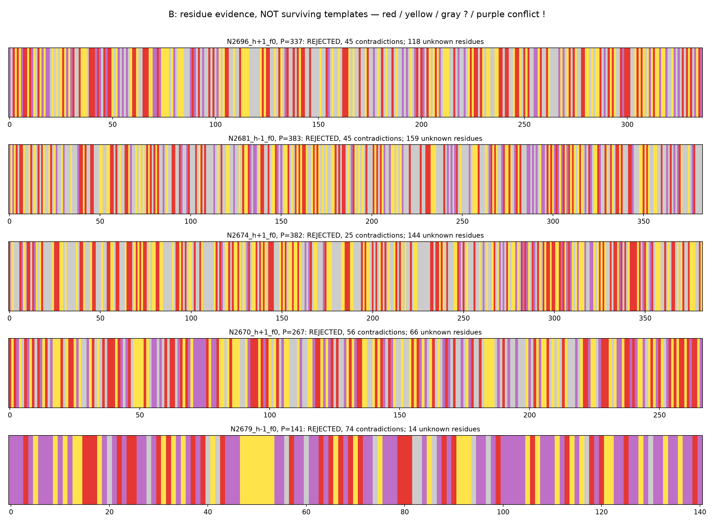

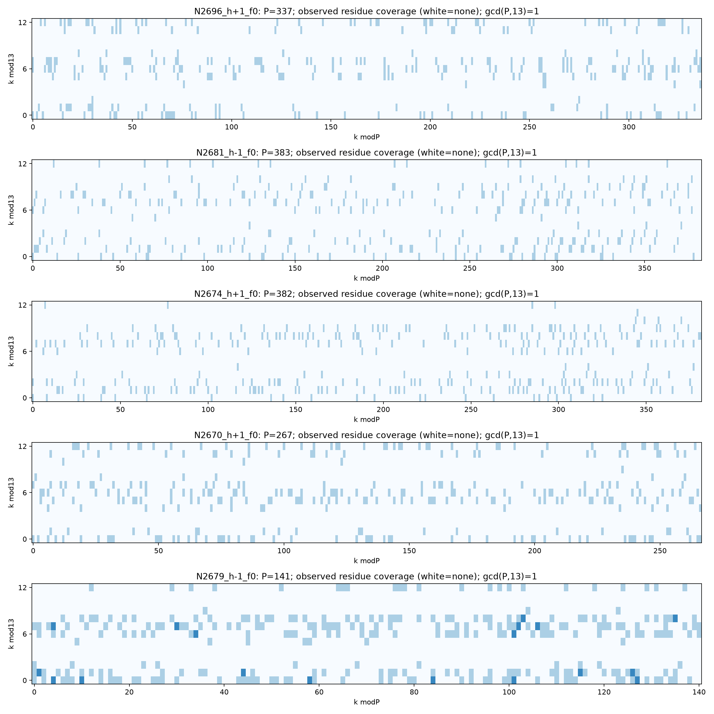

The nominal6.5-beads-per-turn structure can correlate visibility with k mod13.
For every admitted P here, gcd(P,13)=1, so no exact shared-factor13 obstruction
exists; this does **not** guarantee photographic coverage. Counts have slightly
different exact N/T, finite repetitions, perspective/occlusion and incomplete color
observations. The heatmaps report actual coverage instead of inventing a numerical
exclusion near multiples of13. Unknown positions remain unknown even when a model
predicts that a surface is visible.

Geometry uses the original254 training/56 heldout spatial split. Period nomination
uses only conditionally unique training observations; choose minimum contradiction
count, then shorterP. This explicit complexity preference never converts a
nonzero-conflict result into a solution. Every unobserved/conflicted residue abstains
at evaluation, with no majority vote. Model nominees use training geometry only;
N2674's color rank uses all310 and is explicitly post-hoc. The many model/period
comparisons and historical whole-photo work limit independence.

The N2674 diagnostic gets13 correct,6 wrong and37 abstentions on56 heldout bodies:
68.4% of19 predictions,33.9% prediction coverage, **with12 training contradictions**.
It cannot count as successful pattern validation. Training-geometry nominees yield
0/0/56 (+1,N2696) and7/14/35 (−1,N2681). The first shows how spatial holdouts can
leave every tested residue unseen/conflicted for a particular P; absence of wrong
predictions is not success. Five maker target identities are held out separately,
but their point evidence can overlap R252, so this is only relational holdout and
not five wholly independent photographic observations.

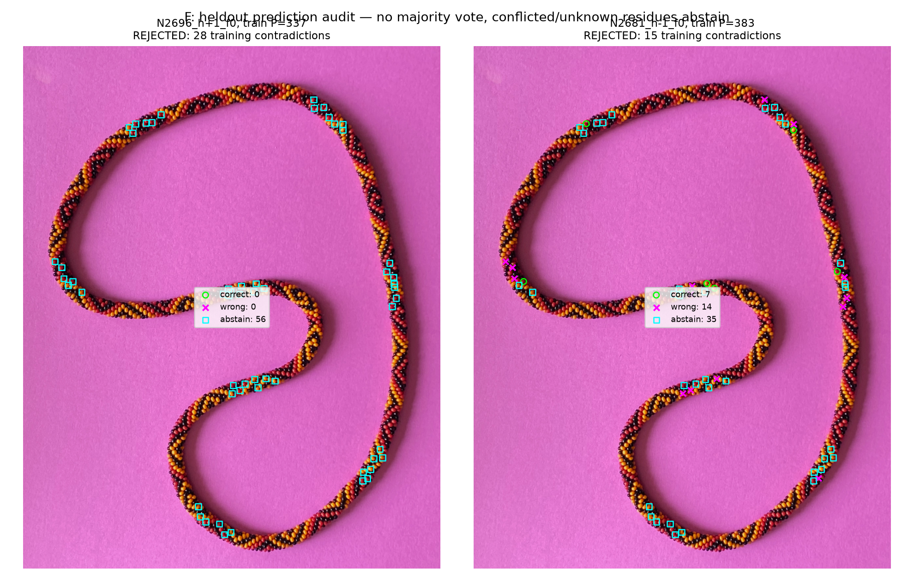

Since no consistent template exists, the requested logically justified template-
color prediction map contains **only unknown colors**. The observed red/yellow
rings in native overlays are evidence, never inferred template colors. No hidden or
unobserved bead has been photographically declared black.

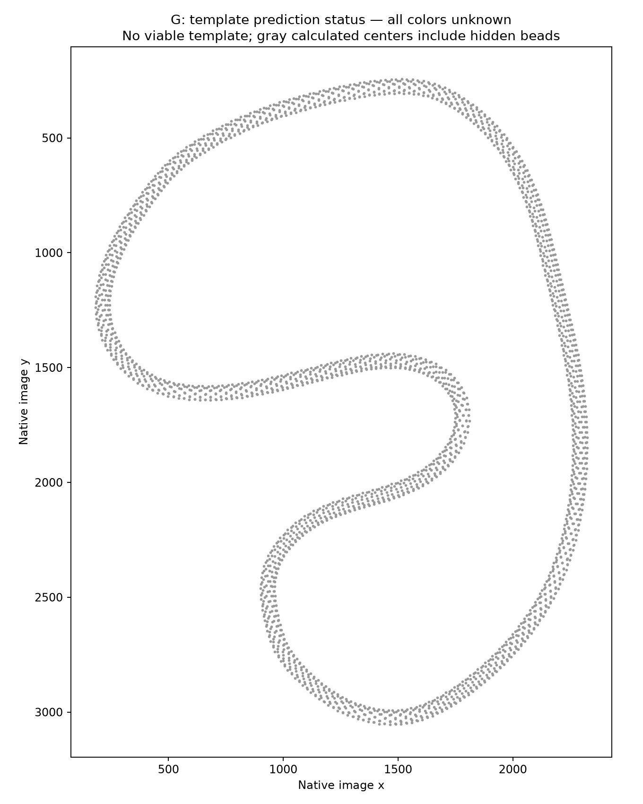

## Validation, limits and stopping point

Nineteen relevant tests pass: order-independent minimum-conflict arithmetic,
unknown-not-black, shift/reversal invariance, seam-cut exhaustive brute-force control,
the superseded incomplete-repeat diagnostic versus active divisibility admission,
exact known-pattern partial recovery, exhaustive small propagation soundness,
feasible/infeasible integer-assignment controls, deterministic pinhole projection/
ray/closure controls, orthographic ray parity, and existing R253 geometry tests.
The known P7/N35 example recovers RY?R?YY from red/yellow evidence, predicts the next
heldout colored observations, and leaves its black source slots unknown. This is
an exact mathematical control, not a realistic photo-recovery benchmark.

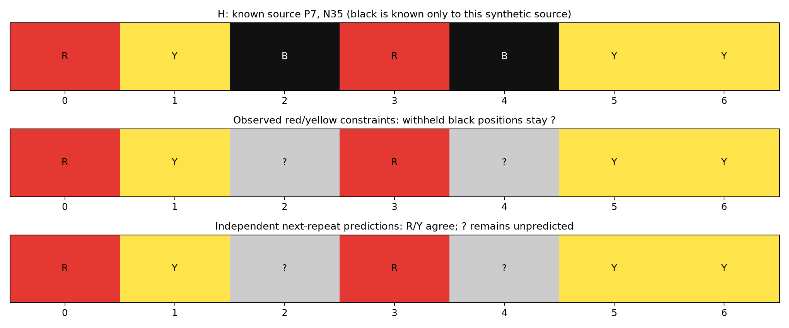

A separately written counting implementation agrees on all399 periods for each
of the six original selected models. Three fitted camera solutions replay their
parameters, all310 assignments and patch metrics exactly. Every saved propagation
witness replays. Source hashes, artifact hashes, parameters and reproduction commands
are sealed in verification.json. Numerical correctness does not certify the image
model; the raw/marked figures are provided precisely to expose that distinction.

The period search is exhaustive **for each fixed mapping**. The bounded saved-domain
assignment exclusions are exact. The continuous geometry/count/camera search is
not exhaustive. StageC is a bounded model-and-period comparison with modest
color-blind geometric refinement; **no feasible candidate reached a further
color-constrained continuous optimization stage**. No observation was discarded
or recolored, and no distortion penalty was relaxed to force success.

Before claiming the actual sequence recovered, establish a globally consistent
identity mapping with photographed anchor and distributed neighbor checks, find an
admissible exact P/template, distinguish competing N/P/h solutions and equivalences,
and predict sufficiently many withheld colors. Independently mapped black evidence
or additional colored observations will then be needed for genuinely unobserved
residues. Current failures do not identify a unique geometric correction or establish
an error in any trusted color observation.

**Next concrete task:** review the two P382 conflict pairs and the maker-point7 /
distributed-star overlays, then investigate global row/index slips using independently
supported local neighbor walks before expanding continuous camera flexibility.
Preserve the other periods/counts and both hands. Stop here after scoped delivery;
no automatic next phase. Recommend GPT-6 Astra / High for that follow-up, with
/new before a new implementation round after visual review. This is a recommendation,
not a newly asserted active-model status; the user controls switching.
