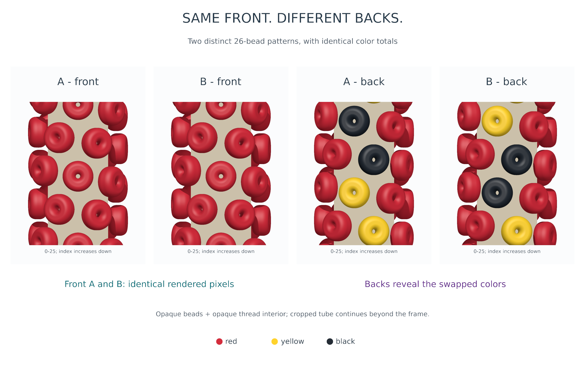
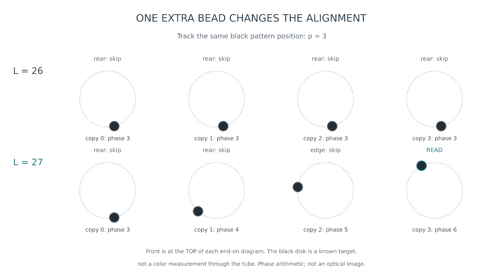
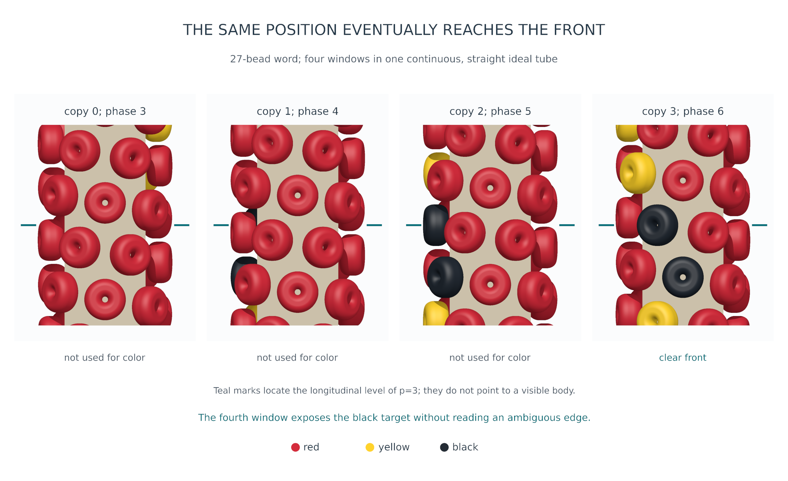
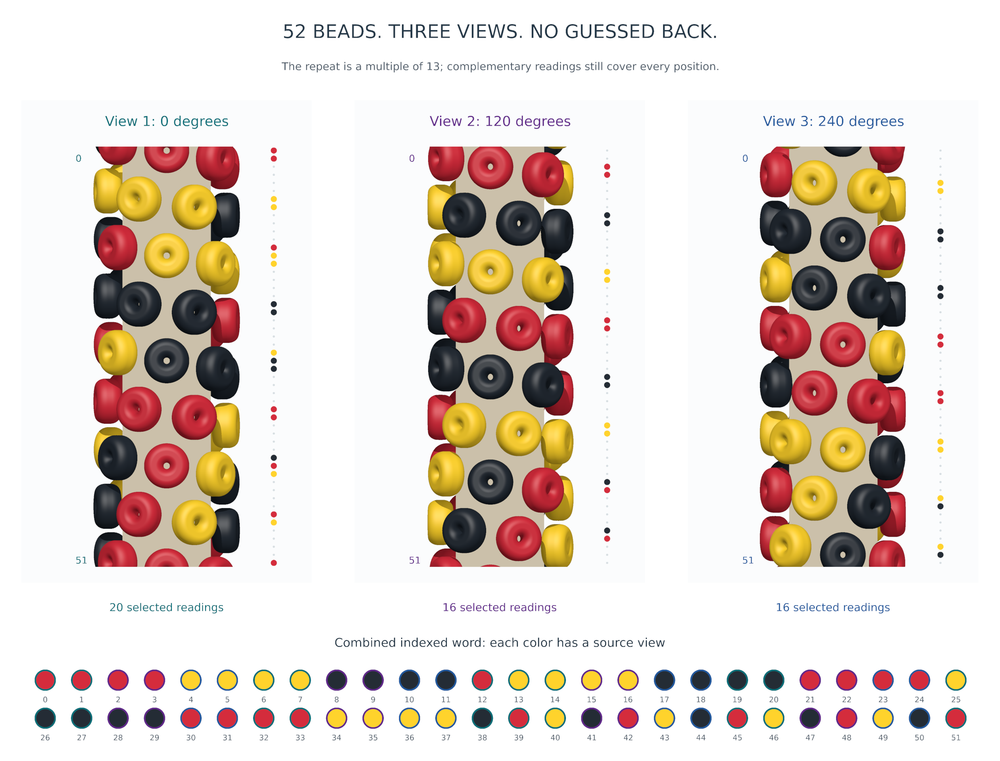
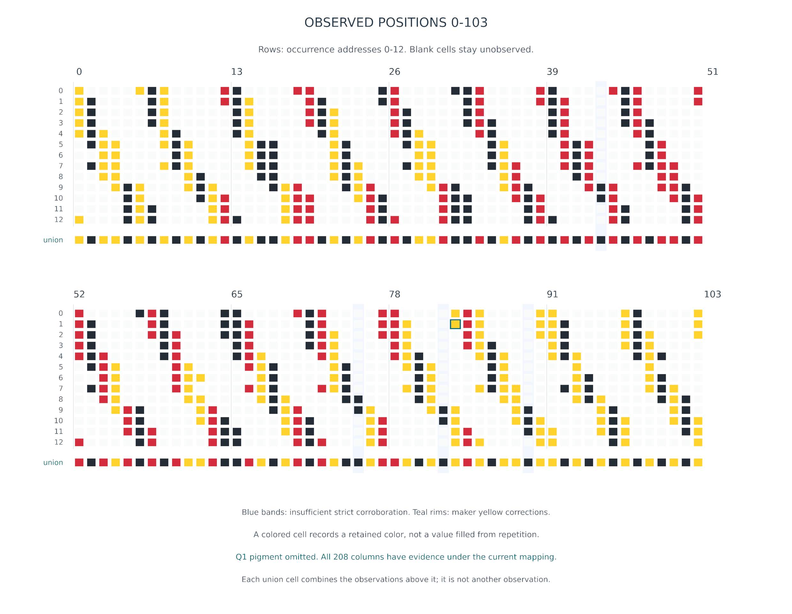
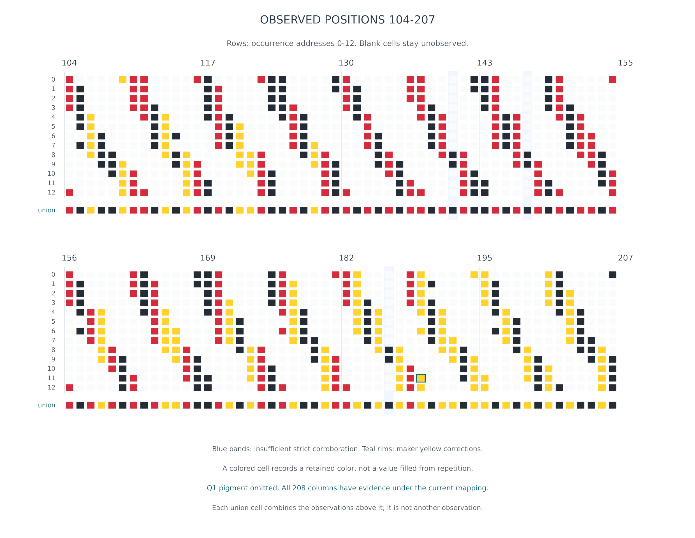
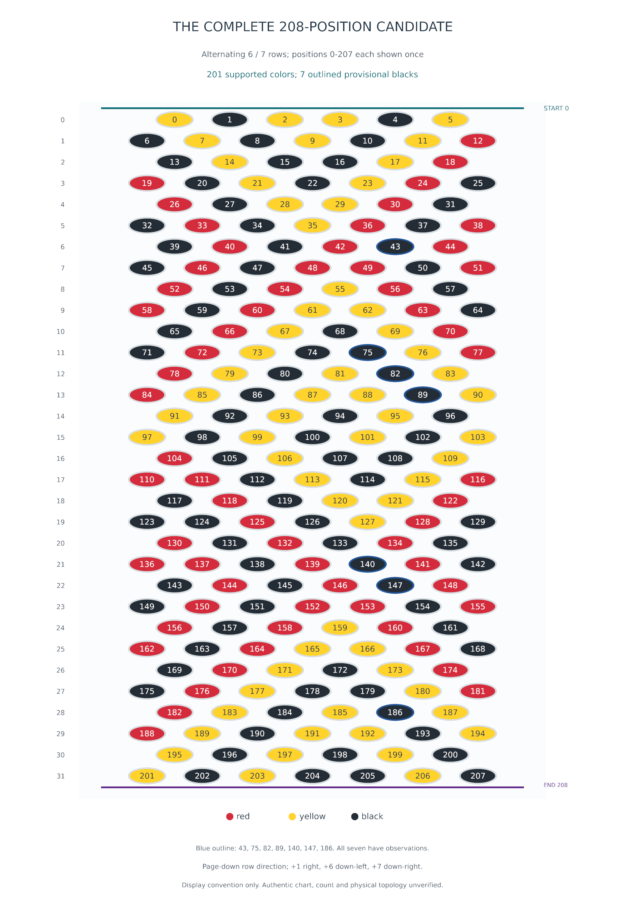

# Why a hidden bead pattern can still be recovered

A repeat divisible by thirteen can keep the same positions hidden in every copy.
It can still be recovered when different views expose those positions and we can
match them correctly. A repeat not divisible by thirteen helps by moving each
position around the tube from one copy to the next.

*Illustrated review edition, following [Draft 2](PATTERN_VISIBILITY_EXPLAINED.md).
The new illustrations are actual POV-Ray renders. They explain constructed
examples and display saved evidence; they introduce no new necklace reconstruction.*

Knowing a pattern lets us predict its hidden colors. Recovering an unknown pattern
asks whether the observations determine those colors. These are different tasks:
a predictable back need not be discoverable from the front.

## 1. An adversary chooses an unidentifiable back

Imagine a straight beaded tube, viewed from one fixed side. In our ideal
6.5-beads-per-turn construction, thirteen string positions span two turns.
A 26-bead repeat therefore returns each position to the same angular phase.

The adversary chooses pattern A. Here `R` is red, `B` black and `Y` yellow;
spaces separate groups of thirteen, rather than physical gaps:

```text
A: RRRBRRRRRRBRR RRRYRRRRRRYRR
B: RRRYRRRRRRBRR RRRBRRRRRRYRR
```

Pattern A has a red front, with black beads deep on the back of the first group
and yellow beads on the back of the second. Pattern B swaps two hidden colors.
Both have shortest period 26 and the same totals: 22 red, two black and two yellow.
They remain different under every choice of starting position and reading direction.



*Figure 1. Both patterns share the same illustrative geometry. Separate front-view
checks with identical cameras and lights give pixel-identical images; the rear
views distinguish the patterns. The neutral interior explicitly represents an
opaque thread core.*

Even knowing the repeat length and color totals does not choose between A and B.
Without that information, an all-red word of period one also explains the front.
An optimizer cannot extract information that these measurements do not contain.
A view of the back, the original chart or an independently justified construction
rule would supply new information.

### What the rendering actually establishes

The example uses opaque beads with rounded bores, an opaque interior and guard
beads beyond both cropped ends. It is a deliberately simple object, rather than
a recovered physical model of the photographed necklace. Transparency, unknown
twist and complex thread geometry are outside this example.

We checked the front comparison without labels or antialiasing: all 452,480 image
pixels agree. A separate surface-ownership render finds zero front pixels from
the two swapped bodies. The rear images differ at 36,608 pixels. These are
finite-render checks of the stated construction. Enclosing geometric bounds
also put both deep-rear phase classes entirely behind the opaque core in this
orthographic front view. The conclusion depends on this stated geometry and
material, rather than all bead shapes or viewing directions.

The first ray trace found that the wider rear set proposed in Draft 2 leaked
small colored surfaces through gaps. **Rear-facing centers did not guarantee
hidden surfaces.** We retained that [rejected example](retrospective/visibility/development/rear-leak/README.md)
and narrowed this illustration to the deepest rear phase classes, 3 and 10.
The illustrative words and their counts above consequently differ from Draft 2;
the scientific 208-bead candidate has not changed.

## 2. One extra bead changes what repeated copies reveal

Append a red bead to A, producing this primitive 27-bead word:

```text
RRRBRRRRRRBRR RRRYRRRRRRYRR R
```

A 26-bead copy advances four full turns. A 27-bead copy advances one bead farther:
about 55.4 degrees. That extra step changes which side faces the camera.



*Figure 2. Follow position 3, a black bead, through four copies. Front is at the
top of each end-on diagram. The disk shows the known target's location; it does
not claim a color measurement through the tube.*

The corresponding front-view renders make the consequence visible:



*Figure 3. Four windows in the same continuous 27-bead construction. Teal marks
identify the target's longitudinal level. The first target is hidden. The second
is rear-facing with a small surface glimpse, and the third is near an edge;
neither is used as color evidence. The fourth is clearly front-facing. An
ownership pass independently records this visibility progression.*

### A short explanation of the arithmetic

Let `k` be string index and `r = k mod 13` its phase class. The ideal bead angle
is `4πr/13`: thirteen beads make two turns. Position `p` in copy `j` of a length
`L` word has phase:

```text
r = (p + jL) mod 13
```

If `L` is divisible by 13, successive copies leave this phase unchanged.
Otherwise, because 13 is prime, the copies visit all thirteen phases. That is
why nonmultiples can help: a position hidden in one copy can turn to the front
in another.

For a conservative ideal color-reading rule, select only phases within 60 degrees
of the front: `0, 1, 6, 7, 12`. Do not infer colors from the other phases just to
increase coverage. Position 3 in the 27-bead example visits phases 3, 4, 5 and 6
in its first four copies: rear, rear, skipped edge, then clear front.

| Same reading rule, thirteen copies | Distinct pattern positions read |
|---|---:|
| 26-bead word | 10 of 26 |
| 27-bead word | 27 of 27, each read five times |

This is a coverage argument **given the correspondence between copies**. Finding
the repeat length, matching similar-looking beads and assigning reliable colors
remain separate problems. A short photograph may show too few copies. For a
different circumferential phase count `m`, the general issue is `gcd(L,m)`:
each position visits `m/gcd(L,m)` phase classes, which need not be all of them.

## 3. A multiple of thirteen can still be fully observable

Fixed alignment relative to the construction does not mean fixed alignment to
the camera. Another viewing direction, or a suitably oriented occurrence
elsewhere on a curved or twisted tube, can expose previously hidden positions.
Bending alone does not guarantee that exposure; the actual orientation matters.

Consider this 52-bead word, whose shortest period is 52:

```text
RRRRYYYYBBBBR
YYYYBBBBRRRRY
BBBBRRRRYYYYB
RYBRYBRYBRYBR
```

In one fixed view, more identically facing repeats keep the same gaps. Instead,
look from three directions: 0, 120 and 240 degrees around the tube. Preserve a
reference index and direction, so readings can be matched without ambiguity.

| View | Selected phase classes | Positions read |
|---|---|---:|
| 0 degrees | 0, 1, 6, 7, 12 | 20 of 52 |
| 120 degrees | 2, 3, 8, 9 | 16 of 52 |
| 240 degrees | 4, 5, 10, 11 | 16 of 52 |
| Combined | All thirteen classes | **52 of 52** |



*Figure 4. Dots beside each tube record only that view's selected readings; gray
marks are unread positions. The combined word has a border identifying the
source view: teal, purple or blue. Every admitted body has visible surface pixels
in its source view. Other glimpses at edges are deliberately unused.*

No color on the back is guessed from the front. Every gap has a direct reading
elsewhere. The phase classes are covered regardless of the chosen colors, so
this is not a lucky color word: the same coverage construction works for any
length `13m`, if the views and position correspondences are available. Some color
words would have a shorter true period; this particular one does not.

Three views of one piece of tube are an easy controlled example. Complementary
occurrences in a single photograph can serve the same informational purpose,
provided their addresses are correctly established. The illustration does not
claim that every bent necklace automatically supplies these exact views.

## 4. Why the 208-bead target was decodable

Our proposed repeat is `208 = 16 × 13`. On the adversary's fixed-facing straight
tube, that divisibility could keep positions hidden indefinitely. But that
restriction does not describe the saved photograph-to-pattern assignments.

Under the current indexing, **every one of the 208 positions has recorded color
evidence somewhere in the photograph**. Different occurrences supply different
parts of the word. The proposed crochet lattice supplies the common addresses
that allow us to combine them; repeated colors by themselves do not establish
those addresses.


*Figure 5. Existing whole-necklace context, unchanged from R346: photograph,
R345 render and R346 lighting revision. This identifies the target; visual
plausibility does not independently verify the pattern, topology or bead poses.*

The current R347 maker-answer assessment is:

- 1040 retained color observations agree with the provisional 208-position word.
- All 208 positions have observations; 201 meet the strict support rule.
- Seven positions remain insufficiently corroborated and provisionally black.
- Q1's unreadable pigment is withheld; it supplies no confirming color.
- Two former red interpretations are yellow according to maker inspection of
  the original photograph.

The following matrices show the information doing the work. Columns are pattern
positions and rows are occurrence addresses in the current conditional indexing.
A colored cell records an observation; a blank cell remains blank. The bottom
union summarizes the column and adds no observation.



*Figure 6a. Positions 0–103, split into two panels for readable print. Blue bands
mark insufficient strict corroboration. The teal-rimmed yellow cell is maker
correction Q2. Q1 at position 83, occurrence 2 supplies no pigment cell.*



*Figure 6b. Positions 104–207. The teal-rimmed yellow cell is maker correction Q3.
Across both matrices all 208 columns contain evidence, while the seven sparse
black positions remain visibly distinct from better-corroborated positions.*

These rows are addresses, not thirteen independently photographed complete
necklaces. Geographic corroboration is assessed separately in R347; the picture
does not redefine that rule. The [source-address manifest](retrospective/visibility-example-checks.json)
lists the retained observation IDs behind each column.

The color word also contains substantial longitudinal variation: the best
13-position word fits only 451/1040 observations (43.37%); the best 104-position
word fits 954/1040 (91.73%); 208 fits 1040/1040. Thus the saved colors are not
simply thirteen angular colors repeated. These are fitted-label compatibility
scores, not independent accuracy measurements.

## 5. The complete candidate and its remaining uncertainty

The chart shows all 208 candidate positions once, in alternating six/seven-bead
rows. Each row is numbered at the left; each symbol carries its string position.
The seven tentative blacks have blue outlines. No lateral display copies are
included in this compact chart.



*Figure 7. The full candidate, not a perspective image of physical beads. Rows
increase down the page: string increments are +1 right, +6 down-left and +7
down-right. This page convention reverses the mathematical lattice's vertical
display direction. The cuts enclose positions 0–207, ending just before 208.*

The table makes the uncertainty explicit. In the strict column `?` means
insufficient corroboration; in the complete candidate lowercase `b` marks the
same tentative black. All other symbols have current R347 supported status.
The stored uppercase candidate remains unchanged.

| String positions | Strict evidence | Complete candidate (`b` tentative) |
|---|---|---|
| 0–12 | `YBYYBYBYBYBYR` | `YBYYBYBYBYBYR` |
| 13–25 | `BYBBYRRBYBYRB` | `BYBBYRRBYBYRB` |
| 26–38 | `RBYYRBBRBYRBR` | `RBYYRBBRBYRBR` |
| 39–51 | `BRBR?RBRBRRBR` | `BRBRbRBRBRRBR` |
| 52–64 | `RBRYRBRBRYYRB` | `RBRYRBRBRYYRB` |
| 65–77 | `BRYBYRBRYB?YR` | `BRYBYRBRYBbYR` |
| 78–90 | `RYBY?YRYBYY?Y` | `RYBYbYRYBYYbY` |
| 91–103 | `YBYBYBYBYBYBY` | `YBYBYBYBYBYBY` |
| 104–116 | `RBYBBYRRBYBYR` | `RBYBBYRRBYBYR` |
| 117–129 | `BRBYYRBBRBYRB` | `BRBYYRBBRBYRB` |
| 130–142 | `RBRBRBRRBR?RB` | `RBRBRBRRBRbRB` |
| 143–155 | `BRBR?RBRBRRBR` | `BRBRbRBRBRRBR` |
| 156–168 | `RBRYRBRBRYYRB` | `RBRYRBRBRYYRB` |
| 169–181 | `BRYBYRBRYBBYR` | `BRYBYRBRYBBYR` |
| 182–194 | `RYBY?YRYBYYBY` | `RYBYbYRYBYYBY` |
| 195–207 | `YBYBYBYBYBBYB` | `YBYBYBYBYBBYB` |

The tentative positions are **43, 75, 82, 89, 140, 147 and 186**. They all have
observations; this is a corroboration shortage, rather than complete invisibility.
The supported colors are 62 red, 62 yellow and 77 black. The complete candidate
adds seven tentative blacks, giving 62 red, 62 yellow and 84 black.

Positions use the current A convention relative to C-1302-0316. The origin and
direction are conventions, not a recovered physical starting bead. The working
whole-necklace rendering repeats this word thirteen times under the conditional
2704-bead interpretation. Groups of thirteen in the table span two turns;
they are not rows of thirteen in the crochet chart.

### What this establishes—and what it does not

The [length scan](retrospective/PATTERN_LENGTH_MATCH.md) checks every integer
length from 1 through 415: only 208 matches all retained colors under the current
A indexing. The [conditional period analysis](R347_PATTERN_CONFIRMATION.md)
also tests the specified lattice families and closure-compatible complete
repeats: only A/208 survives its period-below-400 premises.

Neither result independently verifies the indexing premises. The authentic
chart, physical bead count, exact topology and physical bead geometry remain
unverified. Nor have we established which particular bend, twist or pose exposed
each observed body. The coverage matrices demonstrate complementary saved
evidence under the proposed correspondence, rather than a complete physical
explanation of visibility.

The useful distinction is now concrete: **divisibility controls phase alignment;
complementary observations control coverage; reliable correspondence lets us
combine that coverage.** A repeat divisible by thirteen can be recoverable
without forcing unreadable dark-edge pigments into the evidence.

## Sources and reproduction

The illustrations and their checks are generated by
[render_figures.py](retrospective/visibility/render_figures.py); the
[verification receipt](retrospective/visibility/verification.json) records the
render commands, input hashes, visibility checks and exact illustrated words.
The rounded, bore-bearing bead macro is reused from [beads.pov](../beads.pov).
Its illustrative placement, opaque material and thread core are explicitly
constructed for this explanation, not alterations to the historical renderer.

The scientific sources are the unchanged [candidate](r344/pattern208.json),
[saved graph](r344/graph.json.gz), [R347 assessment](r347/answers/ASSESSMENT.md)
and [machine-readable assessment](r347/answers/assessment.json).
[Graph-paper conventions](GRAPH_PAPER_6_5_BEADS.md) document the lattice mapping;
[R348 sensitivity](r348/SENSITIVITY.md) distinguishes withholding Q1 pigment from
removing its identity and graph links. Historical R344 figures remain historical;
the support marks here come from R347.

See the [rendering and PDF instructions](retrospective/visibility/README.md)
for reproducible exports. This review edition preserves Draft 2 and the failed
initial illustration, and changes no observations, selected pattern, active
graph, necklace geometry or historical lighting.
