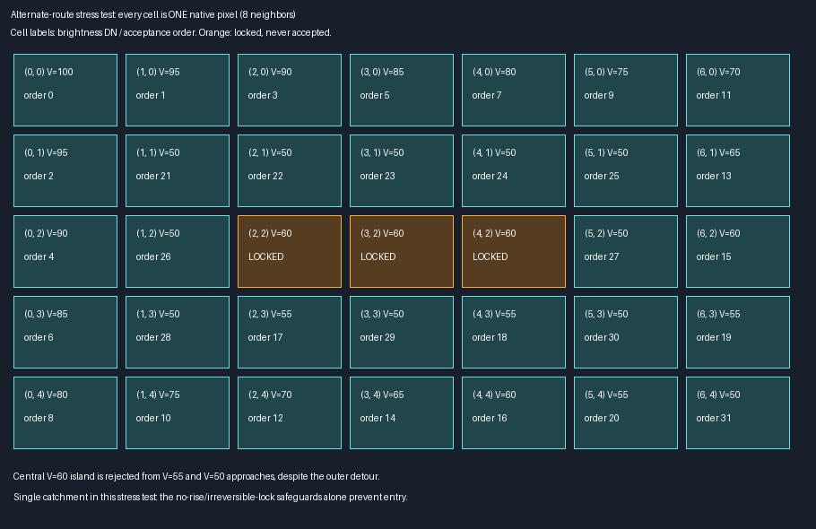
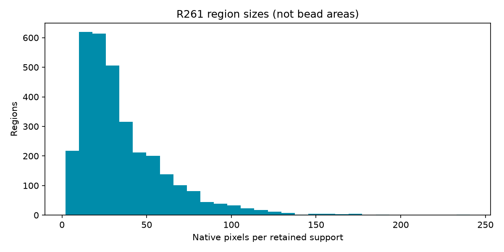
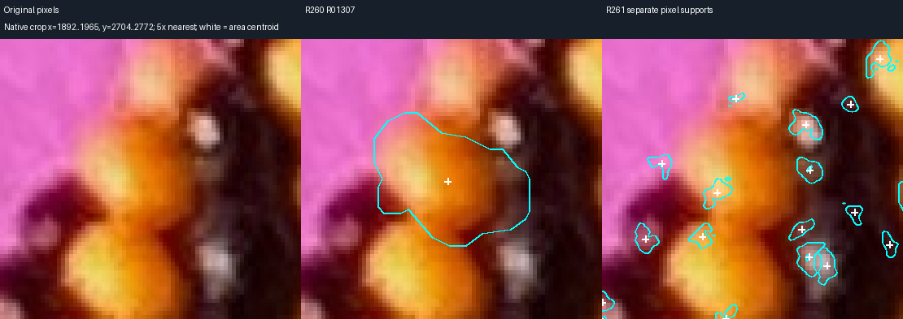
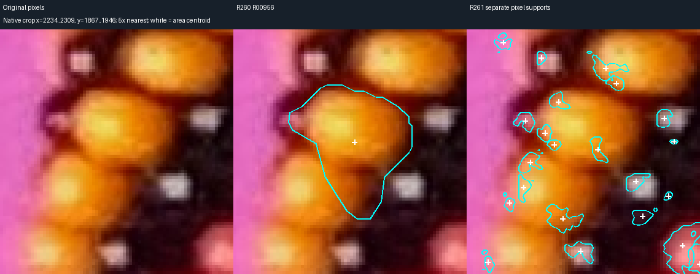
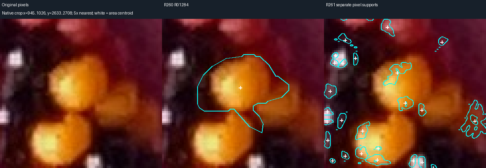

# R261 — replace radial detection with native-pixel growth

The default detector is now [pixel_detect.py](bead_detection/pixel_detect.py), a
standalone native-pixel implementation. It produces **3,204 retained supports**,
all with unresolved physical bead identity. Median support area is **28 pixels**.
The result favors compact evidence, but fragmentation means it does **not** yet
establish one coordinate per bead or complete coverage.

[Viewer and reproduction](bead_detection/README.md) ·
[Full data, traces and evidence](review/r261/README.md)

## What was selected

Three implementations were considered: monotone priority growth alone, watershed
ownership alone, and native-maximum catchments plus monotone priority growth.
The third is implemented. A priority queue alone cannot prevent independent roots
claiming the same slope, while watershed alone does not enforce each growth path's
brightness history. The two constraints are applied together. There are no rays,
angular samples, interpolation, detection blur, minimum radius, or modeled priors.
The old radial implementation remains solely for historical reproduction.

## Native pixel algorithm and safeguards

1. Decode the original JPEG and apply EXIF orientation without resizing. Value is
   exactly `max(R,G,B)` in integer 0–255; HSV is computed from the same decoded RGB.
   No white balance or old calibrated color box is applied.
2. Find **every raw 8-connected regional maximum plateau**. Equal adjacent values
   belong to one plateau only if the connected plateau has no brighter neighbor.
   Store its exact pixels, peak, centroid and stable maximum ID. Raw `h_maxima`
   prominence of 10 DN identifies meaningful candidates for growth. Lower-prominence
   plateaus remain in the rejected catalog; they are not silently discarded.
3. Reserve a raw watershed catchment for **every** maximum, including noise and
   paper candidates, before rejection decisions. Watershed operates on integer
   negative Value with 8-connectivity. It is only an eligibility partition; its
   pixels are not automatically accepted as regions. Rejected catchments never
   become available to a nearby retained maximum. Distinct raw maxima are never
   merged in this run. Equal watershed flood levels use the library's deterministic
   queue tie handling, not inferred physical bead boundaries.
4. Choose the actual plateau pixel nearest its centroid as the root. A heap accepts
   **one pixel at a time**, ordered by highest eligible Value, then y and x. Each
   accepted pixel examines all eight native neighbors. Store its earlier adjacent
   predecessor and HSV. Growth reconstructs a tree of actual adjacent-pixel paths.
   The connected near-peak bright patch is the accepted prefix within 10 DN of
   the peak, before retreat; save its runs and centroid separately.
5. Any positive brightness rise, including **1 DN**, stops that approach. The entire
   destination pixel becomes permanently locked for that region, including queued
   approaches from elsewhere. Waiting predecessors receive explicit lock-stop
   entries. A subsequent route cannot reopen it. Equal values are allowed; there
   is no positive tolerance to accumulate into a climb. A global nonincreasing
   acceptance ceiling supplies an additional invariant. Foreign catchments stop
   growth even when their next pixel is locally darker.
6. Hue is an additional stop: establish the first reliable chromatic sample on each
   predecessor path (S ≥ .35, V ≥ .20, S·V ≥ .08), then stop at circular drift ≥20°.
   A saturation loss ≥.40 below the near-peak band also stops. These relative rules
   are symmetric for palette changes and ignore unreliable achromatic hue. They
   can stop within a shaded bead; they do not establish material identity.
7. Stop at the first encountered pixel with V ≤81 DN and peak-to-pixel drop ≥36 DN.
   These pixels are not accepted. Separately verify the first complete dark shell
   around the seed's **raw** above-81 connected bright component. The shell is the
   one-pixel 8-neighbor dilation minus the component; image-edge components fail.
   A single meaningful maximum inside that component permits the conservative
   `dark-enclosed-bright-support` evidence label. Multiple meaningful maxima leave
   that interpretation unresolved. This establishes a dark enclosure, not a full
   black body or a confirmed black material. Growth may stop still earlier at
   noise catchments or color changes; it never proceeds into the dark shell to
   seek the entire bead.
8. Retreat along the recorded predecessor tree. For pixel i, let L_i be the minimum
   Value among its accepted descendants and terminal dark-frontier pixels. Retain
   it only above `L_i + max(retreat_dn, retreat_fraction × (peak − L_i))`, with a
   retained predecessor. Defaults are 2 DN and .30. The actual peak plateau remains
   as a fallback. This removes dark tails even where darkness could be on the bead.
   Every accepted pixel records whether it survives and its retreat floor.
9. The framed-paper prior estimates normalized RGB appearance from a generic 3.5%
   border band. This numeric band is an implementation choice, not a supplied bead
   coordinate. Reject a grown candidate when its entire bright patch matches that
   learned paper appearance, unless it has the verified dark-enclosure evidence.
   Paper-colored beads can still be rejected; no color-only completeness claim.
10. Exact pixel runs determine area, area centroid and the nearest supported pixel
    to that centroid. Display contours alone receive one cyclic 1:2:1 averaging
    pass and are closed. They are never rasterized back into detection, measurement,
    or hit testing. Cyan curves can deviate fractionally from exact pixel edges.

The no-bypass claim is algorithmic: no accepted predecessor edge rises; the full
acceptance sequence never rises; a locked destination is never accepted later;
a region never enters a rival maximum's catchment. Thus taking a detour cannot
make a brighter pixel reachable after crossing a detected valley. This does not
prove every physical inter-bead boundary appears as a measurable valley. Equal
brightness bridges, shallow texture, and optical blur remain photographic limits.

The audit records 814,592 competing-catchment stops, 57,044 dark-frontier stops,
16,913 hue stops and 1,501 direct brightness-rise stops (plus 46 lock bookkeeping
entries). Thus most photo growth is limited by the conservative raw-maximum
partition. This is a substantial source of fragmentation, not evidence that every
saved catchment boundary separates physical beads.

Noise is handled conservatively through candidate significance and reserved raw
catchments, **not** by smoothing or permitting tiny uphill steps. Consequently
noise peaks can split one bead and suppress useful surrounding support. Multiple
highlights remain separate ambiguous proposals. No photographically unverified
same-bead association is manufactured to reduce the count.

## Validation before the photograph

The six requested synthetic scenes passed before the full-image run. All source
pixels and traces are saved, with 5× nearest-neighbor raw/contour illustrations.
Two separated bright beads produce two retained supports; several highlights on
one body remain separate; a reflection on black produces one compact support;
a dark shadow produces no retained region; uneven lighting still separates the
two bright supports; noise/equality preserves candidates and does not authorize
uphill growth. These are constructed images, not calibrated photo recall tests.

This 7×5 example deliberately gives the growth algorithm a single catchment,
so watershed cannot solve it. The outer route remains available, but the central
V=60 island is never accepted from its V=55 or V=50 neighbors. Its stopped edges
and all acceptance/predecessor records are saved in `valley-proof.json`.

Nine new tests cover the six scenes, the detour, equality, 1-DN rise, noise maxima,
color direction/wraparound, on-bead retreat, palette/rotation/determinism, and
50 randomized all-frontier logging cases. The 21 historical detector/strict tests
also pass. The full-photo audit checks **669,505 accepted pixels and 890,096 stopped
edges**, all source HSV values, adjacent/nonincreasing predecessors, irreversible
locks, eight-neighbor examination, retreat, support connectivity, exact centroid,
supported-location membership, nonoverlap and closed display contours. All **97**
dark shells pass an independent exterior-flood enclosure check.

The audit exposed and fixed an initial trace omission for previously queued
approaches that another path later locked; pixel masks were unchanged. Every such
approach now has a stopped-edge record. An isolated replay with only the detector
file and original photograph reproduces the JSON byte-for-byte, both label arrays,
and all **7,543 compressed traces**. No historical evidence is available to that run.
The simplified viewer passes **41 Chromium checks**, including individual pixel
acceptance, stop-time replay, exact stop HSV, size browsing, pan/zoom and downloads.

## Full photograph results

Generation `5e12fe3816473053`; source and detector hashes, full parameters and
artifact hashes are saved in the evidence directory.

| Quantity | R261 |
| --- | ---: |
| All native regional maxima / plateaus preserved | 154,761 |
| Meaningful maxima grown (10-DN prominence) | 7,543 |
| Retained regions | 3,204 |
| Ambiguous retained candidates (overlap with preceding row) | 3,204 |
| Total rejected candidates | 151,557 |
| Rejected for low prominence, preserved without growth | 147,218 |
| Rejected after growth for paper-compatible patches | 4,339 |
| Retained supports with verified dark enclosure | 97 |
| Retained area minimum / median / maximum | 2 / 28 / 241 px |

Every maximum is accounted for: 3,204 + 4,339 + 147,218 = 154,761.
No confidence score disguises the unresolved identities. Neither the raw maxima
nor the region count is a bead inventory. The R260 run had 1,057 retained proposals
and median area 526 px, generated from 1,498 smoothed maxima. Those populations and
ID namespaces differ; a higher R261 count does not establish improved recall.

## Exact R260 failure comparisons

Each comparison includes the same raw crop, the R260 contour, all retained R261
supports intersecting the crop, native CSV rows with RGB/HSV and memberships, and
full candidate/centroid/overlap tables. Native pixels are enlarged by an integer
factor without interpolation. White crosses are area centroids, not physical centers.
Historical IDs are used only by the comparison exporter after detection.

**R01307:** the previous 854-pixel support becomes several small patches in the
crop. P132164 has 30 retained pixels, all inside the old support, centroid
(1919.833, 2741.300), supported coordinate (1920, 2741). P131806 and P132671 also
intersect the old mask but lie toward the adjacent dark/reflection evidence in
the crop. They remain separate. This removes the broad extension, but does not
assign all those maxima to specific physical beads.

**R00956:** the 1,052-pixel support's lower extension no longer becomes one large
connected region. Five R261 supports intersect its old pixels: P091868 (24 px),
P091867 (12), P091744 (19), P091289 (23), P091549 (27). P091868's centroid is
(2276.292, 1905.792), 4.02 px from the old area centroid. That displacement is not
an accuracy measurement. Several bright patches appear on the same yellow body;
one-bead/one-coordinate consolidation remains unresolved. Nearby tiny paper-edge
proposals in the enlarged crop also show why retention is not certification.

**R01284:** P128275 (70 px; centroid 981.514, 2659.900) and P128915 (38 px;
985.553, 2675.447) intersect the former 1,053-pixel mask. The large old right/lower
extensions are absent. The two compact patches appear compatible with separate
brightness peaks on one yellow body; no same-bead identity is asserted. The
supported coordinates are (981, 2660) and (985, 2675), respectively.

These targeted assistant comparisons show containment changes and duplicate
uncertainty, not measured coordinate errors or exhaustive detection quality. The
algorithm was not tuned to these IDs. Source-only regeneration confirms they do
not enter detection. Weak beads without meaningful maxima, paper-colored bodies,
noise catchment fragmentation, low-contrast dark reflections and false edge patches
remain limitations. The 97-versus-136 dark-support counts cannot be interpreted as
a recall difference because the algorithms and meanings differ.

## Delivery and stopping point

The new default viewer keeps the original photograph, cyan contours, IDs, centroids,
pan/zoom, region selection, histogram and the requested growth replay. No modeled
geometry, old spline or manually identified bead is loaded. R259/R260 results,
strict comparisons, and production reviews remain unchanged; the historical viewer
is available through `server_r260`. Sites was used only for the local viewer
workflow, without hosting or publication. No manual bead-marking request was made.

Stop after this scoped commit/push and verification. Next: inspect duplicate
supports and missed visible locations using these native crops/replays before
considering evidence-based same-bead association. No global indexing or geometry
work is authorized by this delivery. Recommend GPT-6 Astra / High for that visual
inference review (a task recommendation, not a claim of changed session status),
consistent with [official OpenAI documentation](https://developers.openai.com/api/docs/models/gpt-6-astra).
No `/new` is needed just to inspect the viewer; use `/new` before another substantial
algorithm round. User controls model and session switching.
