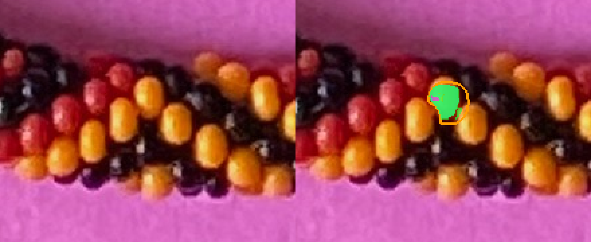
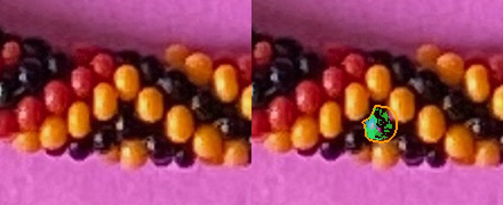
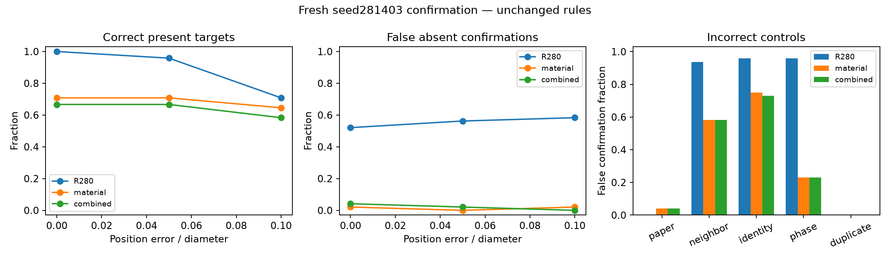

# R281 — bead presence, exposed neighbors, and one real-photo pilot

[Layered review](review/r281/index.html) · [reproduction](r281/README.md) ·
[original protocol](r281/PROTOCOL.md) · [frozen rules](r281/results/freeze.json).

Explicitly comparing a target-present explanation (H1) with a target-removed
explanation (H0) reduces false confirmation of absent beads. On the original
held-out set, the combined method supports **38/59 present targets and 0/59
removed targets** at exact geometry. The unchanged R280 baseline supports all
59 present targets but also **32/59 removed targets**. This is a substantial
precision/recall tradeoff, not a general solution to bead ownership.

An additional pre-frozen 24-scene confirmation finds **34/48 present and 1/48
absent** for the material ablation, versus **32/48 present and 2/48 absent** for
combined. Thus the original zero-error result does not persist on fresh scenes.
Material has a modest observed recall advantage, with uncertainty and remaining
ownership failures; no method is promoted to production.

Incorrect neighboring placements remain a failure: combined confirms **27/59**,
and an unanchored identity substitution confirms **40/59**. The real pilot gives
one plausibly supported yellow surface under one hand, with physical identity
unresolved. No chain growth, indexing, global fitting or pattern search is justified.

## Methods and measurement path

Three methods were specified before implementation:

1. **Material continuity:** learn normalized-RGB material from spatially separated
   pixels, allowing an achromatic specular contribution. Compare target material
   with material extrapolated from the surfaces exposed when the target is removed.
2. **Differential boundaries:** compare image edges at H1/H0 contours that differ;
   shared contours cannot establish which explanation owns the pixels.
3. **Combined evidence:** 60% material fit and 40% boundary support, with independent
   optimization of H1 and H0 over the same small registration grid.

The material and boundary controls change the acceptance score while using the
combined method's registrations and quality gates. They are ablations, not three
independently optimized detectors. Evidence scores are not probabilities.

The viewer starts from the original decoded photo pixels. Orange is predicted
geometry; cyan Phase1 dots are existing photographic locations; coherent measured
interiors, H1-favoring pixels, H0-favoring pixels, newly exposed owners, and location
uncertainty have independent layers. Measured locations are native-pixel support
centroids, never physical centers. Highlights do not define full-body boundaries.

For each target, H0 removes only that bead and retraces the affected rays through
the other literal rounded annuli. It can therefore explain newly exposed beads
and seams that R280's original overlap guard could not see. If an exposed material
has no independent context, it receives its own cross-validated fit rather than
being declared wrong by default. The frozen gate requires at least 25% independently
constrained H0 context; the rest remains a limitation.

The final gates are margin >=.10, >=40 coherent pixels, coherence >=.65,
independent H0 context >=.25, H1 boundary support >=.30, and H1 material loss <=.45.
The development grid and original stricter/default failures remain in
[calibration](r281/results/calibration.json) and `results/development-v1/`.
The development-only criterion was >=95% paired precision and >=50% present recall,
with the context floor. Combined selected **16/23 present, 0/23 absent**.

## Benchmark integrity and scope

The original experiment has 12 development and 40 held-out scenes, both hands,
intended source radius 1.784536980648071, and pitch1.12/1.20 testing geometries.
All 52 have analytic separating-plane certificates. These are compatible test
dimensions, not measurements of the actual necklace. No historical pose, manual
neighbor chart, maker-confirmed physical identity, or repeating color prior enters
inference. Frozen Phase1 and R280 sources are unchanged.

The fixed R280 evaluator selects up to four easy, substantial central colored
targets per scene before detector scoring. There are 23 development targets in
9 populated scenes and 59 held-out targets in 23 populated scenes. Three development
and 17 held-out scenes have no eligible target and remain in the ledger; 25/48 and
101/160 requested target slots are unavailable. Reported recall is conditional on
eligible targets, not all beads or all scenes. The selected held-out targets are
26 red and 33 yellow; black-body reliability is not established.

Each selected target gets its own independently rendered absent scene. Its
prediction is identical in the paired present/absent trials. Every target also has
0/.05/.10-diameter position trials, 5°/10° roll trials and five incorrect controls.
Only pixels and predicted geometry enter the detector; rendered identities are
evaluation-only. The benchmark includes both hands but is not a fully crossed
factorial design: hand is coupled to scale and some scene settings.

Rules and source hashes were frozen at **2026-10-14 04:19:26 UTC**, before held-out
inference. Generation stopped on one numerical silhouette disagreement. The saved
[amendment](r281/results/benchmark-amendment.json) permits at most three discrepancies
per render, each within one pixel of a silhouette; it changes no detector, geometry,
target selection, or measured pixel. All discrepancies remain in evaluation.
The full original audit counts 9,604,079 resolved rays, 1,041 unresolved rays and
three boundary disagreements across present/absent projection checks.

The old R280 eight-pair absence set was used as development diagnosis, not held-out
evidence. With frozen R281 rules, its two original false confirmations become
contradicted; five of eight present targets remain supported. All old outcomes survive.

## Original held-out results

Precision below uses the equally weighted paired present/absent query set and
requires at least 90% support purity for a correct positive. Changing the prevalence
of absent beads changes precision. A zero observed error count does not prove a
zero population error rate.

| Fixed method, exact geometry | Correct present /59 | False absent /59 | Paired precision | Present recall |
|---|---:|---:|---:|---:|
| Unchanged R280 C | 59 | 32 | 64.8% | 100% |
| Material ablation | 42 | 0 | 100% observed | 71.2% |
| Boundary ablation | 4 | 3 | 57.1% | 6.8% |
| Combined, original selected method | 38 | 0 | 100% observed | 64.4% |

Combined finds 19/26 red and 19/33 yellow targets. The material ablation recovers
23/26 red and 19/33 yellow. The original selected method is not silently replaced
after seeing the held-out outcome.

| Position error | Combined correct present /59 | Impure accepted present | False absent /59 | Paired precision | R280 correct / false absent |
|---|---:|---:|---:|---:|---:|
| 0D | 38 | 0 | 0 | 100% observed | 59 /32 |
| .05D | 38 | 0 | 0 | 100% observed | 56 /34 |
| .10D | 34 | 2 | 0 | 94.4% | 38 /35 |

At .10D, material accepts 35 correct present, three impure present, and one absent
target. Thus its higher exact-position recall is not uniform superiority.
At either 5° or 10° roll, combined recovers 36/59 present and falsely confirms
0/59 absent. These are 2D raster roll trials with the inverse angle explicitly in
the search grid, not a test of unknown camera inclination or perspective.
The position shift is along image x; it is not an isotropic uncertainty guarantee.

For the 38 correct exact-position combined outputs, median error from the true
visible-surface centroid is .0090 diameter and 95th percentile .0832 diameter;
all lie within the nominal .15D radius. This excludes rejected targets and does
not measure physical-center error or establish calibrated uncertainty coverage.

Scene-cluster bootstrap (2,000 draws of the 23 populated scenes) gives a 95%
present-recall interval of **50.9–76.3%**. The bootstrap cannot infer unseen failures
from zero observed absent errors: its [0,0] interval is not a population guarantee.
Even treating the 23 populated scenes as independent, the one-sided 95% upper bound
on the probability a new comparable scene has any failure is **12.2%**. Empty scenes
have no target-conditioned measurement and are excluded from this bootstrap, with
their availability failures explicitly retained above.

## Incorrect ownership remains the blocking result

| Negative control, 59 each | R280 false confirmations | Combined false confirmations |
|---|---:|---:|
| Paper displacement | 0 | 0 |
| Neighbor displacement | 58 | 27 |
| Unanchored identity substitution | 55 | 40 |
| Wrong phase | 56 | 14 |
| Explicit duplicate claimant | 0 | 0 |

The neighboring and phase controls perturb the whole local prediction bank; they
do not preserve independently established anchor correspondences. The identity
control queries an actual different bead while attributing the answer to the
original target. Its surface can fit correctly while the requested identity is
wrong. Presence evidence cannot by itself recover that correspondence. The
phase control is an intentionally incorrect pose hypothesis, not literal absence
of all material in the aperture. Duplicate abstention is triggered by an explicitly
provided competing claimant, not automatic discovery of all duplicate explanations.

These failures survive with raw images, complete predictions, scores, registrations
and support masks. They preclude a claim that H1/H0 has solved ownership or that
the absence improvement authorizes connected growth.

## Real photograph: four anchors, frozen neighboring predictions

The 220×180 native crop starts at **(498,1515)** in the EXIF-transposed source image.
Automatic selection uses existing image-only Phase1 interior quality, local PCA
straightness and six eligible central colored observations. Four left-side fitting
anchors are `C-0585-1605`, `C-0541-1602`, `E5-0562-1620`, and `C-0565-1588`.
They derive from R273 and automatic R275 band recovery; the R278 inventory is only
their preserved container. No R278 geometric fit is an input.

Only those four observed interiors enter the fit. Its coarse search has 924
connected assignment permutations, both hands, pitch1.12/1.20, three inclinations,
24 phases and shared translation/scale/roll; 48 candidates and 12 refinements
survive in the ledger. Centroids initialize a proxy fit, then sampled interior
ownership scores shared-pose alternatives. No bead moves independently.

Four certified models are retained, two per hand, with centroid-proxy RMS
1.09–1.18 native pixels. The original 48-pixel-per-anchor fit score is 100%
ownership; an added full-mask audit finds **1,713/1,718 anchor pixels (99.7%)**
owned as assigned in every model. Five pixels in one anchor disagree. This is
photographic interior containment by a hypothesis, not independent proof of identity.

Two geometrically visible immediate-neighbor sites per model were frozen before
target pixels or non-anchor Phase1 overlaps were evaluated. Each also gets a .8D
displaced control. Reversed local index assignments produce identical images within
each hand; the four models are not four independent confirmations. Their indices
are conditional local model labels, not recovered string indices. Region selection
saw photo-derived quality and PCA information, so this is an anchor-only fit split,
not a wholly unseen photograph.

| Pilot outcome | R281 combined | R280 |
|---|---|---|
| Eight candidate records, two per model | 2 supported, 6 ambiguous | 8 strong |
| Eight displaced controls | 4 contradicted, 4 ambiguous | 8 strong |

The two supported records are the **same yellow surface under the positive-hand
index reversal**. Its coherent 395-pixel support overlaps 329/402 pixels of existing
Phase1 interior `C-0603-1587`; this is not a newly discovered bead. Visual inspection
shows a plausible substantial yellow patch, with conditional physical identity.
The negative-hand fit reaches the same patch but has material loss .472 above the
.45 gate; the positive hand has loss .414. This modest appearance difference does
not certify helicity. The other target falls on a dark mixed/reflection region and
fails coherence/material gates. All ambiguous examples remain visible.

The incorrect controls test displacement sensitivity; the photo has no independent
truth labels for physical identity. No real-photo accuracy percentage is claimed.

## Recovery, additional work and stopping point

The reboot left the main implementation and results uncommitted, without this
report or final handoff. Recovery preserves every frozen detector/fit source and
all original predictions. A separate audit checks full historical Git blob hashes,
all native mask sizes and centroids, full anchor masks, raw-crop fidelity, and exact
replay. The browser was restored after `/tmp` loss and tested with approved launch
outside the sandbox.

The user subsequently authorized more work on this task. A separate, pre-frozen
24-scene confirmation uses seed281403 to compare the existing material ablation
against combined with unchanged rules. Original held-out outcomes motivated this
follow-up and were already known; they are not relabeled as fresh evidence.
The [confirmation freeze](r281/results/confirmation-freeze.json), written at
2026-10-14 13:39:35 UTC, precedes these scenes. All 24 have valid physical
certificates. They supply 48 targets in 19 populated scenes, with five empty
scenes and 48/96 unavailable target slots retained. The detector, registration
search, material/boundary weights and acceptance rules are unchanged.

| Fresh confirmation, exact geometry | Correct present /48 | False absent /48 | Paired precision | Recall |
|---|---:|---:|---:|---:|
| R280 | 48 | 25 | 65.8% | 100% |
| Material | 34 | 1 | 97.1% | 70.8% |
| Boundary | 11 | 4 | 73.3% | 22.9% |
| Combined | 32 | 2 | 94.1% | 66.7% |

Material recovers three targets combined rejects and loses one combined recovers:
a net two-target (4.2 percentage point) improvement. The paired scene-bootstrap
95% interval for the recall difference is **−3.6 to +11.6 points**, so superiority
is not established. Combined's paired precision is below the original 95% selection
criterion on this fresh set. Neither result justifies retuning on these scenes.

| Fresh position trial | Material correct / impure / false absent | Combined correct / impure / false absent |
|---|---:|---:|
| 0D | 34 /0 /1 | 32 /0 /2 |
| .05D | 34 /0 /0 | 32 /0 /1 |
| .10D | 31 /1 /1 | 28 /0 /0 |

At 5°/10° roll, material recovers 35/36 of 48 with zero absent confirmations;
combined recovers 31/31 with one absent confirmation at each angle. Again, these
are known inverse-angle 2D searches rather than general camera recovery.

Fresh wrong-neighbor confirmations remain **28/48 for both**. Unanchored identity
confirms 36/48 for material and 35/48 for combined; wrong phase 11/48 for both.
Explicit duplicate controls yield zero confirmations. The nominal paper-shift
control produces two confirmations for both methods. Inspecting evaluator truth
shows the fixed 85px displacement actually lands on other beads: one support
contains 63/60 pixels of two different bodies, and the other 270 bead/37 paper pixels.
These are incorrect-placement confirmations, not proof of fabricating a bead on
entirely empty paper. The misnamed category and all outputs are preserved; no
truth-based filter has been introduced into inference.

The fresh exact-geometry absent failures are scene10/target0 (combined only) and
scene17/target−1 (both). In scene10 the material margin is only .005, but the
boundary contribution raises the combined margin to .219 and confirms an absent
bead. Scene17 has material margin .218 and combined margin .178, so dropping the
boundary cue alone would not remove that failure. The independent H0 interpretation
is useful but remains incomplete under real occlusion/material ambiguity.

The real-photo material comparison supports the same single yellow surface; it
turns the four combined contradictions into abstentions, accepting none of the
displaced controls. No new real bead or physical identity is recovered. The better
result of this follow-up is a modest recall alternative plus a clearer failure
boundary, not a solved reconstruction.

Validation completed during recovery: **25 focused scientific checks**, all
**6,844 protected historical file hashes**, **7,832 native mask/count/centroid
measurements**, original raw-crop fidelity and the complete anchor-mask audit.
The original experiment independently rerenders 268 photographic/identity rasters
and reproduces 134 geometry/truth array files, all 1,230 synthetic queries at the frozen
operating point, both original summary tables, the real prediction freeze and all
real measurements exactly. With the fresh scenes included, projection audits have
14,764,608 resolved rays, 1,472 unresolved rays and 9 retained one-pixel boundary
disagreements. R280, Phase1, the source photograph and source geometry remain exact.
The additional 720 fresh-scene queries replay exactly from saved pixels and geometry
(four method outputs each), without independently rerendering that follow-up.
In total, all **1,950 synthetic queries** replay exactly, with development decisions
normalized to the frozen operating point. **28 rendered browser examples and seven
independent layers** pass; original-image panels stay unchanged. The evidence is in
[recovery audit](r281/results/recovery-audit.json),
[fresh replay](r281/results/confirmation-replay-check.json), and
[browser checks](r281/results/browser-check.json).

Next bounded task: resolve shared anchor-to-model correspondence and test anchored
wrong-neighbor/wrong-phase alternatives, including uncertain material and camera
pose, before any one-neighbor growth. Stop after this R281 delivery. Keep the current
model and reasoning setting; no `/new` is needed. No automatic next phase.
