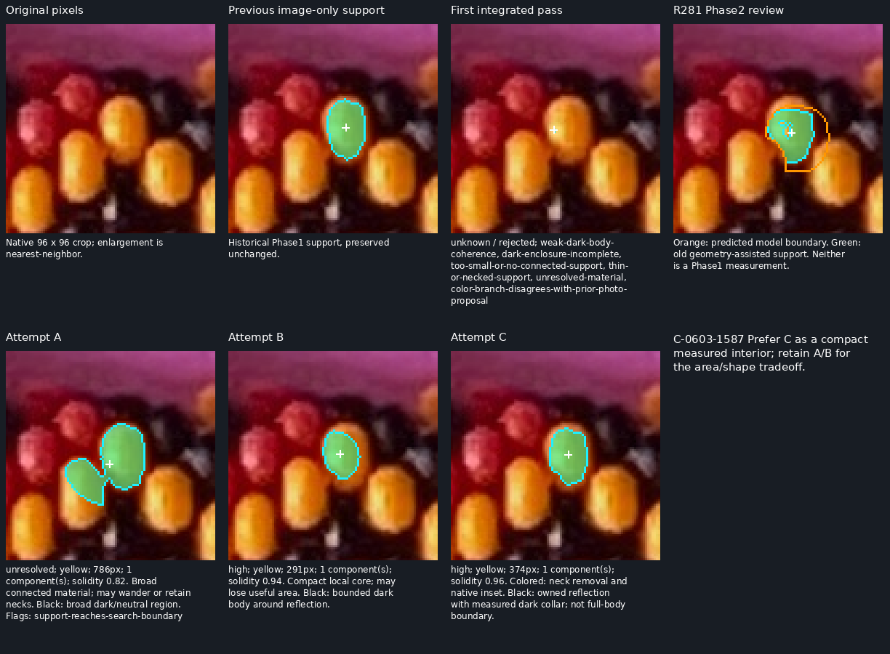
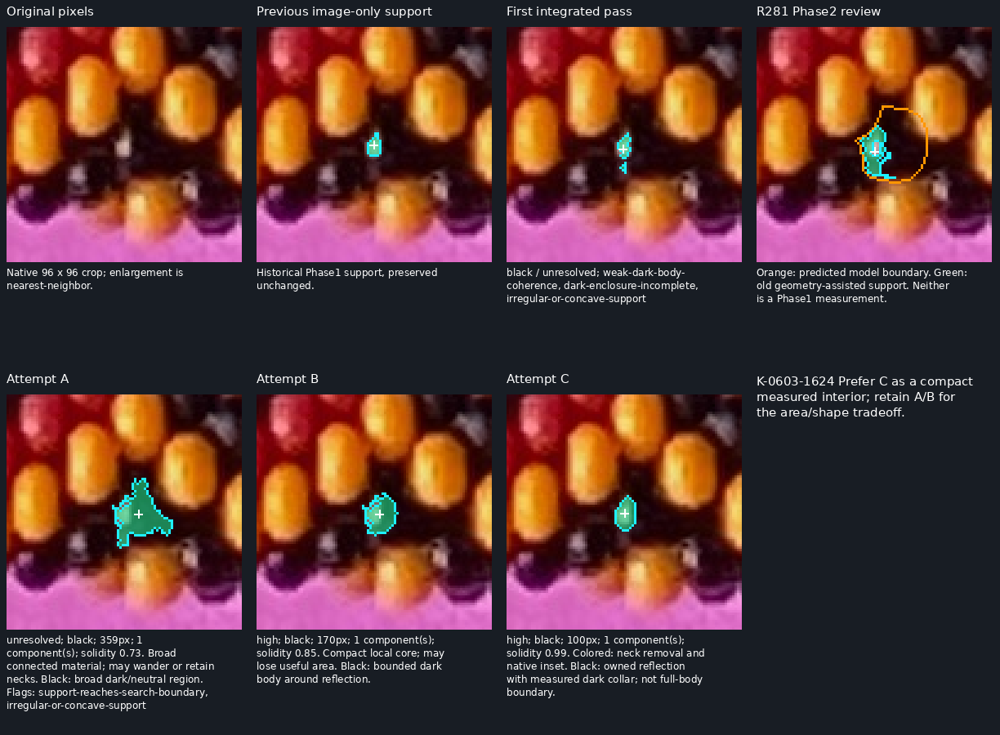
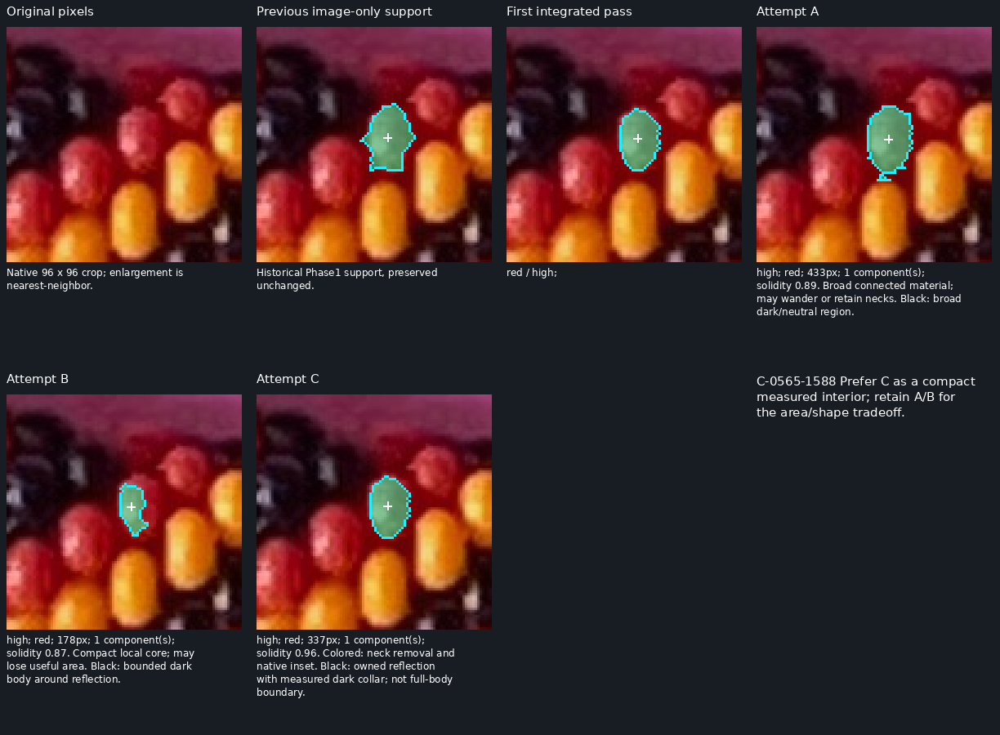
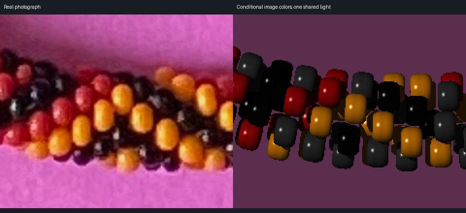
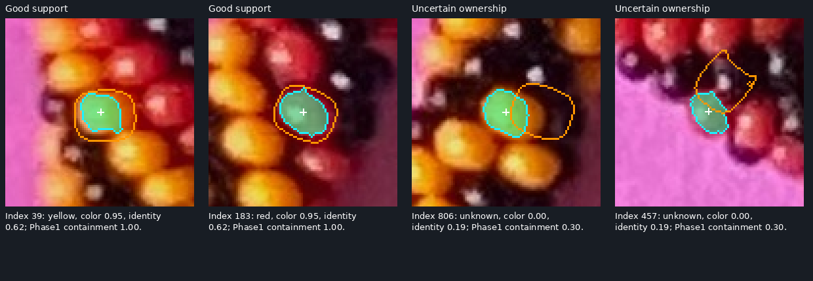
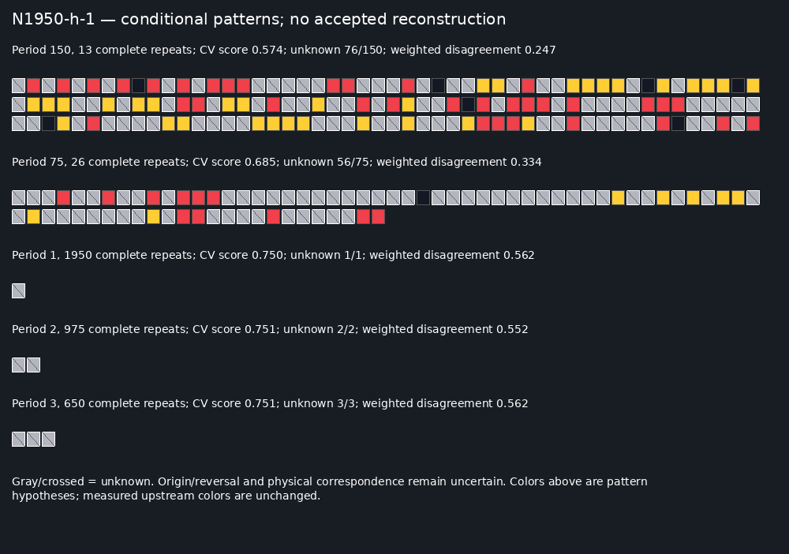

# R282 — implemented three-phase reconstruction, with exposed failures

All three phases now exist, run in order, and have been tested on `beads-photo-2.jpg`.
The useful advance is a more compact photographic inventory and an auditable path
from that evidence to conditional physical inventories and repeating-pattern candidates.
**The necklace's physical identities, total count, helicity and pattern are not solved.**

The complete [specification](R282_SPECIFICATION.md) was saved before implementation.
The [checklist](R282_CHECKLIST.md) links every requirement to code, tests and results.
Start inspection with the [22-panel review](review/r282/index.html), especially the
Phase1 comparisons. All important panels are standalone PNGs and work without JavaScript.
[Reproduction](r282/README.md) describes the entry point and output conventions.

## What was implemented, in order

1. **Phase1:** photograph-only native support measurements. Reuse 900 preserved
   image-only candidate locations as starts, add192 automatic near-centerline maxima,
   learn the image palette, compare three support rules, assign explicit uncertainty.
   No physical fit, string index, count or repeating pattern enters this phase.
2. **Phase2:** fit a closed planar rope with literal rounded annular beads to the
   reliable measured supports. Compare five counts and both hands with equal budgets;
   resolve all-neighbor visibility, image colors and shared-light consistency, and
   export every bead for four retained physical hypotheses.
3. **Phase3:** search permitted exact repeat divisors using weighted Phase2 evidence;
   retain unknown slots, conflicts, held-out losses and strict-evidence alternatives.
   No result writes back into Phase1 or Phase2.

The entire first pass completed **before** any quality repair. It learned a
background-tinted hue as its second bead color, yielded no high-class black beads,
and produced misleading red-dominated pattern rankings. Its full outputs and source
remain in [first-pass](r282/first-pass/). One Phase1 repair excluded the border-like
hue only when learning the palette and measured a bounded dark collar around owned
black reflections. The full second run remains in [second-pass](r282/second-pass/).
A subsequent Phase2 repair samples the intersection of a reliable measured support
and its predicted visible surface when containment is at least60%; it remeasures
actual RGB rather than copying the Phase1 color label. This repair leaves Phase1
and all physical fits unchanged. The final full run is in [results](r282/results/).

## Phase1: the main inspection target

[Inventory](r282/results/phase1.json.gz), [all A/B/C attempts](r282/results/phase1-attempts.json.gz),
[summary](r282/results/phase1-summary.json), [whole-photo coverage](review/r282/phase1-overview.png),
[retained geographic gaps](review/r282/phase1-gaps.png).

| Color | High | Medium | Unresolved | Rejected |
|---|---:|---:|---:|---:|
| Red |267|24|152|10|
| Yellow |285|7|78|1|
| Black |140|0|122|6|
| **Total** |**692**|**31**|**352**|**17**|

These are algorithmic reliability classes, **not measured precision**. The high class
uses weight0.96, which must not be read as a demonstrated96% success probability.
All photographic observations have high importance, including unresolved ones.
The inventory contains1092 candidate starts;1085 have nonempty connected measured
masks. The seven empty results survive with reasons. A location is not a full silhouette
or necessarily a distinct bead. Remaining duplicates/ownership errors are possible.

The image-derived reference centerline has8193 stations. A high-class location lies
within26 native pixels at7897 stations (**96.39%**, versus52.78% in the failed first
pass). The worst station is36.71px from one. Near-centerline classification contains
447 high,9 medium,171 unresolved and9 rejected starts. **This is spatial proximity
coverage, not evidence that all centerline beads have been found.** The requested
all-beads-near-centerline standard remains unproved; the gap panels expose where to
inspect next. The reference spline and old starts are image-derived historical
inputs, so this is a revised inventory, not a claim of a wholly new detector from scratch.

Three rules are retained at every candidate:

- **A:** broad connected appearance. It preserves larger support but can bridge beads.
- **B:** a tighter local core. It often looks compact but may truncate useful evidence.
- **C, selected:** colored regions use native opening/neck removal and inset; black
  regions use a bounded reflection component with measured dark collar, enclosure,
  connectedness and shape checks. The support is a measured interior, never a claimed
  complete black-body boundary. Material/ownership/overlap failures remain unresolved.

Selection is based on conservative support quality, not maximizing retained count.
B gives749 high candidates before final overlap reconciliation, versus761 for C;
C's final692 reflects subsequent ambiguity checks. No individual reviewed coordinate
or manual identity changes runtime acceptance.

| Representative | Attempt A | Attempt B | Attempt C, selected |
|---|---|---|---|
| Yellow C-0603-1587 |786px, solidity.820; joins neighboring yellow, unresolved|291px, solidity.942; smaller core|374px, solidity.959; one connected compact interior|
| Black K-0603-1624 |359px, solidity.733; wandering dark region, unresolved|170px, solidity.854; bounded core|100px, solidity.990; reflection plus measured dark collar|
| Red C-0565-1588 |433px, solidity.889|178px, solidity.873; loses area|337px, solidity.963; compact interior|

The recent orange/green R281 examples are explicitly labeled **old Phase2** in these
panels. Their geometry-assisted supports are not relabeled as Phase1 observations.
Raw96×96 crops and separate576×576 enlargements accompany six representative cases;
three additional high/near-centerline examples are selected automatically. Centroids
are means of the exact native mask pixels, not physical bead centers. The yellow
repair removes the conspicuous lower/right wandering and near-split behavior in this
case. The black support is deliberately small; it demonstrates local coherent
measurement, not recovery of the whole dark silhouette or proof of body ownership.
The remaining122 unresolved black starts are a material limitation.

## Phase2: fitted alternatives, not recovered identities

[Comparison and parameters](r282/results/phase2.json); per-model `*-fit.json`,
`*-inventory.json.gz`, `*-light.json` and `*-summary.json` live alongside it.

Fit inputs are692 high Phase1 observations:515 training,177 geographic holdout;
180 geographically distributed training anchors drive optimization. Each count/hand
gets96 cold proxy starts and27 exact first-hit support evaluations. The proxy only
initializes the search. Exact support correspondence is one-to-one with allowed
unmatched anchors. Holdout locations never enter the fit objective, but all inputs
come from this same photograph and historical image-only selection: this is not a
blind new-photo accuracy estimate. Final exports match all high anchors without
refitting pose, and preserve original measured supports/centroids separately from
predicted physical centers and predicted visible centroids.

The physical family uses source radius1.78453698, literal rounded annuli, a planar
closed centerline, both helical hands and one shared camera. Pitches1.35/1.45 are
**exploratory large changes**, not measured small strain. Count/scale/camera tradeoffs
remain. The bounded grid and local search do not establish a global optimum.

| Count/hand | Training objective | Held-out support | Collision certificate |
|---|---:|---:|---|
|N1950-h-1|0.637|0.550|pass|
|N1950-h+1|0.637|0.595|pass|
|N2080-h-1|0.643|0.584|FAIL, retained|
|N2080-h+1|0.603|0.549|pass|
|N2300-h-1|0.621|0.532|pass|
|N2300-h+1|0.608|0.569|pass|
|N2600-h-1|0.553|0.559|pass|
|N2600-h+1|0.607|0.601|pass|
|N2696-h-1|0.583|0.499|pass|
|N2696-h+1|0.567|0.552|pass|

Nine of ten have analytic separating-plane witnesses for the outer bead envelopes;
N2080/h−1 fails and is retained. Certification establishes noninterpenetration in
that model, **not compatibility with the photograph**. Training-only ranking retains
two certified counts per hand. Four complete inventories contain8500 conditional
physical records in total. Identity weights are capped at0.65 before multiplying
anchor reliability, and are further reduced by poor containment/color conflict.

| Model | Linked Phase1 | Geometry-assisted candidates | Unconfirmed | Red / yellow / black / unknown | Visibility0 |
|---|---:|---:|---:|---|---:|
|N1950-h-1|605|255|1090|513 / 399 / 302 / 736|0|
|N2300-h-1|643|287|1370|576 / 488 / 356 / 880|24|
|N1950-h+1|625|252|1073|502 / 408 / 284 / 756|0|
|N2300-h+1|646|285|1369|588 / 512 / 346 / 854|2|

Visibility is the ratio of native first-hit pixels to isolated projected pixels.
Invisible beads have visibility0 and unknown color. Nonzero includes tiny slivers:
129–406 beads per model have visibility below0.1. The sparse exploratory geometry
makes almost every bead at least partly visible; this is a prediction of a weak
model, not a measured census. Unknown/grazing ray counts (499–748 in these exports)
are explicitly retained rather than treated as resolved surface ownership.

Colors are read from ICC-managed photo pixels, with red/yellow hue evidence and
separate neutral-dark/reflection evidence. Reliable matched masks constrain the
sampling intersection when containment permits; otherwise the inset predicted
surface is used and mixtures can remain unknown. The second pass classified almost
all linked Phase1 black beads as unknown. The repaired final pass reads black on
102/127,99/136,99/126 and104/137 linked black observations respectively. Other linked
black records remain unknown or conflicting. This is improved **evidence transfer**,
not a separate accuracy test. Weak or unreflected black evidence has low reliability.
No pattern supplies any Phase2 color.

The shared-light test remains poor: usable held-out highlights agree within30° for
only a small fraction of matched beads; median angular disagreements span roughly
61–80°. Wrong first-owner highlights remain in the tables. The comparison therefore
does not support claiming correct camera, phase or physical correspondence.

POV-Ray independently renders the literal source primitive and one shared distant
light. The real-photo appearance mismatch is obvious and retained. A separate
identity-color render checks the numerical first-hit engine in the same fitted
photo crop:95,837 resolved pixels across both hands, one boundary disagreement,
zero disagreements in83,372 stable interior pixels,163 unknown rays. This validates
numerical projection/occlusion, **not** the fitted physical interpretation.

## Phase3: complete-repeat hypotheses, no accepted pattern

Weights are `visibility × color_reliability × phase2_identity_reliability`.
Only exact divisors L of N with N/L≥4 are eligible, implementing **more than three
complete repeats and no partial appearance**. Separately, the preserved maker fact
that L is not divisible by13 is applied and documented. Phase3 uses no photographic
refitting, no manual color labels and no upstream writes.

Consensus requires sufficient weight, at least two observations and75% dominant
color per slot; otherwise the slot stays unknown. Five index-block holdouts measure
prediction loss (wrong1, unknown0.75) plus a modest length penalty. The loss is a
comparison score, not a probability. Rotation, reversal and physical origin remain
unresolved. All permitted candidates, excluded-period reasons and explicit conflict
witnesses are saved, not just the leader.

| Physical hypothesis | Leading period | Full repeats | Unknown slots | Validation score | Strict-evidence leading period |
|---|---:|---:|---:|---:|---:|
|1950/h−1|150|13|76/150|0.574|75|
|2300/h−1|115|20|99/115|0.746|23|
|1950/h+1|75|26|56/75|0.634|6|
|2300/h+1|115|20|103/115|0.747|25|

The strict sensitivity subset requires Phase1 reliability≥0.9, color reliability≥0.75
and identity reliability≥0.5. Changing the evidence changes the leading periods;
changing hand/count does too. Period75/150 alternatives under1950 outperform shorter
all-unknown candidates but retain many unknown slots and conflicts. Under2300,
period115 is scarcely better than the all-unknown loss0.75. Short periods such as1,
2 or3 can rank next simply because they abstain everywhere; they are **not recovered
patterns**. Longer alternatives lose through insufficient repeat support, conflicts,
held-out uncertainty and the length penalty. Every candidate fails scientific
acceptance; no complete sequence is asserted. The repeat constraint is obeyed but
does not rescue an uncertain physical indexing.

Per-model `*-patterns.json` contains weighted and strict alternatives;
`*-phase3-inventory.json.gz` adds `pattern_color` and uncertainty separately.
Measured Phase1/Phase2 colors, locations and masks remain byte-for-byte unchanged.

## Tests, provenance and delivery

- **17 scientific contract tests pass:** native masks/centroids/provenance, connected
  versus necked supports, palette/background regression, separate black-body logic,
  Phase1 import independence, literal geometry, one-to-one assignments, visibility,
  black color transfer, weighted conflicts, known-pattern recovery and divisor rules.
- **Complete independent replay:** all37 algorithm output files reproduce exactly,
  including all ten fits, four physical inventories and Phase3 candidates. Run
  timestamps/source manifests are recorded separately rather than falsely compared
  for byte identity.
- **Saved-data audit:**1092 records,1085 connected native masks,692 high-mask size
  checks,8500 physical records,2519 unchanged Phase1 links,112 weighted/strict
  period cases and upstream hashes pass.
- **Independent POV-Ray geometry:** two real-fit crops,96,000 pixel rays, one resolved
  boundary difference and zero stable-interior differences;163 rays remain unknown.
- **Browser:**22 phase/example panels render, with working navigation and no script
  errors. Static raw/enlarged comparisons are available independently.
- **Preservation:**8916 historical files match base `e6a6d4c`; first and second failed
  integrated passes remain alongside final results. No historical experiment was
  rewritten. [Audit](r282/results/audit.json), [browser results](r282/results/browser-check.json),
  [POV results](r282/results/pov/validation.json).

The shared schema preserves required importance, reliability, visibility, colors,
locations/masks, model index/confidence and uncertainty notes. `phase_origin` is an
ordered contributor list; geometry-assisted detections remain Phase2, and conditional
pattern inferences are explicitly Phase3. A measured support centroid is never
silently promoted to a physical center. Phase1 visibility remains null until modeled.

**What works:** all three implemented phases, reproducible provenance, smaller
believable interiors in the named yellow/black cases, broad geographic coverage,
explicit competing physical inventories and uncertainty-preserving pattern search.
**What remains weak:** independently verified Phase1 precision/distinct-body ownership,
remaining centerline gaps and black ambiguities; physical correspondence/lighting;
and therefore all pattern conclusions. No completeness or final reconstruction claim.

**Next bounded task:** review and automatically audit Phase1 distinct-body ownership
and the retained central gaps, concentrating on easy central colored/black supports;
freeze that evidence before improving local Phase2 correspondence and camera/light
agreement. Do not start another global pattern search just to improve its score.
Stop after this R282 delivery. Keep the current model/reasoning; no `/new` needed.
