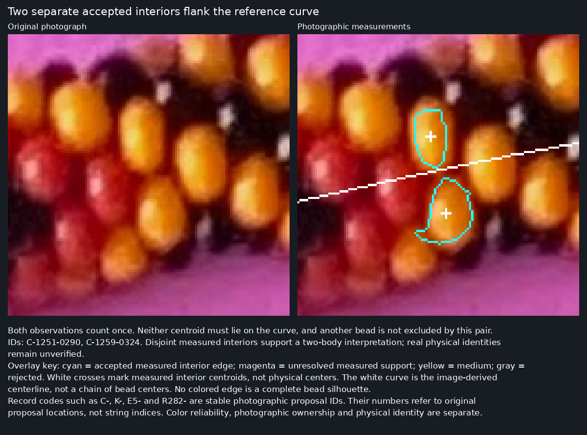
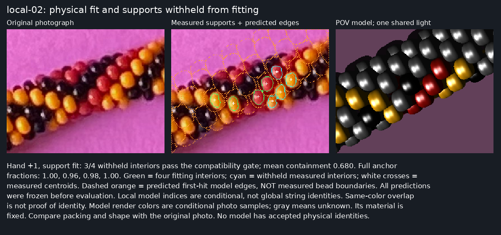

# R283 — stronger ownership evidence, correct two-sided accounting, incomplete physical correspondence

R283 improves the first link of the reconstruction and exposes a remaining local
geometry failure. **It does not establish total bead count, helicity, physical
identities or a repeating pattern.** All three phases remain operational; R282
implementation, measurements, outputs and specification are unchanged.

Start with the [28-panel review](review/r283/index.html),
[requirements checklist](R283_CHECKLIST.md), and [reproduction](r283/README.md).
Every review panel has original pixels beside annotations and substantial bottom
captions explaining symbols and the scientific question. No additional manual
labels or visual decisions were requested.

## Recorded user decisions

| R282 example | User decision |
|---|---|
| Yellow `C-0603-1587` | B and C both good; slight preference for C |
| Black `K-0603-1624` | Prefer C |
| Red `C-0565-1588` | Prefer C |
| Eight gap pictures | Original metric unclear; improve explanation and analysis |

Attempt C remains the measurement method. B remains a yellow sensitivity control;
371 nonempty B/C pairs have median centroid difference2.39px, maximum10.11px.
These shifts are measurement sensitivity, not error against ground truth.
[All old A/B/C comparisons](review/r282/index.html) survive. The named coordinates
never enter ownership, selection or fitting rules. The preferences are qualitative
review evidence, not verified physical identities.

## Experiment 1: distinct photographic ownership

R282's greedy overlap check could question one claimant while leaving another
high simply because it was processed first. R283 applies a symmetric graph audit
to unchanged native C measurements. It compares shared pixels, photo-only
peak/trough separation and broader dark-envelope alternatives. Close color or
distance alone cannot merge records. A near-equivalent pair of masks gets a
representative measurement, while both original records survive. General connected
ambiguity groups are **not** declared single beads.

| Color | High | Medium | Unresolved | Rejected |
|---|---:|---:|---:|---:|
| Red |196|23|224|10|
| Yellow |228|7|135|1|
| Black |137|0|125|6|
| Total |**561**|**30**|**484**|**17**|

All1092 IDs, measured supports, centroids, seeds and colors survive exactly.
131 formerly high observations move to unresolved; no high observation is
manufactured. All observations retain high importance, including difficult ones.
Every one of16 geographic sectors retains28–46 high observations. This is81.1%
retention of the former high inventory, not measured real-photo recall.

The graph contains152 shared-material conflicts, one near-equivalent measurement
pair, five shared-dark-envelope alternatives, three other possible secondary
features, and nine separated-feature diagnostics. These are pair counts, not bead
counts. Shared material requires at least5 pixels and12% of the smaller support.
Black alternatives compare nearby C reflections with overlapping broader A dark
supports. Because two real black beads can also connect through darkness, the
result is **abstention, not automatic merging**. Black reflection and dark-body
measurements remain separate from full silhouette claims.

[Possible duplicate reflection](review/r283/duplicate.png),
[shared-material abstention](review/r283/abstention.png),
[yellow](review/r283/good-yellow.png), [red](review/r283/good-red.png),
[black](review/r283/good-black.png). Supports remain conservative interiors.
The high class means the fixed checks found no detected ownership conflict; it
does not certify every photographed body. Numerical reliability fields are
explicitly **uncalibrated engineering weights**, with no assigned correctness
probability. Material-color reliability and physical-identity reliability remain
separate; all Phase1 physical identities are unresolved.

### Independent synthetic test and failed first method

The initial16 scenes, seed283501, exposed five duplicate black detections that
compact-support overlap could not recognize. That unsuccessful run survives in
[first-pass](r283/first-pass/). Inspecting these failures motivated the broad-dark
abstention rule; those scenes then became development evidence. The revised rule
was frozen before16 new scenes, seed283601, with new phases, hands, poses, scale,
random red/yellow/black assignments, same-color neighbors, lighting, roughness and
occlusion. All32 scenes have noninterpenetration certificates for literal source
annuli. Appearance is rendered by POV-Ray; identity rasters are evaluator-only.
The detector receives pixels, never identities, geometry or truth centroids.

The fresh confirmation has389 eligible visible bodies: at least40 visible pixels
and a centroid within the detector's24px image margin. Deep shadows remain in the
recall denominator. A correct measured support has at least95% pixels belonging
to one true body; this purity threshold is not a probability estimate.

| Fresh confirmation | R282-style greedy audit | R283 symmetric + black alternatives |
|---|---:|---:|
| High records |184|151|
| Pure single-body records |167|148|
| Duplicate high records |2|0|
| Mixed-body/foreign support failures |17|3|
| Majority-background false detections |0|0|
| Distinct-body precision |89.7%|98.0%|
| Eligible bodies recovered |165/389|148/389|
| Recall |42.4%|38.0%|
| Eligible adjacent pairs with both bodies recovered |250/833|202/833|

The paired scene-bootstrap interval for distinct-precision improvement is
**+4.3 to +13.1 percentage points**. This establishes an improvement on this
synthetic family, with a recall cost; it does not calibrate the real photograph.
The first/development family's revised precision is96.1%, also below perfection.
Fresh per-color recovery is red63/129, yellow40/118, black45/142. The three remaining
fresh failures are black mixed-body supports and are pictured in the review.
All148 pure supports have correct color and centroids on their true body.
Median distance from measured centroid to the complete visible-body centroid is
5.31px; a conservative interior need not share that full-silhouette centroid, so
this is a descriptive offset, not a claim of5.31px localization error.

Synthetic recall remains low, particularly black recall. Most eligible bodies are
not high-class detections; their missed identities and adjacent-pair failures are
retained. The revised rule preserves89.7% of baseline recovered bodies. It does
not achieve near-perfect precision by deleting the whole inventory, but it also
does not meet complete detection. Palette, material and illumination coverage are
narrower than the real image. No further tuning used the fresh confirmation.

## Experiment 2: both sides of the centerline

The image-derived curve is a structural reference, never a list of bead centers.
For every support pixel, R283 measures local tangent/normal relationships and
signed distance; it retains the full signed extent, not just centroid sign.
An interior reaching within one native pixel of the curve with support on both
sides is marked crossing. Side-changing and empty cases are explicit.

Principal nearness is minimum support distance within half the local median
equivalent **interior** diameter, estimated from nearby high supports. This uses
photographic extent and local scale; it is still an operational rule whose scale
underestimates full bead diameter. The old26px centroid rule remains diagnostic.
No physical model or pattern certifies any observation.

There are **323 high near-curve observation IDs**, counted once:169 crossing,
80 on the negative side and74 on the positive side. Additionally190 unresolved,
three medium and one rejected support are near. **24 candidate flanking pairs**
have separate accepted interiors on opposite sides at comparable longitudinal
positions and no detected pair conflict. Neither centroid must touch the curve;
no rule forces exactly two beads at every station. Physical distinctness of the
real-photo pairs remains uncalibrated.

Longitudinal bins assign each observation once.141/428 bins have no high assigned
observation; these are diagnostic inventory intervals, **not141 missing beads**.
There is no station-proximity percentage presented as completeness. Unresolved
supports and alternative ownership remain visible to later phases.

### What the eight old gap pictures actually mean

R282 selected the maximum centroid distance in each of eight sectors. That
procedure did not establish missing beads. In this particular dataset all eight
maxima exceed26px, but the selection did not require that. Their closest accepted
material lies appreciably nearer than their closest accepted centroid:

| Old picture | Old centroid distance | Nearest accepted support | Interpretation |
|---|---:|---:|---|
| [1](review/r283/gap-1.png) |36.7px|23.2px|Curve crosses an unresolved reflection; no accepted support close enough under local-scale rule |
| [2](review/r283/gap-2.png) |27.5px|18.0px|Unresolved black/colored candidates near the line; accepted material farther along |
| [3](review/r283/gap-3.png) |30.2px|20.5px|Unresolved dark reflection close to the station; nearby colored support does not close the question |
| [4](review/r283/gap-4.png) |28.7px|18.4px|Dark observations occur on both sides but their ownership remains unresolved |
| [5](review/r283/gap-5.png) |27.2px|16.0px|Medium dark observation and unresolved colored measurements remain |
| [6](review/r283/gap-6.png) |29.3px|18.0px|Accepted colored supports surround unresolved central dark evidence |
| [7](review/r283/gap-7.png) |34.8px|20.6px|Unresolved dark supports approach/cross the curve despite nearby accepted color |
| [8](review/r283/gap-8.png) |28.7px|17.8px|Unresolved central reflection, nearby accepted colored material |

All eight have retained unresolved evidence; none is established as an absent
bead or a defect of the curve. None meets the narrower accepted-flanking-pair
criterion at the actual selected station. Elsewhere the24 flanking examples
demonstrate the user's two-sided requirement directly. A normal-shift sensitivity
test is retained for every old station; it diagnoses dependence on the reference
curve without fitting a replacement curve to produce better coverage.

## Experiments 3–4: local physical fit, withheld support and shared light

Phase1 and coverage are frozen before local fitting. Automatic selection chooses
a relatively straight, two-sided region with four well-exposed anchors and four
other independent Phase1 supports. Region selection sees their existence and
quality; the fit reads only the four anchors, their highlights and the image-derived
axis. No manually supplied neighbor charts, previous physical fit or historical
model indices enter. Candidate indices are arbitrary local labels.

The cold search compares both hands, minor-circle phases, camera inclinations,
shared translation/roll/scale and source pitch alternatives. Radius is the intended
**1.78453698**. Source rounded annuli and orientation are unchanged. Close-packing
families use pitch1.12–1.24; pitch1.45 is retained as a loose control and excluded
from adoption. All eight retained local models across both regions are certified
noninterpenetrating. These20% scale/pitch changes are exploratory construction
adjustments, not measured small strain or verified photographic packing.

The first short-bank fit covered anchors but predicted0/4 withheld supports.
Its finite−14…14 bank and unconstrained axis were inadequate. A preserved second
pass used a longer bank and axis constraint, but its positive-hand score sacrificed
one complete anchor. A final crop-margin regression also found that the81-bead bank ended in crop corners; that run is preserved in third-pass. The final129-bead bank is checked against161 beads. Final fitting penalizes the worst anchor and compares exact
first-hit one-to-one assignment against physical-center proxy assignment; centroids
are never silently treated as physical centers. All changes use training evidence.
The development targets had been inspected during this investigation, so this is
not a blind generalization estimate. The second region below tests the fixed method.

Native first-hit surfaces for neighboring labels are frozen **before** comparison
with withheld masks. Matching is one-to-one; the compatibility gate requires at
least80% containment and a20-point margin over every competing model owner.
It is a compatibility gate, not proof of correct identity. Predicted material on
photographic paper, wrong owners and camera/phase sensitivity are retained.

| Region / hypothesis | Minimum full-anchor containment | Compatible withheld /4 | Mean withheld containment | Held-out yellow light error |
|---|---:|---:|---:|---:|
| Development, hand−, support |88.8%|1|36.6%|71.8°|
| Development, hand−, shared light |79.9%|0|34.8%|32.8°|
| Development, hand+, support / shared light |96.0%|3|68.0%|34.2°|
| Fresh region, hand−, support |82.9%|1|40.7%|42.0°|
| Fresh region, hand−, shared light |86.4%|1|40.4%|57.2°|
| Fresh region, hand+, support |88.3%|2|45.3%|60.7°|
| Fresh region, hand+, shared light |85.2%|2|45.5%|67.0°|

The development positive-hand fit explains three withheld interiors simultaneously:
82.2%,100%,89.9% containment. `C-1331-2113` remains unsupported. Its predicted
neighbor material includes **19.9% photographic-paper pixels**, visibly contradicting
a complete physical explanation. Negative-hand shared-light refinement reduces
angular error but harms a fitting anchor; it is not accepted. Support and light
ranking select the same positive-hand model, not two independent confirmations.

The second automatically selected region is more than250px away, with four new
anchors and four new withheld observations. The method was fixed before its fit;
no subsequent tuning used its outcomes. It confirms neither3/4 recovery nor the
development light improvement. All four second-region alternatives survive.

The light test uses one distant direction inferred from yellow training highlights
(two in development, four in confirmation), surface normals of the frozen annuli,
and the mirror relation. A highlight is a measured small region, not a bead center.
Red/black reflections remain weaker diagnostics; absent highlights cannot prove
absence of a bead. Camera inclinations and phases differ across retained poses.
POV renders include the local neighbors and shared-light shadows. The angular
test is not radiometric/BRDF calibration; perspective and global camera intrinsics
remain uncalibrated. All local fits use the orthographic small-region approximation.

Development positive-hand containment changes from68.0% to57.4–64.7% under±5°
inclination,55.7–62.3% under±0.2 phase, and60.2–61.4% under±3° roll. Wrong neighbor
labels±1/6/7 explain at most3.3% mean support at the same pose. These reject those
specific wrong labels, not all alternative configurations. No hypothesis recovers
all four withheld beads, and no local result determines global count or closure.

## Experiment 5: integrated three-phase regression

The frozen561 high observations feed the unchanged R282 global model family.
All five counts and both hands run again; all ten models have separating-plane
certificates, but held-out support spans only46.0–59.4%. Different high inventories
change the holdout set, so this range is not a controlled before/after improvement
over R282. Local improvements are not silently promoted into the global generator.

Four retained alternatives export **8,280 conditional bead records**, with native
visibility,0 for invisible predictions, image-derived HSV/color evidence, unknown
colors, and2,085 unchanged Phase1 measurement links. All unlinked/unresolved
photographic evidence remains in the shared Phase1 inventory. Weak black/reflection
evidence remains low reliability. Model-only colors cannot change Phase1 colors.

An explicit engineering identity ceiling0.35 propagates unresolved local identity
into Phase3. Original uncapped exports and pattern searches remain as sensitivity
controls. Weighted leading periods are80,75,1,75 for the four models; the period1
leader is all-unknown abstention, not a recovered uniform-color pattern. The strict
subset has no sufficiently strong identities and returns all-unknown candidates.
**No pattern is accepted.** Every permitted period obeys `N % L == 0` and `N/L >= 4`.
The separately established maker restriction `L % 13 != 0` is retained; it is not
a constraint on total count. Phase3 cannot alter upstream measurements or colors.

## Verification and next bounded task

The16 new scientific tests and17 preserved R282 tests pass. Eight independent
local POV identity renders agree with all resolved Python ownership rays, with
zero stable-interior disagreements;174 grazing rays remain unknown. Native raw
crops match original decoded pixels. The28 browser panels load with captions.
All9,087 pre-round tracked photo2/source files remain unchanged. All217 compared algorithm/array/raster files reproduce exactly in an independent
fresh-directory replay; its comparison list is recorded in
[audit.json](r283/results/audit.json); source/freeze metadata exclusions are explicit.

The strongest progress is duplicate/mixed-support reduction on fresh synthetic
evidence, symmetric real-photo uncertainty, explicit two-sided accounting, and a
local3/4 compatibility result with visible failure controls. Reliable real identity,
complete coverage, common-light consistency and global reconstruction remain unmet.

**Next bounded research step:** explain the development model's unsupported fourth
interior and excess paper coverage using a training-only joint support/exterior
constraint, while retaining tighter certified packing and shared-light alternatives;
test the frozen method on another automatically selected patch. Do not enlarge a
pattern search or claim global count before that local ownership/exterior test works.
Stop after scoped R283 commit/push and remote verification. Keep the current
model/reasoning setting; no `/new` is needed.
