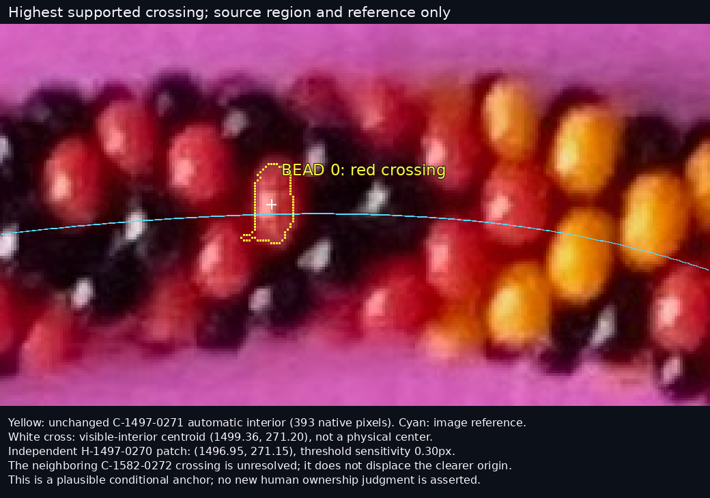

# R294 — a conditional 221-bead fit, with central failures retained

The model places **−20…200 from a clear top crossing**, follows the top arc into
the right bend, and explains many independent bright patches. The certified
revision makes small local improvements, but **does not resolve the clear central
surface mismatches or establish a recovered physical sequence**. A seemingly better
fit trades photographic compatibility for actual bead interpenetration and is
preserved as a failed alternative.

[Open the visual review](review/r294/index.html) ·
[Initial whole photograph](review/r294/initial-whole.png) ·
[Revised whole photograph](review/r294/revised-whole.png) ·
[Mismatch comparison](review/r294/mismatch-comparison-whole.png) ·
[Full run: original / initial / revised](review/r294/full-run-comparison.png)

## Bead 0 and direction

Bead 0 is the red surface recorded as **C-1497-0271**. Its unchanged historical
visible-interior centroid is **(1499.36,271.20)**. Its393 native support pixels span
signed reference distances **−18.70…+10.38px**, demonstrating an observed-interior
crossing. It is the highest crossing candidate with a high historical photographic
class, at least100 pixels and no recorded ownership conflict. Nearby
C-1582-0272 is slightly lower and unresolved. The higher outer-row beads do not
cross the reference; they are not preferable origins for this request.

Independent H-1497-0270 has patch representative **(1496.95,271.15)** and threshold
sensitivity **0.30px**. Its nearby alternative H-1499-0279 remains separate. The
patch/interior representative difference is2.41px; neither measurement is a physical
center or calibrated error bound. The revised projected center is **(1502.03,272.66)**,
with3.32px conditional local parameter sensitivity. That radius excludes uncertainty
in the construction family and integer ownership. No new human label is asserted.
No previously human-accepted complete region lies in this short fitting window;
the anchor is supported by existing independent measurements and the actual pixels.

Positive labels initially go right, then follow the necklace down the right bend.
They advance through the physical helix, with6.5 beads per minor revolution;
the next visible image neighbor need not be index+1. Negative labels extend left.
All221 indices survive, including hidden/unsupported predictions. Bead200 is near
**(2027.91,707.04)** in the revised fit. This is a bounded run, not global indexing.

## Model and independent evidence

Reuse: R279 literal rounded-annulus shape, R280 separating-plane contact machinery,
R282 exact first-hit visibility, and the unchanged R293 image-derived reference.
No old fitted pose, ownership chart, global count, synthetic image or renderer is
used. The axis lies in one plane. One orthographic camera projects the helical
centers and actual annular surfaces; foreground surfaces occlude background ones.

The radius is1.78453698 source units, minor radius4, with fixed6.5-index progression.
Units are construction units, not measured millimeters; z is relative to the rope
axis plane. The selected scale is8.3px/unit, nominal transverse bead diameter29.62px,
and camera elevation60°. Pitch1.26 gives about3.92 deprojected axis pixels per
index. Camera/scale/pitch remain coupled;60° is a fitted family member, not a camera
calibration. Perspective and varying bead dimensions remain possible explanations.

Before fitting, freeze123 eligible independent R289/R293 bright patches in a fixed
image-axis window−60…750px from the anchor:92 training and31 withheld in120px
geographic blocks. Historical high colored interiors provide separate, explicitly
unverified shape evidence:29 training and7 withheld. Reflection patches are surface
observations, never center targets. Center proximity initializes only; final fitting
uses exact annular first-hit containment, one-to-one historical-interior assignment
with unmatched slots, and the anchor. Multiple patches can conditionally share an
owner. These channels share photographic pixels and are not independent statistical
replicates. Every original location, patch, color/RGB, uncertainty and provenance survives.

The freeze retains all R293 judgments. Its two rejected merger masks/centroids are
excluded from trusted inputs; independent patches remain. Accepted snapshots are
linked without converting qualitative acceptance into pixel truth or ownership.
All data come from one repeatedly studied photograph; withholding is an algorithmic
split, not a blind new-image accuracy test.

## Initial fit, diagnosis and revision

Both hands receive the same cold search over scale/pitch/elevation/phase. All288
starts across both hands and15 refined initial candidates are retained. The initial winner
has hand−, scale8.3, pitch1.26, elevation60°, phase.53rad and origin2.25px. The
opposite-hand proxy basin has almost the same training score but fails contact.

Training diagnosis identified the clear crossing yellows E5-1633-0278 and
E5-1607-0290, several red interiors, and small exterior-paper borrowing. The recorded
revision adds five slow in-plane normal corrections and log-spacing knots, with
regularization and a training-only paper penalty. It cannot move a single bead
independently, alter a source observation or introduce out-of-plane axis bends.

The **certified revision** keeps the initial camera/scale/pitch/phase and changes
the axis by at most1.5 deprojected pixels; log-rate knots are
−.00625/0/0/0/.025 at indices−30/30/90/150/210. This is a small adjustment.

The unconstrained revision instead prefers hand+, improving held-out bright-patch
containment to91.0% and compatible old interiors to2/7. It fails95 separating-plane
tests, and actual sampled annular surfaces penetrate neighbors in **93 pairs**.
It is **not** the primary revised reconstruction. Both displayed primary models
certify all874 candidate contact pairs; revised minimum gap is.00857 source units.
Selection uses training score and physical feasibility, with no parameter refit
after held-out inspection. The failed output, images and exposed evaluation are
retained in [its checkpoint](r294/checkpoints/unconstrained-revision/).

## Degree of match

Containment is the fraction of each measured support assigned to one predicted
visible bead surface; compatible means≥80% containment and≥20-point rival margin.
It measures geometric compatibility, **not correct physical ownership or precision**.

| Fixed-window evidence | Initial | Certified revision |
|---|---:|---:|
| Training bright patches: mean / compatible |91.2% /79 of92|93.6% /83 of92|
| Withheld bright patches: mean / compatible |87.5% /25 of31|88.3% /26 of31|
| Training old colored interiors: mean / compatible |73.9% /11 of29|74.5% /12 of29|
| Withheld old colored interiors: mean / compatible |54.6% /0 of7|53.1% /0 of7|
| Full anchor support contained by bead0 |96.2%|93.9%|
| Predicted material on paper proxy, requested run |1.77%|1.76%|

The fixed diagnostic window includes end context beyond200: four withheld patches
and one old interior map to guard indices. Those are excluded from the221-position
export. Restricting compatibility to requested indices gives **22/31** withheld
patches for both models; mean scored containment, counting context/unmatched as0,
is75.1%→73.7%. The revision therefore offers **no demonstrated held-out improvement
on the requested run**. The paper proxy is the old border-learned hue/luminance
diagnostic, not a new segmentation or exact background truth.

Examples, each with unmarked pixels beside both fits:

- [Matched yellow at index130](review/r294/matched-01.png):99.3% containment in both;
  [yellow/reflection neighborhood](review/r294/matched-02.png) and bead0 also align.
- [Clear crossing yellows](review/r294/mismatch-01.png):E5-1633-0278 remains
  44.2%→45.6%; E5-1607-0290 remains52.5%→49.9%. Model boundaries cut across useful
  illuminated material. Smooth axis alignment does not solve the local lattice.
- [Right-bend red](review/r294/mismatch-02.png) and
  [earlier red crossing](review/r294/mismatch-03.png):neighboring surfaces still
  split the observed support. These are central mismatches, not only weak edges.
- [A modest improvement](review/r294/improved-01.png) coexists with
  [a central regression](review/r294/regressed-01.png). No favorable subset replaces
  the fixed evaluation denominator.

**Index stability is conditional:**118/123 feature assignments stay the same,
including unmatched entries. Five change, including10→7,57→58, a guard209→203 and
one lost match at200. The rejected opposite hand changes117/123 assignments. Even
the primary revision links compatible patches to only90 of221 predicted sites;
131 lack such support and66 have less than10% modeled visibility. These are model
visibility/prediction counts, not observed absent beads or recovered distinct bodies.
Conditional sensitivity grows from about3px near the anchor to17px by200.

There is no large axis drift in the selected pair; the remaining errors chiefly
concern local phase/neighbor ownership and shape/exposure, with globally coupled
camera, nominal dimensions and pitch. One common mirror-light diagnostic fitted
to19 compatible training reflection candidates still gives about50° median error
on the two withheld neutral-context reflections. The frozen flags supply no yellow
reflection candidates here, so a yellow-only light fit is unavailable. Pooling
reflection candidates is explicitly descriptive; it does not certify black bodies.
[Reflection comparison](review/r294/reflection-01.png). Neither source reflection
locations nor their fitted owners become physical black-bead centers.

## Lessons and next step

Phase1 is sufficient for this bounded diagnostic experiment. Its small bright
patches alone are easy for a wrong model to contain. Later Phase1 work would benefit
from separated, larger visible-material supports and explicit seams, while retaining
multiple highlights independently. Geometry can flag a proposed merger spanning
incompatible bead surfaces, but this model's own clear failures prevent using that
flag as truth. Expected visible extents must come from occluded annular geometry;
one universal oval or area threshold would discard valid caps and partial bodies.
Black reflections are most useful when several yield a consistent common-light
direction under stable ownership; containment alone is insufficient. No new Phase1
detector or observation was implemented.

Next Phase2 task: freeze a small clear crossing group from this run, jointly test
competing integer-neighbor/hand assignments, bead dimensions and a shared-light
camera interpretation under nonintersection throughout optimization; withhold
adjacent larger supports. Resolve that local mismatch before extending the index
run. Preserve the present long-run baseline and failed alternatives. No Phase3,
production adoption or automatic R295.

[Positions, uncertainty and alternatives](r294/results/revised-positions.json.gz),
[CSV](r294/results/revised-positions.csv),
[correspondence changes](r294/results/correspondence-comparison.csv),
[complete metrics/contact/light records](r294/results/revised-evaluation.json),
[reproduction and verification](R294_REPRODUCE.md). Delivery is recorded separately
in `r294/results/delivery.json`. Nine real-data/analytic contracts pass; both searches
replay all candidates/history, ten data/visibility exports and27 review PNGs exactly.
All12766 prior science files and69 live feedback files are unchanged. Chromium
loads14 images and checks26 links on desktop/narrow views. **Stop for user review.**
