# R312 — physical-chain minimax and performance

R312 completes the authorized two-stage experiment. Measured computational speed improves substantially; photographic minimax gains are partial and do not establish a substantial overall reconstruction improvement. It preserves all historical science and source photographs. The output is a set of conditional geometry fits, not recovered bead identities or an adopted reconstruction. **Stop for scientific review; no Phase 3 or pattern inference.**

## Objective and physical scope

Stage 1 uses exactly the **200 consecutive physical addresses −100…99**. Hidden and partially occluded beads remain in the geometry. Every necklace body participates in camera/shadow occlusion and spatial contact checks, including neighbors at offsets +1, +6 and +7. Photographic safeguards use a frozen neighborhood around the original 200 centers. Stage 2 evaluates the full necklace.

The immutable Stage 1 photographic cohort contains 27 strong localized observations associated with this interval by the unchanged R306 reference. Stage 2 contains all 269 strong observations. All 811 catalog observations survive, including 542 weak/uncertain observations. A photographic reference point or reflection is not a measured physical bead center. The physical identity of every association remains unverified.

An initial native one-to-one bottleneck assignment establishes each hypothesis’s conditional owners. Owners remain frozen during each optimization epoch. The initial Stage 2 campaign retains Stage 1 owners; R311 distant basins share their parent’s map. A subsequent full-chain initialization control, explained below, starts a separately frozen before/after epoch. The primary loss is the **maximum Euclidean reflection displacement in image pixels**, plus 10000px per missing lobe. This penalty exceeds the image diagonal. Ambiguous strong observations remain in the maximum. Reassignment-only changes are never counted as geometry improvements. Exact measured max/RMS/P95 and missing counts are reported separately; a low measured maximum with missing lobes is never a successful minimax result.

Initially unambiguous associations (assigned nearest owner and a ≥3px gap to the next alternative) and initially ambiguous associations have separate statistics. These are numerical association diagnostics, not verified physical identities. Free rematching is retained only as a labeled secondary control, together with the number of reassigned observations. Weak observations have nearest-only descriptive diagnostics and never enter the primary loss.

## Native results

| Stage / basin | Before max / RMS / P95 (px) | After max / RMS / P95 (px) | Missing | Primary loss (px) | Dense safeguards |
|---|---|---|---:|---:|---|
| 1: trial-004166-N2265-h1-closed | 15.796 / 9.128 / 12.855 | 13.796 / 9.137 / 13.437 | 0 | 13.796 | pass |
| 1: trial-004381-N2405-h-1-open | 14.844 / 9.987 / 14.240 | 13.950 / 9.819 / 13.856 | 0 | 13.950 | pass |
| 1: trial-003551-N2265-h1-closed | 15.796 / 9.128 / 12.855 | 14.114 / 9.192 / 13.778 | 0 | 14.114 | pass |
| 1: trial-004304-N2265-h-1-open | 17.335 / 9.868 / 14.021 | 14.194 / 9.224 / 13.957 | 0 | 14.194 | pass |
| 1: trial-003921-N2265-h1-closed | 15.796 / 9.128 / 12.855 | 14.223 / 9.063 / 13.321 | 0 | 14.223 | pass |
| 1: trial-003389-N2265-h1-closed | 15.796 / 9.128 / 12.855 | 14.229 / 9.238 / 13.464 | 0 | 14.229 | pass |
| 1: trial-004019-N2265-h1-closed | 15.796 / 9.128 / 12.855 | 14.268 / 9.187 / 13.889 | 0 | 14.268 | pass |
| 1: trial-003383-N2405-h-1-open | 14.844 / 9.987 / 14.240 | 14.552 / 9.911 / 14.134 | 0 | 14.552 | pass |
| 2: trial-1000144-N2405-h-1-open | 17.744 / 9.084 / 14.056 | 17.626 / 9.132 / 14.267 | 0 | 17.626 | pass |
| 2: trial-2000000-N2405-h-1-open | 17.744 / 9.084 / 14.056 | 17.744 / 9.084 / 14.056 | 0 | 17.744 | pass |
| 2: trial-1000357-N2733-h-1-closed | 22.242 / 8.830 / 13.857 | 21.403 / 8.920 / 14.446 | 0 | 21.403 | regression; inspect |
| 2: trial-1000185-N2733-h-1-closed | 22.242 / 8.830 / 13.857 | 22.223 / 8.853 / 14.277 | 0 | 22.223 | regression; inspect |
| 2: trial-2000014-N2733-h-1-closed | 22.242 / 8.830 / 13.857 | 22.242 / 8.830 / 13.857 | 0 | 22.242 | regression; inspect |
| 2: trial-1000003-N2405-h-1-open | 17.744 / 9.084 / 14.056 | 21.002 / 9.159 / 14.168 | 1 | 10021.002 | pass |
| 2: trial-1000534-N2733-h-1-closed | 22.635 / 8.929 / 13.973 | 20.787 / 8.932 / 14.310 | 2 | 20020.787 | regression; inspect |
| 2: trial-1000134-N2405-h-1-open | 17.744 / 9.084 / 14.056 | 21.512 / 9.285 / 14.558 | 3 | 30021.512 | pass |
| 2: trial-2000009-N2860-h-1-open [tradeoff only] | 15.438 / 8.415 / 13.034 | 15.438 / 8.415 / 13.034 | 0 | 15.438 | regression; inspect |
| 2: trial-2000007-N2535-h-1-closed [tradeoff only] | 16.277 / 9.352 / 14.393 | 16.277 / 9.352 / 14.393 | 0 | 16.277 | regression; inspect |

Stage 1’s best native primary maximum is **13.796px**, versus 15.796px for its own frozen-map baseline (12.7% reduction). Its RMS is 9.137px and P95 is 13.437px, with 0 missing observations. All retained models and their full parameters/contact witnesses remain in `r312/results/campaign/stage1/exports/`.
For the initially unambiguous subset, the exact maximum / RMS / P95 is 12.546 / 7.721 / 11.045px, with 0 missing. Ambiguous observations remain in the conservative primary maximum above; neither subset establishes physical identity.
Against the common R306 calibration in the same photographic region, dense ownership changes 57.564→53.523%, paper occupation 5.698→4.666%, colored omission 14.238→18.496%, and exterior boundary RMS 6.474→6.768px. Its minimum separating-plane margin is 0.043633739 source units; this is numerical nonpenetration for a conditional model, not a measured physical clearance or mechanical equilibrium.

Stage 2’s best native primary maximum is **17.626px**, versus 17.744px for its own frozen-map baseline (0.7% reduction). Its RMS is 9.132px and P95 is 14.267px, with 0 missing observations. All retained models and their full parameters/contact witnesses remain in `r312/results/campaign/stage2/exports/`.
For the initially unambiguous subset, the exact maximum / RMS / P95 is 17.021 / 7.790 / 12.770px, with 0 missing. Ambiguous observations remain in the conservative primary maximum above; neither subset establishes physical identity.
Against the common R306 calibration in the same photographic region, dense ownership changes 59.983→60.417%, paper occupation 6.662→6.897%, colored omission 31.239→31.166%, and exterior boundary RMS 4.925→4.832px. Its minimum separating-plane margin is 0.000366148 source units; this is numerical nonpenetration for a conditional model, not a measured physical clearance or mechanical equilibrium.

The separately preserved initial Stage 2 campaign ran 1273 evaluations in 30.03 minutes; its best inherited-map objective was 17.705590px. The subsequent full-chain controls and contingent refinement are separately checkpointed under `stage2/local/`; their trials are included in the combined performance ledger.

The initial full-necklace campaign exposed a scope problem: the immutable photographic cohort selected by the R306 reference can extend outside addresses −100…99 under another count hypothesis. Reserving its Stage 1 owners can then force a poor full-chain assignment. The complete initial 1800-second campaign and maps remain sealed. A separate control recomputes full-necklace assignments at **identical starting geometry**, saves every changed owner and labels all resulting score changes as correspondence-only. For example, unchanged R306-2733 changes 65.257→22.242px and N2860 hand− changes 97.973→15.438px, with no geometry improvement. The R306-2405 baseline changes no owners. The contingent local epoch freezes the new full-chain maps, retains all 269 observations, and compares each fitted result with its own refreshed-map baseline. Final Stage 2 tables use this epoch; every exported model also retains its original-map score as a control. These alternatives are conditional, not recovered bead identities. The main campaign’s inherited maps restricted useful exploration of denser families; its failure cannot rule those families out.

The search guards permit at most 2 percentage points loss of mean positive-interior support coverage, 1 point additional paper occupation, 2 points colored omission, 1px boundary RMS regression and no extra missing supported contour. Stage 1 compares each hypothesis with its own calibration. **Stage 2 requires both that comparison and preservation against the common R306-2405 baseline.** Lower-error models failing the common safeguards remain diagnostic tradeoffs. These are operational tolerances; they do not establish that every region improves. Dense measurements can also fail the sampled search guards. A reflection improvement alone does not establish a substantial overall photographic reconstruction improvement.

A post-seal audit found that my Stage 1 boundary guard included native hole edges, whereas the photographic contours annotate outer boundaries. Complete fitting records and original boundary scores remain preserved. Dense exterior-only diagnostics reuse the same saved native rays, with no fitting repeated and no change to any reflection result. Stage 2 uses exterior-only boundary guards. Native holes remain visible in overlays. This limits conclusions based on Stage 1 safeguard selection.

## Where large errors appear

For every retained basin, static plots show Euclidean error and signed tangential/transverse components against frozen conditional physical address. Separate positive/negative outward plots show individual errors and the cumulative maximum from address 0. First observed crossings of 5/10/15/20px are saved; gaps between observations are unknown, not verified error-free beads. Bead 0 has no independently verified reflection correspondence.

The twenty largest measured mismatches include observation IDs, native photographic locations, predicted points, displacement vectors, magnitude and conditional owner. Missing lobes are listed separately. Before/after photographic overlays include complete native visible boundaries for the rendered target bodies; all other bodies still occlude them. Orange annotations mark ambiguous alternatives or a frozen owner different from the nearest alternative. The top-20 crop atlas uses dashed white vectors for the baseline.

### Stage 1 best basin: first observed ≥10px errors

- Before, toward negative addresses: K-1443-0285, conditional index -13, 15.796px at [1449.0123973646241, 278.7995963899751].
- Before, toward positive addresses: K-1783-0330, conditional index 69, 11.647px at [1785.2540519283154, 328.76712982321953].
- After, toward negative addresses: K-1443-0285, conditional index -13, 13.776px at [1449.0123973646241, 278.7995963899751].
- After, toward positive addresses: P5-1645-0309, conditional index 40, 11.429px at [1644.6281841098223, 309.53331842477286].

Largest regional maximum-error changes (after minus before; negative improves): section 31: -2.000px, section 1: -1.434px, section 30: -0.670px, section 0: +1.001px. These fixed photographic sections are diagnostic, not independent tests.

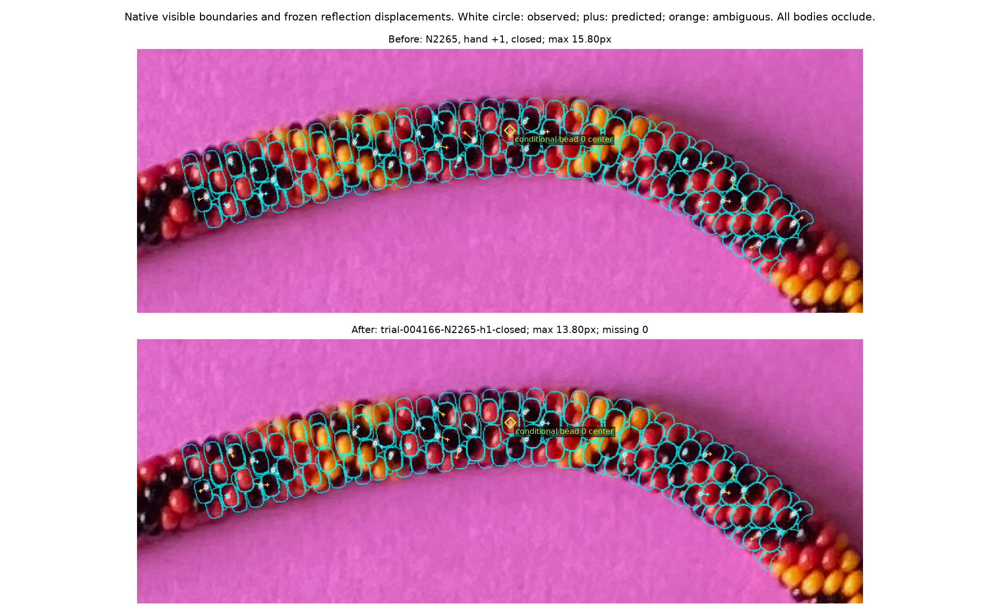
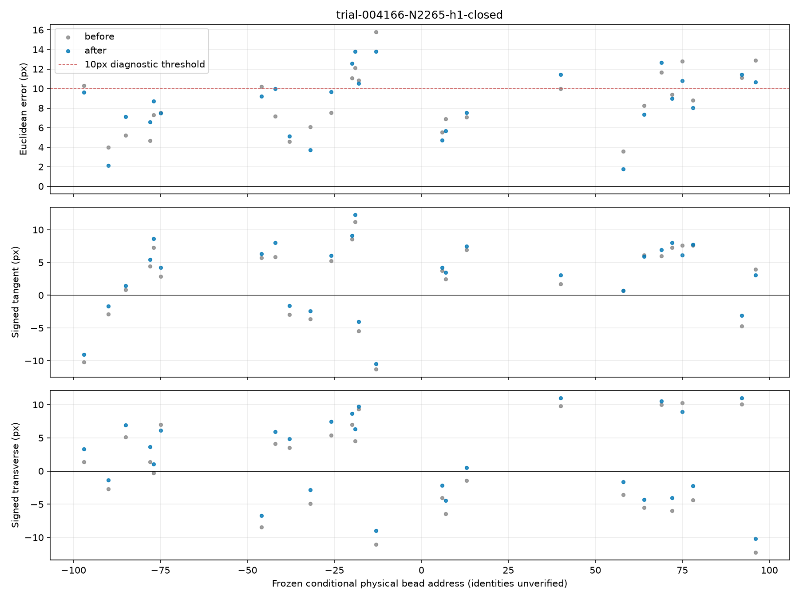
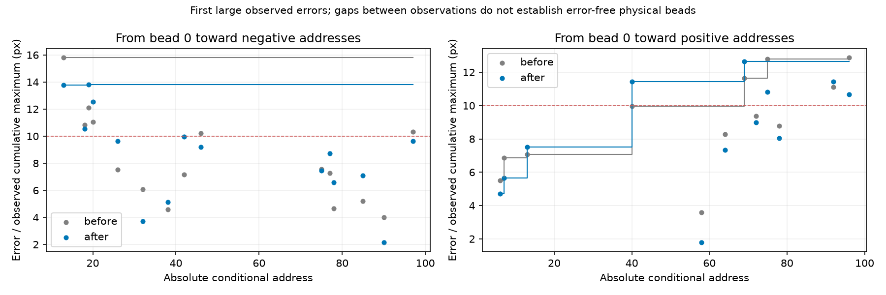
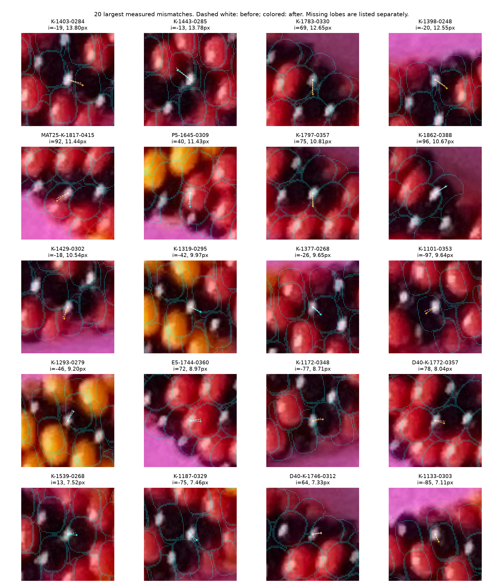
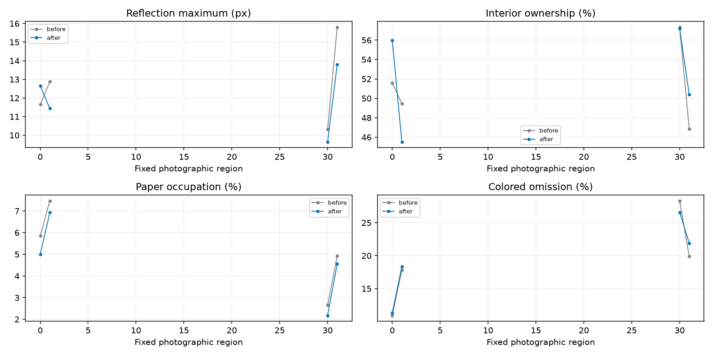

### Stage 2 best basin: first observed ≥10px errors

- Before, toward negative addresses: K-1443-0285, conditional index -13, 13.362px at [1449.0123973646241, 278.7995963899751].
- Before, toward positive addresses: K-1721-0308, conditional index 59, 10.253px at [1722.5210138149396, 306.26457009335957].
- After, toward negative addresses: K-1443-0285, conditional index -13, 11.983px at [1449.0123973646241, 278.7995963899751].
- After, toward positive addresses: E5-1744-0360, conditional index 77, 15.103px at [1743.4134681438645, 360.67269322849967].

Largest regional maximum-error changes (after minus before; negative improves): section 1: -1.420px, section 30: -1.183px, section 20: -1.105px, section 6: +1.444px, section 18: +1.302px, section 0: +1.205px. These fixed photographic sections are diagnostic, not independent tests.

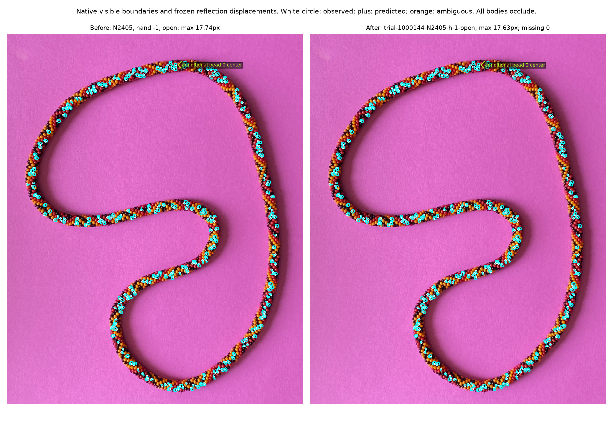
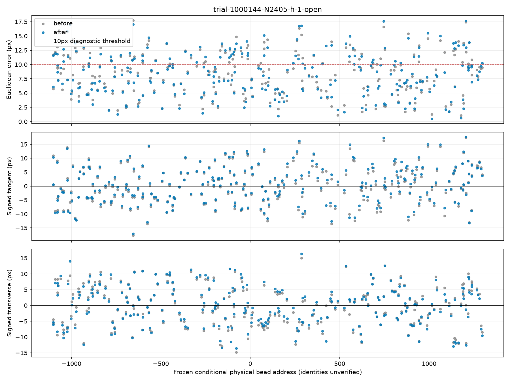
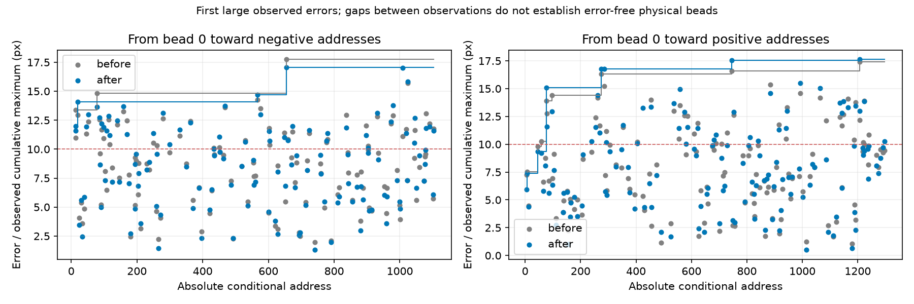
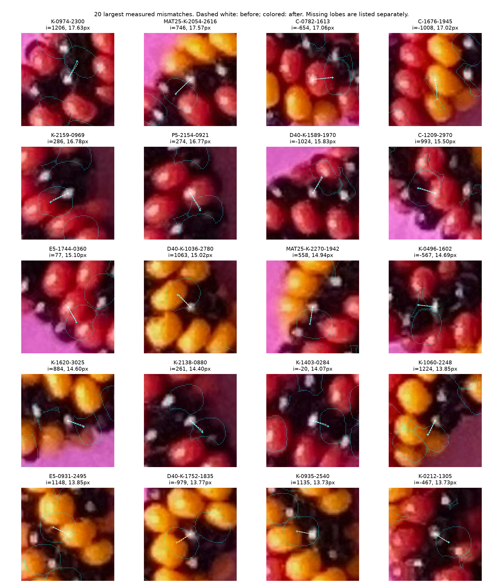
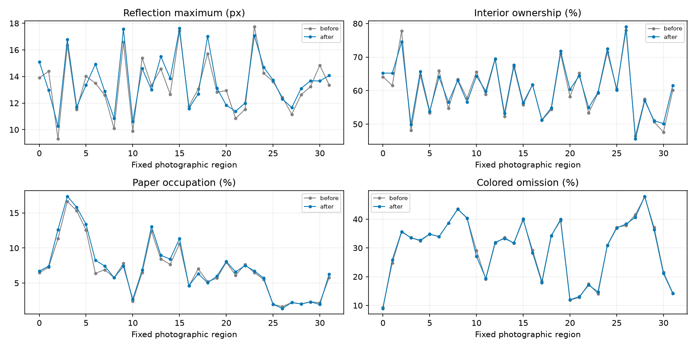

## Search breadth and limitations

The existing periodic planar axis, true arclength transport, affine annulus and shared optical law are retained. The optical law is a positional approximation, not a calibrated radiometric model. Phase/registration, elevation/roll/tilt, scale/perspective, minor radius/axial thickness, winding/turn, gap, height laws, shared light direction/roughness/distance and the existing smooth axis/phase/spacing fields are varied in coupled blocks. Mean axial advance/pitch follows true length, count, scale and gap; the inactive legacy `pitch` field is not advertised as a fitted degree of freedom. No new bead-shape law or per-bead correction is introduced.

Scrambled Sobol proposals interleave full-box and moderate/wide coupled blocks across hypotheses; multistart perturbations and differential evolution refine multiple feasible basins. Both hands and both topologies are represented, with count hypotheses spanning 2000…3200. Discrete combinations and joint boxes are sampled, not exhaustively enumerated. The maker’s minimum count 2000 and near-6.5 winding/closure-twist constraint remain distinct from numerical exploration boxes and inherited field-rate bounds. An uncertified separating-plane search is inconclusive, not a demonstrated penetration.

- Stage 1: 4396 unique evaluations in 30.01 wall minutes / 28.53 CPU minutes; 7 strict running-best safeguarded improvements; statuses `{'certified': 2994, 'numerical-bound': 12, 'numerical-rejected': 1, 'uncertified-family': 88, 'unresolved-contact': 1301}`; kinds `{'differential-evolution': 365, 'multistart-refine': 1235, 'sobol-box': 882, 'sobol-coupled': 1892, 'start': 22}`. Peak RSS 571.2MiB. Attempted counts `[2000, 2002, 2132, 2204, 2265, 2405, 2535, 2733, 2860, 3068, 3200]`. Native improvement per CPU-second: 0.000612px/s.
- Stage 2: 1846 unique evaluations in 39.96 wall minutes / 38.63 CPU minutes; 17 strict running-best safeguarded improvements; statuses `{'certified': 1412, 'numerical-bound': 71, 'uncertified-family': 60, 'unresolved-contact': 303}`; kinds `{'differential-evolution': 57, 'illumination-batch': 174, 'multistart-refine': 221, 'native-simplex': 573, 'sobol-box': 267, 'sobol-coupled': 527, 'start': 27}`. Peak RSS 1770.6MiB. Attempted counts `[2000, 2002, 2132, 2204, 2265, 2405, 2535, 2733, 2860, 3068, 3200]`. Native improvement per CPU-second: 0.000051px/s.

Full parameter ranges and projection plots show actual attempts and certified outcomes separately. Range endpoints from different candidates do not imply joint coverage. Failed searches remain in atomic trial files. Fixed conditional owners prevent reassignment-only gains but can penalize a legitimately relabeled distant basin; physical identities remain unknown. Finite time, discrete starts, existing shape laws and numerical bounds limit negative inference. The R297 legacy placement implementation remains historical and is not a fresh R312 fitting family. Immutable family keys retain two old plus-hand aliases; displayed counts/hands/topologies come from actual parameters. The result does not establish that the photographed necklace cannot be reconstructed with the existing geometry.

Stage 1 seals its checkpoint and saves distinct native basins and complete static diagnostics before Stage 2. The later exterior-only control overlaps Stage 2 initialization, as recorded in the milestone receipt. Stage 2 changes the same continuous parameters again; it does not freeze Stage 1 values. Its initial starts include Stage 1 basins and the original hypotheses. The contingent 600-second multistart Nelder-Mead epoch refines shared illumination, coupled geometry/camera and existing harmonic fields from three full-chain controls. The preflight’s 2px lattice lost small lobes and shifted some individual errors substantially, so native 1px fitting is used for the executed Stage 2; the 2px measurements remain explicit approximation diagnostics.

All available strong photographic observations enter fitting. Dense final measurements and historical comparisons are retrospective diagnostics, not fresh validation or statistically independent holdouts. Correlated pixels are not independent observations. Only 16 uncertain photographic contours exist; their boundary uncertainty remains approximately ±3px, and unannotated bodies have no measured complete photographic outlines.

## Performance before fitting

The initial paused benchmark completed normally and was reused. Its optical timing suite uses the same 2px lattice for both implementations; the later minimax timing suite and executed fitting use native 1px sampling. Original-Python accuracy audits separately use 1px sampling. Statistical Python stack sampling identifies native work by its Python call site; it can be delayed by the GIL. Exclusive wall timers measure geometry, contact, camera rays, surface normals, shadow occlusion, reflection assembly, outlines, correspondence and safeguards. Numerical threads are fixed to one. Warm timings use medians of two repetitions; these are measurements on this machine, not precise population estimates.

| Same-lattice benchmark | Before (s) | Optimized (s) | Speedup |
|---|---:|---:|---:|
| 200 bodies, directional light | 0.3813 | 0.1088 | 3.50× |
| 200 bodies, finite light | 0.9005 | 0.1151 | 7.82× |
| whole bodies, directional light | 1.5836 | 1.1851 | 1.34× |
| whole bodies, finite light | 7.4565 | 1.2740 | 5.85× |

| Full-necklace finite-light subsystem | Before (s) | After (s) | Speedup |
|---|---:|---:|---:|
| camera_ray_tracing | 0.70872 | 0.67825 | 1.04× |
| contact | 0.30565 | 0.00857 | 35.66× |
| light_occlusion | 6.21278 | 0.36663 | 16.95× |
| positions_orientations | 0.00286 | 0.00315 | 0.91× |
| reflection_assembly_and_shading | 0.18698 | 0.18093 | 1.03× |
| surface_normals | 0.03948 | 0.03645 | 1.08× |

Contact checks avoid refining pairs after a valid positive analytic separating plane is found. Finite-light queries conservatively enclose projected bounding spheres on the light-centered unit sphere before the unchanged native marcher. Directional shadow trees are reused. Bounded caches reuse geometry, contact results and native camera first hits when only illumination changes. Stage 2 renders complete boxes for frozen target owners, while retaining all occluders. Exact centroid thresholds, annulus shape, marching tolerance, unknown-ray treatment and light law remain unchanged.

Initial timing identified contact refinement and finite-light all-pairs shadow queries as worthwhile targets. Geometry construction was a few milliseconds and did not justify a new compiled placement kernel. After acceleration, camera rays and shadow rays dominate. Analytical reflection positions were considered but not substituted for complete annular visible lobes: holes, changing ownership and shadows require native evaluation. The old complete photographic objective, which excludes contact checks, measured 1.754s before and 1.784s afterward in its single pair; no speedup is claimed for that test.

| Complete native minimax evaluation | Cold (s) | Camera reused (s) | Speedup |
|---|---:|---:|---:|
| Stage 1, directional light | 0.4255 | 0.1064 | 4.00× |
| Stage 1, finite light | 0.4459 | 0.1275 | 3.50× |
| Stage 2, directional light | 2.0986 | 0.5817 | 3.61× |
| Stage 2, finite light | 2.2078 | 0.6373 | 3.46× |

Stage 2 adds measured exact improvements against the archived Stage 1 objective: alternative-distance bookkeeping 23.41× faster (0.0878→0.0037s), repeated unchanged-contact evaluation 59.57× faster, and a three-evaluation native illumination batch 2.05× faster. Primary errors/owners are exact and alternative-distance roundoff is 0px. Illumination proposals are batched so the measured camera reuse is actually used by the search.
- Stage 1: 19 camera-reused evaluations, 0 recorded contact-reused evaluations, 1559574 camera rays avoided by reuse.
- Stage 2: 533 camera-reused evaluations, 613 recorded contact-reused evaluations, 168508064 camera rays avoided by reuse.

Caching helps illumination proposals with unchanged geometry; arbitrary geometry changes still pay for new first hits. Exact cold-versus-cached predictions agree. Initial original-Python audits reported zero centroid differences. The minimax preflight also exactly agrees with the previous native predictor. Computational agreement is not photographic accuracy: a 10px photographic mismatch remains a 10px mismatch even when both renderers agree numerically.

The preflight’s 2px approximation changes some errors by up to 10.68px and changes lobe presence; it is not treated as a reliable substitute for native minimax. Baseline/optimized subsystem timings, stack samples, approximation measurements, memory and per-trial wall/CPU times are retained in the performance comparison and both stage ledgers. The ledger retains the chronology of both correspondence epochs; its running-best reduction must be interpreted alongside the same-map before/after model tables, and is not automatically a pure geometry gain. Increased throughput permits the recorded thousands of direct broad proposals and native refinements; it does not prove that the same basins would have been unreachable with a slower implementation and more time.

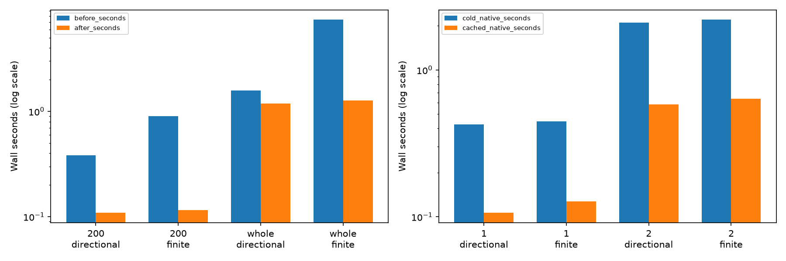

## Independent verification and delivery

The fresh-process verifier passes 6242 unique trial records and 26 exported model/baseline combinations: 64548 positions, 184050 independently recomputed analytic contact witnesses, 728000 original-Python camera/guard rays, 5723815 original compiled optical rays for every fitted lobe, and 667811 original-Python optical rays for the actual top twenty errors. Primary centroids agree within 1e-9px; all reported distances, RMS/P95/max, fixed maps, complete 200-address cohorts and source archives pass. Arclength refinement and right-handed orthonormal frames are checked.

Preservation audit checks 21872 pre-existing tracked files. Historical scientific data and source photographs are byte-identical; handoffs/logs contain only additive text. Exact fitting-source bundles preserve both stages. The scientific push and independent remote-tip receipt are recorded separately in `r312/results/delivery.json`.

Static review: [R312 index](r312/results/campaign/index.html). Numerical receipt: [verification](r312/results/campaign/verification.json). Full protocol: [specification](R312_SPECIFICATION.md). Reproduction: [commands](R312_REPRODUCE.md).

**Stop for maker review of the minimax/material/regional tradeoffs.** No model adoption, Phase 3, color-pattern inference or automatic R313. Keep this session for review; no `/new` or model switch is needed.

## Resolution sensitivity

- Stage 1: identical parameters/maps at 0.5px sampling shift centroids by at most 0.409px; 0 lobe-presence changes. Native max 13.796px; half-pixel max 13.841px. This is computational sampling sensitivity, not a new fit or physical ground truth.
- Stage 2: identical parameters/maps at 0.5px sampling shift centroids by at most 4.247px; 0 lobe-presence changes. Native max 17.626px; half-pixel max 17.635px. This is computational sampling sensitivity, not a new fit or physical ground truth.

Export alternative lists, weak nearest-only diagnostics and secondary rematching use their rendered target-owner pool, and can omit unrendered competitors. Primary maps remain frozen and all strong observations enter the maximum regardless of this ambiguity flag. The separate all-body optical-pool control checks the full-necklace best and baseline without changing parameters, maps or selection.
- trial-1000144-N2405-h-1-open: 2405 bodies, 1953 native lobes, 970266 rays; maximum target-only versus all-body centroid difference 0px. Full-pool free rematching gives max 17.626px with 18 owner changes; that is a correspondence control, not a fitting gain.
- baseline-fullchain-R306-2405: 2405 bodies, 1943 native lobes, 970296 rays; maximum target-only versus all-body centroid difference 0px. Full-pool free rematching gives max 17.744px with 0 owner changes; that is a correspondence control, not a fitting gain.
