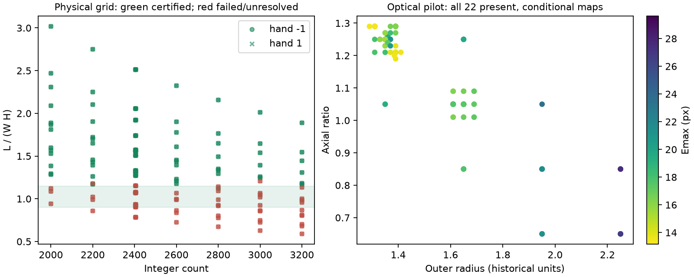
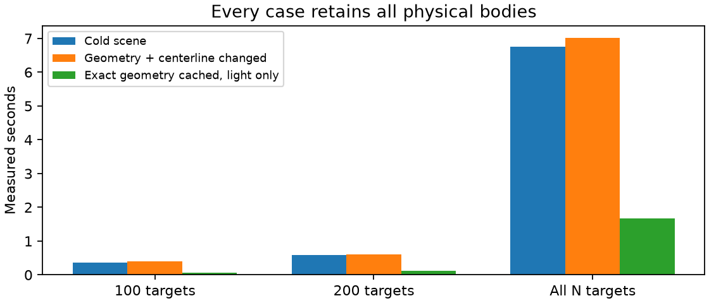

# R320 — derived closed staircase; packing tradeoffs and measured cost

**No reconstruction is adopted. Stop for review; no automatic R321.**

The new model derives winding, minor radius and hole-axis orientation from count, radius, thickness and the actual closed staircase. The best near-rise diagnostic has conditional Emax **13.156px**, versus R319 **11.824px** under its different frozen map. Its diameter is only **22.68px**, compared with the fixed uncertain photo reference33.468px, and pigment omission is **31.1%**. The discrepancy is 0.393 fixed photo diameters and 0.580 fitted diameters. This is a physically constrained pilot with visible geometric deficiencies, not a better reconstruction or a recovered bead count.

[Photographic review](r320/results/index.html) · [Specification](R320_SPECIFICATION.md) · [Reproduction](R320_REPRODUCE.md) · [Performance JSON](r320/results/performance.json) · [Cost plan](r320/results/optimization-plan.json)

## Physical interpretation and equations

The identical legacy bead is the rounded annular cross-section from `beads.pov`: major cross-section radius0.57r, flat half-width0.086r, rounding radius0.344r and axial stretch (0.7/0.43)a. Its exact radial support is r and axial half-support is0.7ra, hence **H=1.4ra**, not a redefined axial parameter. Hole fraction0.14 and roundedness0.8 are fixed. The original macros also illustrate other profiles/materials; R320 uses one shared rigid shape.

For each integer N, W=floor(N/6.5+0.5), T=N/W, R0=r/sin(pi/T), P=L/W. The ideal signed tilt is -hand atan(H/(2πR0)). The implemented axis is the normalized cross product of the radial direction and the actual helical center-trajectory tangent, with its sign chosen toward the major tangent. Thus it is normal to the local staircase surface, not aligned with a hypothetical thread. On a straight major axis this gives -hand atan(P/(2πR)); on a curved axis the normal also includes the local major curvature. Independent analytic differentiation checks this construction.

The POV expression is r=0.96 R sin(pi/6.5), so R=r/[0.96 sin(pi/6.5)]: **4.167% larger**, not smaller, than the ideal radius. This is an empirical placement allowance, not an independently fitted material constant. POV major length gives P=1.05×1.3r=1.365r, so P/H=0.975 for its height0.7 profile. Its object rotations keep the hole axis on the major tangent; it does not implement the derived staircase tilt. The old file is preserved byte-for-byte.

The photographic centerline and fixed R319 camera establish L in historical units. Camera scale stays8.658283442409605px/unit, so 2r×scale is the actual explored image diameter. Allowing radius and camera scale to rescale together would introduce a similarity gauge; this pilot deliberately holds that gauge fixed. Elevation, roll and common light are inherited nuisance assumptions, not calibrated constants. Perspective is set from the inherited negligible value to zero.

A deterministic contact construction starts at R0, tests increasing factors1.02/1.04/1.08/1.12/1.16 when necessary, then bisects the first successful bracket eight times. It uses the exact shared support function and all spatial pairs; actual annular-volume fallback distinguishes demonstrated penetration from unresolved convex-envelope failure. This is a sufficient construction, **not proof of a global minimum packing radius** or monotonic feasibility. No minor radius is adjusted to fit photograph errors. All refinement factors and failed brackets are retained.

The primary near-rise screen is **0.90≤L/(WH)≤1.15**, explicitly an exploration budget, not measured crochet tolerance. Wider ratios remain labeled diagnostic controls. No large rise violation is hidden in the objective. At fixed count/camera/centerline, thicker beads reduce this ratio and can intersect; smaller beads improve clearance but lose pigment coverage. An exact mechanical packing/equilibrium law remains absent.

## Closed topology, seam and correction budgets

The selected model has N=2800, W=431, T=6.49651972, r=1.310000, axial=1.290000, H=2.365860, L=1141.884893, R/R0=1.000000, **L/(WH)=1.119840**. Ideal signed tilt=7.6121°, actual curvature-aware range=7.7507…9.2567°. Derived tilt is stored in the frames; the unused legacy scalar tilt is zero.

`topology=closed`, `gap_steps=0`, fixed `seam_fraction=-0.5`; no seam/gap/turn/tilt/compact_tilt/cant fitting. Signed addresses start at ceil(-N/2). Bead0 retains the original photo reference station and phase convention as N changes. Global phase/station registration moves actual geometry; it never relabels the index origin. The first/last pair and offset6/7 seam-crossing pairs receive the same spatial scrutiny as interiors. Additional N2401/2402 controls cross W369→370, with no index reset.

All inherited centerline/phase/spacing fields were reset before this experiment. Their previous totals were **8.357px** centerline displacement, **24.42°** local phase, **3.189px** integrated station departure and **2.015%** local spacing-rate departure. R319 also had translation[6.081336210795, 0.11448202433054644]px and station6.197px. These are total inherited departures, not just the last round’s increments.

Following the user’s centerline steering, four coefficients describe two periodic normal-displacement harmonics. Maximum total displacement is capped at3.3468px (0.10 fixed photoD); selected total is **0.0000px**. Local minor-phase correction=0° and local spacing correction=0%. Global station is bounded±3.3468px, translation remains zero. Centerline, radius, axial, global phase and station are probed jointly; camera and lighting are not fitted. Every resulting L/(WH) is recomputed.

## Search coverage and photographic results

The first structured grid evaluates **288** inputs: nine counts2000…3200 (including2404/2405/2406), radii1.35/1.65/1.95/2.25 and axial0.65/0.85/1.05/1.25, both hands. Implied coarse diameters23.38…38.96px. Outcomes: {'certified-separation': 169, 'demonstrated-interpenetration': 45, 'unresolved': 74}; **1** satisfy both certification and the near-rise screen. These are input-vector counts; internal contact-construction probes are separately serialized in each history.

The optical pilot records **140** trials with per-count/hand frozen maps, joint radius/axial grids, bounded centerline controls and small registration probes. A further **110** coupled trials use bilateral sensitivities and local minimax steps across counts2800,2600,2200, retaining missing predictions and physical failures. The first local refinement also included nearly adjacent2404/2405 counts; these are explicitly redundant local controls, not independent broad basins. Actual parameter ranges and every outcome remain in the serialized trial directories.

All comparisons retain the identical22 photo-only observed principal half-maximum centroids:7 black,11 red,4 yellow. Each count/hand map is initialized from one-to-one observed-bright-support overlap without predicted reflection distances, then frozen throughout its fitting epoch. Unsupported assignments remain provisional and difficult observations are never dropped. Missing predictions make Emax infinite. Full benchmark cohorts contain40/74/754 eligible automatic observations in fixed baseline geography; the full1217 detection catalog and all historical811 measurements remain unchanged. The broader automatic benchmark cohort has not received the same compact-cohort scientific review, so its errors are diagnostic.

| Model | Emax px | L/(WH) | Dmodel px | Pigment omitted | Color seam conflicts | Dual distinct-color claims | Bracket p95 px |
|---|---:|---:|---:|---:|---:|---:|---:|
| R319 baseline | 11.824 | 1.2916 (nominal W; open) | 30.91 | 9.4% | 25.0% | 0 | 7.200 |
| derived-best | 13.156 | 1.1198 | 22.68 | 31.1% | 22.4% | 0 | 19.000 |
| centerline-control | 17.909 | 1.1216 | 23.38 | 28.7% | 21.1% | 0 | 19.300 |
| derived-2600 | 15.834 | 1.1377 | 24.07 | 27.4% | 19.7% | 0 | 18.300 |

| Model | Black (7) Emax px | Red (11) Emax px | Yellow (4) Emax px |
|---|---:|---:|---:|
| R319 | 11.764 | 11.824 | 11.731 |
| derived-best | 10.203 | 12.765 | 13.156 |
| centerline-control | 11.436 | 14.288 | 17.909 |
| derived-2600 | 15.834 | 14.125 | 11.395 |

All seven black reflections remain in the maximum; there is no color-dependent dropping or weighting.

Different-map maxima are conditional comparisons, not identified geometric gains. The selected-model assignment controls evaluate the historical and new maps at identical geometry and explicitly mark assignment effects as non-geometric. All per-core fractions, paper occupation, missing brackets and internal core crossings remain in the exports. A low dual-claim count does not establish correct ownership. There are no invented black-bead silhouettes or hidden outlines.

The centerline-control export is a one-coefficient intervention with its matching uncorrected parent retained in `centerline-controls.json`; coupled final changes are not mislabeled as an isolated centerline benefit. The photograph overlays show actual visible owner edges (including modeled holes/occlusion edges), observed yellow circles, predicted magenta crosses and displacement vectors. Only supported material-to-paper brackets are scored as exterior evidence.

Actual principal-parameter ranges including refinement: radius 1.280665…2.250000 units; axial 0.650000…1.310000. Global phase 0.098930…0.398930rad; station -3.3468…3.3468px. See [actual search ranges](r320/results/actual-search-ranges.json) for distinct-value counts.

| Fixed-map coupled family | Parent Emax px | Best complete-map Emax px | Best L/(WH) | Centerline displacement px |
|---|---:|---:|---:|---:|
| N2800, hand-1 | 13.538 | 13.156 | 1.1198 | 0.000 |
| N2600, hand1 | 20.223 | 15.834 | 1.1377 | 2.742 |
| N2200, hand-1 | 15.623 | 13.495 | 1.4504 | 2.549 |

The 2,200-bead result violates the near-rise screen and remains diagnostic. The 2,600-bead gain jointly changes radius, thickness, registration and centerline; it is not attributed to centerline alone. The best 2,800-bead reflection result retains the uncorrected centerline. Isolated centerline interventions and every ownership regression are saved separately.

## Contact and packing diagnosis

**derived-best**: 8400 independently checked positive support witnesses; maximum position seam gap 1.03e-13 units, frame gap 3.3e-12.

- Offset+1: median glass-clearance bracket [0.03008, 0.06916] units; 0 pairs have certified upper gap≤0.02r, 2455≤0.10r. All seam-crossing records are retained.
- Offset+6: median glass-clearance bracket [0.19935, 0.20480] units; 3 pairs have certified upper gap≤0.02r, 120≤0.10r. All seam-crossing records are retained.
- Offset+7: median glass-clearance bracket [0.25555, 0.25555] units; 6 pairs have certified upper gap≤0.02r, 155≤0.10r. All seam-crossing records are retained.

**centerline-control**: 8400 independently checked positive support witnesses; maximum position seam gap 1.05e-13 units, frame gap 2.98e-14.

- Offset+1: median glass-clearance bracket [0.02915, 0.06870] units; 0 pairs have certified upper gap≤0.02r, 2498≤0.10r. All seam-crossing records are retained.
- Offset+6: median glass-clearance bracket [0.20549, 0.21170] units; 0 pairs have certified upper gap≤0.02r, 99≤0.10r. All seam-crossing records are retained.
- Offset+7: median glass-clearance bracket [0.25873, 0.25873] units; 12 pairs have certified upper gap≤0.02r, 176≤0.10r. All seam-crossing records are retained.

**derived-2600**: 7800 independently checked positive support witnesses; maximum position seam gap 4.12e-14 units, frame gap 1.58e-14.

- Offset+1: median glass-clearance bracket [0.03287, 0.07407] units; 0 pairs have certified upper gap≤0.02r, 2292≤0.10r. All seam-crossing records are retained.
- Offset+6: median glass-clearance bracket [0.25510, 0.26028] units; 0 pairs have certified upper gap≤0.02r, 18≤0.10r. All seam-crossing records are retained.
- Offset+7: median glass-clearance bracket [0.31686, 0.31686] units; 0 pairs have certified upper gap≤0.02r, 74≤0.10r. All seam-crossing records are retained.

Clearance lower bounds come from optimized separating planes; upper bounds come from explicit actual-glass surface endpoints checked by the implicit shape. They are not mislabeled exact distances. Neighbor classes need not all contact simultaneously. Actual tangency is not asserted from a finite tolerance.

Straight-axis packing controls hold the same rigid profiles and test P/H0.95…1.30, with R/R0=1 and1/0.96. They isolate local staircase packing from the curved photographic centerline and are not closed bracelets. Both the control classifications and actual penetration witnesses are retained. At P/H=1.00 every tested straight thickness (axial0.65/0.85/1.05/1.25) demonstrates interpenetration, at both R0 and R0/0.96. At P/H=1.05 all eight controls certify separation. Thus even the straight rounded rigid shapes need a small rise allowance in these tests. On the curved photo centerline the coarse construction never rescued a failed R0 input by increasing R up to1.16R0; all169 certified coarse inputs already passed at R0. The coarse full-scene failures show a contact/circumference tension; they do not prove the requested physical model impossible, because phase, major shape, profile uncertainty and untested packing constructions remain.

## Performance: measured, not scaled from R319

Seconds below are geometry-invalidated medians (three configurations). Bodies remain2200/2600/2800 at every scope; targets are100,200 or all bodies. The second evaluation changes radius and a0.25px centerline harmonic, invalidating geometry and the centerline cache. Operation groupings are deliberately honest:

| Operation | 100 | 200 | All |
|---|---:|---:|---:|
| Positions/orientations + initial spatial trees | 0.00797 | 0.00804 | 0.00852 |
| All-body rigid contact/nonintersection | 0.00322 | 0.00323 | 0.00336 |
| Target native lattice | 0.01239 | 0.02442 | 0.46308 |
| Camera rays + surface normals | 0.16368 | 0.30156 | 3.92212 |
| Visible boundary extraction from first hits | 0.00143 | 0.00354 | 0.05209 |
| Shadow queries + illumination | 0.05078 | 0.10084 | 1.54031 |
| Connected principal reflection localization | 0.00578 | 0.01131 | 0.21004 |
| Evidence rays + outline/ownership diagnostics | 0.13753 | 0.14652 | 0.64665 |
| Frozen-map Euclidean objective | 0.00011 | 0.00019 | 0.00174 |
| **Total** | **0.397** | **0.600** | **7.021** |

| Scope | Cold median / p95 | Changed geometry median / p95 | Exact-cache light median / p95 | Camera pixels range | Peak RSS MiB |
|---|---:|---:|---:|---:|---:|
| 100 | 0.366 / 0.467 | 0.397 / 0.438 | 0.056 / 0.076 | 27602…41958 | 260.5 |
| 200 | 0.593 / 0.798 | 0.600 / 0.730 | 0.112 / 0.182 | 54557…83588 | 281.2 |
| all | 6.758 / 7.970 | 7.021 / 7.266 | 1.675 / 1.821 | 728499…883715 | 876.1 |

Hardware: **Intel(R) Core(TM) i7-14700F**; 28 logical CPUs exposed, one numerical/OpenMP thread, one process at a time. Peak RSS is a process high-water mark, not exclusive allocation per operation. Setup median0.406s is outside the evaluation total. C++ shared libraries were precompiled on disk; no compiler cold-start claim. Empirical p95 from three configurations is not a calibrated tail estimate.

The contact-derived packing construction is an additional measured cost: median0.0106s, p951.3079s over the physical grid. The measured complete physical-grid batch, including actual-solid fallback and serialization, averages0.4026s/input; the expected plan uses this aggregate cost rather than pretending the cheap median describes a mixed coarse grid. Near-contact/unresolved proposals can be much more expensive than the already-certified scenes in the rendering table. The packing batch partly overlapped preliminary timing work, so it is a measured campaign cost rather than an isolated kernel benchmark; the final rendering table was repeated sequentially. Full-scope camera rays dominate; shadows are second, followed by photographic evidence and lattice assembly. The objective arithmetic itself is negligible.

Local timing includes the fixed R319 geometry patch, while all-bracelet timing additionally measures the historical447 positive-interior regions and paper cues. Scope100/200 therefore means modeled target interval, not100/200 measured highlights or100/200 fully observed bead contours. Unknown camera/shadow cases, actual observation counts and missing predictions are explicit in the machine-readable records. No missing prediction is rewarded.

Exact caching helps light-only changes but cannot be charged to count/radius/axial/centerline changes. Promising improvements are batching/accelerating exact camera intersection, native lattice construction and grouping, followed by shadow-query reuse. Preserve original-kernel comparisons and nonintersection certification. Parallel independent families are plausible, but no unmeasured parallel speedup is credited.

## Later optimization plan

| Phase | Count families | Radius/axial combinations | Probes/iterations per family | Expected evaluations | Scope | Median / conservative sec per evaluation* | Low / expected / high hours |
|---|---:|---:|---:|---:|---|---:|---:|
| coarse_count | 49 | 25 | 1 | 1225 | 100 | 0.800 / 1.857 | 0.06 / 0.28 / 1.27 |
| coarse_radius_axial | 8 | 81 | 1 | 648 | 100 | 0.800 / 1.857 | 0.03 / 0.14 / 0.67 |
| basin_refinement | 6 | 1 | 200 | 1200 | 100 | 0.800 / 1.857 | 0.06 / 0.27 / 1.24 |
| bilateral_jacobians | 6 | 1 | 68 | 408 | 100 | 0.800 / 1.857 | 0.02 / 0.09 / 0.42 |
| local_minimax_proposals | 6 | 1 | 300 | 1800 | 100 | 0.800 / 1.857 | 0.09 / 0.40 / 1.86 |
| expand_200 | 3 | 1 | 300 | 900 | 200 | 1.003 / 2.199 | 0.06 / 0.25 / 1.10 |
| full_bracelet_refinement | 3 | 1 | 200 | 600 | all | 7.423 / 9.484 | 0.54 / 1.24 / 3.16 |
| independent_final_verification | 6 | 1 | 5 | 30 | all | 7.423 / 9.484 | 0.27 / 0.62 / 1.58 |

*Per-evaluation costs include packing. The independent-verification phase has a separately declared **unmeasured10× original-kernel allowance**, not an invented benchmark. Counts of Jacobian evaluations are separate from optimizer proposals. Initial count sampling uses49 families roughly25 apart across2000…3200, followed by exact winding-transition neighbors. Low/high scenarios halve/double evaluation counts and use observed timing extrema/packing p95; they are planning scenarios, not confidence bounds or convergence guarantees.

**Serial total: 1.13h / 3.29h / 11.30h (low / expected / high).** Each phase uses M×measured evaluation cost plus per-family cold setup. No linear extrapolation from22 reflections, from100 bodies, or from N is used. More ambitious dense photo evidence, other count/radius extremes and independent full-field original-kernel verification still need their own timings. This plan does not authorize or launch another round.

## Verification and remaining limitations

Four focused contracts cover support dimensions, both-handed closure across integer winding changes, centerline budget/zero recovery and forbidden free orientation/seam variables. Independent selected-model audits check 24600 exact support witnesses, analytic staircase normals, 300 original Python camera rays and original Python shadow intensities. Every selected +1/+6/+7 pair, including the seam, receives clearance brackets. All trial cohorts, Euclidean maxima, hashes, performance-row counts and static artifact links are checked separately.

The old results and original image are unchanged. Preliminary overlapping-work timings, a caught duplicate-key failure and a caught benchmark-loop-control failure are archived and excluded from the final table; the final six-row/cache-mode contract prevents silently losing a mode. A separate neighbor-clearance check caught support-gradient endpoints falling into the annular bore at degenerate axial normals; the initial distance artifacts were rejected and archived. Corrected actual-glass support endpoints now satisfy explicit implicit-surface assertions before any upper distance is reported. An initial coupled-search assumption about handedness also failed before new trials; the retained correction selects the actually available complete-map parent in each count family.

Remaining obstacles: correct count/correspondence, physically credible packing near one thickness on a curved centerline, undersized visible surfaces in the current near-rise candidate, uncertain glass optics and illumination, and finite sampling/principal-lobe changes. A positive support certificate establishes nonintersection, not mechanical equilibrium or real contact forces. The small centerline corrections do not establish a recovered centerline. No final geometry or color pattern is adopted.

Start04:10:01UTC; scientific cutoff04:34:01UTC; delivery deadline04:40:01UTC on2026-10-18. Actual commit/push receipt is in `r320/results/delivery.json`. **Stop for review.**
