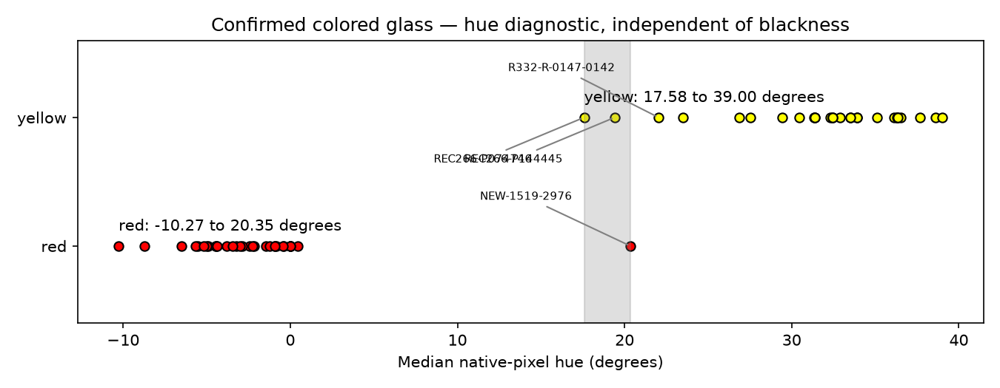

# R342 — fixed pixels, separate hue,195 supported pattern positions

[Offline photographic review](r342/review/index.html) · [Reproduce](R342_REPRODUCE.md) · [Maker ledger](r342/corrections.json) · [Strict block](r342/pattern208.json)

**The four maker judgments resolve four conflicts:191 supported /9 conflicting /8 insufficient →195 /5 /8 on the identical1040 indexed observations.** There are no additional automatic color changes, new bead admissions, coordinate changes, link changes or winding changes. All historical maker decisions and exclusions remain intact. The complete necklace count and actual shortest repeat remain conditional.

## Maker overlay and activity

Each decision refers to feature1 in its own R341 photograph. Original records remain in R341; the separate [overlay](r342/graph.json.gz) retains before colors and authority independently of activity.

| Stable ID | Before→maker color | Conditional position | Full-cohort outcome |
|---|---|---:|---|
|R332-R-0077-0077|red→black|169|Supported; edge judgment retained|
|NEW-1681-1498|red→black|102|Supported; automatic sampling abstains|
|R332-R-0147-0142|red→yellow|9|Supported|
|REC266-P074746|red→yellow|35|Supported|

All four are retained in the default **recorded-color cohort**, because their colors now have explicit maker authority and their established coordinates/links are unchanged. This does not certify photographic material ownership or physical indexing. Excluding Q102 separately gives **194 /5 /9**: its removal also removes the third geographic block at102. Excluding Q169 gives195 /5 /8; excluding both gives194 /5 /9. Neither exclusion changes their authoritative black color. No uncertainty is silently removed to improve a score.

## One fixed-pixel black measurement

The selected method uses a **9×9 native-pixel core centered six pixels right of the rounded recorded support**. Search its49 complete contiguous3×3 patches; select the one minimizing the maximum of all27 RGB values. **Black is strictly below73.5; otherwise the measured material is only not-black.** It never chooses red versus yellow.

There is **no bead diameter, local spacing, affine orientation, reflection detection, hue, average brightness or pattern input** in the selected black measurement. The offset is specific to this original photograph's existing support convention; no claim of rotation/scale generality is made. Automatic eligibility uses established indexing and an existing photographic-outline clearance of **at least18 fixed pixels**, with no diameter multiplier. An outline screen is an edge abstention, not proof of owned glass.

Three alternatives were tested, each with the same fixed9×9 size: at the original support; offset six pixels right; offset plus fixed-pixel neighbor-bisector clipping. Selection uses56 development examples, with64 other maker labels reserved. The at-support trial misses24 development blacks; both offset variants have one false-black edge sample and one missed black. Clipping adds no control benefit, so **the simpler offset core wins**. No aperture voting or parameter sweep follows. An initial false-positive-first selection policy, which selected the unusable at-support core, is archived explicitly; total development errors select the useful method. This policy revision is retrospective, not a new blind trial.

| Reference comparison | True black /true colored | False black /missed black | Abstain |
|---|---|---|---:|
|Original48 manual examples|24 /24|0 /0|0|
|Reserved64 maker examples|30 /34|0 /0|0|
|Same117 active maker labels, R341 raw|57 /59|1 /0|0|
|Same117, R342 raw|56 /60|0 /1|0|
|Same117, R342 fixed edge eligibility|24 /33|0 /0|60|

The60 automatic maker abstentions comprise33 black,18 red and9 yellow. On the **same fixed eligibility** R341 and R342 give identical24 /33 correct, no errors and60 abstentions. Thus simpler geometry is useful, but universal photographic superiority is not established. The64 held-out labels were exposed in earlier rounds; they are held out from this round's selection, not fresh photographic discoveries.

All1058 active observations have saved regions, patch boxes and actual RGB in [classification](r342/audited-classification.json.gz). Raw output is393 black /665 not-black. Fixed automatic eligibility gives **148 black /328 not-black /582 abstentions**. These are decisions, not an independently measured accuracy census. Only137 selected patches are exactly identical to R341's; correctness of other ownership is not certified by agreement with stored labels.

Every raw disagreement after the maker corrections was inspected in native pixels:

| ID | Fixed score | Native conclusion |
|---|---:|---|
|C-1253-2928, yellow|48|Still samples boundary darkness beyond yellow glass; abstain, preserve yellow|
|NEW-563-1633, unindexed red record|71|Below visible yellow E5-0562-1620, on uncertain rim/shadow; no black correction or identity admission|
|NEW-1681-1498, maker black|99|Fixed core misses safely owned black material; abstain, explicitly preserve black|

The fixed core avoids earlier raw false-black decisions at C-0505-1557 (57→123), C-1264-2957 (43→113), and E5-1178-2887 (73→82). The three historical black stress cases remain black-positive: K-1740-1575=29, RF70T-K-2172-1154=59, K-2183-1053=19. These are region-selection results, not a reason to lower the darkness threshold. [Native comparison sheets](r342/regressions-01.png) and [all three errors](r342/fixed-disagreements-01.png) show the actual pixels. All120 maker colors are accounted for:117 active plus three historically excluded controls, still excluded and raw not-black at235/152/118.

## Red/yellow: hue only

After the maker's steering, **the channel-ratio experiment was abandoned and archived; it is not used for decisions**. The separate [hue diagnostic](r342/hue-diagnostic.json) takes the median circular HSV hue of pixels in the same fixed core, using red as0°. Hue never enters blackness, identity or indexing.

Development references have overlapping hue envelopes: confirmed shadow-yellow **REC266-P074746=17.58°** and confirmed red **NEW-1519-2976=20.35°**. Values in this overlap abstain. On34 reserved colored controls: **33 correct /one abstention /zero wrong**. On all60 active maker-colored examples, retrospectively:57 correct /three abstentions. Those abstentions are REC266-P074746, NEW-1519-2976 and maker-yellow REC266-P144445=19.41°. Newly confirmed yellow R332-R-0147-0142=22.03° is correctly on the yellow side. Unknown ownership also requires abstention; hue on a boundary is not a glass measurement.

No single hue threshold fully separates the confirmed colors. No automatic red/yellow recoloring is justified in the remaining partial-body cases. This explicit uncertainty is preferable to making shadowed yellow red.

## Remaining pattern constraints

Photographic colors and inspection judgments are frozen before final pattern scoring. Full1040 and original1039 both give195 /5 /8. The fixed710 cohort remains155 /0 /53; it does not erase five full-cohort conflicts. The [partial string-order sequence](r342/pattern208.json) has195 adopted entries and13 question marks; every conflict retains its actual IDs in the review.

| Position | Remaining contradictory recorded sources |
|---:|---|
|29|Maker-red NEW-1519-2976 versus yellow C-1001-2678, C-1226-1539, C-1250-2138, E5-1792-1727|
|83|Red R332-R-0037-0040 and REC266-P035619 versus five yellow records|
|101|Red REC266-P100583 versus yellow C-0272-1512, C-0990-1588, C-1677-1513|
|127|Red R332-R-0125-0118 versus yellow C-0900-1612, C-1592-1479|
|189|Red R332-R-0197-0183 versus seven yellow records|

At29, the maker-red is authoritative and several other bodies are visibly yellow. There is still no opposite-color pair both carrying maker confirmation. Hue overlap cannot overturn the maker-red. If all retained colors, associations and indexing are correct, exact208 is contradicted; the spatial recurrence alone cannot settle that conflict.

A **color-blind, complete intersection of allowed primitive-neighbor cells** tests the six red minority sources. Five, including maker-red NEW-1519-2976, have only their present cell if their existing physical neighbor pairs are preserved, even allowing direction-family reassignment. The degree2 source at189 has one alternative, [196,185]. Actual patch substitution changes both incident directions and replays all2287 equations, but **duplicates C-0581-0575 and misses native target geometry by49.29px**, versus5.41px for the current site. It is explicitly rejected; the active graph is untouched. [Replay and changed links](r342/consistency.json) · [Rejected patch graph](r342/rejected-local-patch.json.gz). This rules out these local repairs, not every larger coherent reconstruction alternative.

The eight insufficient positions remain **43,62,75,82,89,140,147,186**. Six have only two recorded occurrences. At62 (yellow) and89 (black), three distinct conditional occurrences already agree, but occupy only two of the original geographic blocks. Their colors are useful observations, still unknown under the unchanged strict support rule. No majority filling or relaxed independence criterion is adopted.

A bounded review checks36 saved R332 cues and16 pure predictions for those positions, and fits all18 active unindexed records independently of color. None has an unambiguous new indexing at the needed sites. Five promising saved cues receive current native/neighbor consistency replay. None is admitted: edge identity/pigment remains uncertain, or an explicit historical veto applies. In particular **R332-B-0105-0098 stays rejected as the K-0935-2540 shoulder**, despite score27 and plausible numerical links. R336's rejected R332-B-0138-0130 is also preserved. The review offers one useful provisional colored-body question at62, without promoting its cache into a bead.

On the **identical1036 unchanged-color targets**, flat208 geographic held-out agreement improves **96.62%→97.39%**; whole-occurrence agreement stays99.23%. Hierarchical104-parent geographic agreement improves97.59%→98.17%; whole-occurrence stays99.42%. These predict recorded colors, not true bead identity or physical stringing order. The four new judgments were already predicted by other occurrences; this is not a new blind test of208.

All nine proper divisors of208 have opposite-color witnesses among supported entries; for104, positions0=yellow and104=red suffice. Thus a completed exact208 block consistent with those entries would be primitive. This does **not** establish the actual complete necklace count, the shortest physical repeat, or correctness of the current A indexing. No broad length, winding or rendering search was performed.

## Review and verification

Two precise questions have named native photographs, target1, explicit companion2, current adjacency, source RGB and comparable occurrences with their own independent keys:

1. **Q101 — REC266-P100583:** red versus yellow on the distinguishable brown/orange partial body, or uncertain ownership.
2. **C62 — R332-Y-0104-0097:** whether the existing provisional amber cue is a separate exposed bead, and its pigment. Proposed links remain dashed and unaccepted.

The four solved R341 maker examples are not asked again. Thin peripheral responses at83/189 and the weak127 crescent are diagnostics, not forced pigment votes. Position29 needs an independently supported association/continuation explanation if exact208 is to survive; changing a lone index or threshold cannot resolve it.

Independent checks pass:2504 historical hashes;3174 complete fixed-region scores/masks;1058 scalar hue recomputations;1058 preserved observation identities/XY;1040 coordinates and distinct current sites;2287 primitive equations;all maker colors;2496 strict cohort entries;all eight held-out calculations;16 literal native crops;the rejected coherent patch and historical duplicate veto. A fresh replay reproduces28 scientific products,31 images and offline HTML. Actual desktop/narrow/offline browser checks pass. Native judgments are explicit scientific inputs, not an independent second visual inspection.

**Stop after scoped commit/push and remote verification.** The most useful next evidence is the two targeted reviews; for the remaining hard29 conflict, independently test the photographic association and coherent connecting lattice continuation while preserving maker colors. No automatic R343 or model/session change.
