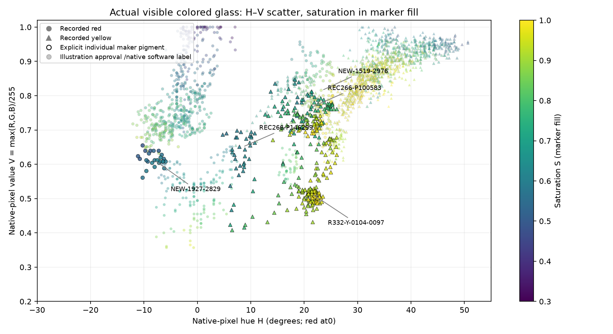
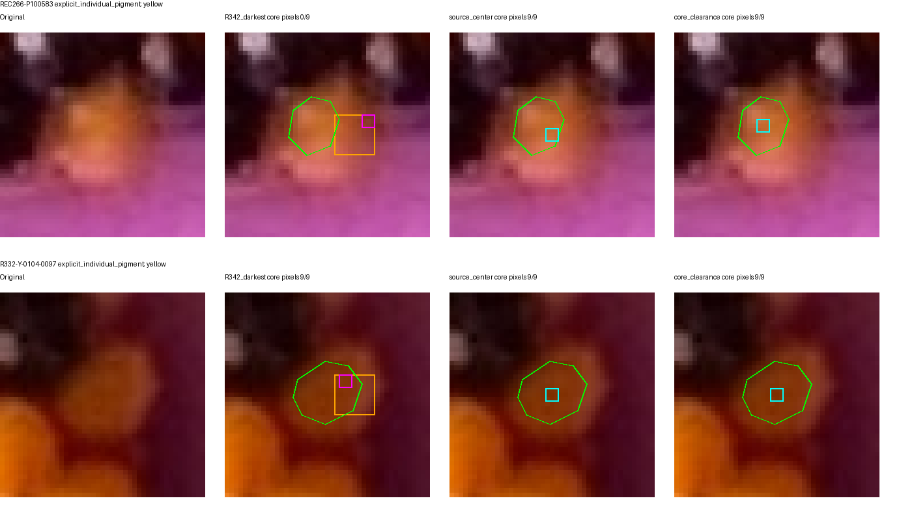

# R343 — actual glass HSV, targeted provenance, 197 supported positions

[Offline pixel-and-photograph review](r343/review/index.html) · [Reproduce](R343_REPRODUCE.md) · [Partial sequence CSV](r343/pattern208.csv) · [Independent checks](r343/verification.json)

**The conditional 208-position pattern advances from 195 supported /5 conflicting /8 insufficient to 197 /4 /7.** Q101 changes from red to maker-yellow. C62's maker-yellow material passes a separate native-body/lattice check and is admitted as one working observation with three links. One provenance annotation is refined without changing that observation's red color or protection. No other pigments, existing coordinates, links or winding change.

## Genuine-glass joint HSV

This is a real two-dimensional distribution: **2,377 individual native pixels from 25 inspected glass cores**, with H horizontal, V vertical and S in marker fill. Circles denote recorded red; triangles recorded yellow. Black outlines identify explicit maker pigment/material judgments; gray outlines identify illustration approval; faint markers identify native/software labels. Negative H wraps continuously through red: −8° means352°. The [interactive plot](r343/review/index.html) filters these evidence types and links each clicked point to its exact original pixel, RGB, HSV and photograph.

There are **six explicitly maker-labeled materials: five yellow and one red**. The other19 are not promoted to individual maker truth. Nineteen reference bodies—eight red, eleven yellow—supply the descriptive comparisons; **all five position29 bodies and the position127 probe are excluded from those reference comparisons**. They remain visible as separately identified investigation data. The complementary [H–S plot colored by V](r343/HSV-HS.png) and [source pixels](r343/source-pixels.json.gz) are also available.

| Individually confirmed material | Median H° | Median S | Median V | Interpretation |
|---|---:|---:|---:|---|
|REC266-P100583, Q101|21.40|0.732|0.767|Yellow; safe interior differs from old boundary sample|
|R332-Y-0104-0097, C62|21.43|0.938|0.514|Strongly saturated yellow in shadow|
|REC266-P146299|8.57|0.607|0.651|Yellow shifted much farther toward red/orange hue|
|NEW-1927-2829|−8.00|0.573|0.612|Explicit shaded-red control; still excluded from reconstruction|

The brighter illustration/native yellow controls have median hues around32–37°. Shaded yellow occupies a recognizable orangeward region, often H≈5–26°, while the inspected red controls are generally near red/negative hue. But **V alone does not determine yellow hue**: the darker C62 has H≈21°, while the brighter REC266-P146299 has H≈9°, with different S. Within-body value strata also show hue changes that need not be monotone. This is spatial variation in one photograph, not controlled relighting or a fitted universal H(V) law.

The larger red/yellow reference sample shares five coarse joint-HSV neighborhoods (5° H ×0.1 S ×0.1 V bins). This is a descriptive overlap diagnostic, not proof of identical pigments or a decision rule. One explicitly confirmed red body is too little to certify a general separator. We therefore adopt **no automatic red/yellow classifier or additional recoloring** from this study.

Every plotted pixel is at least **two pixels inside its explicitly inspected material region**. Hue interpretation requires S≥0.3 and V≥0.2; all2,377 curated pixels pass, so that filter drives no separation. The initial3,671 full-core pixel study is preserved under `development/full-core-before-inset/`; its differences are geometric sample selection, not accuracy gains. No RGB-channel-ratio pigment classifier is used. The black detector remains separate and unchanged.

## What went wrong with Q101 sampling

R342's fixed9×9 window was a placement proposal, **not a verified glass boundary**. Its black measurement minimizes the maximum RGB across candidate3×3 patches. At Q101 this chose **[1504,2070]–[1507,2073]**, on the right boundary. None of those nine pixels lies in the conservative interior reference region; this does not assert that every pixel there is nonglass, but its pigment measurement is unsafe.

There were two distinct measurements: the selected boundary3×3 has median H≈8.48°, while R342's red/yellow diagnostic took median hue over the **entire9×9 window**, giving12.23°. Both could be contaminated by the same misplaced window. The maker-yellow correction does not require adjusting either a hue threshold or the successful blackness threshold.

The modest replacement for **colored-material sampling** chooses a3×3 patch maximizing clearance inside an inspected glass core, with minimum2pixel clearance. At Q101 the new patch **[1492,2071]–[1495,2074]** has median H22.60°, S0.756, V0.769. It is selected geometrically, without a darkness extremum or expected pigment.

At C62, the old **[979,2563]–[982,2566]** patch is already inside the inspected yellow glass, as the maker said: H20.81°, S0.923, V0.518. The new interior patch **[975,2566]–[978,2569]** gives H22.50°, S0.985, V0.502. Low V is not a reason to call this red.

Across the25 inspected regions, the old patch lies wholly in the conservative core in14/23 available cases; a patch centered on the original support does so in18/25; clearance sampling does so in25/25. **This last result uses explicit region annotations and is partly guaranteed by construction. It is not100% autonomous ownership accuracy.** Outside-core old samples are unverified, not automatically errors. The simple centered alternative is not universally safe either. Records without an inspected/trusted glass region abstain; no elaborate segmentation or whole-photo sampler is claimed. All comparisons and actual RGB/HSV are in [sampling-comparison.json](r343/sampling-comparison.json).

The black implementation in `r342/recognize.py`, its fixed3×3 maximum-RGB measurement and **73.5** threshold are byte-preserved. No black labels change.

## Two maker judgments and independent C62 admission

The [maker ledger](r343/maker-decisions.json) records Q101's active red→yellow correction and C62's yellow material confirmation separately. C62 was already provisionally labeled yellow, so this is **one existing color edit and one strengthened material judgment**, not two old-record recolorings. Neither judgment is inferred from the repeat.

C62's material confirmation is **not recorded as maker confirmation of bead identity**. Independent native inspection identifies one exposed amber body, separate from black MAT25-K-0953-2555 above-left and yellow E5-0962-2596/E5-0942-2582 below-left. Its saved support remains exactly **(975.9121,2567.0055)**, with lattice site **(104,97)**:

- Target-excluded native prediction error2.78px; next-site margin20.60px.
- Colored-only versus all-support prediction difference1.61px.
- Three native-supported neighbor links, two already-existing shared-neighbor triangles, no intervening indexed body and no old link crossed.
- Family spacing ratios0.962,1.091,1.175; all primitive equations and cyclic occupancy pass.
- The REC266-P123596 original cache cue is4.85px away on the same inspected glass body. Its source pixels and centroid are independently checked; same lattice grouping alone is not used as alias proof. Only one observation is admitted.

[Association and all three native corridors](r343/association.json) retain the actual source, aliases, old candidate, predictions and links. Filled foreground/corridor masks are exclusion checks, **not evidence creating a bead**. R336's maker-only helper correctly would not admit a pigment-only statement. R343's explicit instruction authorizes the separate native identity/neighbor investigation; no maker identity assertion is forged, no historical helper or veto is weakened, and no prediction/centroid-growth path runs.

The reconstruction becomes **1,059 active records /1,041 indexed /2,290 links**, one component, with the original H=(214,201). All1,058 old XY,1,040 old coordinates and2,287 old links remain exact. Indexed colors are332 red /317 yellow /392 black. Existing phantom/duplicate exclusions and maker-reviewed gaps remain intact.

## Targeted provenance at position29

**R342's “maker-red” wording for NEW-1519-2976 was too strong.** The actual record is general approval of the displayed R336 labels/adjacency, not an individual red-pigment answer. The original R336 `problem-01` key identifies it as local feature6. R339's authority builder copied that displayed red into the protected ledger; later code treated all ledger entries alike.

The [one-record authority overlay](r343/authority-overlay.json) now distinguishes explicit individual pigment, general illustration approval, native/software classification and pattern prediction. It preserves the original statements, the current red, and **automatic color protection**. Individual pigment confirmation is explicitly false; targeted photographic investigation is allowed. No other existing observation receives a provenance rewrite. Selected plot labels distinguish evidence types without a broad historical authority audit.

The earlier code **did compute all five bodies' pixels and investigate their lattice sites**. It did not attempt automatic red/yellow recoloring, so there is no proven legitimate automatic correction that a guard suppressed. But it prohibited a useful review question and distorted calibration: with all old pixels and other ledger entries fixed, removing only NEW-1519-2976 as a calibration reference lowers the historical red hue maximum **20.35°→0.43°**. That is a targeted diagnostic of influence, not a new calibrated hue boundary; the remaining legacy ledger still includes illustration approvals.

All five occurrences are examined independently in [position29.json](r343/position29.json) and native panels in the review:

| ID | Current pigment /authority | Conditional occurrence | Interior median H° | Native prediction error px |
|---|---|---:|---:|---:|
|NEW-1519-2976|red /illustration approval|5|23.36|5.52|
|C-1001-2678|yellow /native software|6|25.99|3.98|
|C-1250-2138|yellow /native software|7|33.45|1.27|
|E5-1792-1727|yellow /native software|8|38.51|5.23|
|C-1226-1539|yellow /native software|9|35.46|3.78|

Their original positions are exact (16,16) translates, and each has a unique site if its current physical neighbor pairs are retained. Thus no isolated index repair is supported. NEW-1519-2976's **own glass**, compared with reference bodies outside position29, is yellow-like; its red remains unchanged pending the now-legitimate individual pigment question. The four-to-one pattern majority is not pigment evidence.

## Strict pattern and remaining uncertainty

Photographic color, authority and identity decisions are frozen before final scoring. The strict rule remains uncontradicted color with at least three observations in three geographic blocks.

| Evaluation | Supported /conflicting /insufficient |
|---|---|
|R342 baseline, same1,040 sources|195 /5 /8|
|Metadata-only refinement|195 /5 /8|
|Q101 maker correction, same1,040 sources|196 /4 /8|
|Expanded cohort after independent C62 admission|**197 /4 /7**|
|Frozen710 cohort, before/after|155 /0 /53|

Position101 resolves because of Q101's explicit yellow. Position62 gains the missing geographic block because of a newly admitted independent occurrence—not a relaxed support criterion. The [208-entry CSV](r343/pattern208.csv) and offline string-order grid retain **11 question marks**.

Remaining conflicts are **29,83,127,189**. Position127's safely inspected glass resembles shaded yellow, but its red and association are retained pending judgment. The thin sources at83/189 lack a defensible separate material core; no hue conclusion is manufactured. Remaining insufficient positions are **43,75,82,89,140,147,186**. They currently have only black observations: six have two records;89 has three conditional occurrences but only two geographic blocks. These are support limitations, not contradictory red/yellow colors or proof of missing beads.

On the **identical1,039 unchanged-color targets**, flat208 geographic held-out agreement improves **97.50%→97.98%**; whole-occurrence agreement remains99.33%. Hierarchical104-parent geographic agreement improves98.27%→98.46%, whole-occurrence remains99.52%. These predict recorded labels, not physical identity truth. Original other occurrences predict C62 yellow with probability0.648, whereas the color-frequency baseline predicts black. Its maker label was known before association and inspection was targeted, so this is **not fresh blind accuracy**.

A mapping7a+6b, total2704,208 and13 repetitions remain the leading conditional interpretation. The actual shortest complete stringing sequence is still unrecovered. No new period-length, winding or rendering search ran.

## Review, verification and stopping point

Two high-value questions remain: **NEW-1519-2976 at29**, now explicitly distinguished from individual maker confirmation, and **R332-R-0125-0118 at127**, whose visible shaded material merits a pigment/ownership judgment. Each has original pixels, local numbers, matched current adjacency and individually confirmed comparison material with its own separate keys. Q101/C62 are solved material examples, not repeated questions.

Independent verification passes2,599 historical source hashes; all2,377 native RGB/HSV values;25 clearance regions and98 patch checks; unchanged old records/geometry;all2,290 primitive equations,1,041 distinct sites and A indices, connectivity;C62's source/alias/native link replay;the single authority edit;all five position29 sites;1,456 strict entries and all eight held-out calculations;11 literal native crops. Fresh replay reproduces20 science products,26 images, vector plot, CSV and offline HTML/JS/CSS. Actual pixel clicks, authority filters, native keys, old/new samples, offline reload and phone layout pass in Chromium. Annotations and native identity judgments remain explicit scientific inputs, not a second independent human inspection.

An initial excluded-control import used pre-R336 labels; it was caught and corrected to the existing maker colors while preserving its failed epoch under `development/legacy-label-input-bug/`. Current assertions independently protect excluded-red NEW-1927-2829 and excluded-yellow REC266-P146299. No historical record changed.

**Stop after scoped commit, push and remote verification.** The two native judgments are the most useful next evidence. No automatic R344 or model/session change.
