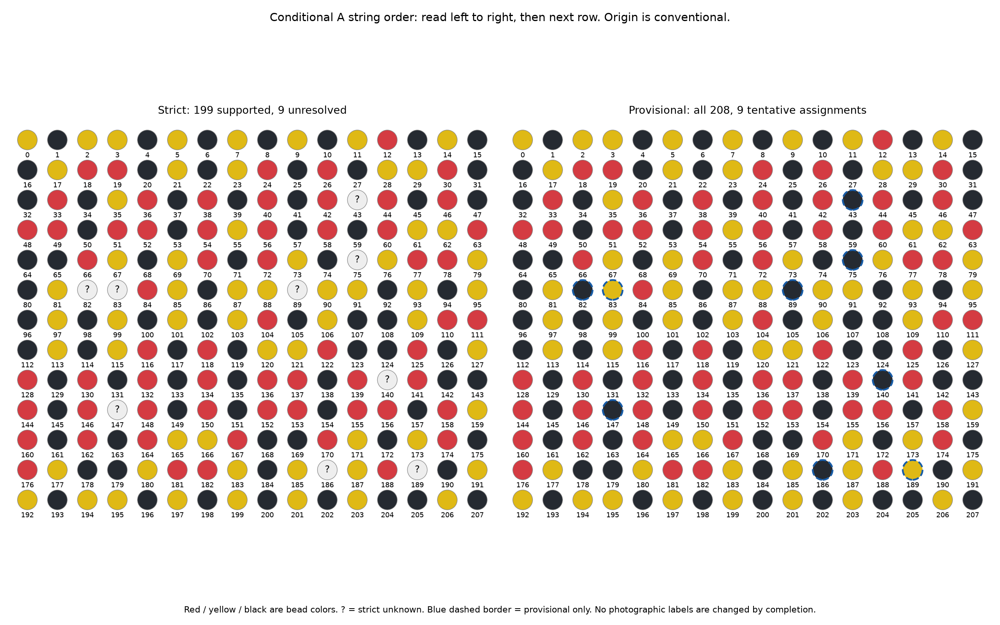

# R344 — the actual partial block, a provisional completion, and measured agreement

[Offline pattern and photographic review](r344/review/index.html) · [Reproduce](R344_REPRODUCE.md) · [All numerical results](r344/evaluation.json) · [Independent checks](r344/verification.json)

**199 of 208 positions now satisfy the unchanged strict support rule; two conflict and seven lack sufficient support.** Both new individual maker judgments are applied as yellow, with no identity, XY, lattice coordinate, link or winding changes. The provisional complete block matches **1,038/1,041 indexed photographic colors (99.71%)**. This is fitted agreement with recorded labels, not independently measured physical accuracy.

## The recovered pattern



These are string-order grids: left to right, then the next row; the 16-column layout is not a physical crochet-row claim. R=red, Y=yellow, B=black. Indices are **0–207**, with A=7a+6b, modulo2704. Index zero is the current reference C-1302-0316. Cyclic origin and positive direction are conventions, not a recovered original stringing start. The strict block has **62 red /60 yellow /77 black /9 unknown** entries; the best provisional block has **62 red /62 yellow /84 black**.

Authoritative strict sequence, `?` retained:

```text
000–015  Y B Y Y B Y B Y B Y B Y R B Y B
016–031  B Y R R B Y B Y R B R B Y Y R B
032–047  B R B Y R B R B R B R ? R B R B
048–063  R R B R R B R Y R B R B R Y Y R
064–079  B B R Y B Y R B R Y B ? Y R R Y
080–095  B Y ? ? R Y B Y Y ? Y Y B Y B Y
096–111  B Y B Y B Y B Y R B Y B B Y R R
112–127  B Y B Y R B R B Y Y R B B R B Y
128–143  R B R B R B R B R R B R ? R B B
144–159  R B R ? R B R B R R B R R B R Y
160–175  R B R B R Y Y R B B R Y B Y R B
176–191  R Y B B Y R R Y B Y ? Y R ? B Y
192–207  Y B Y Y B Y B Y B Y B Y B B Y B
```

Separate best provisional complete sequence:

```text
000–015  Y B Y Y B Y B Y B Y B Y R B Y B
016–031  B Y R R B Y B Y R B R B Y Y R B
032–047  B R B Y R B R B R B R B R B R B
048–063  R R B R R B R Y R B R B R Y Y R
064–079  B B R Y B Y R B R Y B B Y R R Y
080–095  B Y B Y R Y B Y Y B Y Y B Y B Y
096–111  B Y B Y B Y B Y R B Y B B Y R R
112–127  B Y B Y R B R B Y Y R B B R B Y
128–143  R B R B R B R B R R B R B R B B
144–159  R B R B R B R B R R B R R B R Y
160–175  R B R B R Y Y R B B R Y B Y R B
176–191  R Y B B Y R R Y B Y B Y R Y B Y
192–207  Y B Y Y B Y B Y B Y B Y B B Y B
```

Download every individually numbered entry: [strict CSV](r344/strict-pattern.csv), [provisional CSV](r344/provisional-pattern.csv), [full provenance/confidence JSON](r344/pattern208.json). The offline review shows **13 rows of 208 addresses** and links each photographed occurrence to its native body, local numbered key and current adjacency. Solid circles are recorded colors, faint circles are predictions without indexed observations, blue dashed borders are tentative motif entries, and magenta borders mark mismatches. Only 1,041 of the conditional 2,704 addresses are photographically indexed; 1,663 lack an indexed observation. Some may be visible but unassociated, so this is not a count of physically unseen beads. Repeating the provisional block does not measure those missing beads.

## Exactly what changed

The reversible [correction ledger](r344/corrections.json) retains both original records and previous authority statements:

- P29 NEW-1519-2976, own photograph feature1: explicit **yellow**, superseding software red and general illustration approval. Its historical R343 metadata remains intact; a new explicit pigment record has precedence.
- P127 R332-R-0125-0118, own photograph feature1: explicit **yellow glass in shadow**, superseding software red.

P29 becomes five yellow observations in four blocks (5,6,7,8). P127 becomes three yellow observations in blocks**7,8,9**. Previously, its two yellow supporters spanned only8,9; the former red in7 now supplies the third *agreeing* block. Both conflicts therefore become strictly supported. Removing a disagreement alone would not have been sufficient if the third block were absent. No support threshold changes.

| Cohort / colors | Indexed n | Supported | Conflict | Insufficient |
|---|---|---|---|---|
| R336_original1039 | 1039 | 176 | 24 | 8 |
| R343_historical1039 | 1039 | 196 | 4 | 8 |
| R344_historical1039 | 1039 | 198 | 2 | 8 |
| R343_current1041 | 1041 | 197 | 4 | 7 |
| R344_current1041 | 1041 | 199 | 2 | 7 |
| R343_frozen710 | 710 | 155 | 0 | 53 |
| R344_frozen710 | 710 | 155 | 0 | 53 |

The original R3361039-ID set is retained without removals: R343196/4/8 becomes R344198/2/8 there. The two already-admitted extra records in the current1041 cohort explain its additional supported position62. Neither R344 improvement comes from adding or removing observations. The frozen710 cohort is unchanged and still cannot certify global indexing.

## Provisional entries and important alternatives

Strict support requires an uncontradicted color in at least three observations and three fixed geographic blocks. All208 residues have observations; no provisional entry here fills a completely unobserved residue. The seven insufficient entries have only software-derived black records: six have two observations;89 has three observations but two blocks. Their provisional black is useful but not strict. None of the nine tentative residues has an explicit individual maker pigment judgment.

| Position | Prediction | Observed counts | Agreeing geographic blocks | Explicit pigment judgments | Shrinkage score | Actual sources |
|---|---|---|---|---|---|---|
| 43 | black | black:2 | 8,9 | 0 | 0.626 | K-0471-1609; K-1171-1518 |
| 75 | black | black:2 | 8,9 | 0 | 0.626 | K-1069-1565; K-1740-1575 |
| 82 | black | black:2 | 9 | 0 | 0.626 | K-1037-1557; NEW-339-1556 |
| 83 | yellow | yellow:5, red:2 | 0,9,10,11 | 0 | 0.592 | C-0315-0867; C-0870-0396; C-1032-1519; C-1582-0235; E5-0355-1525; R332-R-0037-0040; REC266-P035619 |
| 89 | black | black:3 | 9,10 | 0 | 0.688 | D40-K-1014-1544; NEW-317-843; NEW-326-1528 |
| 140 | black | black:2 | 8,9 | 0 | 0.626 | K-1543-1467; NEW-855-1626 |
| 147 | black | black:2 | 8,9 | 0 | 0.626 | K-0824-1612; K-1518-1455 |
| 186 | black | black:2 | 8,9 | 0 | 0.626 | D40-K-1384-1467; K-0693-1626 |
| 189 | yellow | yellow:7, red:1 | 0,1,2,3,4,6 | 0 | 0.720 | C-1067-2156; C-1243-0349; C-1691-3004; C-1882-0479; C-2168-2478; C-2288-1794; E5-2165-1110; R332-R-0197-0183 |

Scores are the existing fixed concentration3 shrinkage toward training color frequencies, **not calibrated confidence in physical truth**. Every tentative entry has a qualitative confidence statement and original photographic ID/XY/AB/authority in the JSON and clickable review. The provisional choices never overwrite photographic labels.

At83, yellow matches5/7 while red matches2/7; at189 yellow matches7/8 while red matches1/8. Keeping all seven insufficient entries black yields four important red/yellow completions: Y/Y has3 mismatches; R/Y has6; Y/R has9; R/R has12. The fit favors Y/Y, but this does not decide which native pigment or association is correct. Other colors at the insufficient positions would contradict their two or three current black labels; they are logically possible if those records are wrong, but have no positive color support.

## Inventory, fit and source authority

The selected active inventory contains **1,059 recorded observations**, of which**1,041 are indexed and18 unindexed**. This is not a physical bead census. Indexed colors are392 black,330 red,319 yellow; all active records include392 black,337 red,330 yellow. Historical excluded/phantom evidence stays preserved and excluded. All208 pattern positions have recorded support.

The provisional fit agrees with1,038/1,041 and disagrees with3/1,041. The strict block agrees with**1,011/1,011 evaluable observations**, disagrees with0 there and abstains on30/1,041 observations at its nine unresolved entries. Strict100% agreement follows its uncontradicted-entry definition; it is not an independent accuracy estimate. For the historical1039-ID cohort, the current provisional block agrees with1,036/1,039; strict1,009/1,009, abstaining30.

| Recorded color | Provisional fit | Guarded geography held-out | Whole-occurrence held-out |
|---|---|---|---|
| black | 392/392 (100.00%) | 392/392 (100.00%) | 392/392 (100.00%) |
| red | 327/330 (99.09%) | 323/330 (97.88%) | 327/330 (99.09%) |
| yellow | 319/319 (100.00%) | 309/319 (96.87%) | 319/319 (100.00%) |

| Source authority stratum | Provisional fit | Geography held-out | Occurrence held-out |
|---|---|---|---|
| explicit_individual_pigment | 37/37 (100.00%) | 37/37 (100.00%) | 37/37 (100.00%) |
| illustration_label_approval | 83/83 (100.00%) | 81/83 (97.59%) | 83/83 (100.00%) |
| native_software_label | 918/921 (99.67%) | 906/921 (98.37%) | 918/921 (99.67%) |

Authority strata are derived from the retained source statements for this analysis: explicit individual pigment, approval of displayed labels, and native/software label. General approvals are retained as support and not promoted to individual pigment truth. The ledger contains123 entries:120 indexed/active and3 excluded; among the indexed records,37 are explicit individual pigments and83 are displayed-label approvals. All37 explicit indexed pigments agree with the provisional block and both held-out208 predictions. Those judgments were selected during earlier reviews and helped construct the current labels; they are not an independent random test set. No broad metadata reclassification occurs.

## Geography and all thirteen occurrences

Regions below are the same frozen12 photographic station blocks used in recent rounds; neither labels nor model scores choose new boundaries. Geographic held-out training removes the target block and both adjacent blocks, including cyclic adjacency0/11. Occurrence held-out removes the entire leading-A208-address occurrence. Every comparison uses the same target IDs.

[Native photograph with block overlay](r344/geography.png) — overlay colors denote blocks, not pigments.

| Frozen geographic block | Provisional fit | Geography held-out | Occurrence held-out |
|---|---|---|---|
| 0 | 85/85 (100.00%) | 85/85 (100.00%) | 85/85 (100.00%) |
| 1 | 81/82 (98.78%) | 81/82 (98.78%) | 81/82 (98.78%) |
| 2 | 83/84 (98.81%) | 83/84 (98.81%) | 83/84 (98.81%) |
| 3 | 85/85 (100.00%) | 85/85 (100.00%) | 85/85 (100.00%) |
| 4 | 92/92 (100.00%) | 92/92 (100.00%) | 92/92 (100.00%) |
| 5 | 82/82 (100.00%) | 82/82 (100.00%) | 82/82 (100.00%) |
| 6 | 88/88 (100.00%) | 88/88 (100.00%) | 88/88 (100.00%) |
| 7 | 91/91 (100.00%) | 91/91 (100.00%) | 91/91 (100.00%) |
| 8 | 92/92 (100.00%) | 88/92 (95.65%) | 92/92 (100.00%) |
| 9 | 91/91 (100.00%) | 83/91 (91.21%) | 91/91 (100.00%) |
| 10 | 82/82 (100.00%) | 80/82 (97.56%) | 82/82 (100.00%) |
| 11 | 86/87 (98.85%) | 86/87 (98.85%) | 86/87 (98.85%) |

| Conditional occurrence q | Provisional fit | Geography held-out | Occurrence held-out |
|---|---|---|---|
| 0 | 75/75 (100.00%) | 75/75 (100.00%) | 75/75 (100.00%) |
| 1 | 77/78 (98.72%) | 77/78 (98.72%) | 77/78 (98.72%) |
| 2 | 75/76 (98.68%) | 75/76 (98.68%) | 75/76 (98.68%) |
| 3 | 78/78 (100.00%) | 78/78 (100.00%) | 78/78 (100.00%) |
| 4 | 85/85 (100.00%) | 85/85 (100.00%) | 85/85 (100.00%) |
| 5 | 73/73 (100.00%) | 73/73 (100.00%) | 73/73 (100.00%) |
| 6 | 78/78 (100.00%) | 78/78 (100.00%) | 78/78 (100.00%) |
| 7 | 91/91 (100.00%) | 91/91 (100.00%) | 91/91 (100.00%) |
| 8 | 79/79 (100.00%) | 76/79 (96.20%) | 79/79 (100.00%) |
| 9 | 86/86 (100.00%) | 80/86 (93.02%) | 86/86 (100.00%) |
| 10 | 78/78 (100.00%) | 75/78 (96.15%) | 78/78 (100.00%) |
| 11 | 78/79 (98.73%) | 76/79 (96.20%) | 78/79 (98.73%) |
| 12 | 85/85 (100.00%) | 85/85 (100.00%) | 85/85 (100.00%) |

The occurrence numbers assume N2704/208/13 and the conventional origin. They are not independent proof of those assumptions. Full per-observation held-out probabilities and all mismatches are in [heldout-predictions.json.gz](r344/heldout-predictions.json.gz).

## Held-out models and unchanged cohorts

All models were fixed before comparison, using the same1,041 current observations, frozen folds and historical smoothing constants; this is a small hypothesis comparison, not a new length/winding scan. Flat208 geographic prediction gets**1,024/1,041 (98.37%)**; whole-occurrence gets**1,038/1,041 (99.71%)**. The existing104-parent hierarchy gets1,029/1,041 (98.85%) geographically and1,038/1,041 by occurrence. It is a predictor, not a different adopted pattern.

| Fixed predictor | Guarded geography | Whole occurrence | Geographic gain nats | Own closure |
|---|---|---|---|---|
| frequency | 392/1041 (37.66%) | 392/1041 (37.66%) | 0.0000 | yes |
| phase13 | 436/1041 (41.88%) | 447/1041 (42.94%) | 0.0465 | yes |
| A104 | 927/1041 (89.05%) | 939/1041 (90.20%) | 0.6757 | yes |
| A208 | 1024/1041 (98.37%) | 1038/1041 (99.71%) | 0.6100 | yes |
| A208_hier104 | 1029/1041 (98.85%) | 1038/1041 (99.71%) | 0.9546 | yes |
| A338 | 384/1041 (36.89%) | 449/1041 (43.13%) | -0.0358 | yes |
| B207 | 448/1041 (43.04%) | 222/1041 (21.33%) | 0.0211 | yes |
| B299 | 322/1041 (30.93%) | 222/1041 (21.33%) | -0.0782 | yes |
| A306_alias | 591/1041 (56.77%) | 597/1041 (57.35%) | 0.1484 | no |

Frequency uses only training color frequencies; phase13 is a simple spatial/index-phase baseline. A104 tests half-length structure; A338 is the other200–399 divisor of conditional A2704. B207/B299 divide their own2691 total. A306 is a previously noted weak alias and does not close. Every occurrence comparison uses the same leading-A occurrence partition even for B, avoiding favorable alternative test sets. Gain is average log probability relative to the training-only frequency baseline, in natural-log units. A104's geographic log gain exceeds flat208 despite worse hard agreement because flat208 loses support in some folds; the hierarchy handles that sparsity better. Selecting only a favorable accuracy metric would miss this distinction.

For flat208 geography, **997/1,003** targets with at least one remaining same-position record are correct. Another38 targets have no same-position training record;27/38 succeed only through the black frequency fallback. Of17 geographic errors,11 are these cold positions and6 occur despite remaining support. Whole-occurrence testing retains same-position support for all1,041 targets. The all-black success therefore must not be interpreted as new measurement of every unresolved black residue.

| Fixed cohort / label epoch | Geographic all targets | Occurrence all targets | Geographic unchanged-color targets | Occurrence unchanged-color targets |
|---|---|---|---|---|
| R336_original1039 | 932/1039 (89.70%) | 998/1039 (96.05%) | 932/1037 (89.87%) | 998/1037 (96.24%) |
| R343_historical1039 | 1015/1039 (97.69%) | 1032/1039 (99.33%) | 1015/1037 (97.88%) | 1032/1037 (99.52%) |
| R344_historical1039 | 1019/1039 (98.08%) | 1036/1039 (99.71%) | 1017/1037 (98.07%) | 1034/1037 (99.71%) |
| R343_current1041 | 1020/1041 (97.98%) | 1034/1041 (99.33%) | 1020/1039 (98.17%) | 1034/1039 (99.52%) |
| R344_current1041 | 1024/1041 (98.37%) | 1038/1041 (99.71%) | 1022/1039 (98.36%) | 1036/1039 (99.71%) |

“Unchanged-color targets” excludes only the two R344 corrected IDs, holding both ID and target color fixed in the R343/R344 comparison. On the current cohort those1,039 unchanged targets improve geographically1,020→1,022 and by occurrence1,034→1,036; training still legitimately includes the corrected colors in other folds. On the fixed original1039 cohort, the matched unchanged subset has1,037 targets. No problematic observations are removed from the full evaluations.

Scoring the **same current provisional block** against the frozen original R336 labels gives1,006/1,039, versus1,036/1,039 with current corrected labels. This separates historical label corrections from observation selection. Neither cross-validation nor maker review of this same photograph is independent physical validation; previously choosing208 and targeting disagreements also creates selection dependence. No nominal binomial confidence interval is offered for these correlated observations.

## Exact remaining mismatches

| Source ID | Position | Recorded / provisional | Native x,y | AB | A index / q / region |
|---|---|---|---|---|---|
| R332-R-0037-0040 | 83 | red / yellow | 2301.35, 1430.23 | 37,40 | 499 / 2 / 2 |
| R332-R-0197-0183 | 189 | red / yellow | 599.64, 624.45 | 197,183 | 2477 / 11 / 11 |
| REC266-P035619 | 83 | red / yellow | 2124.72, 736.69 | 21,24 | 291 / 1 / 1 |

All three are inherited software-red observations; none contradicts an explicit individual maker pigment. Their native body ownership/edge material remains difficult. R343 could not safely annotate their glass cores, and R344 does not fabricate new hue measurements or recolor them by the motif majority. The review provides actual native crops, current numbered neighborhoods and links. No bead is moved or reindexed to eliminate these residuals.

## What “shortest” can now mean

Every proper divisor of208 is contradicted by a pair of **strict** colors:

| Proper divisor | Strict witness positions | Strict colors |
|---|---|---|
| 1 | 0,1 | Y / B |
| 2 | 0,4 | Y / B |
| 4 | 0,4 | Y / B |
| 8 | 0,8 | Y / B |
| 13 | 0,13 | Y / B |
| 16 | 0,16 | Y / B |
| 26 | 0,26 | Y / R |
| 52 | 0,52 | Y / R |
| 104 | 0,104 | Y / R |

Any cyclic208-word with a smaller period has a proper divisor of208 as a period. These witnesses therefore prove that **every completion of this strict block has minimal cyclic period208**, under the current A indexing. They do not prove that this indexing, winding, N2704 or exact physical208 repetition is true. The three residual photographic contradictions still prevent that stronger claim. Broad alternative winding/global continuation tests are not repeated.

## One recommended next step

**Obtain targeted independent photographic reobservations of the three mismatching bodies at83/189, with their known neighboring beads visible.** The original image leaves those thin/edge glass regions unsafe, so another general classifier or majority vote has little value. These are the only contradictory recorded colors left; the other seven gaps are geographic-support shortages, and conditional208 minimality already has strict witnesses.

Cost: three localized closeups or equivalent direct maker inspection tied unambiguously to the native IDs/neighbors, followed by a bounded association/pigment check. No broad detector, rendering or winding campaign is needed. Success means independently established body identity and pigment for all three, preserving distinct physical beads. If they are yellow, strict support can reach201/0/7 without weakening the rule. If a red body is confirmed at its existing association, that is a substantive counterexample to the exact208 hypothesis and motivates a targeted indexing/design investigation. Either result is more informative than another high fitted score. Additional independent geographic support for seven black residues remains necessary afterward. **This next step has not begun.**

## Verification and stopping

The independent verifier preserves all1,059 original observation identities/XY,1,041 coordinates,2,290 links and H214,201; checks every primitive equation and distinct quotient/index; preserves maker pigments and old exclusions; rederives1,456 strict entries,18,738 held-out probability vectors and20 matched historical summaries without the producer prediction helpers; checks nine shortest-divisor witnesses and five literal native crops. Historical scientific hashes, the black implementation and all earlier results remain unchanged. Fresh replay and actual offline/narrow browser interactions are recorded under r344. Native labels/identities and the physical closure remain hypotheses, not conclusions supplied by arithmetic verification.

STOP after scoped commit, push and remote verification; no automatic R345.
