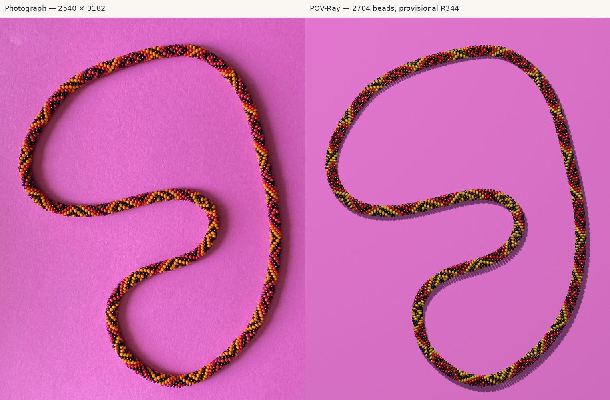

# R345 — rendered R344 necklace in POV-Ray

[Complete 2540×3182 POV-Ray render](r345/output/render.png) · [Photograph beside reconstruction](r345/output/comparison.jpg) · [Alignment overlay](r345/output/geometry-overlay.jpg) · [Transparent geometry layer](r345/output/geometry-transparent.png) · [Index overview](r345/output/indices-full.jpg) · [Helicity detail](r345/output/helicity-detail.png)



This is an actual ray-traced reconstruction of **2,704 separate rounded, hole-bearing glass beads**, using the R344 provisional complete sequence thirteen times. It reproduces the irregular necklace outline and broad color arrangement. It is an inspectable reconstruction, **not a calibrated photorealistic replica**: bead orientation, thickness, twist distribution and optical appearance remain approximations. The fitted image coordinates are bright-support locations, not measured physical centers. No pattern recognition, ledger correction, count search or alternative winding campaign was conducted.

## Inputs and provenance

The source baseline is `d6c4cdb7aab209e53ca32488c43e45f1e12901ad`, branch `photo-2-strategy-v3`. [Configuration](r345/config.json) and [generated provenance](r345/output/provenance.json) record input hashes, the complete strict/provisional uncertainty metadata, renderer version, assumptions and parameters.

| Input | Selection and status |
|---|---|
| Pattern | [R344 pattern208.json](r344/pattern208.json), `provisional_sequence`: 62R/62Y/84B. Every physical bead k uses sequence[k mod208]. |
| Strict evidence | The same JSON's `strict_sequence` and full entries are retained, including all nine unresolved residues. `beads.json` carries strict color and tentative status for every emitted bead. |
| Index and direction | Frozen [R344 graph](r344/graph.json.gz), A=7a+6b mod2704, origin C-1302-0316. Positive A follows the image trace clockwise. |
| Centerline | [R282 saved 8,193 spline samples](r282/results/centerline.json), themselves from R255 `spline-samples.csv`. This is the R175 periodic cubic with the 2px smoothing budget applied to the 303-point image-only seed. [R187 provenance](spline-provenance-r187.json) audits its source. |
| Later geometry | R298's corrected-axis fits, R303–305's local splice continuations and R306–320's geometry campaigns were not finally accepted physical geometry. R305 explicitly retained penetrations; R320 explicitly adopted no final geometry. Their fitted camera/dimensions are not silently substituted. |
| Bead surface | The original `bead` macro is extracted **verbatim** from [beads.pov](../beads.pov) into [shape.inc](r345/output/shape.inc), retaining its cylinders, rounded tori, internal bore and CSG merge. No sphere substitutes for a bead. |
| Lighting history | R257 and R276 investigated shared illumination but did not establish reliable global optics. R345 uses their qualitative high, upper-left illumination as context; it does not import their black brightness peaks as verified reflection measurements. |
| Photograph | Original `beads-photo-2.jpg`, 2540×3182; never mapped onto the paper or necklace. |

There is **no finally measured physical centerline** in these inputs. The selected spline is the best established reproducible *image-axis reference*, not a new claim of physical accuracy. Its shape is unchanged. The 2px smoothing budget is not an accuracy guarantee.

The selected count, 13×208 repetition, 6.5 beads per minor turn, and 416 minor turns are conditional reconstruction assumptions. The R344 evidence remains 199 strict supported /2 conflicting /7 insufficient. The provisional colors at43/75/82/89/140/147/186 are black;83/189 are yellow. All nine remain identifiable, rather than being promoted to measured pigments. Cyan circles in the index overview mark front-facing tentative bead centers. All131 tracked R344 files are independently checked byte-for-byte against the baseline.

## Coordinates, frames and signed winding

World z is the paper normal; paper top is z=0. The orthographic camera has elevation80°, image-right along world+x, and image-down vector `(0,-sin80°,-cos80°)`. Its elevation and orthographic projection are explicit approximations; no measured focal length or camera pose is claimed. Scale is8.5 native pixels per world unit. World units are arbitrary, not measured millimeters.

With image center `(cx,cy)=(1269.5,1590.5)`, scale p and elevation e:

```text
image_x = cx + p*X
image_y = cy + p*(-sin(e)*Y - cos(e)*Z)

X = (image_x-cx)/p
Y = (-(image_y-cy)/p - cos(e)*Z)/sin(e)
```

The inverse requires a specified height Z. The reference curve lies at Z=5.81453698; the paper uses Z=0. This height includes minor radius4, bead radius1.78453698 and a0.03 clearance. Perspective, out-of-plane necklace deformation and paper curl are not recovered.

The image curve is inverse-projected, interpolated with a periodic cubic, and integrated on65,537 samples to physical arclength. Placement inverts that arclength table. Uniform spline-parameter increments are never treated as equal distances. Independent integration at twice the density differs by about1.95×10⁻⁶ world units.

For increasing k, let T be the centerline unit tangent, B=(0,0,1), and U=B×T. This planar transported frame avoids Frenet-normal flips at inflections. The bead center is:

```text
s(k)/L = k/2704 + F(k/2704)              modulo1
phi(k) = helicity*2*pi*416*k/2704 + G(k/2704)
center(k) = C(s(k)) + 4*(sin(phi)*U + cos(phi)*B)
```

F and G are smooth periodic Fourier fields of degree5, with their actual coefficients in the configuration. They are broad whole-necklace station/phase approximations, not independent bead offsets. The global camera, spline shape, bead shape, count and color labels are fixed during this placement calibration. Both station progression and signed phase progression are checked strictly positive everywhere on the dense validation grid. The6.5 beads per turn is the nominal global mean: G permits smooth variation of local angular advance (approximately6.35–6.56 effective beads per turn), while the complete necklace still has exactly416 turns. This is an explicit placement approximation rather than an assertion of perfectly uniform crochet.

`helicity=+1` rotates from +B toward +U as k increases; `-1` rotates toward −U. **The primary uses −1.** Near the reference, its projected +6 and +7 vectors have the same chirality as the actual R344 `(0,1)` and `(1,0)` neighbor vectors. The [detail diagnostic](r345/output/helicity-detail.png) shows projected centers and arrows: cyan+1, green+6, pink+7. These are actual model relations, including centers potentially near an occluding edge, not fabricated observed contours. Changing the sign reverses the carrier winding; the periodic phase field leaves the net winding exactly±416. Independent unwrapping of the actual center offsets verifies both signs.

F and G close with matching derivatives, so there is no seam reset. The bead-hole axis follows T, with a configurable common circumferential tilt (zero in this reconstruction). It deliberately does not follow the tangent of the string's tightly wound helical center trajectory. This preserves the original crochet model's orientation assumption; the actual thread path and individual bead-hole tilt are not measured.

## Bead dimensions and contact

All three pigments use the **same** radius1.78453698, full axial thickness1.9630, bore radius0.249835 and rounding0.8. Radius is the corrected `4*.96*sin(pi/6.5)` value. The primary thickness/diameter ratio is0.55, compared with0.7 in the original examples. This common global approximation avoids the substantial interpenetration of the initial thicker construction. It is not a measured bead dimension.

The initial source-like0.7 thickness produced2,092 sampled penetrating pairs under its first trial placement. Reducing the shared thickness and fixing handedness removed those penetrations. The final degree5 placement has **all8,112 nearby pairs certified disjoint**, including the closure seam. Pairs outside the conservative bounding-sphere threshold are automatically disjoint. Every remaining pair has a positive separating-plane margin computed from the analytic support of a filled rounded-bead envelope containing the true hollow glass. An independent implementation recomputes every certificate from emitted transforms.

The minimum separating-plane margin is0.00012883 world units. This is numerical nonintersection of the selected model, not measured physical clearance or a mechanical crochet simulation. The exact minimum bead height is0.03000068 above the paper. A looser containing sphere extends below the paper; this does not represent the actual glass and is separately labeled in the numerical output.

| Center-pair step | Min / mean / max distance, world units | CV |
|---|---:|---:|
| +1 |3.7042 /3.7398 /3.8228|0.70%|
| +6 |2.5218 /3.0961 /3.5034|4.76%|
| +7 |2.9472 /3.4250 /3.9684|4.25%|

[Contact certificates](r345/output/contacts.json) also bound surface gaps: a positive separating margin bounds distance below, and a pair of explicit points on the real glass bounds it above. For +1, median/maximum upper bounds are0.2552/0.3259 units. The +6 and +7 upper bounds are looser (maximum2.0850/1.7967); they are **not measured gap sizes**. No claim of tightly packed mechanical equilibrium follows. The visibly regular, somewhat thin bodies and scalloped silhouette remain a geometry discrepancy.

## Placement calibration and remaining image errors

The frozen1,041 bright-support XY locations calibrate only F and G, using a robust loss and smooth coefficient penalties. Predicted locations are approximate radial glass-surface proxies, with radius offset0.75 times bead radius. They are not calibrated specular peaks, physical centers or exact visible centroids. No color enters the fit.

| Shared calibration | Native-pixel RMS | Median | P95 |
|---|---:|---:|---:|
| Constant station origin and phase |40.97|32.73|75.07|
| Degree3 periodic station and phase |18.38|9.33|43.91|
| Selected degree5 fields |14.43|6.58|27.19|

The maximum proxy discrepancy remains94.73px. [All source-linked residuals](r345/output/projected-support-errors.csv) retain the complete denominator. These fitted errors do not independently validate the assumed count, camera, physical centers or source associations. The extra broad fields reduce obvious global drift without changing the underlying image-axis curve or assigning separate corrections to individual beads. Their shortest harmonic period is about541 string indices; they do not eliminate localized failures. A smoother ideal rope cannot reproduce all observed body poses and crochet relaxation.

The [alignment overlay](r345/output/geometry-overlay.jpg) shows the reference centerline in white and cyan sampled annular-profile **convex envelopes before occlusion** for front-facing bead offsets. It is not a set of independently measured bead outlines and does not display the bore. This distinction matters when assessing overlap in the overlay.

Enlarged, equal-coordinate comparisons:

- [Straight right section](r345/output/crop-straight.jpg).
- [Tight interior bend](r345/output/crop-bend.jpg).
- [Index-zero reference](r345/output/crop-reference.jpg).
- [Lower bend](r345/output/crop-lower-bend.jpg).

## Paper, camera and optics

The sheet is a finite, thin prism beneath the entire necklace. No paper edge or corner is visible in the photograph. Its vertices are therefore explicitly outside the frame at image coordinates(−250,−250), (2790,−250), (2790,3432), (−250,3432), inverse-projected onto z=0. This models the observed flat pink surface but does not invent a measured outline. Paper thickness0.025 and the unseen extent are assumptions. Paper color starts from RGB channel medians of the native unobstructed20:220 square, approximately(216,112,195)/255. This is encoded photographic appearance, not recovered reflectance. Procedural fine bumps add texture; there is no image texture.

The camera preserves the native aspect ratio, pixel-coordinate orientation, necklace location and apparent centerline scale. Independent rendered camera markers have maximum centroid error0.160 render pixels in the half-resolution test. This validates projection implementation, not the physical camera hypothesis.

A broad upper-left area light at(−300,350,850), intensity1.05, supplies highlights and shadows; a weak shadowless fill and ambient term approximate room illumination. Glass uses IOR1.5, Fresnel reflection, color filtering and distance attenuation. Black has low transmission and strong absorption, rather than manufactured photographic highlight observations. Red/yellow/black optical parameters are independently configurable in `config.json`; their meshes and dimensions are identical.

The render remains more regular and glossy than the photograph. Yellow/red saturation, highlight shape, paper grain, shadow softness and indirect illumination are approximate. The original paper has spatial texture and illumination variation that the simple procedural sheet does not fully reproduce. Shape/orientation and phase errors can also move highlights, so remaining differences cannot all be attributed to lighting. No optical inversion accuracy is claimed.

## Scene changes and validation

[beads.pov](../beads.pov) dispatches to the generated scene when R345 is declared, while retaining the eight original examples otherwise. The original bead macro remains in place and is reused by extraction. The radius sine now uses radians by default; `LegacyRadius=1` restores the old expression. `bead_pattern` and `helicity` can be selected externally. Example5's previously undefined color index4 now uses the existing medium-purple material; this is an intentional repair, not a recovered photographic pigment. Historical Python source-extraction helpers retain their literal legacy radius and placement parity.

[Independent checks](r345/output/independent-verification.json) verify:

- Exactly2,704 emitted object statements/transforms and thirteen exact208-color repeats, retaining strict uncertainty at every instance.
- Closed positional/frame transport, both signed416-turn windings, first/last continuity, orthonormal transforms and the recovered local A-neighbor chirality.
- All8,112 separating-plane certificates and independent physical arclength integration.
- Actual POV-Ray `trace()` rays through the open bore and87 hits on the original rounded CSG surface, with maximum implicit-surface error about1.03×10⁻¹⁴.
- Actual camera-marker projection, plus all eight legacy examples at both corrected and literal radius settings:16 successful parse/renders.
- All131 tracked R344 files byte-preserved. The historical five-case Python/POV placement parity also passes, maximum position error8.30×10⁻¹³.

The periodic axis is C² at closure; its maximum curvature is0.04123 per world unit (minimum bend radius24.254). Position closure error is8.82×10⁻¹³ world units; frame orthogonality error is below9×10⁻¹⁶; signed winding is−416.00000000000006. The independent marker scenes use spheres only as calibration markers, never as necklace beads. [Numerical geometry output](r345/output/validation.json), [renderer log](r345/output/render.log), [render receipt](r345/output/render-receipt.json), and [legacy montage](r345/output/legacy-examples.jpg) provide the underlying receipts.

[Fresh replay](r345/output/replay-verification.json) matches19 generated scene/data/image artifacts exactly, including every native-resolution PNG pixel. POV-Ray date chunks are stripped without changing pixels or color tags; runtime logs and command receipts are excluded.

[Reproduction instructions](R345_REPRODUCE.md) cover the single-command pipeline, fresh replay, controls and scene inputs. R344 scientific files and unrelated stopped R340 work remain unchanged. This delivery stops after the scoped commit, push and remote verification; no R346 or further pattern investigation is started.
