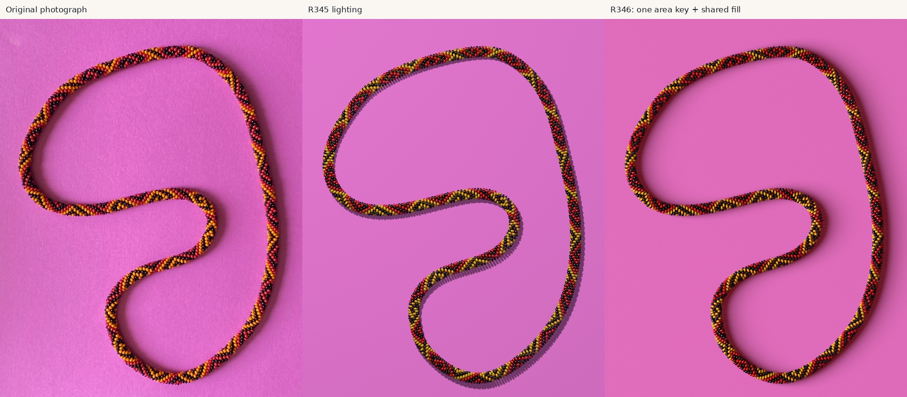
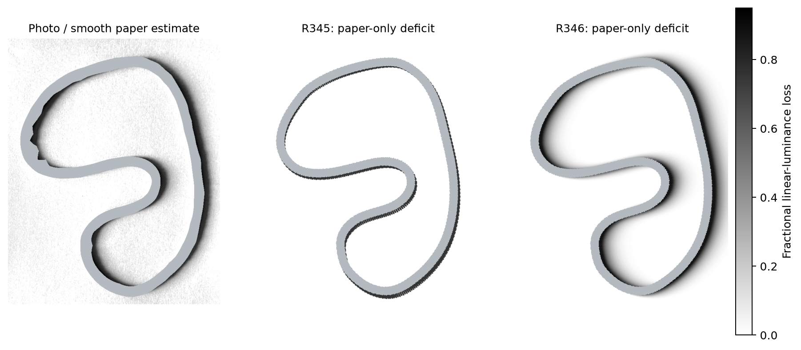

# Reverse engineering the necklace in beads photo 2

Historical and technical retrospective through R346, 20 October 2026. Scientific baseline: [`8e9648b9`](https://github.com/rharriszzz/beads/commit/8e9648b9c9e1379fc66f256bddae0851f1bef39f), `photo-2-strategy-v3`. This report is for discussion; it introduces no reconstruction changes or optimization experiments.

## 1 Executive summary

The project has produced a strong candidate for the necklace's original color pattern, a substantial photographic lattice of bead relationships, a complete executable POV-Ray reconstruction, and a much better approximation to the necklace's broad cast shadow. **The result is close to the photograph, but the exact original stringing pattern and physical reconstruction have not been conclusively recovered.** That distinction agrees with the maker's current assessment.

The strongest final pattern evidence is the 208-position block in R344. Under the working mapping from photographic lattice coordinates to string indices, 199 positions have uncontradicted support from at least three observations in three geographic blocks. Two positions remain conflicting and seven lack that level of geographic support. A separately identified provisional completion agrees with **1,038 of 1,041 indexed color labels**. Three contrary red observations remain at positions 83 and 189; the report and data retain them rather than recoloring them to agree with the majority. The seven insufficient positions provisionally contain black. All 208 positions have some observational support. [R344 report][r344], [pattern with source evidence][pattern208]

This is much stronger than a pleasing render or a repetition guessed from a few similar patches. Geographic prediction, whole-occurrence prediction, comparison with shorter and alternative patterns, exact lattice equations, and direct photographic review support the candidate. Nevertheless, most labels are software or analyst interpretations of the same repeatedly studied photograph. The topology is a working reconstruction with preserved alternatives. Agreement with those labels is not independently measured accuracy against the original necklace.

R345 constructs **2,704 separate rounded, hollow beads**, repeating the provisional 208 block thirteen times. Its selected geometry closes and has separation certificates for all 8,112 nearby pairs requiring explicit examination. This resolves the actual interpenetration problem for that rendered scene. It does not establish that the necklace really contains 2,704 beads, that every photographic support has the right physical identity, or that its camera and centerline are measured correctly. Those remain conditional or approximate inputs. [R345 report][r345], [geometry validation][r345validation]

R346 is a genuine final advance in illumination. It assesses **the cast shadow of the whole necklace on the paper**, on both sides around the loop, rather than fitting selected bead shadows or specular spots. One fixed broad area source and a shared warm room contribution reduce paper-shadow profile RMS error from **20.4 to 6.8 percentage points**, and held-station error from **20.0 to 6.4**. Same-coordinate paper comparisons also improve. The reconstructed global shadow is convincingly closer. Individual bead highlights, local shape differences, and paper texture remain visibly imperfect. The fitted light is a plausible arrangement, not a unique recovered lamp calibration. [R346 report][r346], [saved measurements][r346metrics]



*The final comparison supports substantial visual similarity. Enlarged views still reveal a more regular, thinner, glossier bead arrangement and different background texture. The broad shadow improvement is visible independently of those differences.*

The length of the investigation has several causes, with different evidential strength:

1. **The inverse problem is genuinely ambiguous.** Hidden beads, repeated colors, occlusion, uncalibrated scale and camera, and uncertain surface ownership couple discrete topology to continuous geometry and illumination. A highlight is not a bead center, and a color mask is not a bead identity.
2. **Several methods optimized insufficient or misleading targets.** Early image-region order was substituted for crochet order; center proximity rewarded excessive bead density; brightness extrema and smooth bands were treated as stronger identity cues than they warranted; later objectives improved highlights while degrading visible material. These are documented computational problems, not unavoidable consequences of using one photograph.
3. **Search failure was real, but not a universal explanation.** R301 failed to recover known synthetic geometry even though the accurate forward model represented the exact answer. R311 found missed basins. Conversely, broader searches often traded one photographic error for another, and R319 did not establish a true nonlinear local minimum or prove that its model family was incapable.
4. **The process repeatedly worked on difficult prerequisites longer than necessary.** Useful manual observations, graph algebra and incomplete-word periodicity were available relatively early. Much effort went into increasingly elaborate segmentation and optical fitting before a robust photographic lattice and simple pigment audit were in place. Later work made especially productive use of those simpler constraints.
5. **Preservation improved more than synthesis at first.** The late history is unusually reproducible and candid about failure. However, old discoveries were sometimes preserved without remaining effective constraints, and measurements, labels and approval scopes were occasionally communicated too strongly. R297, R329, R332, R336 and R343 provide concrete examples.

Branch changes generally reflected the maker's dissatisfaction with the preceding work, as the maker clarified during this retrospective. They were not all independent projects or successful milestones. The Git relationships show which changes were true continuations and which were deliberate restarts.

## 2 Repository access and branch inventory

### Access and preservation

All three repositories were present locally before substantive investigation:

| Repository | Local clone | Origin |
|---|---|---|
| beads | `/home/rharris/git/beads` | `git@github.com:rharriszzz/beads.git` |
| bead_map | `/home/rharris/git/bead_map` | `git@github.com:rharriszzz/bead_map.git` |
| hsv_tools | `/home/rharris/git/hsv_tools` | `git@github.com:rharriszzz/hsv_tools.git` |

All origins were fetched with `--all --no-recurse-submodules --no-auto-gc`. Each uses the fetch refspec `+refs/heads/*:refs/remotes/origin/*`. All clones are non-shallow; an object traversal found no missing objects in their locally reachable histories. No clone or large binary download was needed. Fetching the two sibling repositories required access outside the read-only filesystem sandbox; those fetches succeeded. A sandbox DNS failure during an additional beads reference check also resolved with the permitted unrestricted Git command. There was no demonstrated GitHub authentication problem.

The initial working branch was `photo-2-strategy-v3`, matching origin at `8e9648b9`. Existing untracked R340 work in beads and a modified `hsv_picker.py` in hsv_tools were preserved. Historical analysis of hsv_tools uses `git show HEAD:...`, not that modified working file. No branch checkout, source edit, scientific rerun, commit or push was performed for this retrospective. New files are documentation on the existing v3 branch.

The machine-readable [branch inventory](retrospective/branch-inventory.csv), [commit index](retrospective/commit-index.csv), and [access record](retrospective/repository-access.json) accompany this report. There are **416 reachable distinct commits in beads, 5 in bead_map and 10 in hsv_tools**. These are repository-history counts, not counts of independent experiments. Numbered R entries also include questions, clarifications, reviews and delivery steps.

### All branches newest first

Dates below are tip **committer dates**, retaining their recorded UTC offsets. Local and matching remote-tracking references are one branch, not two developments; `origin/HEAD` is a symbolic default-branch reference and is not an extra branch.

| Repository and branch | Latest commit date | Tip | Purpose and relationship |
|---|---|---|---|
| beads `photo-2-strategy-v3` | 2026-10-20 16:44:04 −04:00 | [`8e9648b9`][v3tip] | Latest reconstruction strategy, R233–R346; descends directly from reconstruction-v2. Photographic evidence, physical fitting, lattice recovery, pattern audit, final rendering and whole-necklace shadow. |
| beads `master` | 2026-10-15 17:31:55 −04:00 | [`5d1258cd`][mastertip] | Original forward-rendering/photo repository plus sine/radius documentation. Its recent date does not make it the latest inverse reconstruction. |
| beads `photo-2-reconstruction-v2` | 2026-10-05 19:03:11 −04:00 | [`b28b99e8`][v2tip] | Restart from the older master base, R092–R232. Background, local geometry, manual graph evidence, distributed supports and seed-selection work. |
| beads `photo-2-reconstruction` | 2026-09-27 15:10:37 −04:00 | [`2c4c116b`][recontip] | First photo-2 reconstruction, R001–R091, based on image-to-pattern-2; initial rendering, synthetic indexing checks and reviewed generated-image inventories. |
| beads `archive/image-to-pattern-2-wip` | 2026-09-23 11:10:21 −04:00 | [`debec405`][archivetip] | One archival commit beyond image-to-pattern-2. Preserves unfinished uncommitted v2 work and an earlier render; not a new successful reconstruction. |
| beads `image-to-pattern-2` | 2026-06-09 17:46:24 −04:00 | [`402663eb`][image2tip] | One plan-replacement commit beyond image-to-pattern. A methodological restart plan, not a completed second pipeline. |
| beads `image-to-pattern` | 2026-01-05 17:31:43 −05:00 | [`26ba79a9`][image1tip] | January generic inverse pipeline, layout tests, segmentation/palette experiments, manual color tooling and saturation/FFT diagnostics. |
| bead_map `main` | 2025-04-27 21:25:19 −04:00 | [`46e17d63`][maptip] | Applies manually produced HSV masks to bead detection, nearest-neighbor ordering and skeleton/spline extraction. Separate Git root; directly dependent on hsv_tools outputs. |
| hsv_tools `main` | 2025-04-26 15:22:44 −04:00 | [`3e70fe30`][hsvtip] | Interactive HSV exploration, histogram/bucket counting, line-based selection, merged masks and saved photo-2 masks. Separate Git root. |
| beads `pattern` | 2025-04-24 16:42:43 −04:00 | [`84672643`][patterntip] | April segmentation/quantization/periodicity prototype branched from the photo-file rename commit; not an ancestor of the later inverse branches. Available locally as `origin/pattern`, without a separate local branch. |

### Actual ancestry

The important split is at [`020303ec`](https://github.com/rharriszzz/beads/commit/020303ec16c81cb62802b6ae718adda9bbc2fdfa). Reconstruction-v2 is **not** a descendant of the first photo-2 reconstruction. It starts afresh from their older common master base and carries selected earlier knowledge through documentation and copied evidence. The final v3 branch then adds 194 commits beyond v2.

```text
c100ac8c  original forward scene and website, 2017
  └─ 895f8aa7 ─ 5bbd0e0f  photographs and renaming, April 2025
                   ├─ pattern → 84672643
                   └─ 020303ec  more photographs
                        ├─ master → 5d1258cd  sine note
                        ├─ image-to-pattern → 26ba79a9
                        │    └─ image-to-pattern-2 → 402663eb
                        │         ├─ archive/image-to-pattern-2-wip → debec405
                        │         └─ photo-2-reconstruction → 2c4c116b
                        └─ photo-2-reconstruction-v2 → b28b99e8
                             └─ photo-2-strategy-v3 → 8e9648b9

hsv_tools and bead_map have separate roots, connected by shared mask files.
```

The sine note on master is the same file blob as the note introduced by [`81234cba`](https://github.com/rharriszzz/beads/commit/81234cbaa7afe80ec3f892be495fadb8ae23053b) on v3. The different commit hashes and separate ancestry do not imply two independent discoveries or a merge of the scientific branches.

### What each line left behind

| Branch or repository | What remained unresolved at its stopping point | What survived |
|---|---|---|
| hsv_tools | Pixel selections did not determine distinct beads, physical centers, topology or a repeat. No validated full-pattern output is stored. | Human-guided color sampling, circular hue comparisons, saved masks and an interactive way to inspect source pixels. |
| bead_map | Mask polarity/scale handling and shadow contamination were fragile; greedy proximity did not recover crochet order. No established photo-2 sequence was delivered. | Recognition that centerline, scale and ordering needed explicit treatment; early debugging plots and the exact masks linking both repositories. |
| pattern | Segments and palette clusters were not established bead identities, and region order did not establish string order. | The goal of reversing beads.pov, the 6/7 neighborhood idea, and separation of segmentation, color assignment and periodicity. Later branches did not inherit this implementation through Git. |
| image-to-pattern | Real-image and rendered-JPEG recovery remained poor despite passing component tests. Palette/background mixing, sparse retention and ordering remained unreliable. | Forward-layout tests, source-pattern fixtures, geometry helpers, manual color configuration, and an unusually useful failure record in its plan. |
| image-to-pattern-2 | The new milestone plan had not been completed. | Explicit lessons about per-stage validation, known-pattern photo 4, partial observations and avoiding an untrusted end-to-end baseline. |
| archive branch | Unfinished source/renderer-parity work, not a solved inverse pipeline. | An accessible record of otherwise uncommitted work and the prior render. |
| photo-2-reconstruction | No complete pattern from any of seven generated JPEGs; automatic image-neighbor indexing and physical photo geometry unvalidated. | Original image-axis spline, supplied-edge integer propagation, missing-color periodicity, shape/visibility distinctions and documented failed cues. |
| reconstruction-v2 | No accepted global count, hand, full bead correspondence or robust broad masks. The tip retained M4 as a provisional seed approach, with misses and a same-body question. | Maker graph labels, confirmed positive interiors, distributed color observations, exact surface/visibility tools and the spline reference later reused by R345. |
| strategy-v3 | Exact physical count/topology, nine pattern entries, full geometric correspondence and unique camera/optics remain uncertain. | A connected working lattice, strong conditional 208 motif, conservative pigment corrections, a nonintersecting full scene and a much improved global cast shadow. |
| master | No inverse reconstruction on this branch. | Original bead macro, example patterns and documented radius conventions. |

## 3 Chronological history

### 2017 to April 2025 The forward model and the first inverse attempts

The initial commit, [`c100ac8c`](https://github.com/rharriszzz/beads/commit/c100ac8c), already contains a functioning conceptual forward model: a repeated linear color array placed around a minor helix whose axis follows a major circle. The bead macro models rounded hollow glass rather than colored points. This was valuable prior knowledge, but it was an illustrative construction model, not a measured mechanical model of photo 2. The photography was added in April 2025.

The `pattern` branch tried SLIC superpixels, region-adjacency merging, palette clustering and repetition detection. Its documentation describes an iterative segmentation/quantization approach, but the code exposes a larger problem than color noise. In `main.py`, the initial color sequence is extracted by sorting region records; that ordering is not physical crochet order. The optional graph path between outer and inner background regions is also not the complete string traversal of a tube. `pattern.py` attempts three distance clusters corresponding to the 1/6/7 neighbor families, but image distance alone does not identify those families around bends and occlusion. [Prototype description][patternmd], [main program][patternmain], [ordering implementation][patterncode]

This was a reasonable exploratory decomposition, but the ordering step lacked the physical constraints needed to make an autocorrelation or exact string-period result meaningful. The saved code and documentation do not establish successful recovery of photo 2.

The other two repositories belong to this same attempt. `hsv_tools` developed histogram/bucket exploration and a two-click line picker that collects HSV values, with circular hue tolerance and an option to merge selections. Its final commit saves red, yellow, black and background masks for `beads-photo-2.jpg`. `bead_map/bracelet-pattern-extractor.py` explicitly says these masks were made by hand with hsv_tools. The red, yellow and black mask blobs are **identical in both repositories**, which establishes an actual artifact transfer rather than merely similar intentions. [HSV picker][hsvpicker], [HSV counts][hsvcounts], [mask consumer][mapextractor]

`bead_map.py` estimates an apparent radius from component areas, proposes LoG blobs, constructs a KD-tree and follows a nearest-neighbor cycle. Its estimate of total count is based on detected visible candidates, so it cannot independently count hidden beads. The spline helper in `bracelet-pattern-extractor.py` closes masks, skeletonizes them, chooses widely separated skeleton points and routes between them. This is an initial geometric heuristic, not a reliable complete closed necklace reconstruction. [bead_map implementation][mapcode]

There are also identifiable implementation hazards: mask polarity is treated differently between color classes in `bead_map.py`, and the spline helper compares `imread(..., as_gray=True)` values with 128 even though those grayscale values use a normalized float scale. These are static code findings; the history does not isolate their contribution to a particular saved run. More fundamentally, even corrected masks and blob coordinates would not make a nearest-neighbor walk equal to the crocheted string's order. The June plan later explicitly describes the sibling centerline code as unreliable around cast shadows. [June plan][image2plan]

### January 2026 A modular pipeline without a trustworthy full recovery

`image-to-pattern` implemented layout, source patterns, segmentation, sampling, palette inference, bead detection, graph ordering and periodicity as tested modules. This was more organized than the April prototype. It also accumulated a GUI for manual color rectangles, HSV mask tools, sparse-mask heuristics, saturation segmentation, unwrapping and FFT diagnostics. [January plan and results][image1plan], [pipeline code][v1pipeline]

The tests often exercised simplified bands, grids or supplied layout information. The plan's real-image results are more informative than the test count. Early auto-geometry produced only three samples on a generated bracelet because multiple passes inflated measured width. A longest-run correction helped that defect. Nevertheless, CLI examples still returned a one-color period: photo 2 had approximately 159 samples and pattern `[0]` in that recorded trial. K-means mixed magenta paper into inferred colors and split dominant hues. Later fixture comparisons sometimes improved, but often retained very few samples, so higher best-case matches did not establish a complete sequence.

The early plan even described photo 2 as suggesting a purple/skin-tone palette; the magenta was paper. This is a concrete example of scene interpretation being wrong before downstream inference began. Manual color tooling was a productive response. GUI refinements and many mask-selection iterations were usable infrastructure, but they did not resolve the relationship between visible regions and physical string indices.

The branch stopped with a saturation-based spline/unwrap/FFT debug script on 5 January. There is no demonstrated end-to-end recovered photo-2 pattern at that tip.

### June and September 2026 A new plan and an archive

The sole new commit on `image-to-pattern-2`, [`402663eb`][image2tip], replaces the plan. It explicitly identifies the earlier lack of a trusted baseline, late per-stage metrics, and movement to difficult images before an easier image had been solved. It points to **photo 4 and POV case 4** as a known real-photo pattern pair, and recognizes hsv_tools and bead_map as preceding work. These were valuable methodological corrections. They were a plan, not evidence that those milestones had passed. [Plan v2][image2plan]

The September archival branch preserves an old render and the unfinished `pattern_from_photo` source/parity work in one commit. The archival date does not establish when every previously uncommitted file was written. It should not be counted as a separate successful experiment.

### September 23 to 27 R001 to R091 Establishing what the measurements mean

The first `photo-2-reconstruction` branch generated an initial full-necklace scene around a saved image-derived spline. Its count, camera, materials and pattern remained provisional. The working count of 2,698 was a model hypothesis, not a physical census. The source centerline had 303 points and came from earlier image-only boundary work; later analyses repeatedly reused it. [Branch overview][oldreadme], [methods at R091][oldmethods]

This branch made important conceptual progress. Maker guidance supplied the **±1, ±6, ±7** neighbor steps. R030/R031 established exact index propagation when correct signed edges were supplied. It also demonstrated that a wrong isolated bridge can be internally cycle-consistent. R036 tested partial-word repetition with missing colors while preserving original positions. This avoided the serious error of compressing away hidden or unreadable beads. These combinatorial components were viable well before the final pattern was recovered. [Neighbor audit][oldneighbors], [sequence audit][oldsequences]

Finding the image edges was much harder. Centroid/outline cues improved some synthetic pair precision, but signed-label errors left the tested full graphs inconsistent. Joint triangle/trace constraints rejected false bridges while losing many true edges. Local contour fitting could recover favorable synthetic patches with supplied camera/rope geometry, but did not transfer reliably or settle helicity. Conservative highlight repair recovered omitted pixels; more aggressive shared-cavity assignment added wrong-owner pixels. [Method comparison][oldinference], [joint inference][oldjoint], [local fitting][oldlocal], [highlight comparison][oldhighlights]

The task then concentrated on blind, image-only inventories of `beads1.jpg` through `beads7.jpg`. Reviewed maps improved markers, colors and sliver handling, including black/neutral cases. However, none yielded a complete recovered pattern. This was useful evidence about visibility and measurement failures, but it became a substantial detour from the target photograph. R092 explicitly returned priority to photo 2. The first branch's ending product was a clearer account of approximate masks, boundaries, centerline and candidate observations, rather than recovered physical identities. [R091 methods][oldmethods], [lessons carried forward][priorwork]

The new branch did not simply erase those results. It retained the spline, local shape reasoning and the distinction between visible centroids, physical centers and highlights. Their numerical pipeline and reviewed masks were deliberately not imported wholesale.

### September 27 to October 5 R092 to R232 Local evidence improved but segmentation remained a bottleneck

Reconstruction-v2 restarted from the older master base. Its opening work compared paper/background methods: local Gaussian FFT texture, spatial texture, learned paper appearance, manual labels and smooth contours. Shadowed paper could overlap bead appearance in HSV, so a perfect global hue cutoff was not available. A major practical question was which boundary errors could be bridged from reliable neighboring geometry. [Background methods][background], [parallel paths][parallelpaths]

R114 began with a small assisted patch. Maker feedback separated bodies that proximity alone had confused. R144–R147 extracted a useful integer graph from manual numbered direction series: 27 visible beads and 54 links, with all 28 independent cycles closing after two skipped-step entries were corrected. The correction was concrete: `10→12` became `10→11→12`, and another path was expanded through omitted intermediate names. This showed how small, explicit human annotations plus exact consistency checks could remove ambiguity cheaply. Numeric maker bead names were correctly kept separate from physical string indices. [Maker series analysis][labelseries]

Positive interior constraints were also useful, but did not uniquely determine geometry. R160 refitted both family interpretations and found models of both hands covering all confirmed interior samples and all maker marks, including a fixed-6.5 check. An earlier apparent advantage for one saved pose disappeared when the competing family was actually refitted. This is a particularly clear warning against interpreting a local optimizer's failed start as physical disproof of a family. [Both-family refit][interiorrefit]

R175–R190 extended provisional whole-necklace models, varied count, displayed exposed minor-outward points, collected 41 distributed maker marks, and attempted a bead-derived centerline. The count change from 2,698 to 2,833 was a requested 5% hypothesis, not a recovered total. The independent candidate centerline did not improve the saved-center reference check; synthetic scenes exposed bias from the asymmetric distribution of visible colored interiors. The old spline survived because the replacement lacked stronger evidence, not because it had become a measured physical axis. [Tangent-circle model][tangentcircles], [centerline comparison][centerlinefit]

R192–R214 built trusted positive interiors and attempted registration using those pixels and maker marks. Close same-color points were sometimes two beads despite a bright connecting bridge; one correctly placed seed could still grow into another body. R214 showed that center distances and patch containment favored different count hypotheses: denser models could place some center near every observation while explaining less of each real surface. Same-body constraints were more informative than raw nearest distance. [Ownership audit][ownership], [registration][positivepatch]

R215–R232 returned to broad colored segmentation and seed selection. Diffuse-core refinements improved rendered-fixture recall but produced real-photo masks that the maker rejected: one included black material, another spilled into adjacent yellow. The four-method seed comparison at R231 was a more useful causal comparison than another aggregate score. M4's local profile support looked most promising to the maker, but retained misses. Crucially, **the rejected old seeds also passed ownership on the synthetic controls**. Those controls therefore failed to reproduce the real failure and could not validate its repair. [Mask failures][diffusecore], [seed methods][seedmethods], [maker's seed review][seedreview]

The branch stopped at that provisional seed review. The dissatisfaction was not just that some edge pixels were inaccurate. A reliable one-observation-per-bead inventory, global index map and recovered pattern were still absent after many rounds of tools and local improvements.

### October 10 to 11 R233 to R254 A new strategy and a bounded global test

V3 continued directly from v2, rather than creating a fourth independent numerical base. The Stage 1 pilot, recovery and ownership work made the precision/coverage tradeoff explicit. R239 removed confirmed false, duplicate and wrong-color cases in six audited sections, but coverage fell: familiar-section support changed from 103/109 to 96/109; fresh-section support fell from 41/44 to 30/44. Nine accepted proposals still had unresolved ownership. The report correctly concluded that a useful subset could support a bounded correspondence experiment without perfect global segmentation. [Stage 1 diagnosis][stage1diagnosis], [ownership result][stage1ownership]

FFT work then separated frequency-vector directions from spatial bead rows, explored Gaussian width/cutoff choices, compared V and luminance-like Y, retained competing trios, and tracked peaks around the necklace. Dense tracking showed rank changes, gaps and fragmentary continuity rather than three perfectly persistent physical tracks. R249 found stable candidate trios at two of six sites in V and four in Y; that did not itself assign physical 1/6/7 families or bead identities. [FFT transfer][ffttransfer], [dense tracking][fftdense]

R252 consolidated **310 distinct red/yellow observations** from overlapping earlier evidence, with source alias checks and geographic coverage. This was an especially productive synthesis step: earlier counts were not simply added together, and ambiguous samples were withheld. [Observation consolidation][consolidation]

R253 compared count/hand hypotheses using these observations. Its leading counts were around 2,670–2,700, with substantial systematic uncertainty; FFT integration suggested approximately 2,675–2,679. The best finite geometry fit did not establish an exact integer. R254 then tested exact repeat compatibility and bounded correspondence alternatives. Every tested admissible exact pattern conflicted with retained colors within its saved domains. The point was not that the necklace lacked a repeat, but that the tested model-to-photo mappings were insufficient. [Global count comparison][global253], [repeat infeasibility audit][pattern254]

At this stage a hard instruction excluded shortest lengths divisible by 13. That restriction is historically important, but **it was later withdrawn in R337**. Treating it as a current physical fact would wrongly reject the final candidate 208.

### October 11 to 14 R255 to R282 Native detection and the separation of image evidence from models

These rounds built increasingly inspectable photographic evidence: full-loop audits, surface debuggers, photo-only detection, native-pixel maxima/growth, reflection ownership, color stops and coverage checks. The progress was real, but candidate count repeatedly had to be distinguished from distinct bead count.

R261's maximum-catchment ownership made supports highly fragmented. R262 removed that watershed veto, allowing independently grown supports to overlap. Its motivating pair shared 259 of 261 pixels after the change yet remained two proposals, correctly exposing duplicate support without assuming two beads. R263 explored parameters against an approximate visible-count target; a high brightness cutoff reached a plausible count while discarding 92 of 97 baseline dark-enclosure supports. That is a direct example of why matching an expected count was an inadequate quality objective. [Native growth][pixel261], [watershed removal][nowatershed], [parameter study][parameters263]

R270 compared brightness definitions and handled the source's embedded Apple Wide Color Sharing profile. Luminance/OKLab found useful pale-yellow locations that max-channel V missed, but permissive spatial searches could still cross into the wrong bead. Better photometry helped coordinate extraction without solving ownership. [Brightness comparison][brightness270]

R276 integrated literal rounded-annulus geometry, all-bead occlusion and shared lighting. It exposed extensive physical intersections in inherited placement. R278's corrected radius convention removed the sampled +1 collision issue but did not automatically solve diagonal packing or indexing. Fourteen new closed candidates had separation witnesses, yet none explained substantially all photographed bodies. This was a valuable distinction: **a physically valid candidate can still be the wrong reconstruction**. [Integrated lighting/geometry][reconstruction276], [radius and correspondence][reconstruction278]

The sine error deserves precise treatment. Historical source used `sin(180/6.5)` with a radians-valued sine function. The intended half-angle is `pi/6.5`. This changed an important geometric scale. It was already recognized and deliberately preserved as a legacy convention in earlier parity work; R278 tested the corrected convention, the October 15 note explained it explicitly, and R345 made the corrected convention the default while retaining `LegacyRadius=1`. It is a significant modeling defect, but cannot explain all later failure: corrected, separated candidates still had photographic mismatches. [Sine note][sinenote], [R278][reconstruction278], [R345][r345]

R282 implemented an end-to-end three-phase system: photographic measurements, physical correspondence/geometry, then pattern inference. Its first pass learned a background-tinted bead hue and produced misleading rankings; later passes repaired specific problems while preserving all epochs. The final result remained conditional. Integration made errors visible; it did not turn uncertain measurements into verified physical identities. [R282 integrated report][integrated282]

### October 14 to 15 R283 to R293 The limits of detailed segmentation

These rounds clarified a permanent measurement distinction. Colored supports were photographic interiors, not complete silhouettes. Black supports were reflection measurements, not inferred dark bodies. J/M/W and related methods compared isophotes, diffuse intensity, watershed competition, dark boundaries and local separators. They repeatedly encountered a fundamental ownership issue: a brightness contour can bypass a valley, split one bead, or join touching beads of the same color. [Measurement contract][phase1contract], [J and M explanation][jandm]

R289 independently detected connected bright patches and found a simple approximately five-pixel displacement useful for predicting historical colored-interior centroids on a qualified subset. It explicitly did not calibrate physical centers. Multiple red highlights and synthetic transfer failures prevented treating this as a general geometric solution. [Independent landmarks][r289]

R290–R292 improved review and separator handling, but R293 diagnosed a process problem: difficult historical cases and fresh-target exclusion rules had shifted review toward peripheral interfaces. Eight of eleven R292 targets lay beyond the stated near-centerline reach convention. They were useful regression cases, but a poor population for judging broad progress. R293 refocused on clear central evidence and allowed a bounded physical trial without another large contour rewrite. [R293 assessment][r293]

### October 15 to 18 R294 to R321 Extensive physical fitting without a final accepted geometry

This was the largest concentrated physical-model campaign. It should neither be dismissed as useless nor presented as a progressively solved inversion.

R294 fit a 221-address top section with exact annular visibility and contact checks. A better-looking unconstrained revision contained **93 demonstrated penetrating pairs**; the physically certified revision did not solve important central colored-surface mismatches. R295 alternated discrete ownership alternatives with continuous geometry and improved some reserved large-region matches while retaining failures. [R294][r294], [R295][r295]

R296 extended fitting to the full necklace. R297's paired diagnosis established why an earlier useful local fit regressed: global normalization changed the local metric as total count changed, and closed winding changed phase progression. Restoring metric/phase recovered earlier local containment, but did not fix every nearby body. A preservation term then made the tradeoffs explicit. This is a direct example of previous progress being archived yet not initially protected by the extended parameterization. [R297 causal diagnosis][r297diagnosis], [paired native-support records][r297paired]

R298 measured shared bead proportions, transverse widths and the planar axis, exposing camera image-plane rotation as an important previously fixed degree of freedom. Thin-bead/wider-rope fits improved those selected dimensions but regressed separators, paper occupation and earlier fits; the primary was not adopted. R299/R300 calibrated and inspected shared-light reflection residuals around the loop. Their magnitudes did not simply accumulate, but signed geographic biases and uncertain joins prevented stable physical indexing claims. [R298][r298], [R300][r300]

R301 compared Sobol/differential-evolution search with coordinate controls and coupled camera, shape and light fitting. It achieved some lower reflection errors, but worsened dimensions and visible material. More decisively, it failed synthetic known-geometry recovery even with known owners. The exact generator could reproduce the observations; the coarse predictor and finite search did not reliably find it. This supports an optimization diagnosis, not a claim that the real necklace was mathematically unreconstructable. R302's sensitivity-guided hierarchy improved the local comparison with fewer dimensional regressions, but still did not identify unique physical constants. [R301 report][r301], [generating-parameter predictor check][r301truth], [recovered versus true parameters][r301synthetic], [search implementation][r301search], [R302][r302]

R303 derived the actual source relationship between axial height and turn advance. R304/R305 extended a local model over 350 and then 1,041 consecutive addresses; visible errors fluctuated and earlier collisions remained. These were valuable stress tests of extrapolation, not successful global recovery. [R303][r303], [R304][r304], [R305][r305]

R306–R309 executed full-circuit optimization and improved performance and some component scores. They did not establish substantial whole-photo improvement. R308 found an inherited false boundary reward involving unresolved rays. R310 showed nearby material failures before a verified physical chain existed; describing a late point as the first accumulated error was premature. R311 audited actual search breadth, found missed global basins and obtained partial repairs, but no finalist improved every important geographic/component measure. [R306][r306], [R308][r308], [R310][r310], [R311][r311], [actual search coverage][r311coverage]

R312–R319 developed minimax reflection objectives, geometry gates, better ray handling, layered rendering and explicit search-space audits. These were substantial numerical advances. They also revealed why their scalar scores could not be called a recovered scene:

- R314 corrected a tautological persistence expression and refused to begin highlight minimization when geometry failed its gates.
- R315 resolved small unknown-ray and censored-boundary errors; those numerical repairs did not explain the much larger coherent surface mismatches.
- R316/R317 substantially improved some early cores with shared geometry while leaving other photographic conditions unsatisfied.
- R318's fixed-map reflection minimax stalled around 12 pixels. R319 showed coupled conflicting responses, many fixed or inactive serialized parameters, noisy secants and real collisions under larger steps. It did **not** certify a nonlinear local minimum or global impossibility.

[R314][r314], [R315][r315], [R316][r316], [R317][r317], [R318][r318], [R319 search audit][r319]

R320/R321 finally derived more of the staircase packing from count, dimensions, contact support and curvature. R321 repaired a photo-sized closed N2800 candidate's collisions without moving its centerline, for both hands. This established that one earlier collision failure arose from the spacing law, not unavoidable physical impossibility. It still did not establish photographic correspondence or a final scene. [R320][r320], [R321][r321]

### October 18 R322 to R329 Photographic topology became the main source of progress

R322 directly tracked photographic diagonal bands. It recovered most of the maker's interior test patch, including a difficult black-highlight sequence, but made three wrong interior links. Smoothness, stable bandwidth and cycle closure had not prevented a band from switching physical rows.

R323 compared **joint multi-support row alternatives across overlapping windows**. It recovered all 25 clearly interior reference beads and all 45 interior links, with zero wrong interior links in that bounded reference. A local winner could lose to a slightly lower-ranked hypothesis when overlap supplied better joint evidence. This was a concrete advance in topology, rather than another attempt to fit uncertain centers. [R322][r322], [R323][r323]

Whole-loop extension exposed implementation and representation limits. R324 processed every region but fragmented into 25 components; 56 links were rejected solely by an artificial chart-boundary rule. R325 removed that fragmentation through cyclic selection, but a changed-context test still contested 174 links. R326 then found that a complete union of individually supported links could lack a simultaneous whole-hypothesis witness in its finite bank. Binary compatibility corrected that defect without proving whole-photo accuracy. [R324][r324], [R325][r325], [R326][r326]

R327 made reversible working choices using target-excluded native predictions and common geometry. R328 simplified the inference to connected photographic patches grown from one seed, with alternative histories, overlap checks and bounded rollback. It completed all 187 windows and returned to 17 starting observations with the same lattice translation **H=(214,201)**. The working graph had 900 indexed supports and 1,862 links. [R327][r327], [R328][r328], [growth implementation][r328code]

That closed *photographic* circuit was a major breakthrough, but not proof of the true string count. Under the two family conventions it implied A=2704 or B=2691. Other retained paths closed differently. R329 traced their first differing row decisions rather than merely comparing final counts. Its later photographic supplement also withdrew an earlier interpretation of a first physical model error at index 31: the frozen model already disagreed with colored material at the reference. [R329][r329], [corrected diagnostics][r329diagnostics]

### October 18 to 19 R330 to R337 A predictive motif and a critical prior correction

R330 applied periodic inference to the photographic lattice rather than insisting that the full optical inversion first be solved. A partial 104 pattern predicted 143 of 296 reserved observations without disagreement, abstaining on the rest. A 208 refinement separated real conflicts between the two 104 halves and explained more of the sequence. Hierarchical prediction, whole-section holdouts and correlated null controls made this much stronger than in-sample visual repetition. [R330][r330], [periodic inference code][r330code]

R331 carefully investigated whether 208 was only a spatial alias. The observed A+208 pairs were actual `(16,16)` translations, which also change B by 208; simply renaming the model B/207 could not remove that phase drift. Other maker-compatible candidates were much weaker under the then-hard non-13 rule. Importantly, the report also incorrectly called 299 nondivisible by 13. R337 later corrected that arithmetic: 299=13×23. [R331][r331], [R337][r337]

R332 expanded the working lattice by 141 indexed observations and 423 links, largely by using retained photographic candidates that earlier adapters had omitted. **122 of 126 new inventory observations came from old caches; only four met its strict fresh-extraction definition.** Much of the apparent need for more detection had instead been a failure to exploit existing evidence. Its display audit also found that prior illustrations omitted many already-recorded labels and third-family links. A sparse picture had understated the actual graph. [R332][r332]

R333 recovered repeated black/red and black/yellow staircase fragments and used pattern breaks to localize possible color or row errors. R334–R336 then investigated pigment and identity separately. In particular, R336 exposed two phantom proposals caused by thresholding dark material near predicted vacancies, moving to the component centroid and resampling it. Those responses were genuine pixels, but not evidence of separate beads. A typed evidence contract and maker decisions corrected their interpretation and prevented admission from darkness alone. Five links formerly blocked by weak/phantom observations were repaired. [R333][r333], [R334][r334], [R336][r336]

In R337 the maker changed “not divisible by 13” to **a preference rather than an exclusion**. The final candidate no longer conflicted with that instruction. The spatial and string descriptions then fit together:

```text
v = (16,16)       A(v) = 208
u = (6,−7)        A(u) = 0
H = (214,201) = 13v + u
A(H) = 7×214 + 6×201 = 2704 = 13×208
```

The area of the lattice domain generated by v and u is 208. R337 produced 176 strictly supported entries with unresolved contradictions retained, and strict witnesses against every proper divisor of 208. This was the beginning of the final conditional pattern, not an independently measured original count. [R337][r337]

### October 19 to 20 R338 to R344 Simpler pigment evidence and a near-complete candidate

R338 added one already maker-confirmed black body after independent association checks, but did not improve the strict count of supported pattern entries. Its careful vacancy audit rejected same-body shoulders and retained unresolved dark responses. This checked whether “more evidence” actually meant another independent bead. [R338][r338]

R339 moved away from increasingly elaborate reflection/annular classification toward simpler body darkness. R340 reduced blackness to a fixed **contiguous 3×3 minimax maximum-RGB measurement, threshold 73.5**, inside a proposed glass region. This had useful interior results while exposing actual region-placement mistakes. A classifier can correctly distinguish black glass when given glass pixels and still fail because its automatic window samples a bright shoulder or a shadow. [R339][r339], [R340][r340], [compact implementation][blackcode]

R341 inspected every active black/red context and controls, making twelve native-supported red-to-black corrections. R342 applied additional explicit maker colors and fixed-pixel sampling, keeping hue separate for red/yellow. R343 then examined **2,377 pixels from 25 inspected glass cores**. It showed that shaded yellow can shift strongly toward orange and that value alone does not determine hue. It also found a boundary-sampling problem and a provenance problem: a general illustration approval had been treated as individual maker-red confirmation. Correcting that scope allowed a useful pigment question without erasing the earlier approval. [R341][r341], [R342][r342], [R343][r343]

The strict progression is informative because these late improvements mostly held identity, XY, coordinates and topology fixed:

| Round | Indexed observations | Supported / conflicting / insufficient positions |
|---|---:|---|
| R337 | 1039 | 176 / 24 / 8 |
| R338 | 1040 | 176 / 24 / 8 |
| R339 | 1040 | 179 / 21 / 8 |
| R340 | 1040 | 181 / 19 / 8 |
| R341 | 1040 | 191 / 9 / 8 |
| R342 | 1040 | 195 / 5 / 8 |
| R343 | 1041 | 197 / 4 / 7 |
| R344 | 1041 | 199 / 2 / 7 |

The extra indexed observations in R338 and R343 are separately identified admissions, not hidden changes in the evaluation denominator. R344 also reports matched historical cohorts and unchanged-color targets. The improvement is therefore much more informative than comparing favorable subsets from unrelated rounds.

R344 applies two explicit maker-yellow decisions, presents strict and provisional patterns separately, quantifies predictive fit, and restores the original alternating 6/7 graph-paper form. Its side extensions are mathematically correct copies, not extra photographic evidence. The seven-per-side refinements and stepped cuts corrected presentation, without changing the scientific pattern. [R344][r344], [general graph-paper method][graphpaper]

The graph-paper equations make the relationship to crochet explicit: `x=a−b`, `y=a+b`, hence `2k=x+13y` under A. Rightward moves advance k by 1, up-left by 6 and up-right by 7. A thirteen-unit strip contains alternating six- and seven-bead rows; a 208 block spans 32 rows. The same-index seam translation is `(13,−1)` in XY, so a rightward copy moves down one row. This is a verified way to display the candidate's continuity, including its uncertain entries; it does not supply additional photographic observations. [General method][graphpaper], [presentation geometry implementation][graphpapercode]

### October 20 R345 and R346 A complete scene and a better global shadow

R345 turns the provisional pattern into a complete actual POV-Ray scene. It reuses the original rounded bore-bearing macro, corrected radius, a shared thinner profile, the old reproducible image-axis spline and smooth global placement fields. No later experimental physical fit is silently promoted to truth. All uncertainty in the nine provisional residues remains attached to every emitted bead. [Scene generation code][r345code], [scene provenance][r345provenance]

R346 then changes lighting while sealing camera, geometry, pattern, materials and paper. Its first narrow paper-reference band was contaminated by the broad shadow and was rejected. The final reference uses distant paper across the image, enabling a meaningful full-loop comparison. Its success is not a recovery of the bead specular field, and should not be judged by those earlier experiments' unresolved highlight residuals. [R346][r346], [shadow analysis code][r346code]

## 4 Technical analysis

### Eight coupled problems with different endpoints

| Problem | Effective methods and turning points | Final assessment |
|---|---|---|
| Identify beads and colors | HSV exploration; positive interiors; native support review; R336 identity safeguards; R339–R343 blackness and actual-glass hue checks | Substantial working inventory and much improved labels. Some source ownership and pigment interpretations remain uncertain. |
| Locate individual beads | Peaks, connected bright patches, measured interiors, explicit source coordinates | Reliable locations for many *features*. They are not generally physical bead centers or one feature per bead. |
| Recover arrangement and ordering | Manual graph cycles, joint two-family inference, connected patch growth and closure | Strong working lattice with retained alternatives; no universal independent correctness certificate. |
| Recover color pattern and continuity | Partial-word/residue constraints, spatial translation, whole-section prediction, strict source support and divisor witnesses | Strong conditional primitive 208 candidate, nine unresolved strict entries, three contrary recorded observations. |
| Model 3D crochet geometry | Exact rounded annulus, transported frames, shared dimensions, derived contact and curvature-aware spacing | Final scene physically nonintersecting. Mechanical equilibrium, actual thread path and individual bead poses unmeasured. |
| Match photo beads to model beads | First-hit ownership, unmatched alternatives, discrete/continuous fitting; later lattice-to-index map | Many plausible correspondences; global mapping remains conditional. Low feature error alone never established identity. |
| Estimate camera, shape and illumination | Shared-camera fits, dimensional cues, sensitivity audits, common-light trials, final paper-shadow inversion | Camera and dimensions approximate; global cast-shadow lighting materially improved, absolute physical calibration absent. |
| Render and compare the full photograph | Native POV-Ray scene, same-coordinate crops, exact transforms, paper-shadow profiles | A recognizable and close complete reconstruction, visibly different at enlarged bead scale. |

### Why a feature is not a bead

The central difficulty was repeatedly an ownership problem, not just a localization problem. A black bead may produce several highlights, a red-looking reflection, or no clear highlight. A colored bead may have disconnected bright lobes. A dark component can be a bore, bead margin, gap or cast shadow. Two same-color bodies can form one connected color region. Consequently, stable peak position, hue agreement, connectivity and small spatial footprint do not independently identify a physical bead.

R193's same-color spill, R231's synthetic controls, R289's multiple red features and R336's phantom responses are different manifestations of this issue. The later separation into source feature, body identity, lattice site, string index and inferred pattern color was essential. It prevented the same image evidence from being counted several times under different names. [Ownership audit][ownership], [seed controls][seedmethods], [R289][r289], [R336][r336]

### Why topology could be solved more effectively than optics

The construction supplies strong integer constraints. Three primitive directions form triangles; shared observations in overlapping patches must have the same coordinates; distinct bodies cannot occupy one site; a full circuit must return with a common winding translation. These constraints remain useful when shading, apparent center and exact bead silhouette are poorly measured.

But local cycle consistency is not sufficient: a wrong bridge can pass it, and a whole patch can consistently follow the wrong row. R322/R323 demonstrated this directly. The effective combination was **joint neighboring-row evidence plus exact graph consistency**, not either alone. R328's alternative histories made later context able to revise earlier choices. Its score remained heuristic, so retained coherent alternative closures still matter.

The final index map A=7a+6b has compelling compatibility with spatial `(16,16)` recurrence and H=(214,201). A geometrically consistent B convention exists, but its simple competing repeats predict these colors much less well. That favors A without making all other global photographic interpretations impossible. [R323][r323], [R328][r328], [R331][r331], [R337][r337]

### Why geometry and camera remained underidentified

Absolute bead radius, camera scale and world units have a scale freedom. A planar axis can be deprojected under different camera hypotheses. Thickness, minor radius, phase, tilt, spacing and exposure can compensate for one another. Positive interiors constrain where glass must appear, but not the complete hidden surface or which of several nearby bodies owns a small patch.

R160 supplied an actual ambiguity witness: competing hands fit the positive constraints. R298 exposed a consequential previously fixed camera rotation. R301 showed that a model with excellent highlight locations could be too small to cover the colored material. R319 measured near-duplicate parameter responses and inactive keys. These observations explain why “give the optimizer more parameters” and “hold the old source dimensions fixed” both failed as general prescriptions. [R160][interiorrefit], [R298][r298], [R301][r301], [R319][r319]

The final R345 model does something narrower and useful. It constructs a complete, coherent realization with fixed count, provisional colors, common shape and smooth station/phase adjustments. Its support-proxy residual is **14.43px RMS, 6.58px median, 27.19px P95, 94.73px maximum** over 1,041 supports. These are explicitly approximate bright-support-to-glass-proxy errors, not measured bead-center or silhouette errors. There is no justification for describing the final geometry as recovered at those accuracies. [R345 validation][r345validation]

### Specular reflection and cast shadow answer different questions

Specular-feature fitting depends on local surface orientation, roughness, illumination, visibility and whether the photographed bright patch is actually specular. Colored/transmitted/diffuse contributions further complicate the target. R276, R289 and R299–R319 show that changing geometry or correspondence can improve reflection residuals without establishing the correct bodies.

The cast shadow on paper integrates the **whole necklace**, its height above the paper, source position/extent and ambient/direct balance. It is a broader and in this case more tractable lighting cue. R346 evaluates 96 stations on both sides, retaining 192 contours and admitting 142 after grayscale boundary/uncertainty checks. Sample bands exclude photographic material and the exact projected model silhouette. Held stations are every fourth geographic station. [R346 method][r346]

| Whole-necklace shadow measure | Photograph | R345 | R346 |
|---|---:|---:|---:|
| Median reach to 10% paper loss, same 42 strong photographic profiles | 125.5px | 27.4px | 123.2px |
| Median outer 90–10% falloff | 117.3px, n=42 | 7.5px, n=24 | 120.9px, n=41 |
| Paper-profile RMS error, all eligible contours | — | 20.4 points | 6.8 points |
| Paper-profile RMS error, held stations | — | 20.0 points | 6.4 points |
| Same-coordinate paper RMS error, held stations | — | 19.8 points | 8.1 points |

The differing falloff denominators are important: missing model falloffs are not silently assigned favorable widths. RMS “points” are percentage points of normalized linear-light paper loss, not a percentage of physical correctness.



*Gray excludes material and uncertain boundaries. The photographic field uses an estimated smooth paper reference, rather than independently measured unshadowed illumination.*

The final source is at `(-5500,-700,4000)` in arbitrary scene units, diameter 6000, with a fixed tilted emitting plane and a shared warm room contribution. Neither source size nor tint varies by section. Individual highlights do not enter the fit. The background estimate is a robust quadratic log-RGB surface fitted to 23,312 distant grid points, with separate residual controls. ICC conversion sensitivity retains the improvement without relighting the scene. These controls support the **improvement**, while paper-reference error, silhouette error, approximate radiometry and coupled height/source geometry limit physical interpretation. Under-body contact darkness is mostly hidden and was not invented. [Configuration][r346config], [R346 measurements and limits][r346]

## 5 Why the investigation took so long

### Inherent difficulty

**Occlusion and repetition create multiple plausible discrete explanations.** One view lacks direct evidence for many conditional addresses. The final map indexes 1,041 of 2,704 assumed positions; the other 1,663 lack indexed observations, which is not the same as proving they are invisible. Repeated colors reduce unique local identifiers. A coherent row switch can preserve many local relationships while changing the winding and downstream pattern phase.

**Image formation obscures the relevant physical variables.** Surface features are not centers. Hidden bead profiles are unavailable. Camera, material, geometry and lighting compensate for each other. The R160 ambiguity and the optical/material tradeoffs in R301 are direct examples; exact physical recovery from this image cannot be presumed merely because the target exists.

**There is no independent full ground truth.** Known synthetic scenes answer implementation questions, but often fail to reproduce the real photograph's failure modes. Human review of the same image improves evidence but cannot reveal occluded material. Geographic holdouts reduce some local overfitting; they do not create a second independent photograph.

These are real constraints, but they do not account for every delay. The history contains avoidable computational and organizational problems as well.

### Methods and implementation choices

| Documented issue | Specific evidence | What it explains and what it does not |
|---|---|---|
| Wrong surrogate for bead order | April region sorting, background-to-background path and greedy nearest-neighbor tracing | Period inference could fail even with good color masks. It does not imply graph-based ordering itself was a bad idea. |
| Validation simpler than the actual failure | January toy fixtures; R231 old and new seeds both pass synthetic ownership | Passing tests did not validate the real photographic repair. Useful synthetic tests were retained, but their scope needed to be narrower. |
| Matching aggregate counts instead of identities | R263 brightness cutoff reaches the count target while losing most dark-enclosure supports | A plausible proposal count could conceal worse coverage. It did not validate an expected visible census. |
| Center-distance/density bias | R214 and R253 high-density controls | More small model bodies can place centers near features while explaining less material. |
| Legacy dimensions treated too literally | Sine convention; R276 collisions; R278 correction; R321 spacing repair | Several physical failures were model/placement defects. Their repair did not establish correct photographic correspondence. |
| Fitting a weak or incomplete objective | R301 highlights improve while material omission increases; R307 sparse objective samples; R308 unresolved-ray reward | A lower score was not necessarily a more accurate scene. |
| Local search and approximate forward ranking | R301 known-synthetic failures; R311 missed basins | Some useful solutions were representable but missed. The history does not establish that one undiscovered global optimum would solve every problem. |
| Restrictive or inactive parameterization | R298 missing camera rotation; R319 fixed fields, inactive stored parameters and near-collinear responses | Declared parameter lists overstated actual search freedom. More active parameters still required identifiable evidence and physical checks. |
| Failed extension of local progress | R297 global station normalization and closure-phase change | Earlier successes could regress when the problem was enlarged, even without an intentional change to old local parameters. |
| Artificial graph fragmentation and incompatible hypotheses | R324 chart gate; R326 finite-bank compatibility audit | Some uncertainty came from the algorithm's representation, not solely from the image. |
| Existing observations not fully used | R332 recovers 122 of 126 additions from old caches | More sophisticated detection was not always the missing ingredient. |
| Self-confirming evidence generation | R336 vacancy → dark component → centroid → enlarged response | Native pixels could be real while the proposed new bead was false. |

These examples are stronger than a general accusation that optimization was “stuck.” Several have controlled interventions or exact bookkeeping witnesses. Other causes remain hypotheses: for example, unrestricted 3D centerline freedom, a more elaborate camera, or a different glass model might improve the photo, but the history does not show they were necessary or sufficient.

### Conduct, diagnosis and communication

**The objective sometimes became a difficult intermediate product.** Broad masks, exact brightness paths, full contours and reflection minimax all received substantial attention before the topology was reliable. The June plan and R239 already allowed a useful partial subset to support the next step; R293 later had to restore that priority. This suggests a sequencing problem, although the final graph did benefit from the accumulated source candidates and surface tools.

**Evidence preservation did not automatically preserve scientific progress.** The late project carefully sealed old products and retained failed versions. R297 nevertheless lost an earlier local match because its new normalization did not preserve the old physical metric. A preserved file is not the same as a live regression constraint or an explicit decision about an acceptable tradeoff.

**The visible explanation sometimes lagged behind the data.** R332 found that prior figures had omitted many already-recorded supports and third-family links. R329's corrected same-diagonal diagnostics made a row-choice disagreement understandable through native colored material; earlier model-index comparisons had overstated the first physical error. These are direct examples of diagnostics exposing a discrepancy before presenting a sufficiently clear cause. [R332 display audit][r332], [R329 correction][r329diagnostics]

**Approval scope was occasionally overgeneralized.** R343 found that general approval of labels/adjacency had become a protected individual pigment fact. That protected a red interpretation and affected its use as a hue reference until the scope was corrected. This was neither an inherent ambiguity nor a failed optimizer; it was a provenance/communication defect. The later separation of explicit pigment judgments, illustration approvals and software labels is a substantial improvement. [R343 authority analysis][r343]

**Hard prior information needed explicit status and periodic review.** Excluding repeats divisible by 13 created a genuine conflict with the best predictive structure. It was legitimate to respect the maker's instruction while it was firm. Once clarified as a hope, it was correct to remove the filter. The lesson is not to ignore maker knowledge; it is to distinguish construction facts, strong recollections, preferences and provisional hypotheses. The arithmetic mistake about 299 was independently avoidable. [R331][r331], [R337][r337]

**Small rounds improved accountability but could fragment the objective.** Frequent stops, extensive handoffs, tests, review pages and preservation work helped prevent silent changes. The chronology also includes many clarification and presentation rounds between scientific steps. The record supports saying that the process had coordination costs; it does **not** support assigning a numerical fraction of elapsed effort to documentation, reviews or any particular model/session choice.

Finally, the calendar is misleading as a measure of continuous work. There are bursts in April 2025, January 2026, June 2026, late September and October 2026, with substantial gaps. The repository's 2017 origin is the preexisting forward-rendering history. It would be wrong to describe this as nine years of continuous inverse reconstruction or to equate 346 request numbers with 346 independent optimization campaigns.

## 6 What the final state establishes

### Pattern evidence

The strict R344 block contains **62 red, 60 yellow, 77 black and 9 unknown** entries. The provisional completion contains **62 red, 62 yellow and 84 black**. Its nine tentative positions are:

| Status | Positions | Provisional choice |
|---|---|---|
| Conflicting | 83, 189 | Yellow at both |
| Insufficient geographic support | 43, 75, 82, 89, 140, 147, 186 | Black at all seven |

The three retained mismatches are:

| Observation | Residue | Recorded / provisional | Native XY |
|---|---:|---|---|
| R332-R-0037-0040 | 83 | Red / yellow | 2301.35, 1430.23 |
| REC266-P035619 | 83 | Red / yellow | 2124.72, 736.69 |
| R332-R-0197-0183 | 189 | Red / yellow | 599.64, 624.45 |

They are inherited software-red records rather than contrary explicit individual maker pigments. Their thin/edge material could not be assigned safe cores in the latest review. They remain substantive unresolved evidence: if a red body and its association are independently confirmed, exact 208 repetition under that mapping is contradicted. If they are yellow, those two conflicts can resolve without altering the topology. Additional support is still needed for the seven black positions. [Native evidence and final ledger][r344]

The best reported fitted agreement is not the only result:

| Evaluation against current recorded labels | Agreement |
|---|---:|
| Provisional completion fitted to all indexed observations | 1038/1041 |
| Strict entries on observations where the strict block emits a color | 1011/1011, with 30 abstentions |
| Flat 208, geographic block and both neighbors withheld | 1024/1041 |
| Flat 208, complete conditional occurrence withheld | 1038/1041 |
| 208 prediction with a 104-parent hierarchy, guarded geography | 1029/1041 |
| Frequency baseline, guarded geography | 392/1041 |
| Exact 104 predictor, guarded geography | 927/1041 |

The strict 100% follows its definition of uncontradicted support; it is not independent accuracy. Geographic prediction has 38 targets without a remaining same-residue training observation, 27 of which succeed through the black frequency fallback. Thus high black predictive agreement does not independently measure every tentative black entry. The hierarchy's better hard accuracy and log score also show why one should not report only the most favorable metric. [Evaluation data][r344evaluation], [evaluation implementation][r344code]

Every proper divisor of 208 has a pair of conflicting **strict** witness colors. Therefore every cyclic completion of the strict block has minimal cyclic period 208 **under the current indexing**. That mathematical statement is solid and useful. It does not prove physical count, exact repetition around the actual necklace, or that the working indexing is unique.

The final active inventory is **1,059 observations, 1,041 indexed sites and 2,290 working links**, one component with H=(214,201). These are observations and working relations, not a certified complete physical census. The 37 explicit individual indexed pigment judgments all agree with the provisional pattern, but were selected during this investigation; they are not a random independent validation sample.

### Geometry and rendering evidence

R345's complete scene has common bead radius 1.78453698, shared axial thickness/face-diameter ratio 0.55, a planar carrier, 416 signed minor turns and smooth periodic station/phase fields. It uses the historical image-axis spline rather than adopting R298–R320 as recovered physical geometry. The orthographic camera elevation is 80 degrees and scale 8.5 native pixels per arbitrary world unit. Those are explicit reconstruction choices. [R345 configuration][r345config], [R345 provenance][r345provenance]

The nonintersection result is stronger than a sample that happened not to hit overlap. Bounding geometry excludes distant pairs, and positive separating-plane margins for the filled rounded envelopes certify every remaining nearby pair. The smallest margin is about 0.00012883 arbitrary world units; exact minimum glass height is about 0.03000068 above paper. Independent verification checks emitted transforms, the original macro's bore/surface and camera marker projection. These certify the implementation and chosen scene's geometric properties, not photographic truth. [Independent verification][r345independent]


*The shadow becomes much closer in R346. The bead-scale differences remain: regular rounded cylinders, repeated poses, visible spacing, gloss and local color arrangement differ from the photographed relaxed crochet.*

### Four levels of accomplishment

| Standard | Assessment |
|---|---|
| A plausible reconstruction | **Achieved.** The final scene is coherent, complete, recognizable, executable and nonintersecting. |
| Fits substantial portions of the photograph | **Achieved.** Many local patterns, the full loop arrangement and the broad cast shadow are close; explicit measurements support more than a visual impression. |
| Exact bead sequence and topology convincingly established | **Strong conditional evidence, not complete establishment.** The 208 candidate is highly supported and conditionally primitive, but nine strict entries, three contrary observations and coherent global mapping alternatives prevent an exact physical claim. |
| Physically and visually convincing reproduction of the entire photograph | **Partially achieved.** Convincing at overall layout/pattern/shadow scale; enlarged geometry, correspondence, paper texture and optics still differ. No whole-image photorealistic or calibrated physical recovery has been demonstrated. |

This assessment does not carry forward obsolete failures. The final rendered scene's interpenetration is solved; the broad cast shadow is substantially improved; black identification is no longer restricted to the early unreliable highlight/hue machinery; the 13-divisibility exclusion is withdrawn; and most late pattern conflicts have actually been resolved. Remaining uncertainty is attached to the latest evidence, not inferred from an early failed round.

## 7 Lessons and practical alternatives in hindsight

### Start with a small trusted photographic graph and a partial color word

Once the maker supplied the 1/6/7 rule, it was practical to annotate a few compact patches with stable IDs, explicit neighbor directions and a small genuine-glass pigment sample. The later 27-bead manual chart shows this was feasible. Exact cycle/duplicate checks could then validate bookkeeping, while source photographs validate the edges. This would have provided a real-image baseline for automatic indexing without demanding broad masks or a solved camera.

The caveat is important: a single patch cannot establish a global winding or all hidden colors. Several geographically separated patches and explicit unresolved bridges would still be required. The alternative is not “do it all manually”; it is to obtain enough independent structure to diagnose an automatic method early.

### Preserve feature types and identity before optimizing them

A source record should distinguish a color sample, bright patch, reflection, body identity, lattice site and pattern prediction from the start. Multiple features on one body should be allowed without silently counting multiple beads. A dark region should never create a new body simply because a predicted lattice vacancy is nearby.

This was practical as a data-design choice before sophisticated imaging algorithms existed. R336's typed contract and R343's approval strata show what the earlier design needed. It would have reduced phantom proposals, false calibration labels and repeated review of the wrong question.

### Use topology and recurrence to diagnose optics before solving optics

The most productive late order was photographic graph → candidate string mapping → predictive motif → independent pigment/identity checks → render. That allowed an imperfect but useful topology to reveal color mistakes. Requiring a globally convincing physical fit before any pattern inference consumed effort on underidentified optical targets.

A constrained graph or factor-graph formulation would have been practical after the local manual chart: discrete family/row choices, reciprocal neighbors, overlapping observations and winding consistency, with a small bank of local photographic hypotheses. R323–R328 demonstrate the relevant mechanisms. A monolithic unconstrained joint pixel optimizer would not automatically have solved this; R326 shows that even a global solver can pool incompatible evidence if its representation is wrong.

Pattern predictions should remain separate from source labels. Their useful role is to locate informative disagreements and compare coherent hypotheses, not recolor every minority observation. The final late rounds follow that discipline substantially better than a free edit-distance alignment would.

### Audit physical source assumptions before fitting a large scene

The sine units, actual axial height, minor radius, turn advance and hole-axis convention were all accessible from the original source. A compact dimensional audit and a straight/curved packing check at the outset would have prevented treating some rendering defaults as measured construction facts. R278, R303 and R320/R321 demonstrate these calculations were tractable.

This would not have recovered the real geometry by itself. The actual beads need not have the original macro's dimensions, and crochet relaxation is not mechanical equilibrium in that model. The practical gain would have been to distinguish source-parity tests from physical hypotheses much earlier.

### Require inverse recovery on representative synthetic controls

Before long searches, use an accurate forward scene with known parameters, perturb the initialization, and check whether the inverse search recovers both geometry and correspondence. Compare cheap and accurate predictors on the same proposals. Include diffuse colored lobes, several highlights, shadowed glass, near-tangent surfaces and same-color touching beads.

This was practical because POV-Ray fixtures and exact geometry were available early. R301's known-answer failure should have been a gating diagnostic earlier in the global-fitting campaign. Yet R231 warns against treating convenient synthetic scenes as sufficient: if the old broken method also passes, the control is not representative of the failure being repaired.

### Inspect actual search freedom and preserve useful local fits

For each fitted parameter, record whether it actually changes the active model, its units, tested range, coupling and start coverage. Test periodic variables as periodic, and distinguish numerical bounds from physical constraints. R298 and R319 show why an exported parameter list is not an adequate search-space audit.

When extending a local fit, verify its actual projected surfaces and physical station map before and after extension. R297's metric regression was detectable directly. Maintain component and geographic checks so that an aggregate loss cannot quietly sacrifice a difficult region. These measures were practical with the existing saved supports; they did not require a new detector.

### Simplify pigment questions and use manual information where it is strongest

For the known red/yellow/black target, a small verified glass patch and a simple blackness test were more informative than reflection hue, large neighborhood means or complex annular voting. Separate red/yellow hue analysis then needed genuine glass ownership and shadow examples. R340–R343 show both the strength and limits of this approach.

The practical earlier intervention would have been a modest stratified set of explicit body/pigment labels, including dark red, shaded yellow and reflection-free black, with exact pixel samples. That could validate automatic outputs and expose sampling errors. It would not justify assuming the 73.5 threshold or a fixed window generalizes to every photograph; even the final simple rule retains ownership failures.

### Use the global shadow as an early lighting cue and keep its baseline independent

The broad shadow was visible from the beginning and is a useful global constraint on source direction, angular size and direct/fill balance. An early paper-profile comparison could have rejected the short sharp shadow of the final R345 baseline before extensive local highlight fitting. The R346 method demonstrates the value of that cue.

However, a quantitatively credible fit genuinely benefited from later nonintersecting full geometry, exact silhouette masks and reliable paper exclusions. Its rejected local reference also shows why “measure the shadow” was not a trivial shortcut. A qualitative global shadow check was practical early; the final rigorous relative-photometry comparison required more infrastructure.

### Organize work around unresolved claims

Keep one compact table of claims—body identity, topology, pattern, geometry, camera, light—with supporting evidence, counterexamples and the next discriminating observation. Retain failed epochs, but make the current selected evidence and superseded assumptions easy to find. Review pages should show all relevant observed neighbors, the actual physical question, and what different answers would change.

The existing reproduction and preservation machinery is worth keeping. The improvement would be to make it serve cumulative scientific decisions, rather than allowing each local algorithm or review page to become a new stopping point. The history does not justify abandoning incremental work; it supports larger coherent milestones with clear evidence gates and fewer redundant prerequisite refinements.

The remaining exact-pattern question now has a much narrower evidential target than it did early in the project: three contrary bodies/associations and seven insufficiently supported residues, together with the conditional global mapping. R344 already identifies independent reobservation of the three contrary bodies as the most informative possible next evidence. This retrospective has not begun that work or any further reconstruction experiment.

## Evidence links

The following references use immutable Git snapshots. Reports are paired throughout with implementations, numerical artifacts or original images where their distinction affects the conclusion. Existing verification receipts were examined as historical artifacts; a small independent static recount of the final graph reproduced 199/2/7 and the three mismatch IDs, and the emitted scene data reproduced 2,704 exact pattern assignments. Recomputing RMS from the saved observed/rendered profile arrays reproduced the R346 comparison. No historical optimizer or renderer was rerun for this report. [Document and preservation checks](retrospective/review-checks.json) record the final link audit and unchanged preexisting work.

[v3tip]: https://github.com/rharriszzz/beads/tree/8e9648b9c9e1379fc66f256bddae0851f1bef39f
[mastertip]: https://github.com/rharriszzz/beads/tree/5d1258cd99301ec803b193ee3b78d9d5ff745d7b
[v2tip]: https://github.com/rharriszzz/beads/tree/b28b99e8ae224d0a597b69049160f43563b29540
[recontip]: https://github.com/rharriszzz/beads/tree/2c4c116bf7f7b9e8c773358a97740dcd77879a8a
[archivetip]: https://github.com/rharriszzz/beads/tree/debec4056a30a2206f73a30b40dec8aab9bb3b79
[image2tip]: https://github.com/rharriszzz/beads/tree/402663eb579a8b66abe553cc3c917ab8f0cbc7c0
[image1tip]: https://github.com/rharriszzz/beads/tree/26ba79a92d03ef6c5a407911c8073fbc20f9a1e3
[maptip]: https://github.com/rharriszzz/bead_map/tree/46e17d63276b9d181a3027a05db33f5298a5abfb
[hsvtip]: https://github.com/rharriszzz/hsv_tools/tree/3e70fe304bd586b160caf12e45b657f33d8141ea
[patterntip]: https://github.com/rharriszzz/beads/tree/84672643ae727b1fdafa9aff5df7ecbbabcb068d
[patternmd]: https://github.com/rharriszzz/beads/blob/84672643ae727b1fdafa9aff5df7ecbbabcb068d/pattern.md
[patternmain]: https://github.com/rharriszzz/beads/blob/84672643ae727b1fdafa9aff5df7ecbbabcb068d/main.py
[patterncode]: https://github.com/rharriszzz/beads/blob/84672643ae727b1fdafa9aff5df7ecbbabcb068d/pattern.py
[hsvpicker]: https://github.com/rharriszzz/hsv_tools/blob/3e70fe304bd586b160caf12e45b657f33d8141ea/hsv_picker.py
[hsvcounts]: https://github.com/rharriszzz/hsv_tools/blob/3e70fe304bd586b160caf12e45b657f33d8141ea/hsv_counts.py
[mapcode]: https://github.com/rharriszzz/bead_map/blob/46e17d63276b9d181a3027a05db33f5298a5abfb/bead_map.py
[mapextractor]: https://github.com/rharriszzz/bead_map/blob/46e17d63276b9d181a3027a05db33f5298a5abfb/bracelet-pattern-extractor.py
[image1plan]: https://github.com/rharriszzz/beads/blob/26ba79a92d03ef6c5a407911c8073fbc20f9a1e3/image-to-pattern/plan.md
[image2plan]: https://github.com/rharriszzz/beads/blob/402663eb579a8b66abe553cc3c917ab8f0cbc7c0/image-to-pattern/plan.md
[v1pipeline]: https://github.com/rharriszzz/beads/blob/26ba79a92d03ef6c5a407911c8073fbc20f9a1e3/image-to-pattern/image_to_pattern/pipeline.py
[oldreadme]: https://github.com/rharriszzz/beads/blob/2c4c116bf7f7b9e8c773358a97740dcd77879a8a/photo2/README.md
[oldmethods]: https://github.com/rharriszzz/beads/blob/2c4c116bf7f7b9e8c773358a97740dcd77879a8a/METHODS_AND_PLAN.md
[oldneighbors]: https://github.com/rharriszzz/beads/blob/2c4c116bf7f7b9e8c773358a97740dcd77879a8a/photo2/NEIGHBORS.md
[oldsequences]: https://github.com/rharriszzz/beads/blob/2c4c116bf7f7b9e8c773358a97740dcd77879a8a/photo2/SEQUENCES.md
[oldinference]: https://github.com/rharriszzz/beads/blob/2c4c116bf7f7b9e8c773358a97740dcd77879a8a/photo2/INFERENCE.md
[oldjoint]: https://github.com/rharriszzz/beads/blob/2c4c116bf7f7b9e8c773358a97740dcd77879a8a/photo2/JOINT_INFERENCE.md
[oldlocal]: https://github.com/rharriszzz/beads/blob/2c4c116bf7f7b9e8c773358a97740dcd77879a8a/photo2/LOCAL_PATCH.md
[oldhighlights]: https://github.com/rharriszzz/beads/blob/2c4c116bf7f7b9e8c773358a97740dcd77879a8a/photo2/SHARED_HIGHLIGHTS.md
[priorwork]: https://github.com/rharriszzz/beads/blob/8e9648b9c9e1379fc66f256bddae0851f1bef39f/photo2/PRIOR_WORK.md
[background]: https://github.com/rharriszzz/beads/blob/8e9648b9c9e1379fc66f256bddae0851f1bef39f/photo2/BACKGROUND_METHODS.md
[parallelpaths]: https://github.com/rharriszzz/beads/blob/8e9648b9c9e1379fc66f256bddae0851f1bef39f/photo2/PARALLEL_PATHS.md
[labelseries]: https://github.com/rharriszzz/beads/blob/8e9648b9c9e1379fc66f256bddae0851f1bef39f/photo2/LABEL_SERIES.md
[interiorrefit]: https://github.com/rharriszzz/beads/blob/8e9648b9c9e1379fc66f256bddae0851f1bef39f/photo2/INTERIOR_REFIT.md
[tangentcircles]: https://github.com/rharriszzz/beads/blob/8e9648b9c9e1379fc66f256bddae0851f1bef39f/photo2/TANGENT_CIRCLES.md
[centerlinefit]: https://github.com/rharriszzz/beads/blob/8e9648b9c9e1379fc66f256bddae0851f1bef39f/photo2/CENTERLINE_FIT_REVIEW.md
[ownership]: https://github.com/rharriszzz/beads/blob/8e9648b9c9e1379fc66f256bddae0851f1bef39f/photo2/BEAD_OWNERSHIP_AUDIT.md
[positivepatch]: https://github.com/rharriszzz/beads/blob/8e9648b9c9e1379fc66f256bddae0851f1bef39f/photo2/POSITIVE_PATCH_REGISTRATION.md
[diffusecore]: https://github.com/rharriszzz/beads/blob/8e9648b9c9e1379fc66f256bddae0851f1bef39f/photo2/DIFFUSE_CORE_REFINEMENT.md
[seedmethods]: https://github.com/rharriszzz/beads/blob/8e9648b9c9e1379fc66f256bddae0851f1bef39f/photo2/SEED_METHOD_COMPARISON.md
[seedreview]: https://github.com/rharriszzz/beads/blob/b28b99e8ae224d0a597b69049160f43563b29540/photo2/SEED_METHOD_REVIEW.md
[stage1diagnosis]: https://github.com/rharriszzz/beads/blob/8e9648b9c9e1379fc66f256bddae0851f1bef39f/photo2/STAGE1_FAILURE_DIAGNOSIS.md
[stage1ownership]: https://github.com/rharriszzz/beads/blob/8e9648b9c9e1379fc66f256bddae0851f1bef39f/photo2/STAGE1_OWNERSHIP.md
[ffttransfer]: https://github.com/rharriszzz/beads/blob/8e9648b9c9e1379fc66f256bddae0851f1bef39f/photo2/FFT_TRANSFER.md
[fftdense]: https://github.com/rharriszzz/beads/blob/8e9648b9c9e1379fc66f256bddae0851f1bef39f/photo2/FFT_DENSE_TRACKING.md
[consolidation]: https://github.com/rharriszzz/beads/blob/8e9648b9c9e1379fc66f256bddae0851f1bef39f/photo2/COLORED_OBSERVATION_CONSOLIDATION.md
[global253]: https://github.com/rharriszzz/beads/blob/8e9648b9c9e1379fc66f256bddae0851f1bef39f/photo2/GLOBAL_GEOMETRY_R253.md
[pattern254]: https://github.com/rharriszzz/beads/blob/8e9648b9c9e1379fc66f256bddae0851f1bef39f/photo2/PATTERN_GEOMETRY_R254.md
[pixel261]: https://github.com/rharriszzz/beads/blob/8e9648b9c9e1379fc66f256bddae0851f1bef39f/photo2/PIXEL_DETECTION_R261.md
[nowatershed]: https://github.com/rharriszzz/beads/blob/8e9648b9c9e1379fc66f256bddae0851f1bef39f/photo2/NO_WATERSHED_R262.md
[parameters263]: https://github.com/rharriszzz/beads/blob/8e9648b9c9e1379fc66f256bddae0851f1bef39f/photo2/PARAMETER_SEARCH_R263.md
[brightness270]: https://github.com/rharriszzz/beads/blob/8e9648b9c9e1379fc66f256bddae0851f1bef39f/photo2/BRIGHTNESS_COMPARISON_R270.md
[reconstruction276]: https://github.com/rharriszzz/beads/blob/8e9648b9c9e1379fc66f256bddae0851f1bef39f/photo2/RECONSTRUCTION_R276.md
[reconstruction278]: https://github.com/rharriszzz/beads/blob/8e9648b9c9e1379fc66f256bddae0851f1bef39f/photo2/RECONSTRUCTION_R278.md
[sinenote]: https://github.com/rharriszzz/beads/blob/8e9648b9c9e1379fc66f256bddae0851f1bef39f/BEADS_POV_SINE_ANGLE.md
[integrated282]: https://github.com/rharriszzz/beads/blob/8e9648b9c9e1379fc66f256bddae0851f1bef39f/photo2/R282_INTEGRATED.md
[phase1contract]: https://github.com/rharriszzz/beads/blob/8e9648b9c9e1379fc66f256bddae0851f1bef39f/photo2/PHASE1_MEASUREMENTS.md
[jandm]: https://github.com/rharriszzz/beads/blob/8e9648b9c9e1379fc66f256bddae0851f1bef39f/photo2/J_AND_M_EXPLAINED.md
[r289]: https://github.com/rharriszzz/beads/blob/8e9648b9c9e1379fc66f256bddae0851f1bef39f/photo2/R289_REPORT.md
[r293]: https://github.com/rharriszzz/beads/blob/8e9648b9c9e1379fc66f256bddae0851f1bef39f/photo2/R293_REPORT.md
[r294]: https://github.com/rharriszzz/beads/blob/8e9648b9c9e1379fc66f256bddae0851f1bef39f/photo2/R294_REPORT.md
[r295]: https://github.com/rharriszzz/beads/blob/8e9648b9c9e1379fc66f256bddae0851f1bef39f/photo2/R295_REPORT.md
[r297diagnosis]: https://github.com/rharriszzz/beads/blob/8e9648b9c9e1379fc66f256bddae0851f1bef39f/photo2/R297_DIAGNOSIS.md
[r297paired]: https://github.com/rharriszzz/beads/blob/8e9648b9c9e1379fc66f256bddae0851f1bef39f/photo2/r297/results/paired-diagnosis.json.gz
[r298]: https://github.com/rharriszzz/beads/blob/8e9648b9c9e1379fc66f256bddae0851f1bef39f/photo2/R298_REPORT.md
[r300]: https://github.com/rharriszzz/beads/blob/8e9648b9c9e1379fc66f256bddae0851f1bef39f/photo2/R300_REPORT.md
[r301]: https://github.com/rharriszzz/beads/blob/8e9648b9c9e1379fc66f256bddae0851f1bef39f/photo2/R301_REPORT.md
[r301search]: https://github.com/rharriszzz/beads/blob/8e9648b9c9e1379fc66f256bddae0851f1bef39f/photo2/r301/search.py
[r301truth]: https://github.com/rharriszzz/beads/blob/8e9648b9c9e1379fc66f256bddae0851f1bef39f/photo2/r301/results/synthetic-truth-check.json
[r301synthetic]: https://github.com/rharriszzz/beads/blob/8e9648b9c9e1379fc66f256bddae0851f1bef39f/photo2/r301/results/synthetic-analysis.json
[r302]: https://github.com/rharriszzz/beads/blob/8e9648b9c9e1379fc66f256bddae0851f1bef39f/photo2/R302_REPORT.md
[r303]: https://github.com/rharriszzz/beads/blob/8e9648b9c9e1379fc66f256bddae0851f1bef39f/photo2/R303_REPORT.md
[r304]: https://github.com/rharriszzz/beads/blob/8e9648b9c9e1379fc66f256bddae0851f1bef39f/photo2/R304_REPORT.md
[r305]: https://github.com/rharriszzz/beads/blob/8e9648b9c9e1379fc66f256bddae0851f1bef39f/photo2/R305_REPORT.md
[r306]: https://github.com/rharriszzz/beads/blob/8e9648b9c9e1379fc66f256bddae0851f1bef39f/photo2/R306_REPORT.md
[r308]: https://github.com/rharriszzz/beads/blob/8e9648b9c9e1379fc66f256bddae0851f1bef39f/photo2/R308_REPORT.md
[r310]: https://github.com/rharriszzz/beads/blob/8e9648b9c9e1379fc66f256bddae0851f1bef39f/photo2/R310_REPORT.md
[r311]: https://github.com/rharriszzz/beads/blob/8e9648b9c9e1379fc66f256bddae0851f1bef39f/photo2/R311_REPORT.md
[r311coverage]: https://github.com/rharriszzz/beads/blob/8e9648b9c9e1379fc66f256bddae0851f1bef39f/photo2/r311/results/audit/coverage.json
[r314]: https://github.com/rharriszzz/beads/blob/8e9648b9c9e1379fc66f256bddae0851f1bef39f/photo2/R314_REPORT.md
[r315]: https://github.com/rharriszzz/beads/blob/8e9648b9c9e1379fc66f256bddae0851f1bef39f/photo2/R315_REPORT.md
[r316]: https://github.com/rharriszzz/beads/blob/8e9648b9c9e1379fc66f256bddae0851f1bef39f/photo2/R316_REPORT.md
[r317]: https://github.com/rharriszzz/beads/blob/8e9648b9c9e1379fc66f256bddae0851f1bef39f/photo2/R317_REPORT.md
[r318]: https://github.com/rharriszzz/beads/blob/8e9648b9c9e1379fc66f256bddae0851f1bef39f/photo2/R318_REPORT.md
[r319]: https://github.com/rharriszzz/beads/blob/8e9648b9c9e1379fc66f256bddae0851f1bef39f/photo2/R319_REPORT.md
[r320]: https://github.com/rharriszzz/beads/blob/8e9648b9c9e1379fc66f256bddae0851f1bef39f/photo2/R320_REPORT.md
[r321]: https://github.com/rharriszzz/beads/blob/8e9648b9c9e1379fc66f256bddae0851f1bef39f/photo2/R321_REPORT.md
[r322]: https://github.com/rharriszzz/beads/blob/8e9648b9c9e1379fc66f256bddae0851f1bef39f/photo2/R322_REPORT.md
[r323]: https://github.com/rharriszzz/beads/blob/8e9648b9c9e1379fc66f256bddae0851f1bef39f/photo2/R323_REPORT.md
[r324]: https://github.com/rharriszzz/beads/blob/8e9648b9c9e1379fc66f256bddae0851f1bef39f/photo2/R324_REPORT.md
[r325]: https://github.com/rharriszzz/beads/blob/8e9648b9c9e1379fc66f256bddae0851f1bef39f/photo2/R325_REPORT.md
[r326]: https://github.com/rharriszzz/beads/blob/8e9648b9c9e1379fc66f256bddae0851f1bef39f/photo2/R326_REPORT.md
[r327]: https://github.com/rharriszzz/beads/blob/8e9648b9c9e1379fc66f256bddae0851f1bef39f/photo2/R327_REPORT.md
[r328]: https://github.com/rharriszzz/beads/blob/8e9648b9c9e1379fc66f256bddae0851f1bef39f/photo2/R328_REPORT.md
[r328code]: https://github.com/rharriszzz/beads/blob/8e9648b9c9e1379fc66f256bddae0851f1bef39f/photo2/r328/grow.py
[r329]: https://github.com/rharriszzz/beads/blob/8e9648b9c9e1379fc66f256bddae0851f1bef39f/photo2/R329_REPORT.md
[r329diagnostics]: https://github.com/rharriszzz/beads/blob/8e9648b9c9e1379fc66f256bddae0851f1bef39f/photo2/r329/photographic_diagnostics/METHOD_REPORT.md
[r330]: https://github.com/rharriszzz/beads/blob/8e9648b9c9e1379fc66f256bddae0851f1bef39f/photo2/R330_REPORT.md
[r330code]: https://github.com/rharriszzz/beads/blob/8e9648b9c9e1379fc66f256bddae0851f1bef39f/photo2/r330/pattern.py
[r331]: https://github.com/rharriszzz/beads/blob/8e9648b9c9e1379fc66f256bddae0851f1bef39f/photo2/R331_REPORT.md
[r332]: https://github.com/rharriszzz/beads/blob/8e9648b9c9e1379fc66f256bddae0851f1bef39f/photo2/R332_REPORT.md
[r333]: https://github.com/rharriszzz/beads/blob/8e9648b9c9e1379fc66f256bddae0851f1bef39f/photo2/R333_REPORT.md
[r334]: https://github.com/rharriszzz/beads/blob/8e9648b9c9e1379fc66f256bddae0851f1bef39f/photo2/R334_REPORT.md
[r336]: https://github.com/rharriszzz/beads/blob/8e9648b9c9e1379fc66f256bddae0851f1bef39f/photo2/R336_REPORT.md
[r337]: https://github.com/rharriszzz/beads/blob/8e9648b9c9e1379fc66f256bddae0851f1bef39f/photo2/R337_REPORT.md
[r338]: https://github.com/rharriszzz/beads/blob/8e9648b9c9e1379fc66f256bddae0851f1bef39f/photo2/R338_REPORT.md
[r339]: https://github.com/rharriszzz/beads/blob/8e9648b9c9e1379fc66f256bddae0851f1bef39f/photo2/R339_REPORT.md
[r340]: https://github.com/rharriszzz/beads/blob/8e9648b9c9e1379fc66f256bddae0851f1bef39f/photo2/R340_REPORT.md
[blackcode]: https://github.com/rharriszzz/beads/blob/8e9648b9c9e1379fc66f256bddae0851f1bef39f/photo2/r340/autoregion/recognize.py
[r341]: https://github.com/rharriszzz/beads/blob/8e9648b9c9e1379fc66f256bddae0851f1bef39f/photo2/R341_REPORT.md
[r342]: https://github.com/rharriszzz/beads/blob/8e9648b9c9e1379fc66f256bddae0851f1bef39f/photo2/R342_REPORT.md
[r343]: https://github.com/rharriszzz/beads/blob/8e9648b9c9e1379fc66f256bddae0851f1bef39f/photo2/R343_REPORT.md
[r344]: https://github.com/rharriszzz/beads/blob/8e9648b9c9e1379fc66f256bddae0851f1bef39f/photo2/R344_REPORT.md
[pattern208]: https://github.com/rharriszzz/beads/blob/8e9648b9c9e1379fc66f256bddae0851f1bef39f/photo2/r344/pattern208.json
[r344evaluation]: https://github.com/rharriszzz/beads/blob/8e9648b9c9e1379fc66f256bddae0851f1bef39f/photo2/r344/evaluation.json
[r344code]: https://github.com/rharriszzz/beads/blob/8e9648b9c9e1379fc66f256bddae0851f1bef39f/photo2/r344/analyze.py
[graphpaper]: https://github.com/rharriszzz/beads/blob/8e9648b9c9e1379fc66f256bddae0851f1bef39f/photo2/GRAPH_PAPER_6_5_BEADS.md
[graphpapercode]: https://github.com/rharriszzz/beads/blob/8e9648b9c9e1379fc66f256bddae0851f1bef39f/photo2/r344/graph_paper.py
[r345]: https://github.com/rharriszzz/beads/blob/8e9648b9c9e1379fc66f256bddae0851f1bef39f/photo2/R345_REPORT.md
[r345code]: https://github.com/rharriszzz/beads/blob/8e9648b9c9e1379fc66f256bddae0851f1bef39f/photo2/r345/render.py
[r345config]: https://github.com/rharriszzz/beads/blob/8e9648b9c9e1379fc66f256bddae0851f1bef39f/photo2/r345/config.json
[r345provenance]: https://github.com/rharriszzz/beads/blob/8e9648b9c9e1379fc66f256bddae0851f1bef39f/photo2/r345/output/provenance.json
[r345validation]: https://github.com/rharriszzz/beads/blob/8e9648b9c9e1379fc66f256bddae0851f1bef39f/photo2/r345/output/validation.json
[r345independent]: https://github.com/rharriszzz/beads/blob/8e9648b9c9e1379fc66f256bddae0851f1bef39f/photo2/r345/output/independent-verification.json
[r346]: https://github.com/rharriszzz/beads/blob/8e9648b9c9e1379fc66f256bddae0851f1bef39f/photo2/R346_REPORT.md
[r346code]: https://github.com/rharriszzz/beads/blob/8e9648b9c9e1379fc66f256bddae0851f1bef39f/photo2/r346/shadows.py
[r346config]: https://github.com/rharriszzz/beads/blob/8e9648b9c9e1379fc66f256bddae0851f1bef39f/photo2/r346/config.json
[r346metrics]: https://github.com/rharriszzz/beads/blob/8e9648b9c9e1379fc66f256bddae0851f1bef39f/photo2/r346/output/comparison-metrics.json
