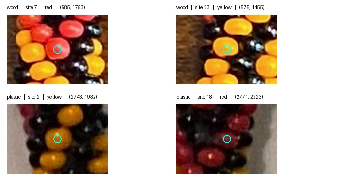

# The bracelet on wood and white plastic

Both photographs support the existing 208-position color pattern. Across eight paths, all **184 readable bead colors** matched the chart after locating the paths. A stricter prediction check produced **81 correct calls, zero contrary calls, eight ambiguous calls and one unreadable bead** in the ends of the paths. Together with a separate check of adjacent beads, the two photographs cover **125 of the 208 chart positions**. These counts describe readings of the same bracelet in two photographs. A bead can appear in both views. [Existing candidate sequence](../r344/provisional-sequence.txt)

## A direct check of the shorter repeat

In each view there is a path with eight steps along each of the two diagonal neighbor families. Under the established crochet rule the endpoints are **104 string positions apart** because 8 × 6 + 8 × 7 = 104. The distance holds if the two families are exchanged or the path is read backwards. A repeating 104-position word would require identical endpoint colors. Both photographs show different colors. This check uses the visible local adjacency and endpoint pigments and requires no alignment to the 208 chart.

| Photograph | Path, numbered clockwise | First bead in native pixels | Last bead in native pixels |
|---|---|---|---|
| Wood | Quarter 3, sites 7–23 | Red at (585, 1753) | Yellow at (575, 1455) |
| White plastic | Quarter 1, sites 2–18 | Yellow at (2743, 1932) | Red at (2771, 2223) |

Follow the 16 steps on the numbered paths. Quarter 0 starts near the top of each original image, and quarters 1, 2 and 3 start approximately 25%, 50% and 75% clockwise around that view. [Wood paths](wood-paths.jpg) · [White-plastic paths](plastic-paths.jpg)

## How much of the chart did the photos predict?

I traced each loop in its own image, reused the project's closed-curve resampling code, and straightened a strip around the trace. In a window at the beginning of each quarter, I marked one visible body per successive diagonal step and recorded its color from the photograph. The central paths favor readable glass. Two unclear plastic-view appearances are recorded as unknown. The path coordinates and readings are explicit analyst inputs. The original pink-background bead positions supply no coordinates in either new image. [Wood strip](wood-loop.jpg) · [White-plastic strip](plastic-loop.jpg) · [Photo readings before registration](paths.csv)

| View | Readable colors matching the fitted chart | Distinct chart positions on paths | Correct predictions in path endings | Ending calls ambiguous / unreadable |
|---|---:|---:|---:|---:|
| Wood | 94/94 | 78 | 46 | 0 / 0 |
| White plastic | 90/90 | 75 | 35 | 8 / 1 |

For each path I used the R344 integer indexing function, tested all 208 starting positions and all four signed assignments of the 6- and 7-step directions. The fit to all readable colors is unique for each of the eight paths. Clockwise tracing gives +7/+6 for inward/outward diagonal steps on wood and −7/−6 on plastic. Each starting position identifies a residue within the repeating chart. It does not identify a particular physical copy around the bracelet. [Native pixel coordinates, readings, fitted residues and predictions](path-results.csv)

For the prediction check, only the first 12 sites of each path supplied color information for registration. All four prefixes in a photo had to be compatible with the same orientation. Each path retained every best starting position; the algorithm made a color call only when all surviving starts predicted the same color. The eight ambiguous endings were all on plastic. The 81/81 agreement among determinate, readable calls is an internal holdout on visually traced paths. Each entire path was visible during annotation, and one analyst produced all the readings. [Per-path fits and ties](measurements.json)

## The seven previously under-supported black positions

I repeated the registration with **every observed black color withheld** and the chart color hidden at **all seven** of the positions below. Only red and yellow observations at the remaining chart positions could reject an alignment. This left one alignment per patch with a common orientation per photo. Wood quarter 1 alone admitted a second, opposite orientation, which the other wood paths excluded. This separates the evidence used to locate a site from the black glass used to check it.

Three on-path readings reached a target directly. For adjacent sites I projected one crosswise bead step from each anchor, using a 31-pixel offset in the straight strip. I kept projected centers in strip rows 32–95 and mixed the 13 resulting targets with 13 controls matched by patch, side and approximate depth in the strip. I then read the numbered crops with their chart addresses and predicted pigments hidden. The circle marks a search location. The visible body, reflection and its relationship to the neighboring anchor informed the reading. Three ambiguous appearances remain unknown. The same analyst set up and read this comparison. [Numbered photos](neighbor-review.jpg) · [Individual readings, native coordinates and registration key](neighbor-results.csv)

| Chart position (zero-based) | Wood, readable black | White plastic, readable black | Additional unclear views |
|---:|---:|---:|---|
| 43 | 3 | 0 | |
| 75 | 1 | 0 | |
| 82 | 2 | 0 | 1 plastic |
| 89 | 2 | 1 | |
| 140 | 1 | 0 | |
| 147 | 2 | 0 | 1 plastic |
| 186 | 2 | 0 | |

All seven therefore have new photographic evidence consistent with black at the conditionally located site. Thirteen of the fourteen readable black appearances in this table come from the wood photograph. At the off-path controls, all twelve readable colors matched and one was unclear. The original geographic-support rule counts distinct regions of the physical loop. The registration here establishes chart residues, leaving the physical repeat-copy identity unresolved, so these results are reported separately from the historical **201 supported / 0 conflicting / 7 insufficient** assessment. [Historical assessment](../r347/answers/ASSESSMENT.md)

## Whole-loop color rhythm

I also measured color variation around each entire visible loop without using the chart or any bead labels. The existing HSV conversion supplies hue and chroma. At each station I averaged a signed chroma signal across the center of the strip, positive for hues between the selected split and 65 degrees and negative elsewhere. The largest nonconstant Fourier component among 1–80 cycles per loop was **26 in both photos**, at all nine combinations of strip half-width (15, 25, 35 native pixels) and hue split (15°, 20°, 25°). The prominent color alternation is visible on the straightened strips. A color wave can recur several times within a stringing repeat, so this measurement alone cannot determine the total bead count or number of complete chart copies. [Both spectra and sensitivity settings](measurements.json)

## Reproduction

For ways to check the remaining uncertainties, see the [ranked follow-up work](FOLLOW_UP.md).

From the repository root run `.venv/bin/python -m photo2.alternate_views.analyze`. The entry point reads the two JPEGs, the historical candidate word and the saved manual readings. It regenerates the overview and numbered images, the native-coordinate result tables and the measurement summary. Two successive runs reproduced all nine generated files byte-for-byte. Source digests are in the measurement summary. The white-background JPEG is a byte-identical copy of the original in the sibling fft-image-explorer repository. [Wood original](../../bead-example-5.jpg) · [White-plastic original](../../beads-photo-2-wb.jpg) · [Analysis](analyze.py) · [Registration and probe selection](registration.py)
