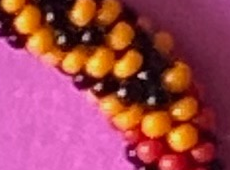
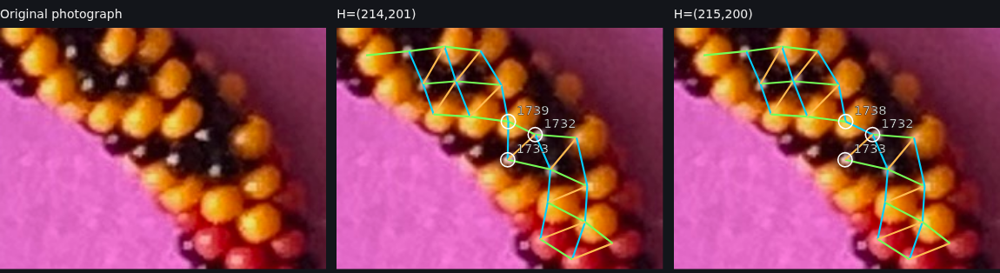
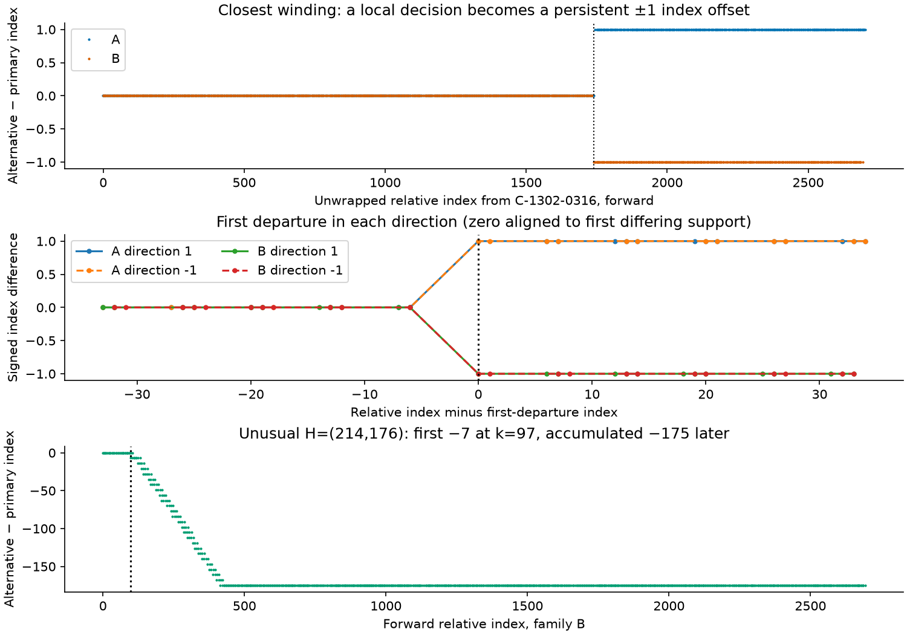
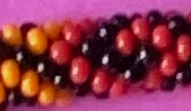
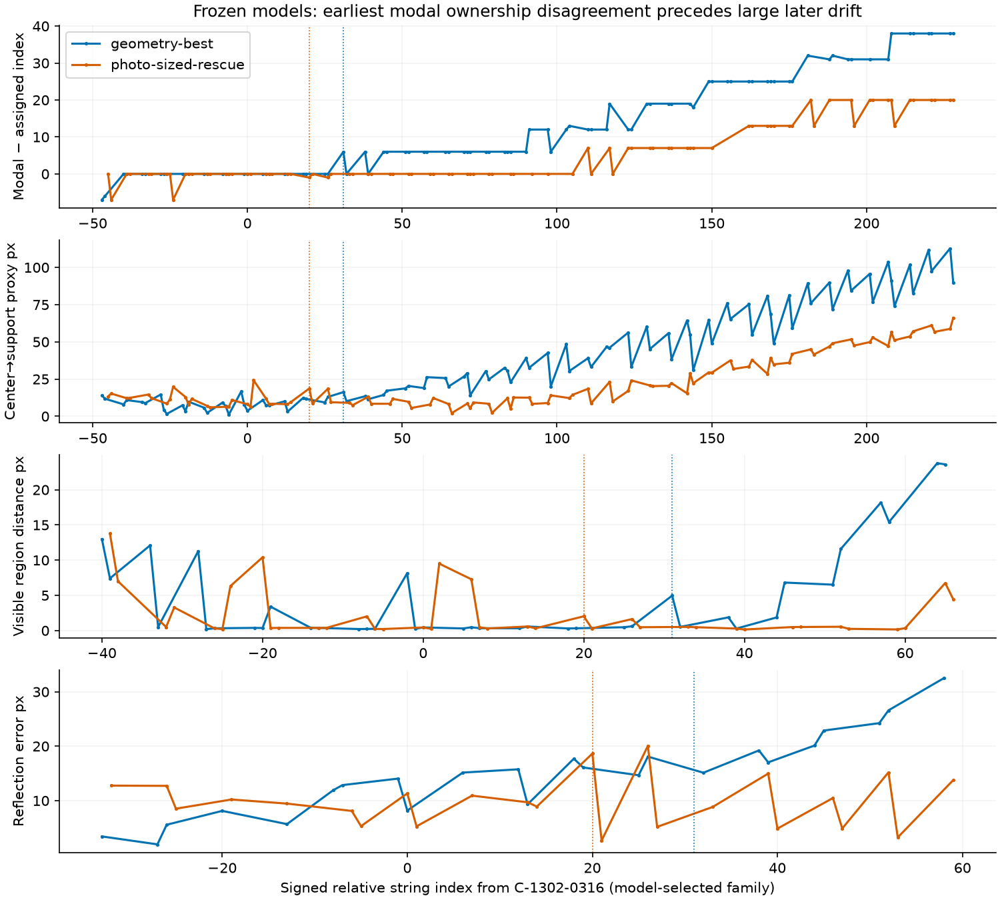
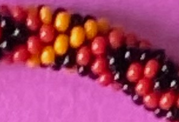
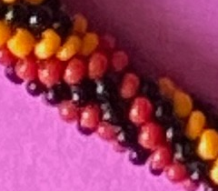

# R329: The four biggest reconstruction problems, explained with photographs

*A slowly paced, illustrated companion to [R329_REPORT.md](../R329_REPORT.md). GitHub will render this file as a formatted page.*

**How to use this guide:** Read one section at a time. Click a picture to enlarge it. Each section begins with the real photograph, explains the proposed bead relationships, and then describes what Codex actually tested. These are existing R329 images; the underlying measurements and reconstruction have **not** been changed.

## Before the pictures: five terms you need

**A bead index** is the bead's position along the original bead string. When the string is crocheted into a thick rope, nearby physical beads may be **1, 6, or 7 places apart** in that original string. Hence the bead next to another bead in the photograph need not have the next consecutive string index.

**A diagonal** is a row of nearby beads running obliquely across the crocheted rope. We need to recognize two diagonal families even as the bracelet curves. A **row switch** occurs when a proposed continuation accidentally goes to a neighboring diagonal.

**A photographic observation** is an actual saved bright patch of red/yellow glass or a reflection on a black bead. Its measured point need not be the center of the glass bead, especially when the black reflection is off-center.

**The reference** is a particular yellow observation named **C-1302-0316**, at approximately (1302, 316) in the full photograph. R329 calls it index **zero** to compare alternatives consistently. The number is arbitrary; this is not a physically special bead.

**A winding** is the total two-coordinate advance in the bead lattice after tracing the circuit and returning to its starting region. For example, **H = (214, 201)** conditionally means either **2,704** or **2,691** total beads, depending on which diagonal family corresponds to +6 and which to +7. A mathematically correct winding is not proof the photograph's rows were traced correctly.

Names such as **C-1721-1566** and **K-1740-1575** are IDs for measured photographic features, not bead indices. The digits are related to photograph coordinates.

---

## Problem 1 — An inward-bend choice changes all later indices by one

### Look at the original pixels first

This photograph shows a small region at the **inward bend**, near x=1721, y=1566 in the full photograph. Three saved measured points are especially important:

| Feature | Position inside the image above | Meaning |
|---|---|---|
| **1: C-1721-1566** | Roughly **121 pixels right, 66 down** | Colored region at the first index disagreement |
| **2: K-1740-1575** | Roughly **140 pixels right, 75 down** | Reflection on a black bead |
| **3: MAT25-K-1719-1592** | Roughly **121 pixels right, 93 down** | Another black-bead reflection, a little below |

These coordinates indicate **photographic features**, not physical bead centers. You may see a large bead surrounding a small black reflection.

### Compare the two sets of diagonal lines

In the **left panel**, look at the glass beads without lines. In the **middle panel**, the program draws the diagonals for its working solution, **H=(214,201)**. In the **right panel**, it draws the alternative **H=(215,200)**.

Both reconstructions describe nearly the same photograph. They disagree about **which diagonal-family step connects the features near C-1721-1566 and K-1740-1575**.

### Step by step

**Step 1 — Agreement.** The two reconstructions enter this region with the same bead-string numbering. Under the family-B convention, the last agreeing photographed feature is **MAT25-K-1719-1592**, at relative index **1733**.

**Step 2 — One neighboring-row decision.** At the nearby colored feature, one reconstruction uses a +6 relationship where the other uses the neighboring +7 relationship (after accounting for traversal direction). Both can draw an apparently plausible set of connections because the beads are close and their photographed bright points are displaced within their bodies.

**Step 3 — The first observed disagreement.** The primary reconstruction puts **C-1721-1566** at family-B relative index **1739**. The closest alternative puts that same observation at **1738**. This is a **one-index difference**, not a claim that the photographed bead itself moved.

**Step 4 — The later error.** Once the two reconstructions differ by one address, they can continue around the bracelet with that offset. A late index mismatch can therefore be caused by one earlier row choice.

**Step 5 — A real experiment.** Codex replaced **only window 124** of the working reconstruction with the alternative. The next original window would not attach. It then replaced the *three-window group 124–126*, and the remaining **64 attachments** reconnected all the way around the circuit. That experiment locates the group of choices responsible for the later offset.

### Which choice is better?

The saved target-excluded photographic predictions favor the primary locally:

| Original observed feature | Primary predicted-point error | Alternative error |
|---|---:|---:|
| C-1721-1566 | **6.11 px** | 9.56 px |
| K-1740-1575 | **5.38 px** | 8.51 px |
| MAT25-K-1719-1592 | **5.22 px** | 12.59 px |

The predictions are made from neighboring photographic evidence; they are **not independent ground truth**. But the comparison supports a specific, understandable preference.

**What to judge visually:** In the original photo, follow each row through several nearby red, yellow, and black beads. Ask which alternative really stays in one diagonal family. A straight line between two black reflection points is not automatically the correct bead-center direction.

**What remains unknown:** Which solution has the true bead-string numbering. We know *where their choices first differ* and which three-window change propagates the difference.

### How the difference appears on a graph

Read the **top graph first**. The horizontal direction represents progression through the original bead-string indices. At first the line is at **zero**: the reconstructions agree. At the dotted line, the alternative's numbering suddenly changes by **one**. The line then remains displaced. The flat portion after the jump does **not** mean everything has become correct; it means the same offset persists.

---

## Problem 2 — The physical 3D model gets the wrong bead near index 31

This is a different comparison. Here we are not comparing two photo tracings. We are comparing **one proposed photographic index map** against a separately constructed **3D glass-bead model**.

### Look at the actual photograph

This crop is approximately x=1260–1535, y=215–355 in the full photograph.

| Label to imagine on the picture | Within this crop | Meaning |
|---|---|---|
| **0** | **42 right, 101 down** | Yellow reference observation C-1302-0316 |
| **26** | **130 right, 97 down** | Colored feature C-1391-0312; last local agreement |
| **31** | **141 right, 33 down** | Black feature K-1398-0248; first observed disagreement |

### What does “the model owns a pixel” mean?

Imagine the simulated necklace is photographed by a virtual camera. Every simulated bead has a number. For each measured real-photo pixel in a bright patch, the program determines **which simulated glass bead would appear at that pixel**. That simulated bead is the pixel's **owner**.

If the photo says we are looking at bead -33 but the virtual camera says bead -27 is visible in the corresponding region, their assignments disagree.

This is not simply a highlight-position error: a bead can cover the right photographed region yet have the wrong modeled reflection.

### The intermediate steps

**Step 1 — Index 26 agrees.** At the colored observation around (1390,312), the expected physical-model bead accounts for **92.86%** of the original photographed support pixels.

**Step 2 — Index 31 fails.** The photographic map expects physical model address **-33** at the black observation near (1401,248). But the virtual model says address **-27** covers the whole bright support. That is a difference of **six addresses**.

**Step 3 — A possible explanation.** Because +6 is a legitimate neighbor step in the crocheted bead string, we might suspect the photo tracker chose the wrong row. Perhaps all subsequent observed beads should be shifted by six addresses.

**Step 4 — Test only that one bead.** Reassigning the single observation to -27 improves its simulated ownership, but **breaks three previously consistent photographed neighbor links**.

**Step 5 — Try shifting everything afterward.** When Codex propagates the +6 offset through the next 200 relative-index units, average support ownership improves from **2.63% to 28.85%**. However, it still violates the same three photo links and gives poor agreement over the complete circuit. Thus a single row shift is not the entire cause.

**Step 6 — Try small physical model changes.** Codex also varied helical phase and longitudinal registration. These improved some local patches but did not eliminate the disagreement farther away. Uniform spacing produced physically intersecting glass beads and was not accepted.

### Understand the error plots

- **First plot:** The difference in *which simulated bead number* owns each support. Look for the first difference near index **31**, not just the huge later discrepancies.
- **Second plot:** How far the projected positions differ in the image, in pixels. A bright support's location is not necessarily a bead center.
- **Lower plots:** How well the simulated bead covers its observed region, and how well the simulated reflection matches. These describe distinct problems.

**Very important limitation:** The physical model tested here contains **3,000** glass beads, whereas the leading photo-derived winding suggests 2,704 or 2,691. The comparison is deliberately testing an incompatible candidate physical count. It can reveal local issues but is not a fully consistent combined reconstruction.

**What remains unknown:** Whether the discrepancy originates in the photo-index map, the physical bead-placement assumptions, the total count, camera projection, or more than one of these.

---

## Problem 3 — A small early row error accumulates into a 175-index difference

This illustrates why looking only at the largest error at the end of a bracelet reconstruction can be misleading.

### Start where the solutions first disagree

This photograph covers about x=1510–1810 and y=215–420.

- **Last agreeing feature:** C-1608-0253, roughly **98 right, 39 down** in this crop; index **92** under the forward family-B convention.
- **First differing feature:** NEW-1621-315, a black bright support roughly **110 right, 102 down**; around index **97**.

**Step 1 — Early agreement.** Both paths have the same indices up through the first feature.

**Step 2 — First row-sized difference.** At the black feature, the alternative assigns a position **seven indices lower** than the primary. That corresponds to a legitimate neighboring-row step size.

**Step 3 — Further changed diagonal decisions.** The alternative chooses different rows across processing windows **10–34**. The individual changes add up.

**Step 4 — The offset becomes large.** By the time those row decisions finish, the alternative is **175 indices lower** in family B. It can then keep that offset and still form a coherent-looking completed circuit.

**Step 5 — Test causation.** Replacing only the initial differing window does not allow the next original window to attach. Replacing the whole group **10–34** allows the remaining original reconstruction to replay successfully.

The unusual winding is **H=(214,176)**, which would conditionally correspond to **2,554 or 2,516** beads.

Why isn't it preferred? It gets much worse shared-bead-shape penalties and its tested own-count 3D constructions explain only around **2.6–3%** of the saved photographed support pixels. These are reasons to doubt the specific tested reconstruction, though not a proof about every local row choice.

**What to look for:** A subtle first change in diagonal continuation near the black feature at index 97—not an obvious missing group of 175 beads near the end.

---

## Problem 4 — Another local row choice at the lower bend

This picture covers about x=1050–1290 and y=2820–3030.

- **Last agreeing feature:** E5-1151-2893, around **100 right, 70 down** inside this crop, relative family-B index **1187**.
- **First differently assigned feature:** NEW-1132-2925, around **82 right, 106 down**, index **1188**.

The alternative in this case is **H=(213,201)** rather than the leading **H=(214,201)**.

**Step 1:** The two reconstructions enter the lower bend with the same indices.

**Step 2:** At the next observed feature, they assign a different neighboring diagonal direction. This changes the later number of original-string steps.

**Step 3:** Codex replaced the local group of windows **79–82**. The remaining **109 attachment steps** then reconnected all the way around the bracelet.

**Step 4:** That demonstrates a consistent *alternative interpretation*, not which diagonal the glass beads physically occupy. To choose correctly, inspect several neighboring beads, including black reflections, on both sides of the proposed continuation.

---

## What I would inspect first

| Picture | Question |
|---|---|
| [Inward bend: side-by-side candidates](results/closest-comparison.png) | Which proposed line really follows the diagonal through the three marked photographic features? |
| [First physical-model mismatch](results/frozen-first-native.png) | Are the observed bead relationships clear enough to trust the photograph's index assignment near 26–31? |
| [Beginning of the large offset](results/upper-first-native.png) | Where does the alternative first switch rows near index 97? |
| [Lower bend](results/lower-first-native.png) | Can you follow the neighboring colored and black bead rows across the first index difference? |

### What would make a future Codex report easier to understand?

For each important disagreement, I would ask for a **single enlarged original photograph with two proposed paths drawn in different colors**, plus labels for:

1. The last bead where both interpretations agree.
2. The *first* bead or connection where they differ.
3. The next three to five beads along each alternative row.

For the physical model comparison, show two outlines over the same photo: **the expected simulated bead** and **the simulated bead that actually appears over the photographed pixels**. Those two objects are different, even when the measured reflection is nearby.

For cumulative error, show several intermediate steps where the one-row error grows, rather than just the beginning and final difference.

**Bottom line:** R329 succeeded in finding *where* the alternative interpretations begin to differ and in reproducing the downstream consequences of changing those choices. It did not settle which choice is the real glass-bead structure. The photographs above are the best places to investigate that next.

---

[Full technical R329 report](../R329_REPORT.md) · [Original technical visual review](results/index.html) · [Existing HTML explanatory guide](ILLUSTRATED_GUIDE.html)
