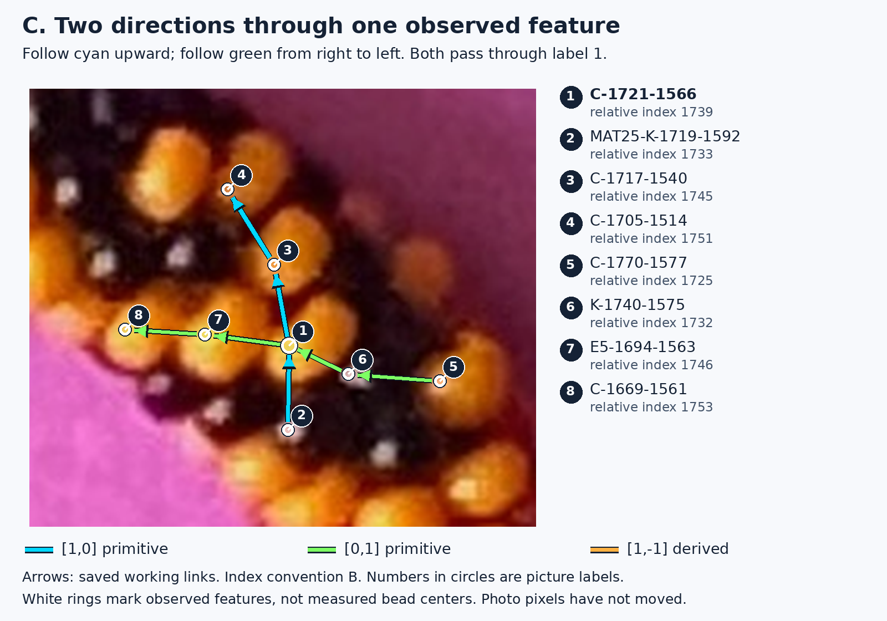

# R329 illustrated guide

**Start with [Reading the bead rows: an illustrated R329 lesson](guide/READING_THE_PHOTOGRAPH.md).** It is a GitHub-readable Markdown page with enlarged original-photo crops, visible observation IDs and consistent directional arrows.

The lesson first teaches the two primitive directions around **C-1721-1566**, then carries both directions into each diagnostic comparison:

- [Figures A–D: cyan `[1,0]`, green `[0,1]`, and the derived orange `[1,-1]`](guide/READING_THE_PHOTOGRAPH.md#learn-the-two-directions).
- [Figure E: the inward-bend segment interpreted two ways](guide/READING_THE_PHOTOGRAPH.md#inward-bend-the-same-segment-changes-interpretation).
- [Figures F1–F3: photographic zero, last agreement 26, and first model mismatch 31](guide/READING_THE_PHOTOGRAPH.md#physical-model-first-mismatch-near-index-31).
- [Figures G1–G2: an early row change that later accumulates a 175-index difference](guide/READING_THE_PHOTOGRAPH.md#early-row-choice-how-a-small-departure-becomes-175).
- [Figures H1–H2: competing rows at the lower bend](guide/READING_THE_PHOTOGRAPH.md#lower-bend-which-row-contains-the-black-feature).

This is explanatory material only. The [R329 scientific report](../R329_REPORT.md), saved reconstructions, original photograph and frozen physical models remain unchanged. No final count or color period is adopted.

The [earlier technical HTML review](results/index.html) remains available alongside this new lesson. Its archived calculations are explained in the Markdown page rather than requiring the reader to infer the meaning of an overlay.

The [previous illustrated Markdown walkthrough](ILLUSTRATED_GUIDE_PREVIOUS.md) and [earlier explanatory HTML](ILLUSTRATED_GUIDE.html) are retained. The new lesson above expands their directional teaching and labels; all four incoming annotated SVGs remain unchanged.
