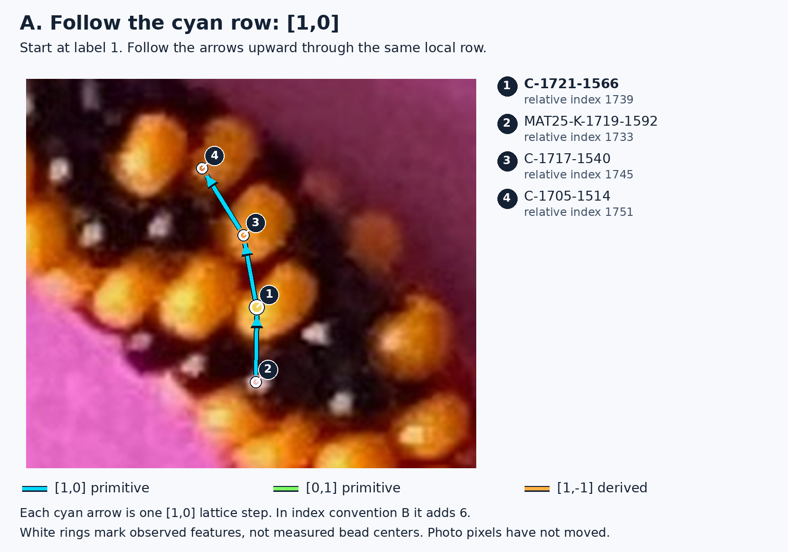
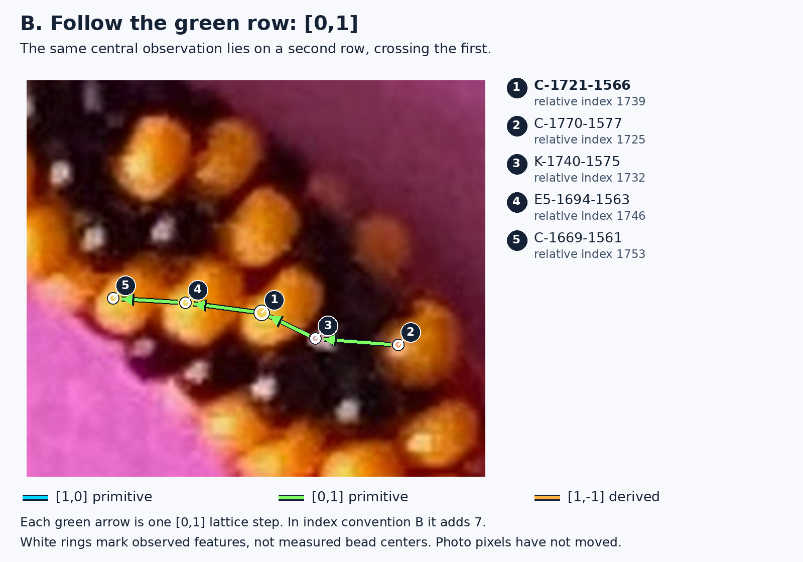
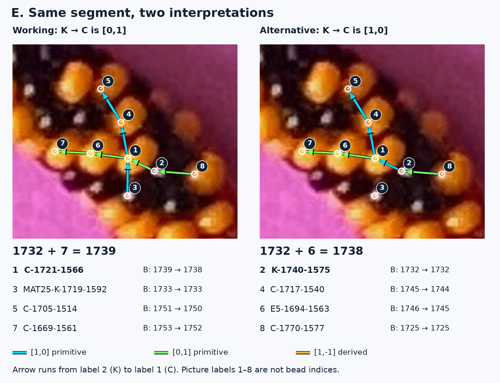
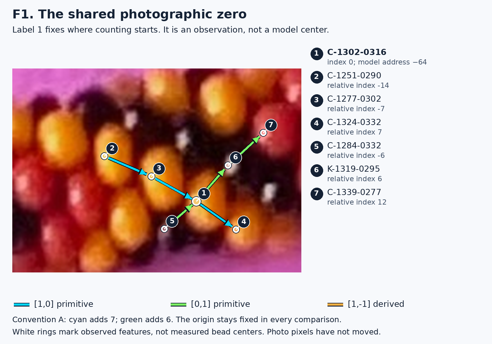
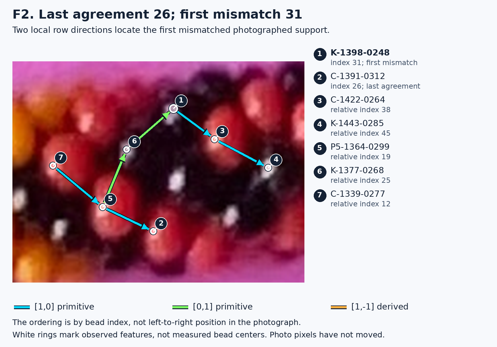
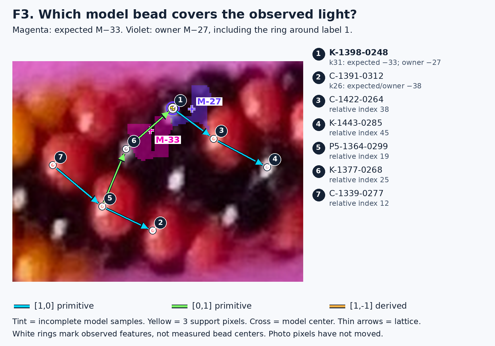
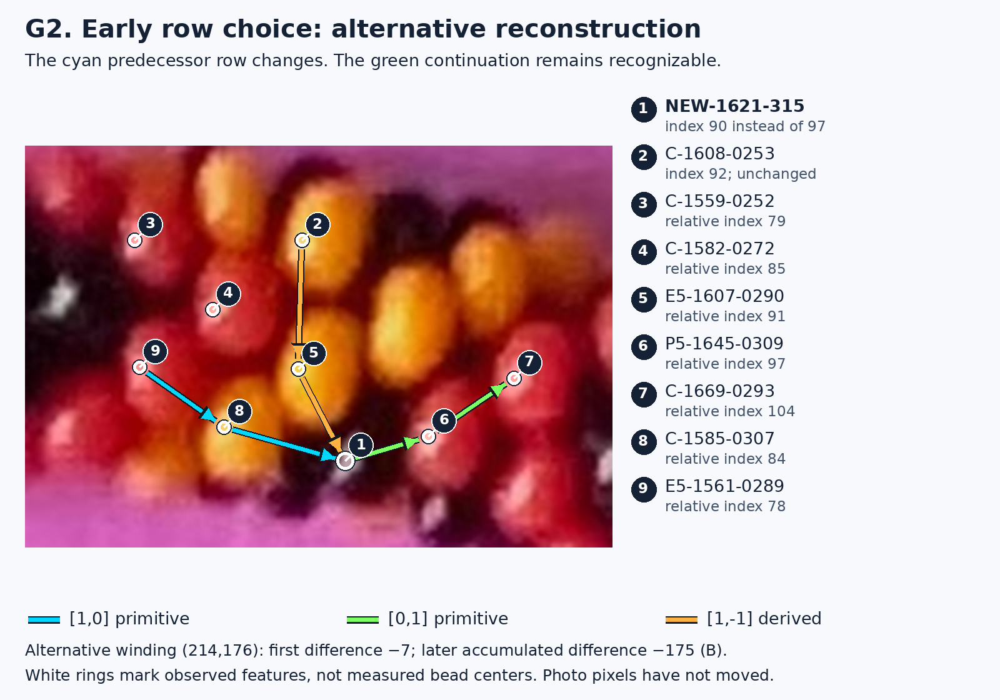
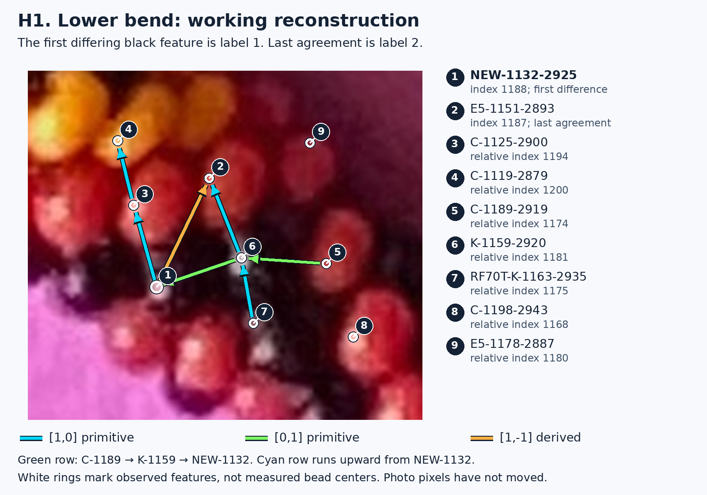
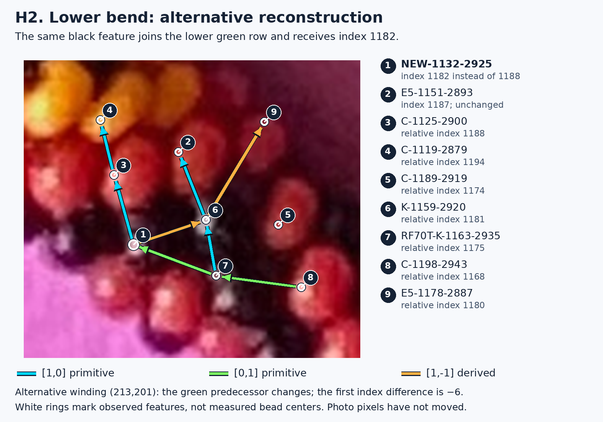

# Reading the bead rows: an illustrated R329 lesson

**The photograph stays fixed. The question is how to connect its observed features into bead rows—and whether a 3D model puts the corresponding beads in the right places.** This page teaches those distinctions using the saved R329 comparisons. It adds explanations and pictures; it does not change a reconstruction, choose a total bead count, or establish a repeating color pattern.

Start with Figures A–D, then compare the two panels in E. The later examples use the same arrow colors. Every diagnostic has a local map of both primitive directions, with full observation IDs printed beside or below the photograph.

- [Learn the two directions: A–D](#learn-the-two-directions)
- [Inward bend: the same segment changes interpretation](#inward-bend-the-same-segment-changes-interpretation)
- [Physical model: first mismatch near index 31](#physical-model-first-mismatch-near-index-31)
- [Early row choice: how a small departure becomes 175](#early-row-choice-how-a-small-departure-becomes-175)
- [Lower bend: which row contains the black feature?](#lower-bend-which-row-contains-the-black-feature)
- [What was tested and what remains uncertain](#what-these-pictures-establish)

## How to read the labels

A **photographic observation** is a measured feature in the original image: for example, a small bright patch on a colored bead or a reflection on a black bead. In these pictures, a white ring marks its measured position. The ring does not claim to outline the bead or mark its center.

An **observation ID** is a permanent name for that photographed feature. `C-1721-1566`, label 1 in Figures A–E, is one such name. Its measured position is approximately x = 1721.08, y = 1566.08 in the original image. The coordinate-like digits help identify it, but use the saved coordinates for exact measurements. The ID stays the same when a reconstruction gives it a different index.

The small dark circles containing **1, 2, 3… are picture labels**, not bead indices. Match each circle to the full ID in that picture's key. The early-row pair and lower-bend pair keep their picture labels fixed between panels. Figures A–D have their own keys because each introduces a different subset of features.

A **bead index** is a bead's proposed position in the construction's one-dimensional counting order. We choose one photographic reference as index zero; zero is not a special physical bead. Hidden or unobserved beads still occupy positions in that count. Consequently, two nearby visible features need not have consecutive indices. Following one photographed diagonal can advance six or seven construction positions.

A **working reconstruction** is the currently selected, provisional interpretation of the photographed rows. An **alternative reconstruction** is another saved interpretation of the same image evidence. A neat network of lines does not make either interpretation established truth.

A **physical model** is different again: it places numbered three-dimensional bead bodies in space and projects them into the picture. A model bead address, such as **M−33**, identifies a body in that model. It is not an observation ID and is not automatically the relative photographic index.

## Learn the two directions

Think of a small patch of beadwork as a network with two basic ways of stepping between rows of neighboring beads. These are the two **primitive directions**. The bracketed numbers describe changes in two lattice coordinates—two bookkeeping counts for local steps. They are not horizontal and vertical pixel distances.

- **Cyan `[1,0]`:** add one step in the first direction; leave the second count alone.
- **Green `[0,1]`:** add one step in the second direction; leave the first count alone.

The arrows point in the positive direction. Going backward along an arrow gives the corresponding negative step. As the bracelet bends, these arrows rotate and curve in the photograph. “Cyan” does not mean “always upward.”

A **diagonal** here means a local sequence of neighboring bead features along one of these slanting rows. It is not required to be a perfectly straight line on the screen. The arrows connect saved observed features, which may be reflections displaced from bead centers.

For Figures A–E, the saved counting convention called **B** assigns **+6 bead indices to a cyan step** and **+7 to a green step**. The letter is just a name for this choice; it is not a bead color. A different saved choice exchanges 6 and 7. The index numbers beside the pictures are conditional on the stated choice. The shared zero is pictured in [Figure F1](#figure-f1--establish-the-common-zero).

### Figure A — one primitive direction, `[1,0]`

Here is the inward bend in the original photograph, enlarged and annotated. Find the central yellow feature, **C-1721-1566**, at label **1**. Follow the cyan row **2 → 1 → 3 → 4**. There are four labeled observations along this row, including the black reflection immediately below the central colored feature.



The sequence is **MAT25-K-1719-1592 → C-1721-1566 → C-1717-1540 → C-1705-1514**. Each arrow is one `[1,0]` step in the working reconstruction. The additional upper observation makes the continuation of the row visible beyond a single pair of features. The lower black reflection helps show how colored and black beads participate in the same bead geometry.

[Inspect this crop without annotations](images/inward-original.png). Enlarging the original pixels makes them soft; it does not supply new detail.

### Figure B — the other primitive direction, `[0,1]`

Find the **same central feature**, again label **1**. This time follow the green row **2 → 3 → 1 → 4 → 5** from right to left. There are five labeled observations.



The sequence is **C-1770-1577 → K-1740-1575 → C-1721-1566 → E5-1694-1563 → C-1669-1561**. Each arrow is one `[0,1]` step in the working reconstruction. The observations on both sides show a continuing row rather than an isolated line drawn between two dots.

This is the second fundamental local direction. It crosses the cyan row at the central observation. Neither direction is a physical thread drawn on the photograph: both are proposed relationships between photographed beads.

### Figure C — both primitive directions together

Now follow both rows in the same image. Cyan runs **2 → 1 → 3 → 4**. Green runs **5 → 6 → 1 → 7 → 8**. Both pass through label **1**.


These are the **two primitive directions used to describe this local lattice**. The other features are included to show that each direction continues on either side of the crossing. Compare the arrow endpoints with the visible colored material and black reflections; the lines are interpretation laid over photographic evidence.

For the photo-to-photo examples on this page, we use the saved counting convention called **B**: one cyan step adds **6** to the bead index, and one green step adds **7**. Thus the same central feature can be reached as **1733 + 6 = 1739** along cyan, or **1732 + 7 = 1739** along green. The two local routes agree under the working interpretation.

The other saved convention, **A**, exchanges these increments: cyan adds 7 and green adds 6. Neither assignment has been established as the physical truth. The model example below explicitly uses A because that is the frozen model comparison R329 tested. Reversing the counting direction negates the signed indices; it does not move any photographic feature.

### Figure D — the derived direction, `[1,-1]`

The orange row is **6 → 7 → 8**: **C-1669-1561 → K-1683-1538 → C-1705-1514**. These nearby observations show a real saved three-feature sequence. We use this neighboring row because the central feature does not have an observed three-feature `[1,-1]` sequence through it in the saved graph. Label **1** remains visible so that you can recognize the same location.


**Orange is not a third primitive direction.** To get from label **6** to label **7**, you can first go **6 → 5**, against the green arrow, then **5 → 7**, along cyan. That is “one step backward in green, one step forward in cyan”: `[1,-1]`. The orange arrow connects the same two endpoints directly.

In convention B, that combined step changes the bead index by **6 − 7 = −1**. An arrow can therefore point forward along a named lattice direction while the construction index decreases. Lattice steps and bead indices are different kinds of labels.

## Inward bend: the same segment changes interpretation

A **row switch** means that the reconstruction connects a photographed feature to a different neighboring row. It does not mean the bead moved. At this inward bend, the disagreement concerns which primitive direction describes the segment between **K-1740-1575** and **C-1721-1566**.

### Figure E — compare the same photographed segment

Both panels use exactly the same crop and feature positions. Look at **label 2 → label 1**. We draw the arrow **from K-1740-1575 toward C-1721-1566** so that it is positive in both interpretations. The reverse arrow would carry a minus sign.



On the **left**, the segment is green, `[0,1]`. The unchanged index of K-1740-1575 is **1732**. A green step adds 7, so the central observation receives **1739**.

On the **right**, the same segment is cyan, `[1,0]`. The starting index is still **1732**. A cyan step adds 6, so the central observation receives **1738**. The discrepancy is **one index**, even though the photographed feature has not moved at all.

The nearby labels show the consequences. **C-1717-1540**, **C-1705-1514**, **E5-1694-1563**, and **C-1669-1561** also receive an index one smaller in the alternative. **MAT25-K-1719-1592**, label 3, remains at **1733**. It is the last preceding agreeing observation in the saved forward B ordering. Its cyan connection to the central feature appears on the left; that connection is not asserted in the alternative panel.

For larger labels, open the individual panels: [working directional map](images/e-working.png) and [alternative directional map](images/e-alternative.png). Each includes both primitive directions and its own full key.

A **winding** records the total advance in the two lattice coordinates when the reconstruction has followed the bracelet around once and met previously observed features again. The working winding is **(214,201)**; the closest alternative is **(215,200)**. These are counts of lattice advance, not image coordinates or bead dimensions. Under convention B they imply total counts **2691** and **2690** respectively. Under A they imply **2704** and **2705**. These are conditional consequences of the interpretations, not measured final counts.

**What Codex tested in R329.** The saved growth history first differs in a small group of three overlapping photographic neighborhoods, internally numbered 124–126. Codex restarted from the agreed earlier history. Changing only the first neighborhood made the next original attachment inconsistent. Replacing the three-neighborhood group allowed the remaining reconstruction to complete, including **17 matching return observations**, with the alternative winding. Removing candidate patches that asserted the working disputed direction also made the closest alternative win a new growth run; another completion with the original winding remained possible.

**What this establishes.** The local group of decisions is sufficient to produce the later winding offset. A correction only near the end of the circuit would miss that cause. The first observed index disagreement is bounded by the last agreeing index **1733** and the first differing working index **1739**. It is not a proof that the central feature, or the alternative, is physically wrong. Saved local image predictions favor the working choice at important neighbors, but shared observations and overlapping neighborhoods are not independent confirmations.

### Why the black reflection needs care

In Figure E, **K-1740-1575** and **MAT25-K-1719-1592** identify small bright features on black beads. A reflection is where light reaches the camera from the bead's curved surface. Its location depends on illumination, surface orientation and viewpoint. It need not be at the bead's center, and its outline need not be the bead's outline.

The black beads still have the same underlying shape and size as the colored beads. Neighboring colored material helps interpret their spacing. A white spot near a neighboring row can nevertheless lead to a wrong association. The rings here mark the saved reflections; this guide has not shifted them toward assumed centers or assigned new bead identities.

## Physical model: first mismatch near index 31

This example compares the working photographic lattice with a **frozen 3D model containing 3000 beads**. It uses **convention A**: cyan adds 7, green adds 6. The photographic winding would imply 2704 beads under A, so this is an intentionally incompatible diagnostic comparison. It is not a claim that the 3000-bead model realizes that whole photographic lattice.

### Figure F1 — establish the common zero

Label **1**, **C-1302-0316**, is the chosen photographic reference near the previously checked region. Its relative lattice coordinates and bead index are zero. The frozen model associates that reference with model bead **M−64**. Follow the labeled cyan and green sequences to see the local frame at the origin.



The original position is **(1301.854,315.585)**. Choosing this point as zero only fixes a counting convention. It does not make the feature more central in the bracelet or require its reflection to sit at the physical bead center. [Original reference crop](images/reference-original.png).

### Figure F2 — locate the first observed departure

Now look a little farther along the index ordering. In this crop, **label 2**, **C-1391-0312**, is the last preceding confident agreement, at **index 26**. **Label 1**, **K-1398-0248**, is the first mismatch, at **index 31**.



Follow green **5 → 6 → 1**, then cyan **1 → 3 → 4**. Another cyan sequence, **7 → 5 → 2**, locates the last agreement in the same frame. These are photographed row relationships, independent of the model overlay in the next picture. “Earlier” here means earlier in the bead-index ordering, not farther left in the crop. [Original mismatch crop](images/model-original.png).

### Figure F3 — expected model bead versus actual model owner

Keep looking at label **1**. The two tinted patches below come from the model's **already saved visible pixels**. They are not new fits or traced photographic contours. Only the archived sampled pixels are shown; their edges are not complete bead outlines.



The photographic assignment expects **M−33**, since **−64 + 31 = −33**. Its saved visible pixels are **magenta**. However, the model body covering the three measured pixels of this black reflection is **M−27**, shown in **violet**. “Owner” means the first model body hit by the camera ray at that pixel. It is a property of this model's projection, not independently established photographic identity.

The small **yellow squares** mark those three original support pixels. A violet ring around them marks their saved model owner, M−27. The tinted raster is incomplete at this location: ownership of the yellow pixels comes from a separate archived ray test at those exact support pixels, not from guessing across a gap in the tint. All three are owned by M−27 in the saved model calculation; none is owned by the expected M−33. The crosses marked **M−33** and **M−27** are projected model centers. The white observation ring remains at the measured feature. These different symbols prevent a model center from being mistaken for an observed reflection.

At label **2**, the expected and actual model owner are both **M−38** for about **92.86%** of the observed support. The first-observed disagreement therefore lies between **26 and 31**. This is a sparse set of observed features: it does not locate a physical error to an unobserved single bead between them.

**How the later failure relates to this picture.** The first owner discrepancy is **+6 model addresses**. Farther around the bracelet, discrepancies become much larger. That does not make the largest later mismatch the starting point. Nor does +6 automatically prove a photographic row switch: bead spacing, orientation, projection or the count-dependent model placement may be wrong.

**What Codex tested in R329.** Assigning this feature to M−27 improves its model ownership but breaks three previously consistent photographic links. Propagating a +6 offset through the following 200 index positions improves mean ownership from **2.63% to 28.85%**, still poor. Over the entire remaining circuit it improves only **0.21% to 2.26%**. Small model phase and station changes were also tested with the photographic addresses held fixed; they did not explain the failure.

**What remains uncertain.** An early placement/ownership disagreement is demonstrated. A single persistent +6 indexing mistake is an insufficient explanation. The exact balance of photographic correspondence error and model geometry error is unresolved. There is no saved reflection-displacement measurement for this black feature under its expected model address; missing reflection error is **unavailable**, not zero. The tint measures visible ownership, not the accuracy of a predicted light spot.

## Early row choice: how a small departure becomes 175

Here the alternatives disagree much earlier in the counting order. Both use convention B. The two pictures have the **same crop, observation positions and picture labels**. A label with no connecting arrow is retained as a comparison landmark; the picture shows selected local sequences, not every saved edge.

### Figure G1 — the working rows

Find **label 2**, **C-1608-0253**, the last preceding agreement at **92**. Then find the black feature **label 1**, **NEW-1621-315**, assigned **97** by the working reconstruction.


The cyan sequence is **3 → 4 → 5 → 1**. The green continuation is **1 → 6 → 7**. Look especially at the cyan arrow entering label 1 from **E5-1607-0290**, label 5. [Original early-row crop](images/early-original.png).

### Figure G2 — a different predecessor row

Now look at the cyan row entering label **1**. It comes from **9 → 8 → 1**, through **E5-1561-0289** and **C-1585-0307**. The first of those observations is an additional neighbor included specifically to make this alternative row visible as a three-feature sequence.



The same black feature receives **90**, seven smaller than its working index 97. Label **2** remains at 92. The orange sequence **2 → 5 → 1** shows that the alternative interprets the route from the last agreeing feature through E5-1607-0290 as the **derived** direction. The green continuation still has the same photographed members, though their indices also change.

This is a visible change in **row membership**, not a smooth drift of a point across the image. The first observed discrepancy is **−7**, bounded by working indices **92 and 97**. It later grows through additional row-sized changes to **−175**. That later number is **not** the size of the first local error. The completed winding changes from **(214,201)** to **(214,176)**; the second lattice advance is 25 smaller, and **25 × 7 = 175** in convention B. The implied B total changes from **2691 to 2516**.

**What Codex tested in R329.** It compared the actual saved attachment histories, then restarted from the original earlier history. Replacing the first differing photographic neighborhood alone failed at the next attachment. Replacing the full differing group—internal neighborhoods **10–34**—completed the circuit with **17 original return matches**. The alternative therefore has an actual successful forward replay, not just a different number written on the final graph.

**What remains uncertain.** The alternate history is enough to cause the later offset; the first observed departure is localized. That does not independently establish which row is physically correct. The unusual alternative has a worse shared-shape penalty, and the tested physical models at its own conditional counts fit the observed supports poorly. Those results weaken the tested candidate, but they do not turn every working row into proven truth or establish that an unseen bead was skipped.

## Lower bend: which row contains the black feature?

This pair also uses convention B and keeps picture labels fixed. Find **label 2**, **E5-1151-2893**, last agreeing at **1187**. The first differing feature is **label 1**, **NEW-1132-2925**, at working index **1188**.

### Figure H1 — the working local rows

Follow cyan **1 → 3 → 4**. Then follow green **5 → 6 → 1**, from **C-1189-2919** through **K-1159-2920** to the black feature. The short orange arrow **1 → 2** shows the derived relation to the last preceding agreement.



[Original lower-bend crop](images/lower-original.png). The reflection at label 1 is the measured feature. Its exact center is not a measured black-bead center.

### Figure H2 — the alternative local rows

The cyan sequence **1 → 3 → 4** keeps the same photographed members. The green sequence changes to **8 → 7 → 1**, through **C-1198-2943** and **RF70T-K-1163-2935**. Those two features expose the neighboring candidate row clearly.



In this interpretation, label **1** receives **1182**, six smaller than 1188. Label **2** still receives 1187. The segment from label **1** to **K-1159-2920**, label **6**, is now orange, part of the derived sequence **1 → 6 → 9**. In H1 that same segment was green in the opposite arrow direction. Comparing the surrounding rows reveals more than circling the uncertain black reflection alone.

The first-observed interval is **1187–1188 in the working ordering**. The alternative can assign its differing feature a number smaller than the last agreement; the two orderings need not remain identical after a row switch. The complete alternative winding is **(213,201)**, implying B total **2685**, compared with the working **2691**.

**What Codex tested in R329.** Replacing the four differing photographic neighborhoods, internally **79–82**, let the remaining 109 attachments complete with **17 return matches**. This demonstrates how an early local row reassignment can propagate through an otherwise compatible suffix—the remaining reconstruction after the restart.

**What remains uncertain.** Successful closure does not decide which row contains the physical black bead. This is a localized black-feature/row ambiguity with a successful alternative replay, not a demonstrated missing bead and not a newly adopted correction.

## What these pictures establish

The pictures separate three things that must be checked independently:

| Layer | What is fixed or compared? | What can still be wrong? |
|---|---|---|
| Photograph | The original pixels and stable observation IDs | A reflection's association with a particular bead may be uncertain. |
| Lattice interpretation | Cyan/green row memberships, derived links and relative indices | A locally plausible row choice can propagate a wrong index offset. |
| Physical 3D model | Placed bead bodies, projected centers and pixel ownership | Placement, geometry, orientation, count or correspondence can disagree with the photo. |

For the inward, early-row and lower-bend cases, R329 changed saved **local decisions** and replayed forward. That is why the local figures can explain a discrepancy that becomes obvious much later. The model case instead tests whether changing correspondence or geometry explains a growing mismatch; the attempted simple corrections are insufficient.

“First difference” throughout this page means **first observed disagreement under the stated origin, direction and index convention**. It does not mean “first physical mistake proven beyond doubt.” The named intervals, alternative directions and unresolved causes are part of the result.

## Sources, reproduction and checks

All scientific claims above describe the already completed [R329 report](../../R329_REPORT.md). The original technical review remains [in `results/index.html`](../results/index.html); download/open locally if GitHub shows its HTML source. The [illustrated-guide entry page](../ILLUSTRATED_GUIDE.md) links this lesson directly.

The drawing program reads saved R328 states, selected patch edges and R329 alternatives. **Every drawn lattice arrow is checked against both the saved two-dimensional coordinates and an actual selected edge in that hypothesis's path.** Model ownership comes from the archived R324 export of the frozen R321 model; no new model is rendered or optimized. Insets without annotations are exact crops of the EXIF-oriented original photo. Enlarged panels resample only for display.

Run from the repository root:

```bash
MPLCONFIGDIR=/tmp/r329-mpl .venv/bin/python -m photo2.r329.guide.build_guide
MPLCONFIGDIR=/tmp/r329-mpl .venv/bin/python -m photo2.r329.guide.verify_guide
```

[Figure data](figure-data.json) records the IDs, exact image positions, relative indices, crop bounds and saved links used in each full panel. [Verification receipt](verification.json) records the checks and preservation audit. The [offline reading-preview check](browser-verification.json) covers desktop, narrow-width and offline loading; it is an HTML preview of this Markdown, not a test of the live GitHub service. The gallery uses ordinary PNG files and Markdown links; GitHub needs no JavaScript or special viewer. Click any image for its full-resolution version.
