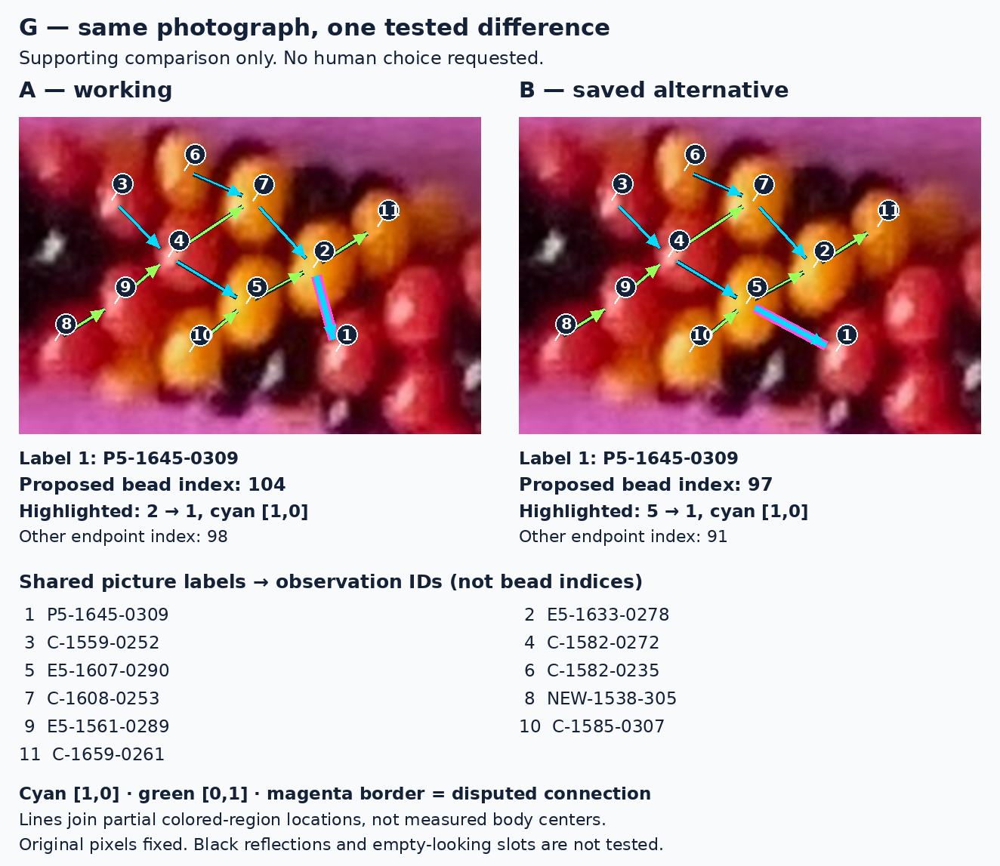
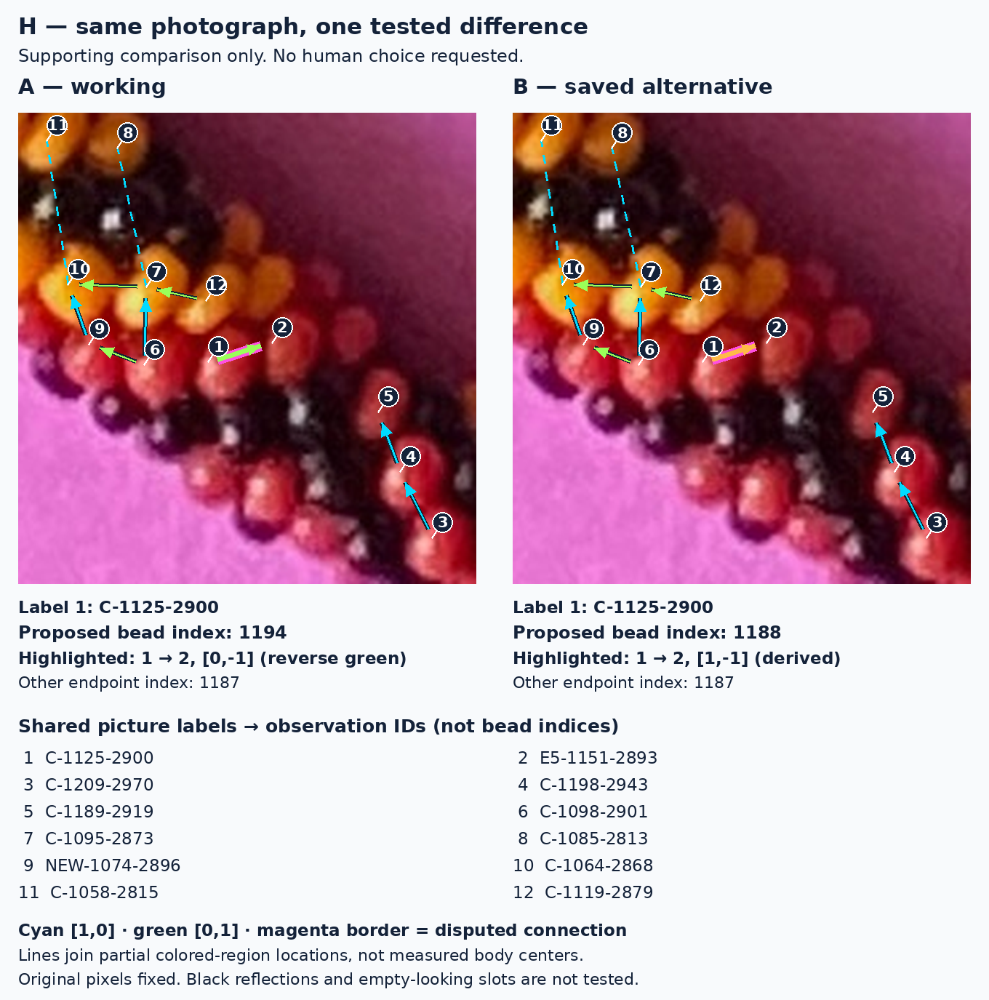

# R329 human-decision audit: supplementary evidence

The short deliverable is [Human Decisions Required](../HUMAN_DECISIONS_REQUIRED.md). This supplement records the additional automatic investigation and why it does not presently generate a question for the user. It is not another reconstruction round. All accepted graphs, prior measurements, model outputs and the original photograph are unchanged.

## G: test more than one colored observation

The earlier transfer test used P5-1645-0309 as the withheld colored target. We now remove each entire reference row in turn, retaining separate cyan and green fields, and repeat all 27 pigment/locality variants. Across 135 settings, the local alternative retains the smaller target miss. Its aggregate range is 5.45–15.26 pixels; working is 16.95–23.92. These correlated settings are sensitivity checks, not independent confirmations.

We also predict four colored observations from the **same 12 shared colored anchors**, excluding all four targets together. Both an affine map and a quadratic map use identical anchors and measurements for the candidates. Neither uses black pixels, positions or proposed black slots. The target coordinates change with the candidate; the reference coordinates do not.

| Held-out colored ID | Affine median error: working / alternative | Quadratic median error: working / alternative |
|---|---:|---:|
| P5-1645-0309 | 20.76 / 10.60 px | 22.23 / 9.65 px |
| C-1669-0293 | 20.62 / 10.93 px | 24.10 / 8.70 px |
| NEW-1697-280 | 21.55 / 15.54 px | 25.27 / 7.02 px |
| E5-1671-0325 | 17.05 / 13.72 px | 30.14 / 24.88 px |

The last target remains poorly predicted by both curved fits. Leave-one-anchor-out errors reach 9.71 px affine and 13.99 px quadratic. This is extrapolation across a local row boundary, not a calibrated physical deformation model. Partial pigment locations are not measured bead centers. The evidence warrants further **automatic local candidate scoring**, not wholesale adoption of the alternative or a user choice of final count.

The new common-anchor test has a different scope from the earlier whole-row fits, whose preferences sometimes changed. Those old results remain intact; this is not a claim that all geometric tests now agree.

### Matched G comparison — supporting evidence, no decision requested

Both panels use exactly the same original crop and scale, colored locations, reference connections and numbered labels. Only the magenta-bordered incoming connection changes: working **2 → 1**, alternative **5 → 1**, both claiming cyan `[1,0]`. The printed target index changes from 104 to 97. The numbers 1, 2 and 5 are picture labels; their stable observation IDs are in the shared key. Both primitive directions have multiple colored reference sequences.



[Unannotated crop](images/g-raw.png). The additional three target errors in the table are **not depicted** in this focused picture; their exact locations and predictions are in `investigation.json.gz`. This picture does not assert that a black bead is misplaced. G's first historical index departure at a black observation and the eventual 175-index discrepancy are not visualized here and are not new findings of this audit.

The displayed connections are visually different. They could be the basis of a future precise question, but currently the local photographic test already favors one and the unresolved issue is how far that result can be trusted and propagated. Asking the user to approve the entire alternative would exceed what this local comparison can establish.

## H: remove the asymmetric reference and fix the cohort

The reference audit found an asymmetry in the prior diagnostic: its last green reference interval, C-1198-2943 → C-1144-2947, has a working coordinate difference `[0,2]`, but C-1144-2947 is not indexed by the lower-bend alternative. Its photographed pigment exists; its use as a two-step reference was conditional on the working map. This is not independent support common to both candidates.

Removing that entire interval leaves the working target miss at **12.30–13.33 px**, versus **14.32–15.85 px** alternative, across the same 27 variants. Thus that reference alone does not explain the working preference. All six leave-one-row-out controls retain the preference. These remain modest geometric comparisons, not proof of the first incorrect physical assignment.

For a separate extrapolation, nine colored observations have identical coordinates in the two saved maps. Only **six** are measurable under every extraction setting. We report a fixed-six-anchor comparison as well as the initial available-anchor comparison, so a changing measurement cohort cannot silently create the result.

| Held-out colored ID | Fixed-cohort affine median: working / alternative |
|---|---:|
| C-1125-2900 | 6.07 / 22.93 px |
| C-1119-2879 | 16.13 / 19.87 px |
| C-1098-2901 | 8.66 / 24.21 px |
| NEW-1074-2896 | 18.25 / 35.89 px |
| C-1144-2947 | 3.95 / unavailable: not indexed |

The fixed reference geometry has quadratic design rank **4 of 6**, so a curved extrapolation is **unavailable**, not a zero error or failed physical fit. Affine leave-one-anchor-out errors reach 14.04 px, and some leave-outs lose rank. The stored controls include only solvable leave-outs; they do not certify the missing transverse coverage. C-1151-2862 has no extracted colored component under these settings; C-1253-2928 and NEW-1247-2991 are available only in some variants. This means the *measurement procedure* is unavailable there, **not that any physical bead is absent**.

### Matched H comparison — supporting evidence, no decision requested

The panels deliberately exclude the asymmetric green reference. All remaining colored reference intervals have the same relative steps in both candidates, even where their absolute lattice coordinates differ by a common translation. Exactly one disputed segment, **1 → 2**, is highlighted: reverse green `[0,-1]` working, derived `[1,-1]` alternative. Its photographed endpoints do not move. The index of label 1 changes from 1194 to 1188; label 2 remains 1187. Index convention is `6a+7b`, relative to the unchanged C-1302-0316 origin (the origin is outside these crops).



[Unannotated crop](images/h-raw.png). The diagram makes the hypotheses explicit but does not create two visibly different physical placements. We are **not** asking which colored line or integer “looks right.” A defensible question would need an independently identifiable connection across the gap that the current automatic measurements cannot settle. Missing curved-reference coverage is an automatic investigation to perform first.

The omitted observation and the additional target errors in the table are **not marked in this focused picture**. Their inventory/measurement records are in the data; the historical omitted-region illustration remains in the prior guide. No new skipped-bead or missing-body claim is made.

## E and F triage

E already has a held-out colored-body failure for the closest alternative and an exact provenance explanation. Asking for a vote would add no necessary fact. F's mismatch is between measured colored material and an actual frozen model/correspondence; neither identity nor model placement should be decided by voting on black highlights. Existing marked E and F figures are linked in the short report; this audit does not rerun their experiments or change their conclusions.

## Reproduction, scope and checks

```bash
MPLCONFIGDIR=/tmp/r329-mpl .venv/bin/python -m photo2.r329.human_review.investigate
MPLCONFIGDIR=/tmp/r329-mpl .venv/bin/python -m photo2.r329.human_review.draw
MPLCONFIGDIR=/tmp/r329-mpl .venv/bin/python -m photo2.r329.human_review.verify
```

`investigation.json.gz` contains all reference-row removals, available/fixed anchor cohorts, target predictions, leave-out errors and reference membership audits. `figures.json` records original crops, scales, label coordinates, highlighted endpoints and indices. `verification.json` records fresh checks. The original saved reconstruction states are read-only inputs. No growth search, full rendering, model optimization, count search or color-period inference is performed here. Numerical diagnostic time was approximately **0.21 seconds**, excluding imports, figure generation and verification.

The matched comparisons were inspected separately at reading size. They mark one connection each, preserve shared labels and photo geometry, and contain no black-location measurements or inferred empty sites. Every review question is deferred: this report explicitly requests **no human decision**.
