# Read the photographed rows before trusting the reconstruction

**For the current decision list, read [Human Decisions Required](../HUMAN_DECISIONS_REQUIRED.md). The reassessment asks for no human decision yet. This longer page remains the diagnostic background.**

**The colored bead bodies provide the visual reference. We first estimate which of the two diagonal directions a sequence follows, then compare it with nearby rows in that same direction.** A closed mathematical network can still connect the wrong photographed beads.

This page replaces the earlier explanation of Figures E, F2, F3, G and H. It includes new photographic tests and actual frozen-model geometry. The old scientific results remain archived unchanged. The important corrections are:

- **E:** the closest alternative fails a specific colored-row continuity test. It should not be presented as equally credible merely because it closes the bracelet.
- **F:** the old “last agreement at 26 / first physical mismatch at 31” was a reflection-ownership result. It did **not** establish the first incorrectly positioned bead. The new pictures show model-body disagreement on colored material instead.
- **G and H:** the direction across the disputed gap is not reliably classified by this local test. We retain that uncertainty; a large eventual index difference does not prove the earliest differing choice wrong.

[Inward bend and learning the directions](#e--learn-the-directions-at-the-inward-bend) · [Photograph versus model](#f--photograph-model-and-visible-disagreement) · [Early row choice](#g--an-early-choice-and-a-later-175-index-difference) · [Lower bend](#h--lower-bend-and-an-unindexed-red-bead) · [Method, provenance and reproduction](METHOD_REPORT.md)

## How to read these pictures

A **photographic observation** is an identified feature in the original photograph. Its **observation ID** is a permanent name, such as `C-1721-1566`. The digits help locate the original feature; they are not a bead number. Several historical observations were bright patches rather than whole beads.

Here, small numbered circles identify **newly measured red/yellow pigment regions** associated with those IDs. Match each circle to the full ID immediately beside the picture. The circle marks the average location of those colored pixels, **not a measured bead center**. Cream edges surround the measured colored pixels only; they are not complete bead outlines. Regions can be partly hidden, truncated or touch neighboring pigment. The tests vary their extraction settings to check sensitivity.

A **bead index** is a proposed position in the bracelet's construction order. Hidden beads count too. The common photographic reference is index zero in F-A. Zero is a convention, not a special physical bead. Picture-label numbers such as 1 and 2 are not indices. A **model address**, such as M−33, identifies a body in a separate three-dimensional model.

A **primitive direction** is one of two basic ways to step between neighboring lattice sites. We draw `[1,0]` in **cyan** and `[0,1]` in **green**. The brackets are two bookkeeping coordinates, not image distances. A **diagonal** is a sequence along one such direction. It can curve around a bend. Colored beads occur in either diagonal; color does not identify the direction.

A **derived direction** combines the two basic steps. Orange `[1,-1]`, for example, means one cyan step and one backward green step. It is not a third primitive direction. A **row switch** means that a proposed continuation leaves the row it was following and joins a neighboring one; it must be demonstrated against the photograph, not inferred merely from a changed index.

The **working reconstruction** is the selected provisional connectivity. An **alternative reconstruction** assigns some of the same observations differently. A **winding** records the accumulated pair of lattice steps after following the whole bracelet back to the starting region. Different windings imply different conditional total counts, but successful closure is not proof of photographic correctness.

Black glass has the same underlying bead shape and size as colored glass. Its bright reflection depends on lighting, curvature and viewing direction; the bright spot need not lie at the bead center. **No black reflection coordinate, intensity or pixel enters the new positioning tests.** A blue “K slot” is a possible location inferred from neighboring colored material. The blue box shows extraction sensitivity expanded by errors on other same-direction intervals. It is neither a bead boundary nor a calibrated confidence interval.

In the candidate panels, **P** is a predicted location of a colored region deliberately left out of the reference rows. A white dashed segment connects P to that region's actual measured location. This makes the test visible without pretending that a black reflection measures a black bead's position. Cyan and green arrows remain visible in the same crop. Dashed row segments span gaps whose number of lattice steps remains conditional.

## E — Learn the directions at the inward bend

[Open the unannotated original-photo crop](images/raw-e.png).

Start with **1, C-1721-1566**, the yellow region near the center. Look first at the actual colored bodies, then follow the arrows. The two teaching panels separate the directions so that the black-containing gap does not dominate the explanation.

### E-A1 — The cyan direction `[1,0]`

Follow **1 → 7 → 5**: `C-1721-1566 → C-1717-1540 → C-1705-1514`. Three visible yellow regions establish one local direction. To the left, **9 → 4 → 3** is another proposed row of that family; the dashed segments acknowledge intervening gaps. At the lower right, **12 → 10** provides a nearby comparison. The thin dashed continuation toward **2** is shown for context; **2 is excluded from the reference measurements used to predict it**.

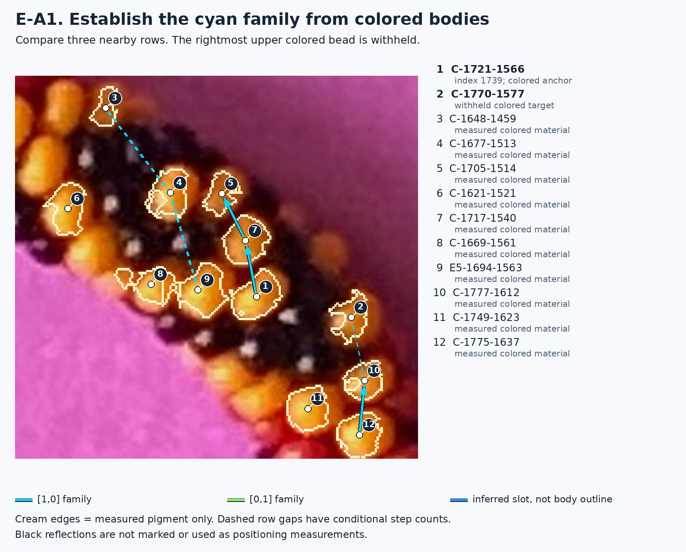

### E-A2 — The green direction `[0,1]`

Now follow **1 → 9 → 8**: `C-1721-1566 → E5-1694-1563 → C-1669-1561`. Compare it with **5 → 4 → 6** above and **12 → 11** below. These are the other diagonal family. The white **colored bridge**, between **1 and 2**, runs across the disputed black-containing gap. Its measured direction is close to these green rows, and far from the cyan rows.

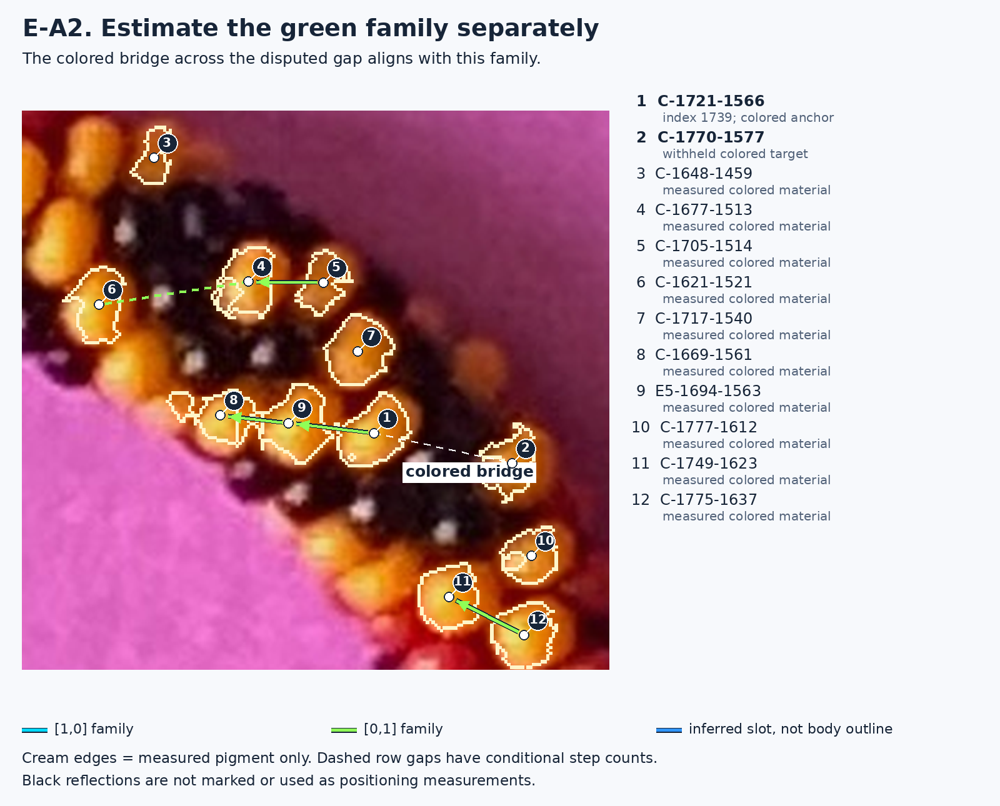

The program estimates cyan and green directions **separately**, using displacements between colored regions. It allows direction to vary with location. The bridge is about 5° from the local green estimate, versus 62° from cyan. Across all 27 extraction/locality settings, only the green family contains its direction within the observed reference-row angular spread. This is a local empirical test, not a rule that all rows must be straight.

### D — Combining the directions

Both primitive directions are visible together below. The orange step **9 → 7**, from `E5-1694-1563` to `C-1717-1540`, can be described as **9 → 1** backward along green, followed by **1 → 7** along cyan. That is `[1,-1]`. The orange connection does not introduce another independent direction.

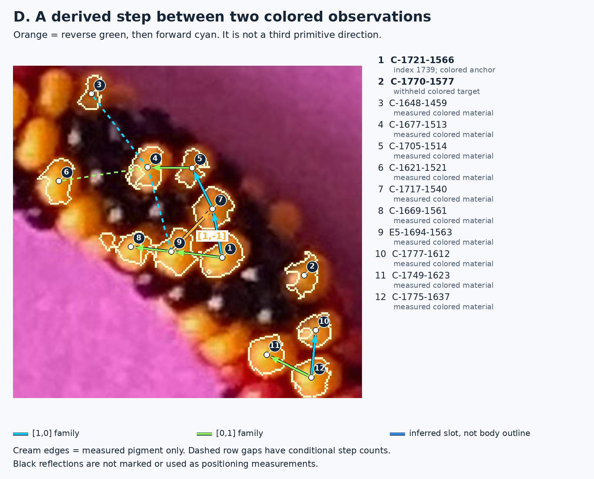

### E-B — What the working reconstruction proposes

The blue slot is the conditional location of **K-1740-1575**. The working reconstruction treats the route from colored **1** through this slot toward colored **2, C-1770-1577**, as two backward green steps. Nearby green rows establish the direction and spacing. The magenta P lands near the measured yellow body **2**. Its miss is 4.5 original-image pixels at the median, and 0.6–9.1 pixels across the tested variants.

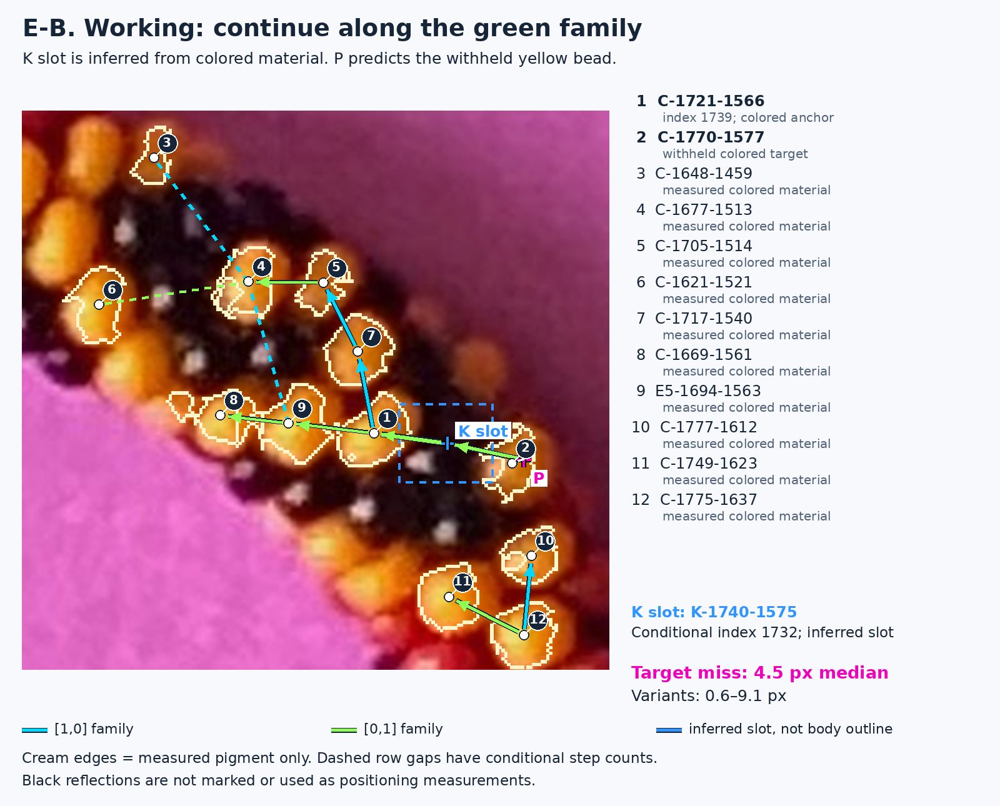

### E-C — What the closest alternative proposes

The alternative assigns the first part of the same disputed connection to cyan, then uses green for the continuation. With the **same measured colored reference rows**, this mixed route puts P below and to the left of yellow body **2**. The white dashed connector shows the discrepancy: median 28.0 pixels, range 24.4–32.6 pixels. This is a failure to reach a visible **colored** body; no black highlight is being used as a position test.

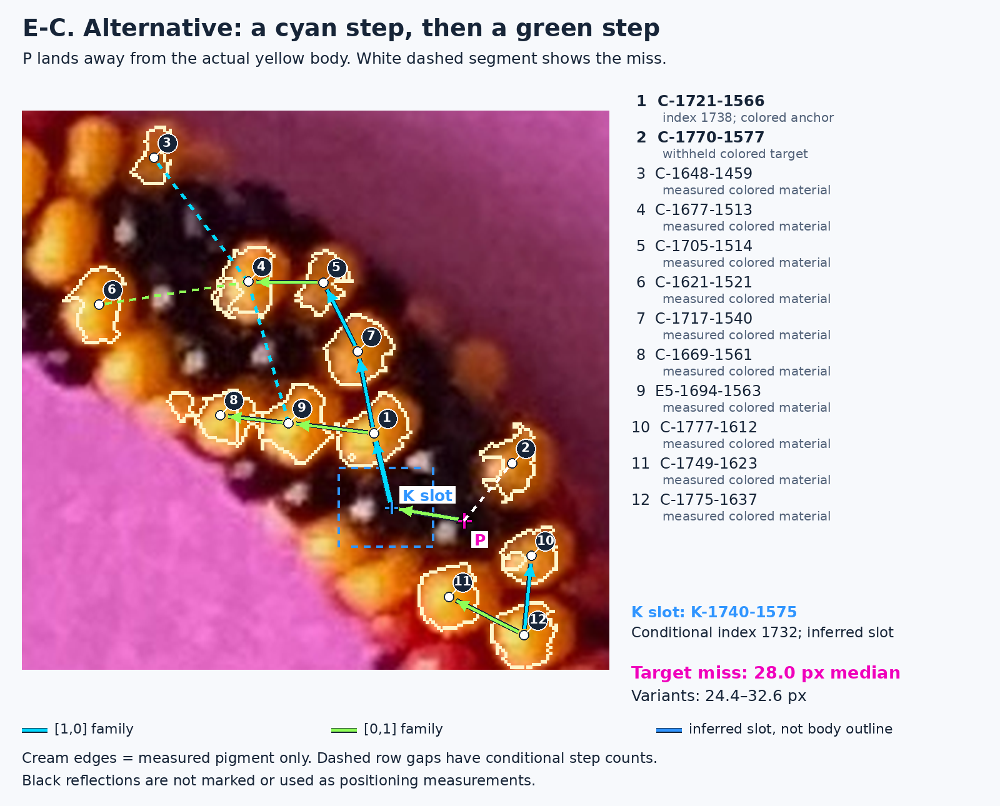

The historical feature-to-feature segment was the same in both candidates. These new panels deliberately show their different **implied geometric slots**, rather than drawing a black highlight as though it were a body center. K retains index **1732** in both candidates. It is colored **1, C-1721-1566**, that changes from working index **1739** to alternative index **1738**, relative to the same origin and the convention of +6 for cyan and +7 for green. This arithmetic explains the one-index difference; the colored-row test explains why the alternatives are not equally credible photographically.

**Why did the search retain the alternative?** It did use photographic scores, but not this same-diagonal, colored-body bridge test. In the three overlapping local patches, the alternative lost support in the first two and gained it in the third, where it included 19 observations rather than 14. The total score deficit was only 1.359. Both candidates received zero penalty from the existing primitive-shape check. The geometry terms predicted historical bright supports, and overlapping patches reused evidence; those are not independent confirmations of body placement. Exact patch IDs, sources and scores are in the [method report](METHOD_REPORT.md#why-e-survived-the-original-search).

**What was tested?** An isolated replay screened candidates in those three patches only when the colored bridge was reliably classified into one diagonal and the candidate assigned it a mixture of diagonals. The unchanged R328 connected-growth algorithm still completed the circuit with working winding `(214,201)`, 900 unique indexed observations and 17 returns. The saved `(215,200)` alternative still replays without this new screen and remains archived.

**Conclusion:** the closest alternative is a **local algorithmic failure case under this explicit colored-row test**. This supports the working continuation here; it does not certify every working link, establish a unique total count, or prove an exact black-bead center. The nearby historical predecessor `MAT25-K-1719-1592` is **not shown or used as positioning evidence** in these replacement panels; its bright-support comparison remains in the archived index ledger.

## F — Photograph, model and visible disagreement

[Open the unannotated original-photo crop](images/raw-f.png).

### F-A — What the photograph shows

The numbered red/yellow regions give several cyan rows and two green connections. Read the index labels in the key: **C-1302-0316 is the common index-zero reference**; **C-1391-0312 is index 26**, and **C-1422-0264 is index 38**, using the other saved assignment, +7 for cyan and +6 for green. This change of convention is explicit; it is not a physical change to the photograph.

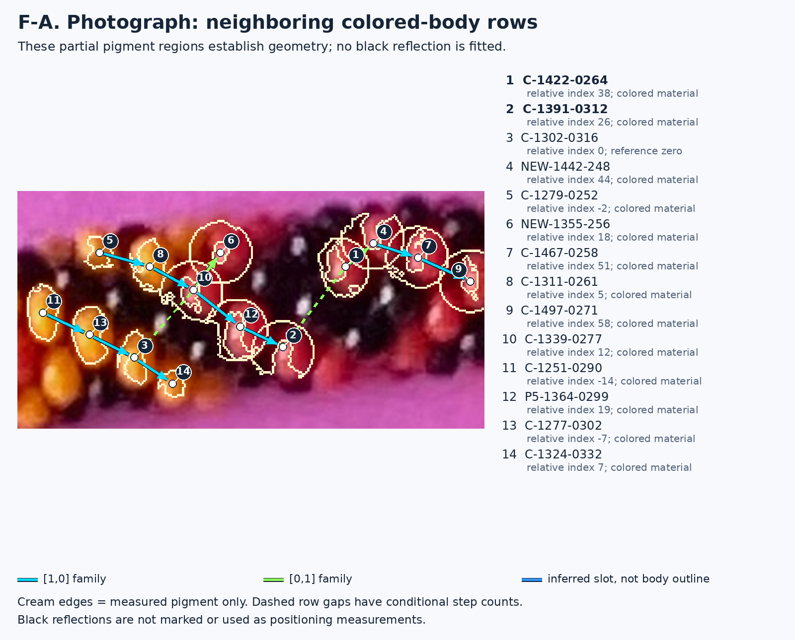

The rows themselves look locally coherent. This picture alone demonstrates no defect in a black bead. The old description called 26 the “last agreement” and 31 the “first mismatch” because a frozen calculation associated bright support pixels with different model addresses. **Those are historical ownership events, not a demonstrated sequence of correctly and incorrectly positioned bead bodies.**

### F-B — What the frozen physical model actually predicts

This enlarged crop retains both local directions. Magenta **M−33** is the model body assigned to relative index 31. Violet **M−27** is the comparison body selected by the old ownership calculation; it is not a proved photographic identity. Crosses mark their projected model centers. **Solid boundaries come from their visible footprints with all 3,000 model bodies present; dotted boundaries show each body's isolated footprint.** These are newly calculated geometry at half-pixel spacing, without lighting or fitting.

The blue K slot is inferred from the colored rows for **K-1398-0248**, conditional index 31. Its broad box makes the positional uncertainty explicit. It is not obtained from the bright spot below it.

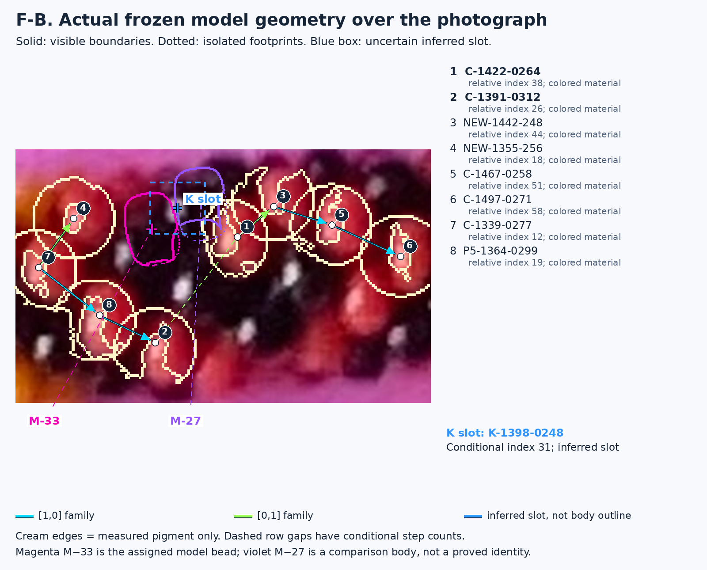

The model alternatives are spatially different, but the colored-row inference does **not** uniquely establish the black body's center or which model address it should have. A claim that this black bead is physically misplaced remains **unproven**. Incorrect correspondence and incorrect model placement are separate possibilities.

### F-C — A disagreement that is actually visible

Here the test uses colored material directly. **2, C-1391-0312**, is assigned to magenta **M−38**; **1, C-1422-0264**, to violet **M−26**. Orange marks measured red/yellow pixels outside that assigned body's **visible** footprint. The colored bodies visibly extend to the right of much of the proposed geometry. The two local diagonal directions remain on the photo.

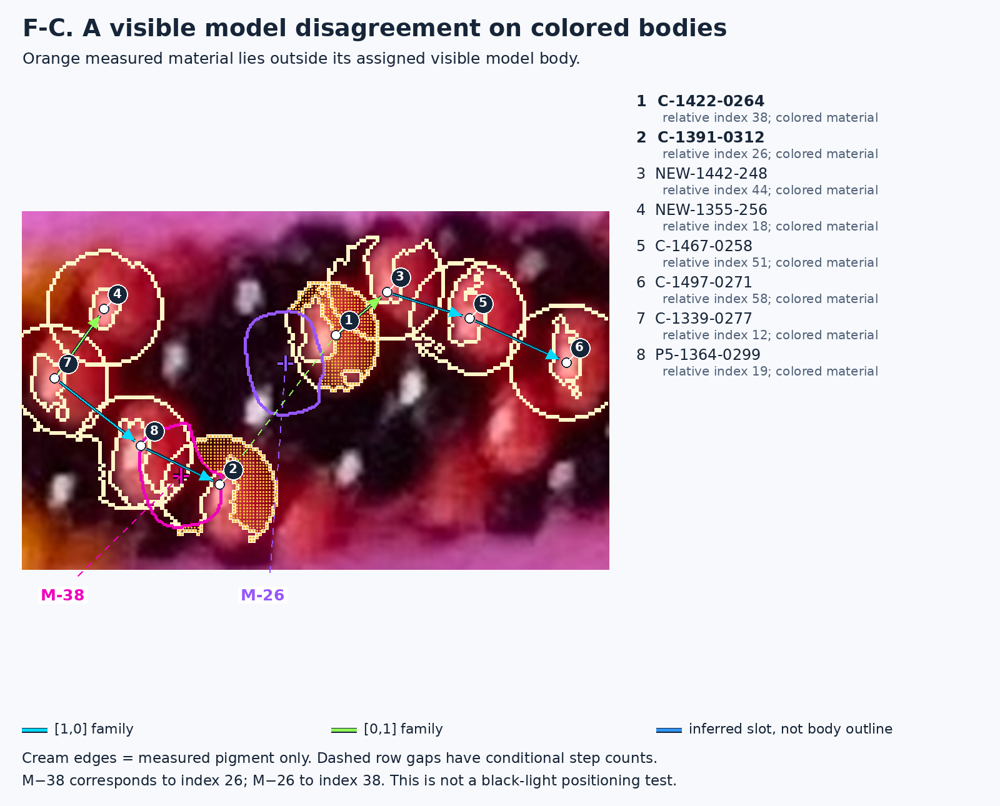

For the measured regions in this figure, M−38 covers **296/751 pixels (39%)**, and M−26 covers **126/625 (20%)**. Changing pigment extraction gives 38–41% and 17–24%, respectively. These are partial colored-region coverage measurements, not whole-bead overlap scores. The visible disagreement can arise from model placement, shape, projection, occlusion or the proposed correspondence; this experiment does not distinguish them.

The same calculation at the index-zero reference covers only 59–63% of its measured yellow region. **That particular model boundary is not shown here**; its measurements are linked in [the data](colored-model-comparison.json). It means we cannot call index 31 the first body mismatch: the frozen registration already disagrees with colored material at the reference. No new “first physical error” is claimed. The historical reflection measurements remain archived but are excluded from these positioning conclusions.

## G — An early choice and a later 175-index difference

[Open the unannotated original-photo crop](images/raw-g.png).

### G-A — Establish the two families first

The key marks **C-1608-0253**, relative index **92**, as the last agreeing colored observation in this comparison. Follow the two cyan sequences across the upper colored beads, and compare the two green sequences slanting the other way. The rows bend; their local direction cannot be replaced with a single straight line across the bracelet.

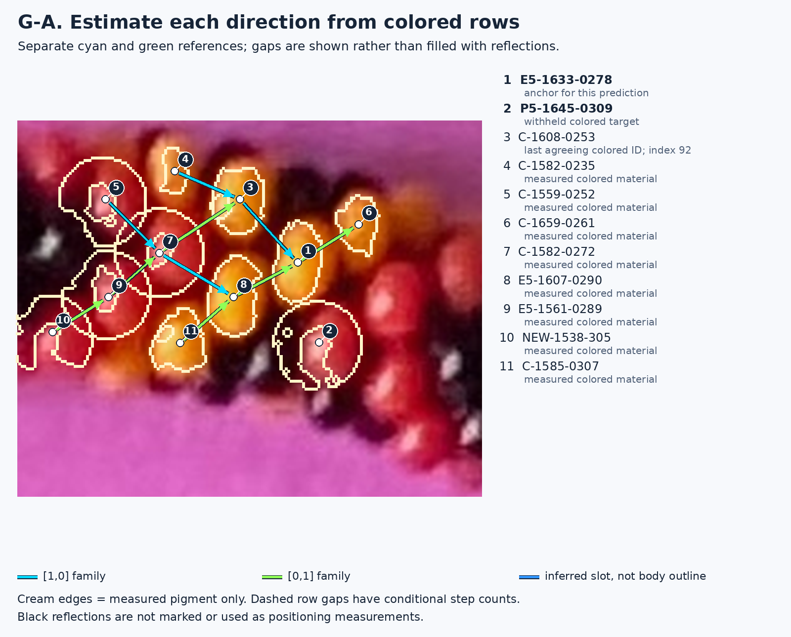

### G-B and G-C — Compare the proposed continuations

The blue slot is the location inferred for **NEW-1621-315**, the first differently indexed feature: working **97**, alternative **90**. The working continuation comes from **E5-1607-0290** along cyan; the alternative comes from **C-1585-0307** along cyan. Both then use a green step toward the colored target **P5-1645-0309**, marked by P's comparison with its numbered region. All three named colored observations are in each picture's key.

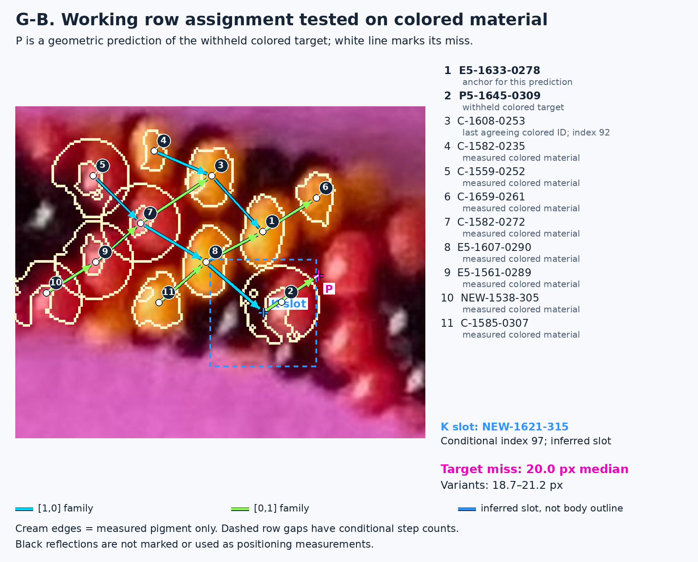

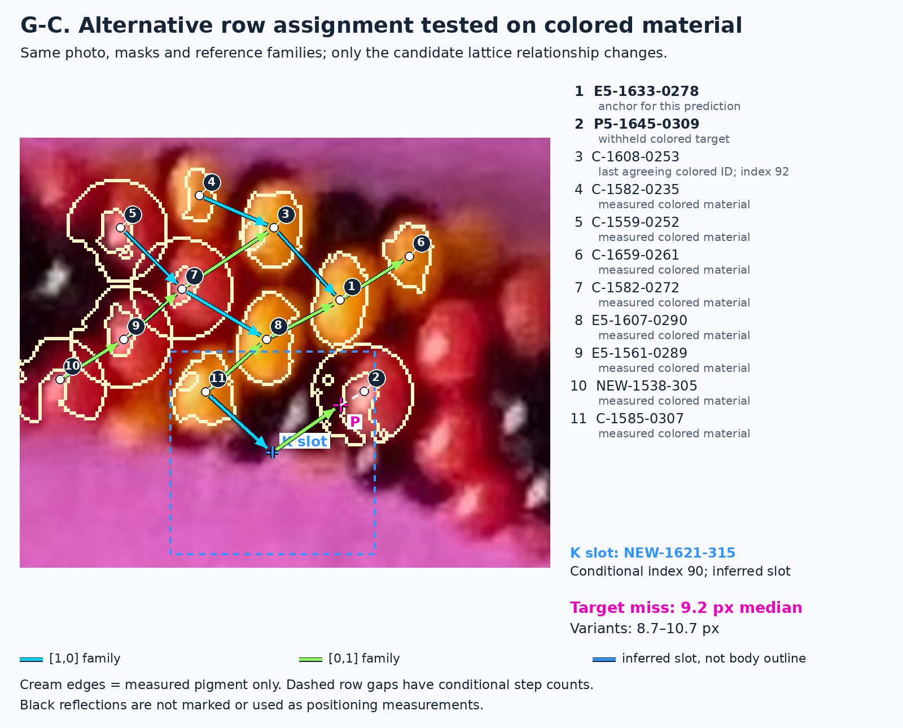

In this local transfer test, the alternative reaches the colored target **better**: median 9.2 pixels versus 20.0 for the working assignment. But the bridge from the anchor to that target does not fit either estimated family robustly; curvature, partial pigment regions or the proposed reference connectivity can matter. Exploratory straight and curved fits also changed the preference. The blue slot boxes are correspondingly broad. **These pictures do not establish that either proposed black-bead position is correct, nor that the first differing choice is an error.**

Both saved paths were replayed through the full circuit. Their windings are `(214,201)` and `(214,176)`, giving conditional counts 2691 and 2516 under this +6/+7 assignment: a later **175-index difference**. That downstream arithmetic is **not shown as a spatial displacement in these local pictures**. What is shown is the much earlier choice of incoming row. The current evidence does not justify rejecting the alternative just because its final winding differs.

## H — Lower bend and an unindexed red bead

[Open the unannotated original-photo crop](images/raw-h.png).

### H-A — Compare parallel rows on both sides

The key identifies **E5-1151-2893**, index **1187**, as the last agreeing feature. Several colored sequences establish cyan and green directions on both sides of the gap. Dashed connections include gaps; their step counts are part of the hypothesis, not independently measured hidden beads.

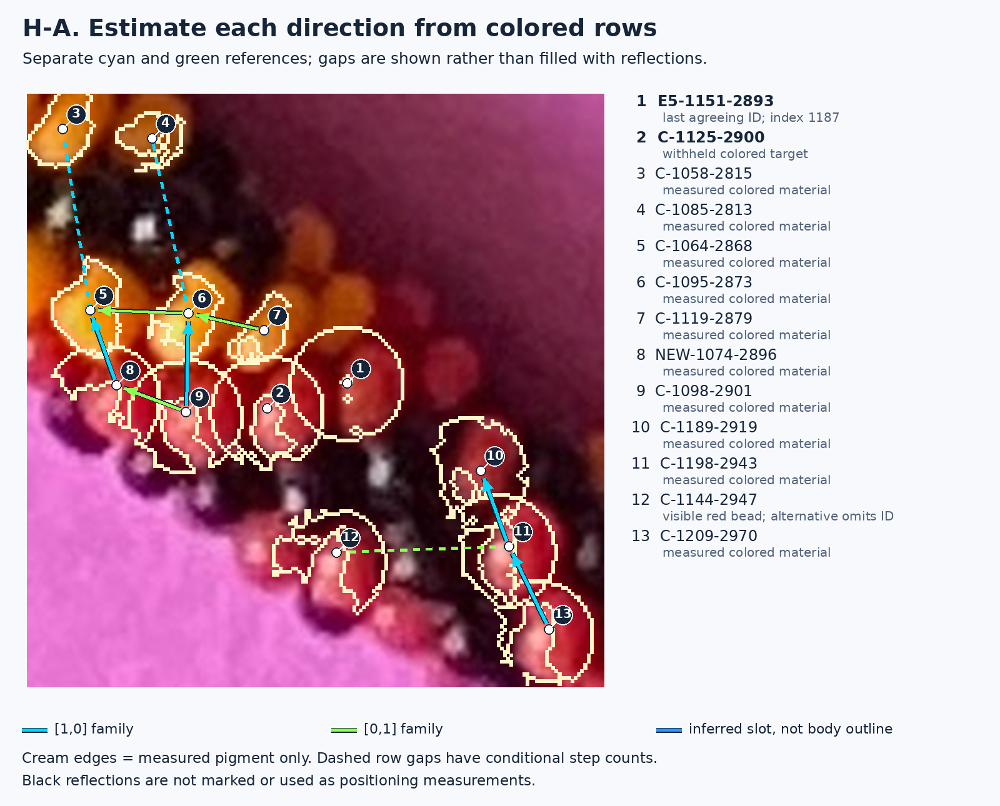

### H-B and H-C — What changes in the two candidates

The inferred **NEW-1132-2925** slot is the first differently indexed feature: **1188** working, **1182** alternative. The working proposal reaches the slot by a backward cyan step and a green step from the anchor; the alternative uses two backward cyan steps and a green step. The blue box shows the net predicted slot; intermediate unobserved sites are **not drawn as measured beads**. The cyan arrow from the slot toward P shows the final step to the withheld colored target **C-1125-2900**.

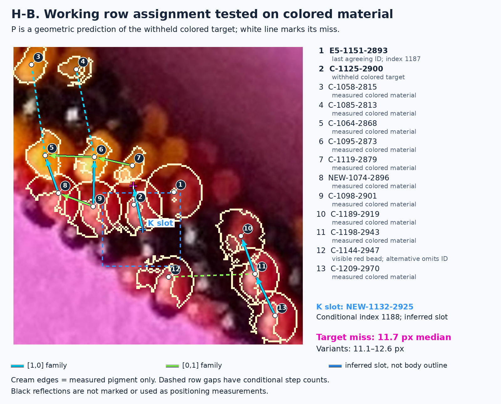

The working colored-target miss is 11.1–12.6 pixels; the alternative gives 15.5–17.2. This modest difference favors the working transfer, but the bridge is not confidently assigned to either measured diagonal across all variants. We therefore do **not** apply the E rejection rule here.

There is a separate, directly visible issue: **C-1144-2947**, circled and marked **“unindexed”** in H-C, is a real red region that the alternative leaves out of its indexed map. The alternative has 899 unique indexed observations rather than 900. That omission weakens its completeness, but does not by itself prove a skipped physical bead or determine the correct hidden row. The red region is still in the photo; it has not been deleted from the evidence.

The alternative replay still closes with winding `(213,201)` and 17 return observations, versus `(214,201)` for the working path. Closure does not resolve this local ambiguity. The first disagreement in index assignment is established; the first **incorrect** physical assignment is not.

## What is evidence, and what remains a hypothesis?

| Layer | What these pictures show | What it does not establish |
|---|---|---|
| Direct photograph | Original pixels, identifiable colored material, spacing and local row direction | Complete boundaries or black-bead centers |
| Reconstructed lattice | Cyan/green connectivity, proposed steps and indices, reversible alternatives | Independent confirmation merely because equations or loops agree |
| Physical model | Actual frozen-model visible and isolated footprints in F | That the model or its correspondence is correct |

The new diagnostic is a small, reversible addition around the existing connected-growth search. It excludes black reflection measurements and compares directions separately. It has been exercised on these examples, not validated as a universal automatic row detector. The reference rows are explicitly listed and visible; their topology still deserves human review. No total bead count, repeating pattern or replacement reconstruction is adopted.

For exact measurements, original candidate provenance, sensitivity controls, replay receipts and reproducible commands, see [the method report](METHOD_REPORT.md). The [previous lesson](../guide/READING_THE_PHOTOGRAPH_BEFORE_BODY_REVIEW.md) is retained as an archive; its reflection-based positioning language is superseded by this page.
