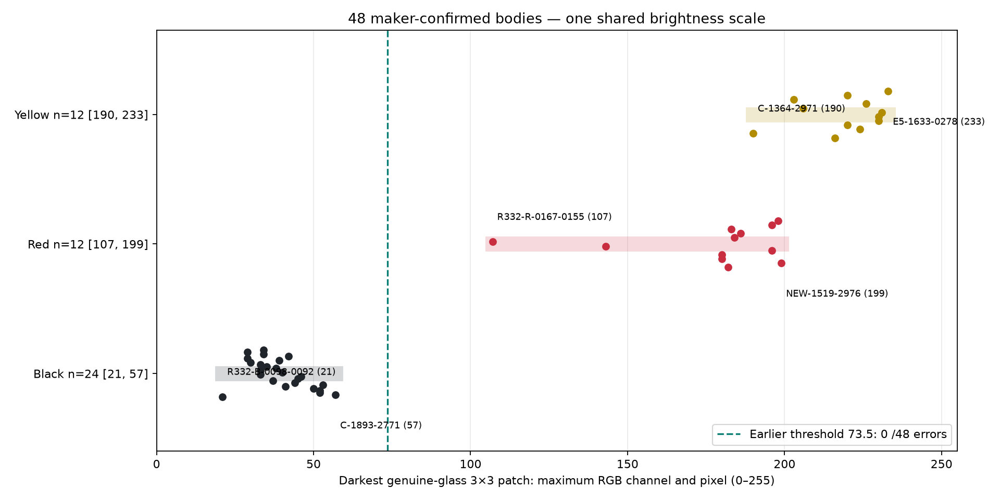

# Material-darkness diagnostic: ten-minute continuation



The maker's proposed distinction holds for all **48 maker-confirmed bodies tested**: **24 black21–57;12 red107–199;12 yellow190–233**, on the0–255 maximum-channel scale. The earlier **73.5** threshold separates them unchanged, with **zero false positives, zero false negatives and no measurement abstentions**. Any threshold t satisfying57≤t<107 separates these particular measurements using black≤t. No threshold was adjusted after seeing this expanded sample.

There are **no black-versus-colored exceptions**. Closest are **C-1893-2771, black57**, and **R332-R-0167-0155, red107**. These have broader unaltered121×121 native context crops in the [offline review](index.html). Red and yellow ranges overlap190–199; this does not affect black recognition. Red observations inside that overlap: NEW-1519-2976, P5-1364-0299, E5-1455-3009, E5-1671-0325. Yellow: C-1364-2971.

Even the darkest *individual* pixel anywhere in the approved red material rectangles has maxRGB90; the yellow minimum is173. Both exceed the brightest selected black3×3 material-patch score57. This directly supports the proposed material distinction in these inspected regions, without averaging dark material with reflections.

## Selection and measurement

The reference labels come from R339's explicit authoritative-label ledger plus the six latest maker black decisions. Earlier displayed-panel acceptances are identified as such, distinct from individually requested recolorings. All48 IDs, exact authority text and original native coordinates are retained in [selection.json](selection.json). Selection prioritizes prior difficult black cases, all six new confirmations, then geographic diversity; no brightness score or repeating-pattern color selects the IDs. The sample contains reflection-free black bodies R332-B-0098-0092 and REC266-P073002, strong/weak white glints, colored reflected illumination, and beads across the photograph. Two earlier visually selected red controls were **not** promoted to maker confirmations.

Three IDs overlap the preceding nine-body diagnostic (R332-B-0098-0092, D40-K-2081-2611, C-0412-1572). **45 bodies are additional tests of its already fixed threshold**, all correctly separated. This is an expanded retrospective test with manually supplied body ownership, not an estimate of automatic whole-photograph accuracy.

1. Inspect original native RGB crops with a local pixel grid. Choose one rectangle safely in visible glass, away from the glint, outer rim and neighboring bodies; all48 explicit choices are in [manual-regions.json](manual-regions.json) and as literal constants in measure.py. Support locations are inherited and never recentered.
2. For each complete contiguous3×3 patch inside that rectangle, compute the maximum of its27 RGB values. Take the smallest such maximum. Thus **all nine pixels and all channels** of the selected patch must be dark. There is no mean, darker-half statistic, hue test, multiple aperture, morphology or repeating-pattern input.
3. Save original patch RGB and both absolute/local coordinates; inspect green material boxes and cyan selected patches against unaltered crops. All48 overlays were inspected; no region was adjusted after its score was seen.

This uses one fixed patch size,3×3 native pixels. Hand-approved material rectangles vary with the visible body; they are explicit photographic ownership annotations, not multiple-aperture votes. The scalar computation itself is simply `sliding_window_view(material.max(axis=2),(3,3)).max(axis=(-2,-1)).min()`.

## Checks, scope and reproduction

All48 vectorized scores were independently recomputed by explicit nested loops; saved native RGB maxima agree exactly. The original photograph SHA256 is in [measurements.json](measurements.json), alongside all measurements and exceptions (empty). The [review](index.html) supplies raw and annotated pixels for every stable ID; the full original photograph is linked. The original seven-maker-plus-two-visual-control diagnostic and its reported60-second overrun remain unchanged.

No classifier was redesigned or applied globally. No recorded colors, identity, geometry, exclusions, pattern or graph changed. E5-2272-1815's new maker-black decision is preserved as a diagnostic reference label; applying it to the reconstruction remains part of the paused broader task. Material ownership is supplied by manual visual inspection here; an automatic method must still avoid inter-bead darkness and boundary contamination. These results support a very simple darkness threshold **once genuine material has been identified**.

Run from repository root:

```
.venv/bin/python photo2/r340/material-diagnostic/select.py
MPLCONFIGDIR=/tmp/beads-material-mpl .venv/bin/python photo2/r340/material-diagnostic/measure.py
.venv/bin/python photo2/r340/material-diagnostic/review.py
```

The reference selection, photograph and manual regions are frozen. Timing: continuation began2026-10-20T01:35:33Z, ten-minute deadline01:45:33Z; expanded measurements completed01:39:15Z (about3m43s after start; numerical computation0.22s). Delivery timing is recorded separately. Stop after scoped add/commit/push; no next analysis step.
