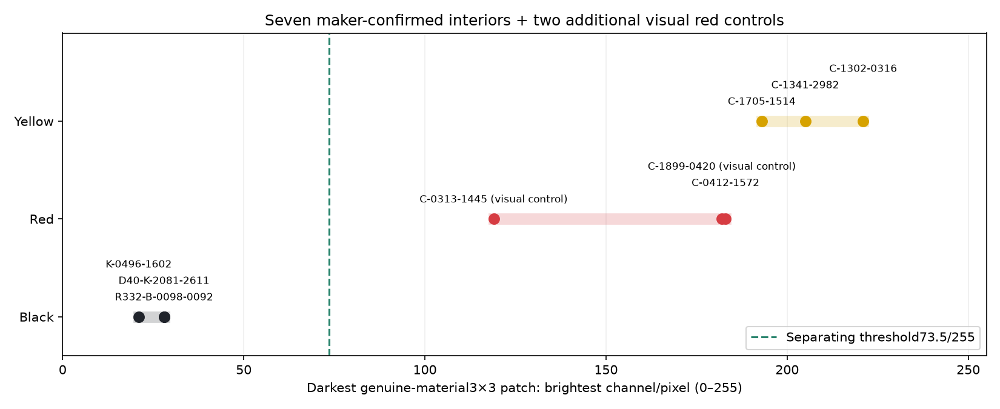

# Quick genuine-material diagnostic

Seven maker-confirmed bodies (3 black,1 red,3 yellow), plus two explicitly visually verified dark-red controls C-0313-1445 and C-1899-0420. They are not misrepresented as maker-confirmed. All nine raw crops, selected interior rectangles and exact RGB samples are preserved.

For each manually approved visible-glass interior, select the darkest complete3×3 patch by minimizing its **brightest maximum-RGB-channel pixel**. Thus all9 pixels must be dark; there is no mean, no dark-half averaging, no reflection averaging, no multiscale vote and no unowned dark component. Green boxes show inspected material interiors; cyan boxes show the measured contiguous patch in measured-native.png.

Combined ranges (0–255): black21–28; red119–183; yellow193–221. Maker-only red=183. No overlap and no exception in this small sample. A threshold73.5 separates every tested black patch from every tested colored patch; any threshold strictly between28 and119 does so. C-0313-1445 is the darkest additional red control at119, still far above the black maximum28. This supports the maker's material-darkness observation here; it does not establish a whole-photograph threshold or automatic body-interior ownership.

The exact provenance is7maker-confirmed+2visual controls. The earlier R340 classifier work remains stopped and uncommitted. Only this diagnostic is delivered; no classifier redesign, full regression or subsequent step is run.

Timing: first tool timestamp01:30:37UTC; provenance check01:32:23UTC (106seconds). The requested60-second limit was exceeded. No further measurement or classifier work followed; only artifact correction and requested delivery.
