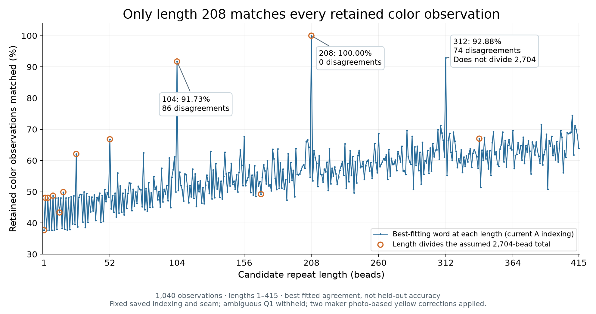

# Which lengths below 416 fit the current observed colors?

**Only 208 fits all 1040 retained color observations under the current A indexing.**
Every integer length from 1 through 415 was tested. The next-best lengths are 312
and 104. This is a finite descriptive calculation on the saved data, not a new
detector, topology inference or geometry experiment.

| Candidate length | Best agreement | Minimum disagreements | Divides conditional N=2704? |
|---|---:|---:|---|
| 208 | 1040/1040 = 100.00% | 0 | Yes |
| 312 | 966/1040 = 92.88% | 74 | No |
| 104 | 954/1040 = 91.73% | 86 | Yes |
| 410, the next best after those three | 774/1040 = 74.42% | 266 | No |

## Definition of the score

For candidate length L, assign each retained observation its saved string index
`k=(7a+6b) mod 2704`, then group observations by `k mod L`. Give each residue the
most frequently recorded color in that group. This chooses the best possible
repeating word of length L for these labels. Its minimum number of disagreements
is the sum of `group size − largest color count`. Ties do not change that count;
unobserved residues are reported separately and add no evidence.

This calculation uses observed labels, not the provisional pattern as training
data. The 208 fitted word is checked afterward against the provisional word and
matches it exactly. The dataset is R347's assessment: Q1 pigment withheld and
Q2/Q3 corrected to maker photo-based yellow. No additional exclusion or correction
is made. The seven geographically undercorroborated black positions still enter
as recorded observations; this scan does not independently confirm their pigments.

Orange circles identify lengths dividing 2704. To be the shortest period of a
complete cyclic repeat under that count, a length must divide 2704. All lengths
are nevertheless plotted, so this is not just a scan of admissible divisors.
Nondivisor scores describe a linear segment using the saved cut `0<=k<2704`;
they need not be invariant to moving that cut. The exact cyclic conclusion is
limited to the fixed saved lattice/closure premises. A 312 block does not form an
integer number of complete repeats around that assumed loop.

Larger candidate words have more freedom, so an improved fitted percentage is
not automatically evidence for a better fundamental period. This is not held-out
accuracy or a calibrated probability. The result does not establish independent
physical topology, bead count, or authenticity of the original chart.

As a separate check, all 415 lengths were also scored under B=6a+7b with
conditional N=2691. None fits perfectly; its best linear fit is 208 with 102
disagreements (90.19%), and 208 does not divide 2691. The figure shows A only;
the CSV preserves both families.

## Data and reproduction

- [All 830 scores in CSV](pattern-length-match.csv)
- [Summary, input hashes and checks](pattern-length-match.json)
- [Vector SVG](pattern-length-match.svg)
- [Source](period_scan.py): run `.venv/bin/python photo2/retrospective/period_scan.py`

Independent NumPy-histogram and dictionary/Counter calculations agree for every
case. All 22 earlier R347 closure-admissible cases reproduce their compatibility
and observed-residue counts. All three scientific input files remain byte-exact.

[Why multiples of 13 can still be decoded](WHY_MULTIPLES_OF_13_ARE_DECODABLE.md)
explains the distinction between circumferential alignment, observation coverage
and a genuine color repeat.
