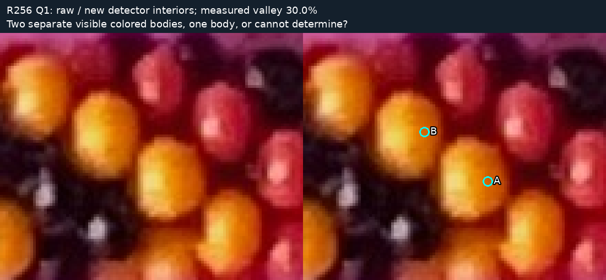
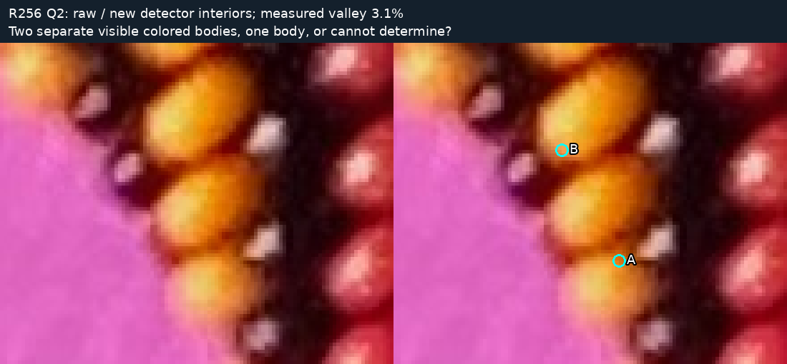

# R256 working viewer — reproducibility and small review examples

Start the application with:

```bash
.venv/bin/python -m photo2.bead_debugger.server
```

Open http://localhost:8767. [Controls, provenance, limitations, reproduction and
staged independent fit](../../bead_debugger/README.md). This directory is supporting
evidence for the working application, not a substitute for interactive review.

- [Whole-photo browser screenshot](viewer-whole.png).
- [Sequential review interface](viewer-review.png). The note/review count shown is
  test data in an ephemeral workspace, not a user judgment or production review.
- [Exact regeneration report](regeneration.json): independent generation hashes,
  candidate accounting, original algorithm's exact edge/midpoint replay, and
  0.001px periodic-spline comparison tolerance (actual max about 0.0000786px).
- [Browser verification](browser-verification.json): actual controls, image pixels,
  overlays, model switching, persistence, import/export and draw timing.
- [Artifact hashes](artifact-hashes.json).

Two optional questions isolate same-color split behavior. Both images were
selected from **new detector measurements alone**, without old site coordinates.
Answers remain separate review evidence and do not automatically train/refit anything.

## Q1 — Two substantial interiors and a 30% value valley



Do A and B identify two separate yellow beads, one bead, or is this indeterminate?
The initial automated split is a hypothesis. Exact fresh IDs, source crop box and
measurement are in [questions.json](questions.json). **Maker answer: two separate beads.**
[Exact scoped answer](answers.json) is preserved separately; no automatic detector
or fit changes follow from it.

## Q2 — Weak 3% value valley



Do A and B identify separate bodies, or two portions of one body? These candidates
remain ambiguous; the weak valley does not establish two beads. Answer pending.

No answers from R255 or historical inventories have been reused for these questions.
No further detector tuning, global fitting, or pattern search is authorized by a
review-file placeholder. The delivered app is the next working tool: start at 0,
record discrepancies, and export a focused ZIP for the first concrete bug.
